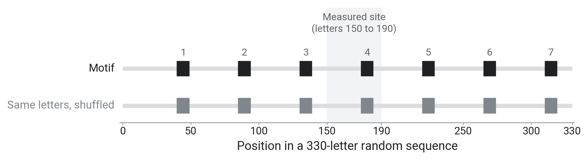
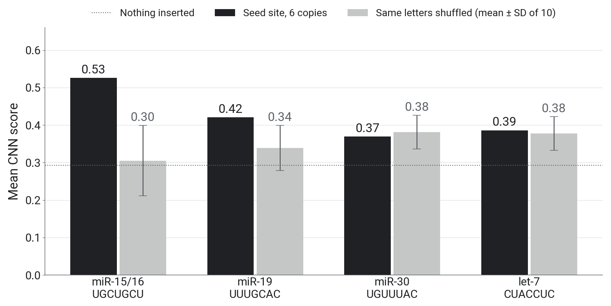

::: {.center}
# 1 The task {data-name="Task"}
:::

## 1.1 About me

::: columns
::: {.column width="34%"}
{height="560px"}
:::
::: {.column width="66%"}
- **Mattan Hoory**: M.Sc. student in Prof. Roee Amit's lab; TA of 00660121 Medical Diagnostics
- Research: predicting where an RNA strand binds DNA as a triple helix (Triplexis)

{width="42%"}
:::
:::

::: {.notes}
- Projected: 1 min.
- B.Sc. in CS (bioinformatics track), now an M.Sc. in Roee's lab. These three parts are a compressed version of the Medical Diagnostics course's ML part.
- Triplexis: sequence in, "does it bind?" out, the same kind of problem as today.
:::

## 1.2 Goals

::: columns
::: {.column width="50%"}
**We will**

- look inside models that read sequence
- judge when a difference in scores is real
- test whether a model uses biology or a shortcut
:::
::: {.column width="50%"}
**We will not**

- write models from scratch
- learn PyTorch or Hugging Face in depth
- open the transformer
:::
:::

::: {.notes}
- Projected: 1 min.
- Inside the models: one-hot encoding and filters (part 1), embeddings (part 2), fine-tuning (part 3).
- Every part ends with a result to interpret.
- Most code is given. The TODOs are short and each one says what to write and what number to expect. An AI assistant can help with a TODO; check its answer against that number.
- Sit next to someone with a different background: a programmer next to a biologist.
:::

## 1.3 What you need

::: columns
::: {.column width="58%"}
- A laptop and a Google account
- Colab with a GPU: *Runtime → Change runtime type → T4 GPU*
- The notebooks: **[github.com/mathoory/ai-days-2026-dna-workshop]{.nowrap}**
- Nothing to install; the data download by themselves
- If a cell fails, raise a hand, or run its "Stuck?" cell and continue
:::
::: {.column width="42%"}
{width="80%"}
:::
:::

::: {.notes}
- Projected: 1 min.
- The QR code opens the same repository link.
- Every notebook runs on its own. At the end of a notebook participants can download their results and upload them in the next; otherwise the notebook loads ours.
:::

## 1.4 Today

| Time | Part | Notebook |
|:--|:--|:--|
| 11:00 | 1. Machine learning and CNNs | `01_cnn` |
| 11:40 | Break | |
| 11:50 | 2. DNA foundation models | `02_foundation_models` |
| 12:30 | Break | |
| 12:40 | 3. Shortcuts, controls and fine-tuning | `03_shortcuts_and_controls` |
| 13:20 | Wrap-up and feedback | |

::: {.notes}
- Projected: 1 min.
- Each part: a talk, then the notebook, then we read the results together.
- One data set all day: 92,346 training sequences plus 1,000 held out, each a stretch of RNA where AGO2 did or did not bind.
:::

## 1.5 RNA, microRNA and AGO2

{fig-align="center" height="509px"}

::: {.notes}
- Projected: 2 min (a recap if the opening lecture covered it).
- Top row, left to right: a gene's DNA (letters A, C, G, T) is copied into a messenger RNA (mRNA, letters A, C, G, U), which the cell translates into a protein. RNA uses U where DNA has T.
- Bottom: AGO2 is a protein that holds a microRNA, an RNA of about 22 letters. It binds mRNAs that pair with that microRNA (A with U, G with C).
- Where AGO2 binds, the mRNA is degraded or not translated, so it yields less protein.
- Humans have several hundred microRNAs; each can regulate hundreds of genes.
- Our sequences are RNA, so the notebooks use U; the DNA models of part 2 read T.
:::

## 1.6 The seed rule

- AGO2 carries a microRNA. Its **seed** (letters 2 to 7) pairs with the target mRNA; this site also pairs letter 8

{fig-align="center" height="432px"}

::: {.notes}
- Projected: 1 min.
- Top row: a real bound sequence from our data, written 5′ to 3′. Bottom row: miR-16, written 3′ to 5′ so that paired letters line up; the vertical lines mark the pairs.
- The bold letters are the miR-16 site UGCUGCU. It pairs with microRNA letters 2 to 8, the seed (letters 2 to 7) plus letter 8.
- Hypothesis for the day: a model that learned AGO2 targeting should respond to seed sites like this one. The last slide of this part tests it (an optional cell in the notebook).
:::

## 1.7 The data

- **Bound**: 48,095 CLIP-seq sites. **Unbound**: 44,251 random positions in the same genes
- The 40-letter measured site sits at letters 150 to 190

{fig-align="center" height="538px"}

::: {.notes}
- Projected: 2 min.
- Each row is one sequence, dark for G or C, light for A or U; 150 of each class, sorted by G+C, first 330 letters. The white stripes on the right are sequence ends.
- Counts are the training file; 1,000 more sequences (500 of each) are held out as the test set.
- CLIP-seq: UV light crosslinks proteins to the RNA they touch, an antibody pulls down AGO2, and the attached RNA fragments are sequenced.
- The data set is the GraphProt CLIP benchmark (Maticzka et al. 2014), used by Pan and Shen (2018), whose CNN we follow. The unbound sequences are the bound sites moved to random positions in the same genes.
- 99% of sequences have the measured site starting exactly at letter 150. Sequences are 137 to 375 letters long.
- The bound half is slightly richer in A and U: mean G+C 0.41 vs 0.45 over all sequences. AGO2 sites are often in AU-rich 3′ UTRs (the part of an mRNA after its protein-coding letters), so part of this may be biology and part may come from how the unbound positions were drawn. Part 3 tests that.
:::

## 1.8 Seed matches are enriched in bound sites

{fig-align="center" height="700px"}

::: {.notes}
- Projected: 2 min.
- Counted inside the 40-letter measured sites. One bar per 7-letter word: the fraction of bound sites that contain it divided by the fraction of unbound sites. The 16 most enriched words among those found in at least 150 bound sites; the text after each bar is the percentage of bound sites that contain the word.
- Black bars are seed matches of known microRNAs. The top word, UUUGCAC, is the seed match of miR-19 (6 times enriched). GCUGCUA (miR-15/16, letters 2 to 7 plus an A) and UGUUUAC (miR-30) are also in the list. The 7-letter miR-15/16 site UGCUGCU of slide 1.6 is not among these 16.
- Even the most enriched word occurs in only 1.3% of bound sites (0.4 to 1.3% across the 16), so no single word separates the classes.
- A model that learned AGO2 targeting should respond to these words. This part ends by testing whether our CNN does.
:::

::: {.center}
# 2 Learning and testing {data-name="Learning"}
:::

## 2.1 What training does

- Model: $\;\hat p = \sigma(w^\top x + b)$, $\;x$ = (G+C fraction, U fraction)
- Training: follow the gradient of the loss downhill, step by step

{fig-align="center" height="584px"}

::: {.notes}
- Left and middle: 3,000 training sequences, one point each, placed by G+C fraction and U fraction; blue bound, grey unbound. The black line is where the predicted probability equals 0.5, at step 0 (a deliberately bad start) and after 300 steps. Right: the loss at each step.
- The smallest possible model on our data: two features per sequence and three parameters (two weights and a bias).
- $\sigma(z) = 1/(1+e^{-z})$ turns any score into a probability between 0 and 1. Every model today ends with a sigmoid.
- Loss: binary cross-entropy, minus the log of the probability the model gives the true label. A coin flip gives 0.69. Here it falls from 0.77 at the bad start to 0.67.
- How well these two numbers separate the classes on held-out data is measured on slide 2.4 (AUROC 0.66).
- Our CNN has 2,491 parameters. The genome models have millions to billions.
:::

## 2.2 Train, validate, test

- **Train**: fit the weights
- **Validation**: choose settings, such as the number of epochs
- **Test**: report once
- Today: 92,346 training and **1,000 held-out** test sequences

::: {.notes}
- An epoch is one pass over the training data.
- The 1,000 held-out sequences are 500 bound and 500 unbound; parts 1 and 2 use them as the test set.
- Never grade a model on the data it was trained on.
- The notebook prints the held-out AUROC after every epoch, so we do look at the test set during training. That is acceptable for a workshop as long as nobody picks the best epoch by it; in a real project that is the validation set's job.
- The split is random by sequence. We checked for near-duplicates: 47% of held-out bound sequences have a training sequence within 150 letters on the genome (13% of unbound). On the 698 held-out sequences without one, the CNN scores 0.85 instead of 0.86, so the effect on our results is small. Real projects split by gene or chromosome.
:::

## 2.3 AUROC

- **AUROC** = the probability that a random bound sequence scores higher than a random unbound one. 0.5 is chance, 1.0 is perfect.

{fig-align="center" height="596px"}

::: {.notes}
- These are the scores of the CNN we build in the next section; for now it is any model that outputs a probability.
- Left: the CNN's scores on the 1,000 held-out sequences, bound in blue and unbound in grey.
- Right: each threshold on the left gives one true positive rate (the fraction of bound sequences above it) and one false positive rate (the fraction of unbound sequences above it), one point on the curve. The dashed diagonal is chance. The area under the curve is the AUROC, 0.86 here.
- It does not depend on a threshold, so it compares models fairly. It says nothing about why a model scores well.
- For anyone who knows diagnostic tests: this is the ROC curve, sensitivity against 1 minus specificity.
:::

## 2.4 Noise in a held-out AUROC

- On 1,000 test sequences, 95% of resampled AUROCs fall within about **±0.025**

{fig-align="center" height="642px"}

::: {.notes}
- One row per model, all scored on the same 1,000 held-out sequences. The dot is the AUROC. Resample the 1,000 test sequences with replacement 2,000 times; the bar covers 95% of the resulting AUROCs.
- Three models from today: the CNN 0.86 (0.84 to 0.88), logistic regression on 5-letter word counts 0.74 (0.71 to 0.77), and on the two composition numbers of slide 2.1 0.66 (0.63 to 0.69). The bars do not overlap, so these differences are larger than the sampling noise.
- The bars describe one model at a time. Two models scored on the same sequences make correlated errors, so their difference varies less than the bars suggest; a paired bootstrap measures it. Overlapping bars mean there is no evidence of a difference; they do not show that the models are equal.
- Rule of thumb: on 1,000 test sequences ignore differences below about 0.03; on 3,000 (part 3), below about 0.02.
:::

## 2.5 Overfitting

- A model that scores much higher on its training data than on held-out data has **overfit**: it memorised its training examples. Report the held-out score

{fig-align="center" height="596px"}

::: {.notes}
- The same model, logistic regression on 5-letter word counts, scored two ways. Light bars: AUROC on its own training sequences. Black bars: AUROC on the 1,000 held-out sequences.
- Left: 12,000 training sequences with regularisation. 0.82 on its own training data, 0.74 held out. A small gap is normal.
- Right: 600 sequences and almost no regularisation. 1.00 on its training data, 0.67 held out.
- Regularisation penalises large weights, which limits how closely a model can fit its training data.
- In any evaluation code, including code an AI assistant wrote, check first which data the score was computed on.

Next: build the CNN.
:::

::: {.center}
# 3 The CNN {data-name="CNN"}
:::

## 3.1 One-hot encoding (TODO-1)

- One column per letter, with a 1 in its row; padding columns of 0.25 up to 501

{fig-align="center" height="611px"}

::: {.notes}
- Each column is one letter; the four rows are A, C, G, U, and the dark cell holds the 1. A sequence becomes a 4 × length matrix. The longest sequence is 375 letters.
- A padding column of 0.25 means "unknown letter": each base equally likely. 501 is the input width used by Pan and Shen, whose CNN this one follows.
- If asked why not A=1, C=2, G=3, U=4: that would impose an order (G "greater than" C) with no biological meaning. One-hot keeps the four letters equally far apart.
- TODO-1 encodes one sequence and checks its first columns against its letters.
:::

## 3.2 A filter computes a dot product

{fig-align="center" height="700px"}

::: {.notes}
- A real learned filter (filter 7) from the trained CNN, applied to the real window where it responds most strongly. The slides from 3.5 on use filter 0.
- Left: the filter, a 4 × 10 matrix of weights, one per letter and position; blue positive, grey negative. Right: the one-hot window.
- Multiplied element by element with the one-hot window, the filter keeps one weight per position: the weight of the letter that is there (the number under each column). Their sum plus a bias is the filter's output at that position (bottom line).
- The same 40 weights are applied at every one of the 492 positions. Sharing the weights across positions makes it a convolution.
- This filter prefers U-rich windows, and its strongest response is only 1.07 times larger on bound than on unbound sequences. It responds to something common in both classes. Part 3 tests composition effects of this kind with a shuffle and with matched data.
:::

## 3.3 The filter along one sequence

- **ReLU**: $\max(0, z)$, so negative outputs become 0

{fig-align="center" height="642px"}

::: {.notes}
- The same filter (filter 7): its output at every position of one bound sequence, after ReLU. x: position; y: output.
- Most positions give 0. Windows that resemble the weights give large values. The highest one is drawn dark and its 10 letters are printed.
:::

## 3.4 The network (TODO-2)

| Layer | Output shape |
|:--|:--|
| input | $1 \times 4 \times 501$ |
| `Conv2d(1, 10, (4, 10))` + ReLU | $10 \times 1 \times 492$ |
| `MaxPool2d((1, 3))` | $10 \times 1 \times 164$ |
| `Conv2d(10, 20, (1, 5))` + ReLU | $20 \times 1 \times 160$ |
| `MaxPool2d((1, 3))` | $20 \times 1 \times 53$ |
| `Flatten` → `Linear(1060, 1)` | one score, a **logit** (any real number) |

- 2,491 parameters. No sigmoid inside the network: `BCEWithLogitsLoss` applies it.

::: {.notes}
- 10 first-layer filters, each 4 × 10. Each produces one output row, a channel.
- Max pooling keeps the largest value in each block of 3 positions.
- The second convolution combines nearby first-layer outputs: 20 channels, each looking at 5 pooled positions.
- The final linear layer has one weight per channel and pooled position: 20 × 53 = 1,060 weights. Slide 5.2 shows them after training.
- The 2,491 parameters are weights plus biases: 410 in the first convolution, 1,020 in the second and 1,061 in the linear layer.
- A logit is any real number; the sigmoid turns it into a probability between 0 and 1. `BCEWithLogitsLoss` applies the sigmoid and the binary cross-entropy in one step.
:::

## 3.5 Training changes the filters

$$\theta \leftarrow \theta - \eta \, \nabla_\theta \mathcal{L}$$

{fig-align="center" height="605px"}

::: {.notes}
- Filter 0 at epochs 0, 1, 3 and 10 of one training run, with the held-out AUROC after each epoch. Rows A, C, G, U; columns the 10 positions; blue positive, grey negative weights.
- Epoch 0 is the random initialisation (AUROC 0.58). After epoch 1 the model reaches 0.79 and after epoch 3 0.85. By epoch 10 the filter has a clear preference, a G at position 7, and the model reaches 0.86.
- The formula: $\theta$ are all the weights, $\mathcal{L}$ the loss, $\eta$ the learning rate. Each step computes the gradient of the loss with respect to every weight and moves each weight against its gradient, scaled by $\eta$. We use Adam, a variant that adapts the step size per weight.
:::

## 3.6 The training step and the evaluation (TODO-3)

```python
opt.zero_grad()                       # clear the previous step's gradients
loss = criterion(model(X), y)         # predict a batch, measure the error
loss.backward()                       # gradient of the loss for every weight
opt.step()                            # move every weight against its gradient

model.eval()                          # evaluation mode
with torch.no_grad():                 # no gradient tracking
    probs = torch.sigmoid(model(X_test.to(DEVICE))).cpu().numpy()
auc = roc_auc_score(test_y, probs)
```

::: {.notes}
- The first four lines are given in the notebook. TODO-3 is the evaluation block.
- `.cpu().numpy()` is needed because scikit-learn cannot read a tensor that is still on the GPU. Leaving it out is a common error in this TODO.
:::

::: {.center}
# 4 Look inside {data-name="Look inside"}
:::

## 4.1 From a filter to a sequence logo (TODO-4)

- `cutoff_for` → `windows_above` → `pwm_of` → logo: collect the windows with the highest output, count letters per position
- Logo height = information content: 2 bits = always the same letter, 0 = all four equally often

{fig-align="center" height="492px"}

::: {.notes}
- Left: filter 0's 40 weights (blue positive, grey negative). Right: its logo, built from the roughly 25,000 windows in bound sequences whose output is above the cutoff (half-way between the filter's mean and maximum output). The notebook's count differs slightly because it scans a different subset.
- The helpers on the slide: `cutoff_for` sets that cutoff, `windows_above` collects the 10-letter windows above it, and `pwm_of` counts the letters at each position. TODO-4 builds a logo for every filter with these helpers, then `consensus_of` reads off the most frequent letter at each position.
- Information content at a position is 2 minus the entropy of the letter frequencies, in bits. Each letter's height is its frequency times that value.
- A logo shows which windows activate a filter. It leaves out the letters the filter penalises (its negative weights).
:::

## 4.2 Test a logo: insert it, against a shuffled copy (TODO-5)

- Insert one filter's consensus 1 to 7 times; control: the same letters, shuffled

{fig-align="center" height="405px"}

::: {.notes}
- Projected: 1 min.
- The bars are a 330-letter random RNA sequence; each box is one inserted copy. `plant(seqs, motif, copies)` writes copy n starting at letter 40 + 45(n − 1), so 7 copies fit. Top row: the motif; bottom row: the same letters shuffled. Shaded: letters 150 to 190, where the measured site is in the real data.
- The consensus is the filter's most frequent letter at each position: a candidate motif.
- Both versions go into the same 1,000 random RNA sequences at the same places, and the CNN scores them.
- The shuffled copy has the same letters, so the difference between the two curves is what the letter order adds.
- This turns a logo, which is only a description of what a filter responds to, into an experiment on the whole model's output.
:::

## 4.3 Your turn

Open **`01_cnn.ipynb`** in Colab, select the T4 GPU, run from the top.

| Step | Task | Check | Time |
|:--|:--|:--|:--|
| TODO-1 | one-hot encode a sequence | first 8 columns match | 3 min |
| TODO-2 | build the network | `torch.Size([2])` | 7 min |
| TODO-3 | held-out AUROC, then train | 0.79, then 0.86 | 7 min |
| TODO-4 | a logo for every filter | ten logos | 9 min |
| TODO-5 | insert the motif and a shuffled copy | two curves | 8 min |

::: {.notes}
- Given cells (setup, data, motif toolkit, take-aways): about 12 min. Projected hands-on total: about 46 min, 51 with the optional sections (the times in the notebook headings).
- TODO-3 check: about 0.79 after epoch 1 and 0.86 after epoch 10. Training takes about 4 seconds per epoch on a T4.
- Helpers for TODO-4: `acts[:, f, :]`, `cutoff_for`, `windows_above`, `pwm_of`; then set `MY_FILTER` and `MY_MOTIF`. TODO-4 ends with choosing a motif. TODO-5 uses `plant`.
- Each TODO has a "Stuck?" cell below it that loads our version.
- Section 5, right after training, downloads `my_cnn.pt`, which part 3 can load.
:::

::: {.center}
# 5 What the CNN learned {data-name="Results"}
:::

## 5.1 Training curve

{fig-align="center" height="700px"}

::: {.notes}
- Show after they have run it. x: epoch; y: AUROC on the 1,000 held-out sequences; dashed line: chance.
- Black: the workshop run, 0.79 after one epoch, 0.86 after ten. Light grey: three other training runs, each from different random starting weights; they follow the same path and end within 0.01 of each other.
- Most of the improvement happens in the first two or three epochs.

Next: the trained last-layer weights.
:::

## 5.2 The last layer weighs positions

{fig-align="center" height="700px"}

::: {.notes}
- The trained last-layer weights: one row per channel (20), one column per pooled position (53); blue positive, grey negative. Our run; the notebook does not draw this.
- Pooled column j covers letters of roughly 9j to 9j + 29. The large weights are in columns 17 to 20, letters about 150 to 210, where the measured site is in almost every sequence.
- The columns on the right (from about column 41, marked "padding") are padding (no sequence is longer than 375 letters), so their weights barely move from initialisation.
- The CNN learned where in the sequence to look, as well as which letter patterns to look for. Slide 5.6 shows what that implies.
:::

## 5.3 All ten filters

{fig-align="center" height="700px"}

::: {.notes}
- One logo per first-layer filter, from the windows above the cutoff in 3,000 bound sequences. Height 0 to 2 bits; letter colours A green, C blue, G yellow, U red.
- Mostly U-rich logos; several have one dominant G or C at a single position; few look like sharp motifs.
- After TODO-4: choose the clearest logo, read its consensus and enter it as `MY_MOTIF`, with its filter number as `MY_FILTER`. That is the hypothesis for the next experiment.
:::

## 5.4 The same filter on unbound sequences

{fig-align="center" height="628px"}

::: {.notes}
- Filter 0's logo from bound sequences (left) and from unbound sequences (right), each from the windows above the cutoff in 5,000 sequences; the titles give the window counts.
- A control for reading logos: filter 0 gives almost the same logo on unbound sequences.
- The windows it responds to look the same in both classes. Whether the filter's pattern changes the model's output needs a test; the next two slides insert it.
- If a student's chosen filter looks the same in both classes, the notebook suggests choosing another one.
:::

## 5.5 Insert the motif

{fig-align="center" height="700px"}

::: {.notes}
- 1,000 random RNA sequences. x: number of copies inserted, with the letter where the last copy starts; y: mean CNN score. The dotted line is their mean score with nothing inserted (about 0.45).
- Black: filter 0's consensus UACACUCUAC inserted 1 to 7 times, the most that fit in a 330-letter sequence. Grey dashed: the same letters in shuffled order. Compare the two curves rather than each curve with the baseline: the shuffled copy has the same letters, so it also changes the score.
- `plant()` writes copy n starting at letter 40 + 45(n − 1). The score jumps when copy 4 (letter 175) is placed in the region the CNN weighs (motif 0.41 to 0.72, shuffled 0.40 to 0.58) and decreases slightly with more copies (0.72 to 0.68), as they replace more of the background.
:::

## 5.6 The effect depends on position

{fig-align="center" height="700px"}

::: {.notes}
- One copy of the motif at every position, averaged over 400 random sequences (a given cell in the notebook). y: change in mean CNN score against nothing inserted. The numbers 1 to 7 mark where `plant()` puts each copy in the previous test; shaded: letters 150 to 190.
- The motif changes the score only between about letters 140 and 190, where almost every sequence in the data has its measured site: up to about +0.35 inside, dips of about −0.1 at both edges.
- The shuffled copy gets much of the same increase there (up to about +0.26), so a good part of the effect comes from which letters are in that region, whatever their order.
- This is the last-layer pattern from slide 5.2: the CNN weighs positions. It reflects how the data were cut, and it means the answer to "does this motif matter?" depends on where it is placed.
:::

## 5.7 The CNN responds to one of four seed sites

{fig-align="center" height="700px"}

::: {.notes}
- The hypothesis from slide 1.6: a model that learned AGO2 targeting should respond to seed sites. This is the optional bonus cell.
- 6 copies of each site inserted into the 500 unbound held-out sequences. Black: the site. Grey: the same letters shuffled, mean and standard deviation over 10 shuffles. Dotted: nothing inserted (about 0.29).
- miR-15/16 (UGCUGCU): 0.53 against 0.30 ± 0.09, a clear effect. miR-19: 0.42 against 0.34 ± 0.06, slightly more than one standard deviation. miR-30 (0.37 against 0.38) and let-7 (0.39 against 0.38) lie within the spread of their shuffles.
- Of the 6 copies, only copy 4 (letter 175) is in letters 150 to 190, the region the CNN weighs.
- The CNN was not given seed sites and responds to one of the four tested. None of the ten logos shows this site; the insertion test detected the response.
- Inside the 40-letter measured site, these seed sites are 3 to 6 times enriched in bound sequences but occur in only about 1 to 2% of them, so the signal is weak.
- The notebook's shuffle numbers differ slightly from these because the shuffles are random.

Next, after the break: part 2, DNA foundation models, pretrained on the whole genome.
:::
