::: {.center}
# 1 The task {data-name="Task"}
:::

## 1.1 About me

::: columns
::: {.column width="60%"}
{.avatar-small}

- **B.Sc. Computer Science**, bioinformatics track, Technion
- **Machine learning** at National Taiwan University with Prof. Hsuan-Tien Lin (co-author of *Learning from Data*)
- **M.Sc. Data Science**, Technion; research in Prof. Roee Amit's lab
- **Unit 81**: embedded Linux lead developer
:::
::: {.column width="40%"}
{height="660px"}

[Taiwan, during the exchange semester (2023)]{.caption-small}
:::
:::

::: {.notes}
- Projected: 1 min.
- B.Sc. in Computer Science, bioinformatics track, Technion (2020 to 2024). An exchange semester at National Taiwan University (spring 2023), where I took Machine Learning with Prof. Hsuan-Tien Lin: co-author of *Learning from Data*, known for his online machine learning courses, and co-leader of NTU teams that won the KDD Cup several times. The photo: Wenwu Temple, Sun Moon Lake.
- M.Sc. in Data Science, Faculty of Data and Decision Sciences, Technion (2024 to 2026), with my research in Prof. Roee Amit's Synthetic Biology Laboratory. TA of 00660121 Medical Diagnostics; these three parts are a compressed version of that course's machine learning part.
- Before that, Unit 81 (2015 to 2020): embedded Linux lead developer, video streaming products and Linux drivers.
:::

## 1.2 My research

**Machine learning for molecular design**: from a sequence to how it binds

::: columns
::: {.column width="42%"}
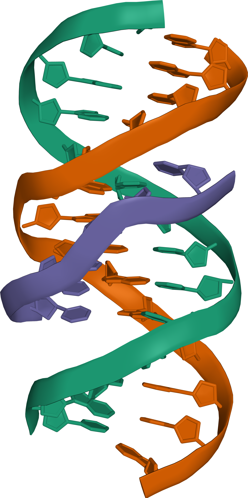{height="520px"}

[**Triplexis**: which DNA sequences an RNA strand binds as a triple helix]{.caption-small}
:::
::: {.column width="58%"}
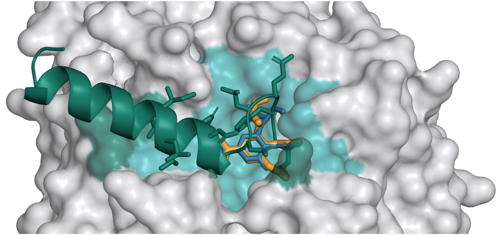{height="400px"}

[**Peptides** against influenza: screening millions of variants with AlphaFold 3]{.caption-small}
:::
:::

::: {.notes}
- Projected: 1 min.
- Triplexis (M.Sc. thesis): sequence-based deep learning for DNA-RNA triple helix formation, trained on synthetic libraries assayed by click chemistry and nanopore sequencing. Sequence in, "does it bind?" out, the same kind of problem as today.
- Peptides: structure-guided pre-screening of peptide inhibitors against influenza A neuraminidase. AlphaFold 3 co-folds a sample of variants, and a model trained on those folds ranks about 14 million variants without folding them. The picture: a predicted peptide pose in the enzyme's pocket, with the drugs zanamivir and oseltamivir superposed.
:::

## 1.3 Goals

:::: {.goals}
::: columns
::: {.column width="50%"}
[We will]{.goal-yes}

::: {.incremental}
- look inside models that read sequence
- build a mental model of how to approach sequence-based models in AI
- use coding agents to bridge the gap to the code
:::
:::
::: {.column width="50%"}
[We will not]{.goal-no}

::: {.incremental}
- learn to write code
- learn PyTorch or Hugging Face in depth
- open the transformer
:::
:::
:::
::::

::: {.notes}
- Projected: 1 min.
- Inside the models: one-hot encoding and filters (part 1), embeddings (part 2), fine-tuning (part 3).
- The notebooks give the problem and the rules; the code is written with a coding agent (Gemini in Colab, or any assistant). The test cell after each TODO checks the result and says what is wrong.
- Every part ends with a result to interpret.
- Sit next to someone with a different background: a programmer next to a biologist.
:::

## 1.4 What you need

::: columns
::: {.column width="58%"}
- A laptop and a Google account
- Colab with a GPU: *Runtime → Change runtime type → T4 GPU*
- Notebooks and slides: **[mathoory.github.io/ai-days-2026-dna-workshop]{.nowrap}**
:::
::: {.column width="42%"}
{width="80%"}
:::
:::

::: {.notes}
- Projected: 1 min.
- The QR code opens the same repository link.
- Every notebook runs on its own. Part 3 starts from our CNN and our embeddings, so everyone has the same models there.
:::

## 1.5 Today

| Time | Part | Notebook |
|:--|:--|:--|
| 11:00 | 1. Machine learning and CNNs | `01_cnn` |
| 11:40 | Break | |
| 11:50 | 2. DNA foundation models | `02_foundation_models` |
| 12:30 | Break | |
| 12:40 | 3. Shortcuts, controls and fine-tuning | `03_shortcuts_and_controls` |
| 13:20 | Wrap-up and feedback | |

::: {.notes}
- Projected: 1 min.
- Each part: a talk, then the notebook, then we read the results together.
- One data set all day: 92,346 training sequences plus 1,000 held out, each a stretch of RNA where AGO2 did or did not bind.
:::

## 1.6 RNA, microRNA and AGO2

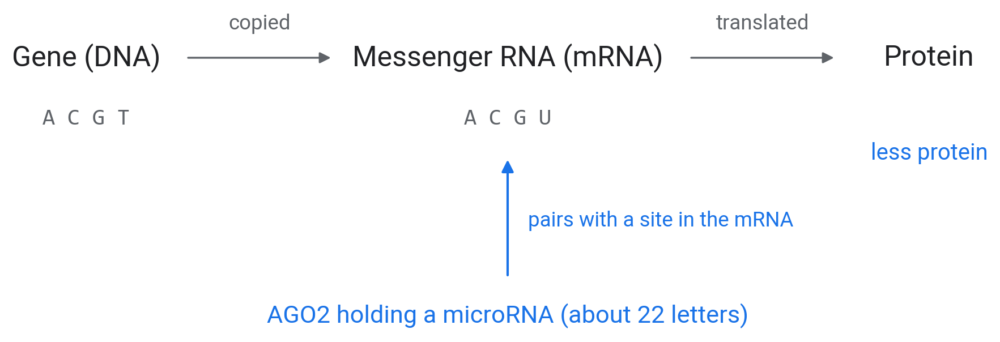{fig-align="center" height="509px"}

::: {.notes}
- Projected: 2 min (a recap if the opening lecture covered it).
- Top row, left to right: a gene's DNA (letters A, C, G, T) is copied into a messenger RNA (mRNA, letters A, C, G, U), which the cell translates into a protein. RNA uses U where DNA has T.
- Bottom: AGO2 is a protein that holds a microRNA, an RNA of about 22 letters. It binds mRNAs that pair with that microRNA (A with U, G with C).
- Where AGO2 binds, the mRNA is degraded or not translated, so it yields less protein.
- Humans have several hundred microRNAs; each can regulate hundreds of genes.
- Our sequences are RNA, so the notebooks use U; the DNA models of part 2 read T.
:::

## 1.7 The seed rule

- AGO2 carries a microRNA. Its **seed** (letters 2 to 7) pairs with the target mRNA; this site also pairs letter 8

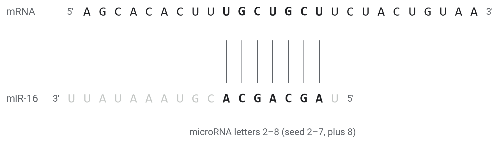{fig-align="center" height="432px"}

::: {.notes}
- Projected: 1 min.
- Top row: a real bound sequence from our data, written 5′ to 3′. Bottom row: miR-16, written 3′ to 5′ so that paired letters line up; the vertical lines mark the pairs.
- The bold letters are the miR-16 site UGCUGCU. It pairs with microRNA letters 2 to 8, the seed (letters 2 to 7) plus letter 8.
- Hypothesis for the day: a model that learned AGO2 targeting should respond to seed sites like this one.
:::

## 1.8 The data

- **Bound**: 48,095 CLIP-seq sites. **Unbound**: 44,251 random positions in the same genes
- The 40-letter measured site sits at letters 150 to 190

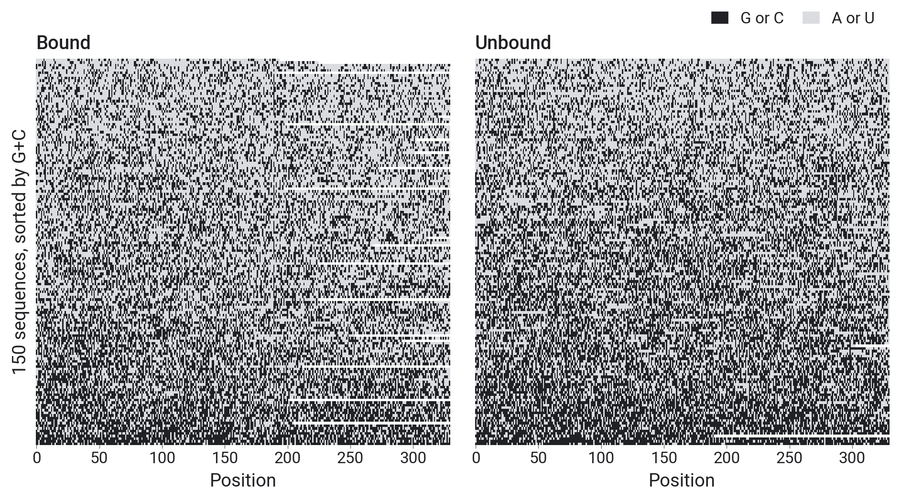{fig-align="center" height="538px"}

::: {.notes}
- Projected: 2 min.
- Each row is one sequence, dark for G or C, light for A or U; 150 of each class, sorted by G+C, first 330 letters. The white stripes on the right are sequence ends.
- Counts are the training file; 1,000 more sequences (500 of each) are held out as the test set.
- CLIP-seq: UV light crosslinks proteins to the RNA they touch, an antibody pulls down AGO2, and the attached RNA fragments are sequenced.
- The data set is the GraphProt CLIP benchmark (Maticzka et al. 2014), used by Pan and Shen (2018), whose CNN we follow. The unbound sequences are the bound sites moved to random positions in the same genes.
- 99% of sequences have the measured site starting exactly at letter 150. Sequences are 137 to 375 letters long.
- The bound half is slightly richer in A and U: mean G+C 0.41 vs 0.45 over all sequences. AGO2 sites are often in AU-rich 3′ UTRs (the part of an mRNA after its protein-coding letters), so part of this may be biology and part may come from how the unbound positions were drawn. Part 3 tests that.
:::

## 1.9 Seed matches are enriched in bound sites

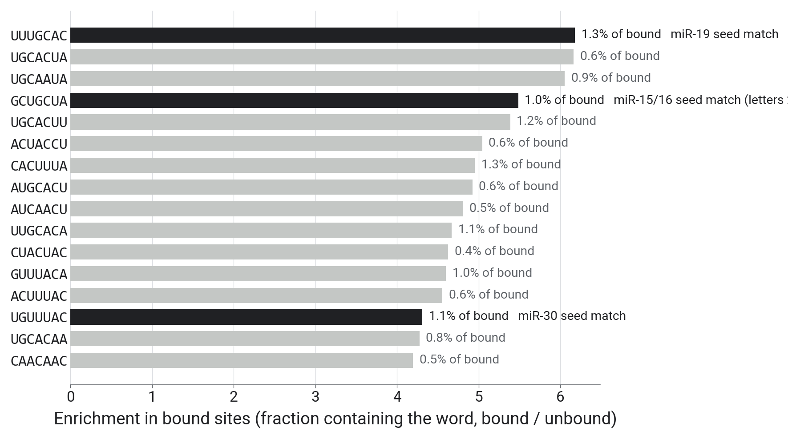{fig-align="center" height="700px"}

::: {.notes}
- Projected: 2 min.
- Counted inside the 40-letter measured sites. One bar per 7-letter word: the fraction of bound sites that contain it divided by the fraction of unbound sites. The 16 most enriched words among those found in at least 150 bound sites; the text after each bar is the percentage of bound sites that contain the word.
- Black bars are seed matches of known microRNAs. The top word, UUUGCAC, is the seed match of miR-19 (6 times enriched). GCUGCUA (miR-15/16, letters 2 to 7 plus an A) and UGUUUAC (miR-30) are also in the list. The 7-letter miR-15/16 site UGCUGCU of slide 1.7 is not among these 16.
- Even the most enriched word occurs in only 1.3% of bound sites (0.4 to 1.3% across the 16), so no single word separates the classes.
- A model that learned AGO2 targeting should respond to these words.
:::

::: {.center}
# 2 Learning from examples {data-name="Learning"}
:::

## 2.1 Supervised learning

- Examples $(x_i, y_i)$, $i = 1, \dots, N$: a sequence $x_i$ and its label $y_i$ (1 bound, 0 unbound)
- A model $f_\theta$ with parameters $\theta$ predicts $\hat p = f_\theta(x)$, the probability of bound

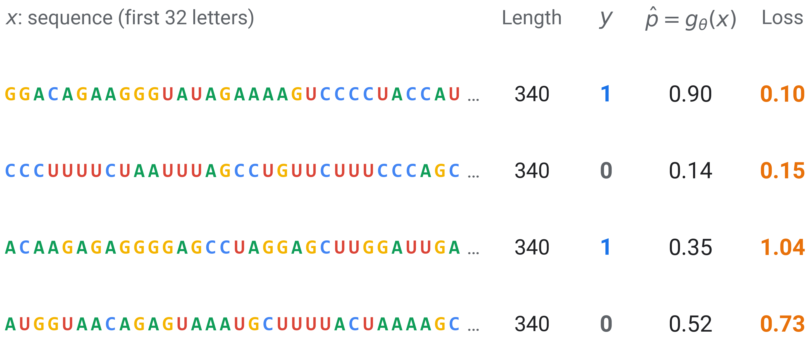{fig-align="center" height="458px"}

::: {.notes}
- Four real training sequences, the first 32 of their 340 letters. $y$ is the CLIP-seq label; $\hat p$ is the prediction of the CNN trained in this part.
- Supervised learning: every training example comes with its answer. Here $N$ = 92,346.
- Training chooses $\theta$ so that $\hat p$ is close to $y$ on the training examples. The goal is good predictions on sequences the model has not seen (section 3).
- The second bound example gets 0.35 and the second unbound one 0.52: the model is often uncertain, and sometimes wrong.
- Tutorial 1 notation, for those who took the course: input space $\mathcal{X}$ (sequences), output space $\mathcal{Y} = \{0, 1\}$, hypothesis set $\mathcal{H}$ (all CNNs of one architecture), final hypothesis $g$ (the trained CNN).
:::

## 2.2 The loss

- **Binary cross-entropy**: $\;\mathcal{L} = -\frac{1}{N}\sum_{i} \big[\, y_i \log \hat p_i + (1 - y_i)\log(1 - \hat p_i) \,\big]$

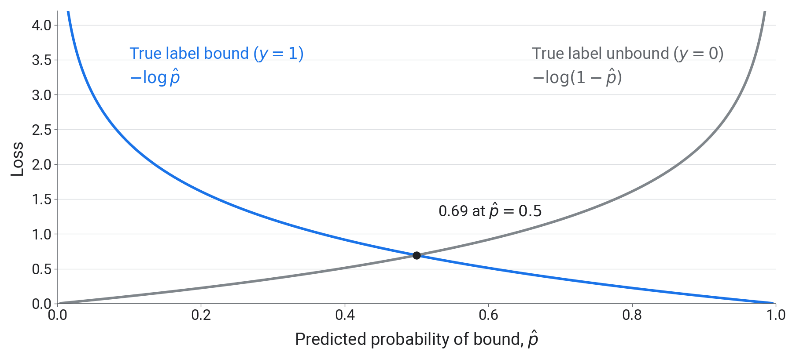{fig-align="center" height="596px"}

::: {.notes}
- One example's contribution to the loss, against the predicted probability. Blue: a bound example, $-\log \hat p$. Grey: an unbound example, $-\log(1 - \hat p)$.
- A confident correct prediction costs almost nothing; a confident wrong one costs a lot ($-\log 0.01 = 4.6$).
- On slide 2.1: predicting 0.90 for a bound sequence gives a loss of 0.11; predicting 0.35 gives 1.05.
- Predicting 0.5 for everything gives $\ln 2 = 0.69$, the loss of a coin flip.
- Tutorial 1 used the mean squared error, for predicting a number. Cross-entropy is the standard loss for a predicted probability.
:::

## 2.3 Gradient descent

$$\theta \leftarrow \theta - \eta \, \nabla_\theta \mathcal{L}$$

- On our data: $\;\hat p = \sigma(w^\top x + b)$, $\;x$ = (G+C fraction, U fraction)

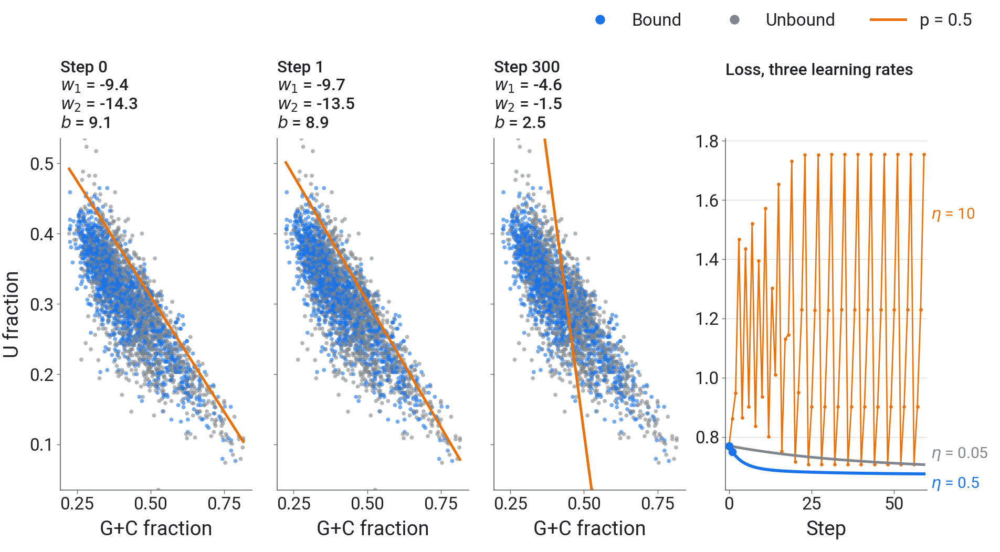{fig-align="center" height="547px"}

::: {.notes}
- The update: $\theta$ are all the parameters, $\mathcal{L}$ the loss, $\eta$ the learning rate. Start from some $\theta$, compute the gradient of the loss with respect to every parameter, move each parameter against its gradient, scaled by $\eta$, and repeat.
- Left and middle: 3,000 training sequences, one point each, placed by G+C fraction and U fraction; blue bound, grey unbound. The black line is where the predicted probability equals 0.5, at step 0 (a deliberately bad start) and after 300 steps. Right: the loss at each step.
- The smallest possible model on our data: two features per sequence and three parameters (two weights and a bias).
- $\sigma(z) = 1/(1+e^{-z})$ turns any score into a probability between 0 and 1. Every model today ends with a sigmoid.
- The loss (slide 2.2) falls from 0.77 at the bad start to 0.67.
- How well these two numbers separate the classes on held-out data is measured on slide 3.3 (AUROC 0.66).
- Our CNN has 2,491 parameters. The genome models have millions to billions.
:::

## 2.4 The learning rate

- $\eta$ sets the size of each step

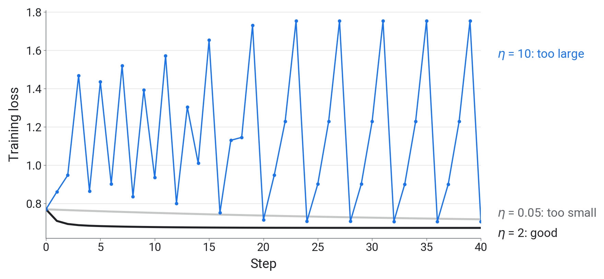{fig-align="center" height="642px"}

::: {.notes}
- The model of slide 2.3, from the same bad start, trained with three learning rates. Training loss after each step.
- $\eta$ = 0.05: every step goes downhill, but after 40 steps the loss is still 0.72.
- $\eta$ = 2: the loss reaches 0.67 within a few steps.
- $\eta$ = 10: each step overshoots the minimum, and the loss jumps between 0.7 and 1.75.
- The learning rate is set before training, a hyperparameter, and chosen on validation data (section 3). The notebook uses Adam with $\eta$ = 0.001.
:::

## 2.5 Mini-batches and epochs

- Each step uses a **batch** of 256 sequences; an **epoch** is one pass over all 92,346 (360 steps)

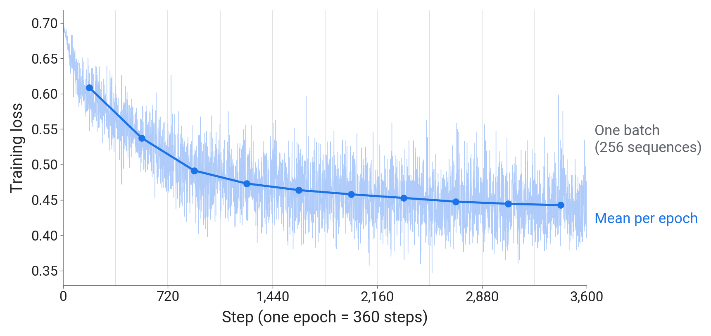{fig-align="center" height="596px"}

::: {.notes}
- The CNN of this part, trained as in the notebook: 10 epochs, 3,600 steps. Grey: the loss on each batch. Black: the mean over each epoch.
- The gradient on one batch estimates the gradient on the whole training set. One batch is quick to compute, which allows many steps per epoch. The estimate changes from batch to batch, which is why the grey line jumps (0.38 to 0.61 within the last epoch). This is mini-batch, or stochastic, gradient descent.
- The epoch means fall from 0.61 to 0.44, most of it in the first three epochs.
- 92,346 / 256 gives 360 full batches; the notebook drops the incomplete last one (`drop_last=True`) and reshuffles the order every epoch.
:::

## 2.6 From logistic regression to a neural network

- A **neural network** stacks layers of units, with **ReLU**, $\max(0, z)$, between them

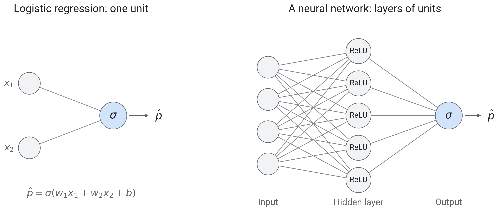{fig-align="center" height="629px"}

::: {.notes}
- Left: logistic regression is one unit, a weighted sum of the inputs plus a bias, then the sigmoid.
- Right: a hidden layer of units, each a weighted sum followed by ReLU, feeds the output unit.
- Without the nonlinearity, stacked weighted sums add up to a single weighted sum, which is no more expressive than logistic regression.
- Training is the same as on slide 2.3. `loss.backward()` computes the gradient for every weight in every layer by the chain rule (backpropagation), and the optimizer takes the step.
- The CNN of section 4 is a network of this kind in which each first-layer unit looks at a 10-letter window.
:::

::: {.center}
# 3 Testing a model {data-name="Testing"}
:::

## 3.1 Train, validate, test

- **Train**: fit the weights
- **Validation**: choose settings, such as the number of epochs
- **Test**: report once
- Today: 92,346 training and **1,000 held-out** test sequences

::: {.notes}
- An epoch is one pass over the training data.
- The 1,000 held-out sequences are 500 bound and 500 unbound; parts 1 and 2 use them as the test set.
- Never grade a model on the data it was trained on.
- The notebook prints the held-out AUROC after every epoch, so we do look at the test set during training. That is acceptable for a workshop as long as nobody picks the best epoch by it; in a real project that is the validation set's job.
- The split is random by sequence. We checked for near-duplicates: 47% of held-out bound sequences have a training sequence within 150 letters on the genome (13% of unbound). On the 698 held-out sequences without one, the CNN scores 0.85 instead of 0.86, so the effect on our results is small. Real projects split by gene or chromosome.
:::

## 3.2 AUROC

- **AUROC** = the probability that a random bound sequence scores higher than a random unbound one. 0.5 is chance, 1.0 is perfect.

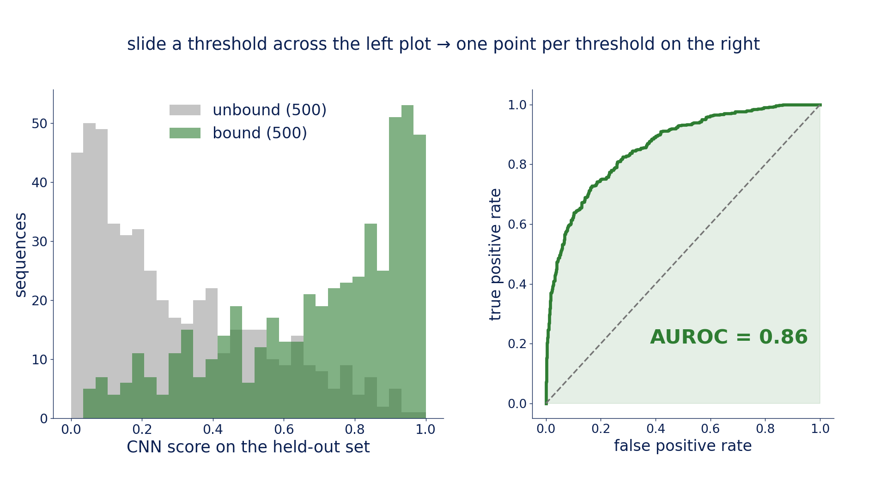{fig-align="center" height="596px"}

::: {.notes}
- These are the scores of the CNN we build in the next section; for now it is any model that outputs a probability.
- Left: the CNN's scores on the 1,000 held-out sequences, bound in blue and unbound in grey.
- Right: each threshold on the left gives one true positive rate (the fraction of bound sequences above it) and one false positive rate (the fraction of unbound sequences above it), one point on the curve. The dashed diagonal is chance. The area under the curve is the AUROC, 0.86 here.
- It does not depend on a threshold, so it compares models fairly. It says nothing about why a model scores well.
- For anyone who knows diagnostic tests: this is the ROC curve, sensitivity against 1 minus specificity.
:::

## 3.3 Noise in a held-out AUROC

- On 1,000 test sequences, 95% of resampled AUROCs fall within about **±0.025**

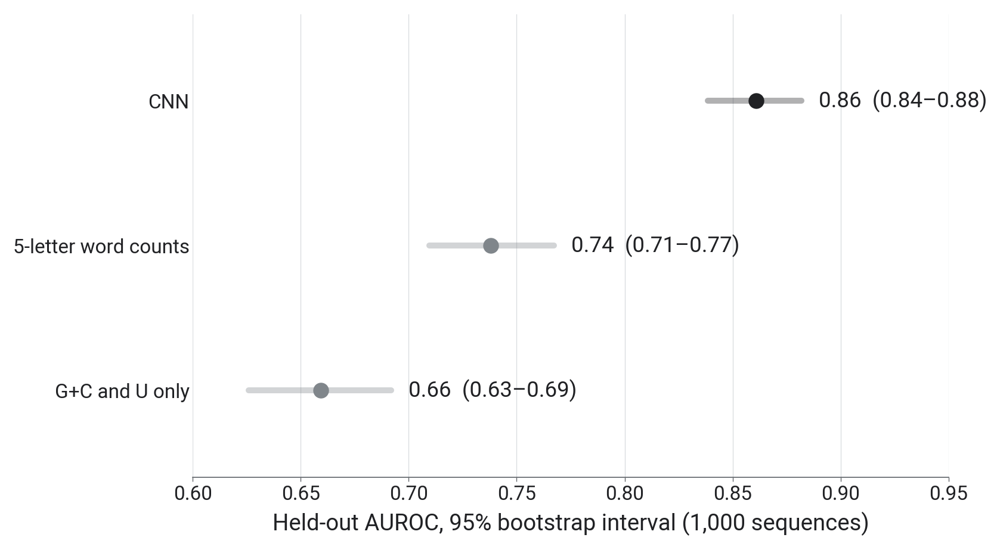{fig-align="center" height="642px"}

::: {.notes}
- One row per model, all scored on the same 1,000 held-out sequences. The dot is the AUROC. Resample the 1,000 test sequences with replacement 2,000 times; the bar covers 95% of the resulting AUROCs.
- Three models from today: the CNN 0.86 (0.84 to 0.88), logistic regression on 5-letter word counts 0.74 (0.71 to 0.77), and on the two composition numbers of slide 2.3 0.66 (0.63 to 0.69). The bars do not overlap, so these differences are larger than the sampling noise.
- The bars describe one model at a time. Two models scored on the same sequences make correlated errors, so their difference varies less than the bars suggest; a paired bootstrap measures it. Overlapping bars mean there is no evidence of a difference; they do not show that the models are equal.
- Rule of thumb: on 1,000 test sequences ignore differences below about 0.03; on 3,000 (part 3), below about 0.02.
:::

## 3.4 Overfitting

- A model that scores much higher on its training data than on held-out data has **overfit**: it memorised its training examples. Report the held-out score

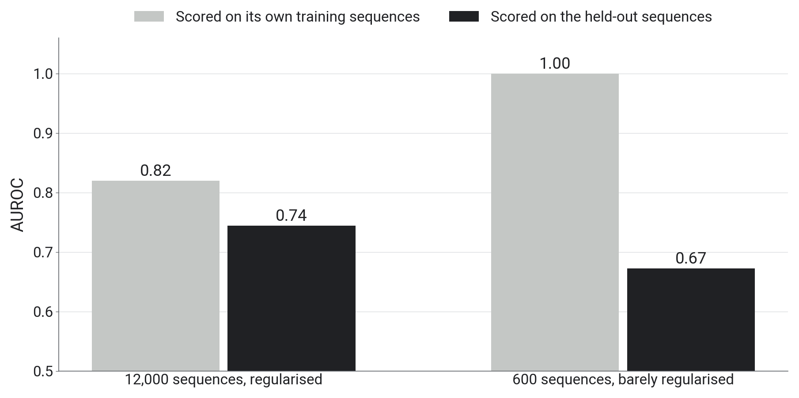{fig-align="center" height="596px"}

::: {.notes}
- The same model, logistic regression on 5-letter word counts, scored two ways. Light bars: AUROC on its own training sequences. Black bars: AUROC on the 1,000 held-out sequences.
- Left: 12,000 training sequences with regularisation. 0.82 on its own training data, 0.74 held out. A small gap is normal.
- Right: 600 sequences and almost no regularisation. 1.00 on its training data, 0.67 held out.
- Underfitting is the opposite: a model too simple for the pattern scores low on both its training data and held-out data.
- Regularisation penalises large weights, which limits how closely a model can fit its training data.
- In any evaluation code, including code an AI assistant wrote, check first which data the score was computed on.

Next: build the CNN.
:::

::: {.center}
# 4 The CNN {data-name="CNN"}
:::

## 4.1 One-hot encoding (TODO-1)

- One column per letter, with a 1 in its row; padding columns of 0.25 up to 501

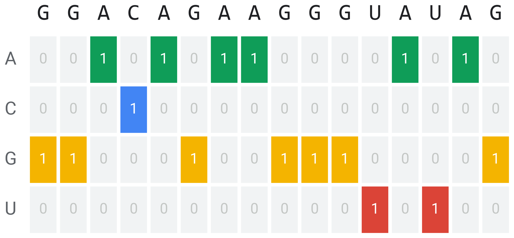{fig-align="center" height="611px"}

::: {.notes}
- Each column is one letter; the four rows are A, C, G, U, and the dark cell holds the 1. A sequence becomes a 4 × length matrix. The longest sequence is 375 letters.
- A padding column of 0.25 means "unknown letter": each base equally likely. 501 is the input width used by Pan and Shen, whose CNN this one follows.
- If asked why not A=1, C=2, G=3, U=4: that would impose an order (G "greater than" C) with no biological meaning. One-hot keeps the four letters equally far apart.
- TODO-1 writes the conversion: `one_hot` for one sequence (TODO-1a), then `encode_batch` for a list of sequences (TODO-1b). A test cell checks 201 sequences, including padding and an unknown letter. The rest of the notebook uses the students' own `encode_batch`.
:::

## 4.2 A filter computes a dot product

- The same 40 weights at every position: **weight sharing**

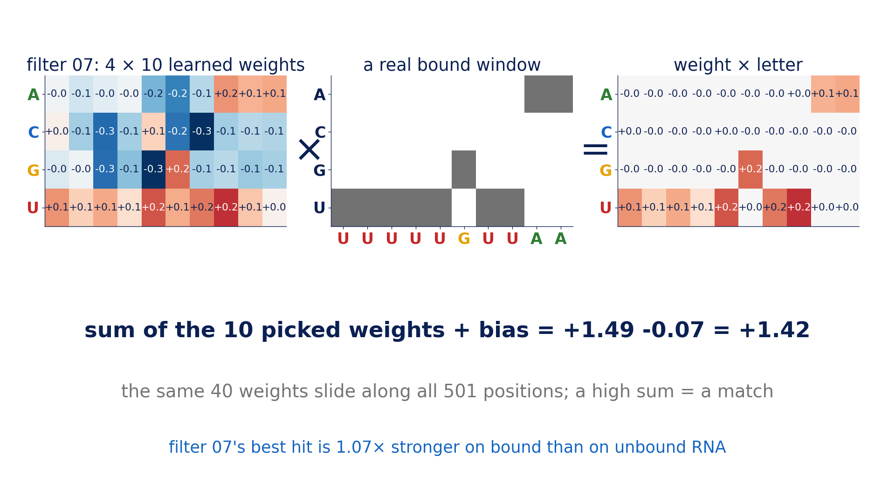{fig-align="center" height="642px"}

::: {.notes}
- A real learned filter (filter 7) from the trained CNN, applied to the real window where it responds most strongly. The slides from 4.6 on use filter 0.
- Left: the filter, a 4 × 10 matrix of weights, one per letter and position; blue positive, grey negative. Right: the one-hot window.
- Multiplied element by element with the one-hot window, the filter keeps one weight per position: the weight of the letter that is there (the number under each column). Their sum plus a bias is the filter's output at that position (bottom line).
- The same 40 weights are applied at every one of the 492 positions. Sharing the weights across positions makes it a convolution. A fully connected layer from the same 4 × 501 input to the same 492 outputs would have 4 × 501 × 492 = 985,968 weights.
- This filter prefers U-rich windows, and its strongest response is only 1.07 times larger on bound than on unbound sequences. It responds to something common in both classes. Part 3 tests composition effects of this kind with a shuffle and with matched data.
:::

## 4.3 The filter along one sequence

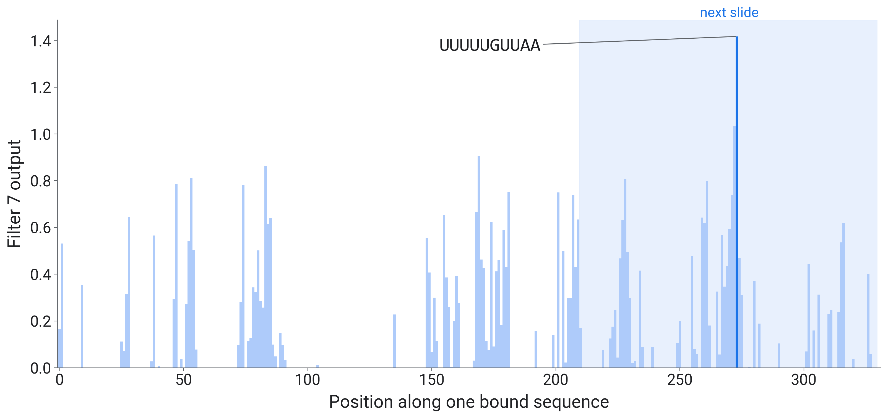{fig-align="center" height="700px"}

::: {.notes}
- The same filter (filter 7): its output at every position of one bound sequence, after ReLU. x: position; y: output.
- ReLU (slide 2.6) sets negative outputs to 0, so most positions give 0. Windows that resemble the weights give large values. The highest one is drawn dark and its 10 letters are printed.
:::

## 4.4 Channels and pooling

- 10 filters give 10 output rows, **channels**; **max pooling** keeps the largest of every 3 positions

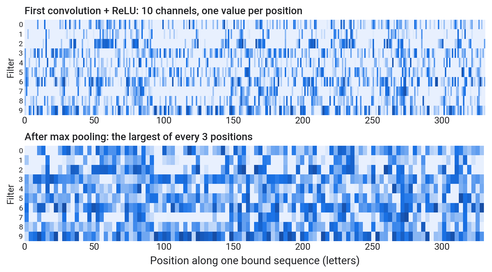{fig-align="center" height="596px"}

::: {.notes}
- One bound sequence of 340 letters, the one on slide 4.3, positions 210 to 330 (filter 7 peaks at 273). Top: the output of all 10 first-layer filters after ReLU at each position; darker blue is larger. Bottom: after max pooling, one value per block of 3 positions.
- Each row is one filter's track; row 7 is the track of slide 4.3.
- The network computes all 492 positions of the padded input (164 after pooling); the figure shows 120 of them.
- Pooling shortens each track threefold and keeps the strongest responses; the exact position within each block of 3 is lost. It has no parameters.
- The second convolution reads all 10 channels at once: each of its 20 filters is 10 × 5, one weight per channel and pooled position.
:::

## 4.5 Build your network (TODO-2)

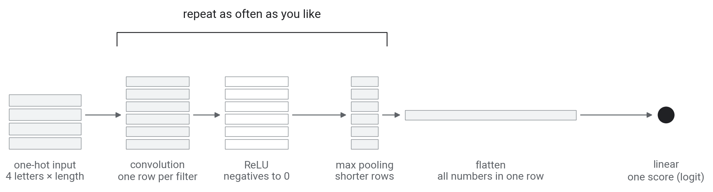{fig-align="center" height="402px"}

- Build it from these parts; you choose how many blocks, how many filters and how wide

::: {.notes}
- The parts: a convolution slides its filters along the sequence (one output row, a channel, per filter); ReLU sets negative values to 0; max pooling keeps the largest value of each block of neighbouring positions, so the rows get shorter; flatten lays everything out in one row; a linear layer makes one number, the logit.
- Two rules: the first filters cover all 4 letter rows, and the network ends with one number per sequence. Everything else is the students' choice; the notebook prints the shape after every layer (`show_shapes`), which tells them how many inputs the linear layer needs.
- Our reference network, used on the results slides: 10 filters of 4 × 10, ReLU, pooling by 3; 20 filters covering 5 pooled positions, ReLU, pooling by 3; flatten (20 × 53 = 1,060 numbers); linear to one logit. 2,491 parameters: 410 in the first convolution, 1,020 in the second, 1,061 in the linear layer.
- Shapes in our network: 4 × 501 → 10 × 492 → 10 × 164 → 20 × 160 → 20 × 53 → 1,060 → 1. A convolution shortens a row by the filter width minus 1; pooling by 3 divides its length by 3.
- No sigmoid inside the network: the loss (`BCEWithLogitsLoss`) applies it.
- Students who finish early can try other networks and compare held-out AUROCs against the ±0.025 noise.
:::

## 4.6 Training changes the filters

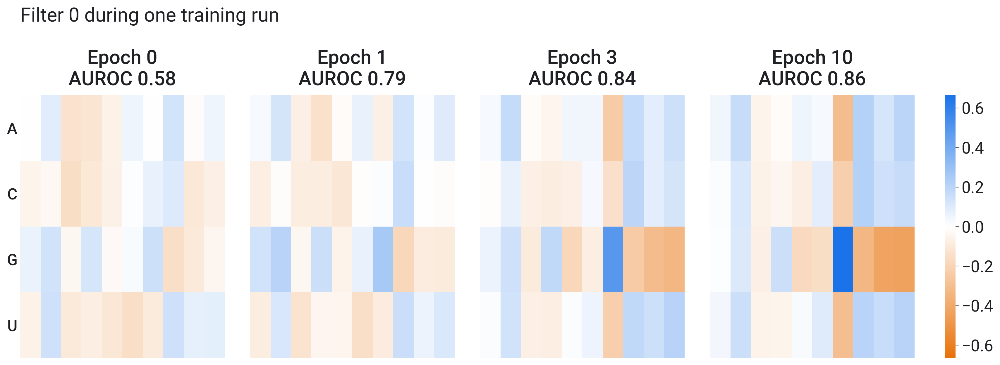{fig-align="center" height="606px"}

::: {.notes}
- Filter 0 at epochs 0, 1, 3 and 10 of one training run, with the held-out AUROC after each epoch. Rows A, C, G, U; columns the 10 positions; blue positive, grey negative weights.
- Epoch 0 is the random initialisation (AUROC 0.58). After epoch 1 the model reaches 0.79 and after epoch 3 0.85. By epoch 10 the filter has a clear preference, a G at position 7, and the model reaches 0.86.
- Each step is the update of slide 2.3, applied to all 2,491 weights. We use Adam, a variant of gradient descent that adapts the step size per weight.
:::

## 4.7 The training step and the evaluation (TODO-3)

```
for each epoch:
    for each batch (X, y):
        clear the gradients
        predict: one score per sequence of X
        loss: the scores against the labels y
        gradients: of the loss, for every weight
        step: move every weight against its gradient
    evaluate on the held-out test set, without learning:
        probabilities: the sigmoid of the scores
        AUROC: the probabilities against the true labels
```

::: {.notes}
- The training loop in pseudocode, the same as in the notebook. Students write the code with their assistant; the pseudocode is what they need to understand.
- TODO-3a: `train_step`, one training step on one batch; the notebook runs it five times on the same batch so the loss falls. TODO-3b: `evaluate`, the held-out AUROC without learning. The given `train()` calls both for every batch and epoch, and measures from epoch 0, so the curves show the start and training against held-out. TODO-3c: the ROC curve of the trained model.
:::

::: {.center}
# 5 Look inside {data-name="Look inside"}
:::

## 5.1 From a filter to a sequence logo (TODO-4)

- `cutoff_for` → `windows_above` → `pwm_of` → logo: collect the windows with the highest output, count letters per position
- Logo height = information content: 2 bits = always the same letter, 0 = all four equally often

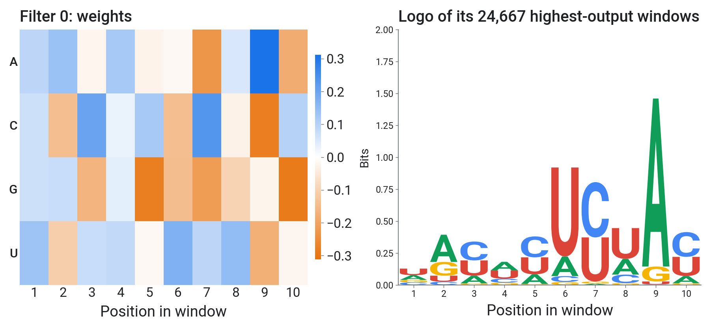{fig-align="center" height="492px"}

::: {.notes}
- Left: filter 0's 40 weights (blue positive, grey negative). Right: its logo, built from the roughly 25,000 windows in bound sequences whose output is above the cutoff (half-way between the filter's mean and maximum output). The notebook's count differs slightly because it scans a different subset.
- The helpers on the slide: `cutoff_for` sets that cutoff, `windows_above` collects the 10-letter windows above it, and `pwm_of` counts the letters at each position. TODO-4a runs these helpers on filter 0 step by step, then `consensus_of` reads off the most frequent letter at each position; TODO-4b repeats the steps for every filter.
- Information content at a position is 2 minus the entropy of the letter frequencies, in bits. Each letter's height is its frequency times that value.
- A logo shows which windows activate a filter. It leaves out the letters the filter penalises (its negative weights).
:::

## 5.2 Test a logo: insert it into random RNA (TODO-5)

- Insert one filter's consensus 1 to 7 times. Which control shows that its pattern matters?

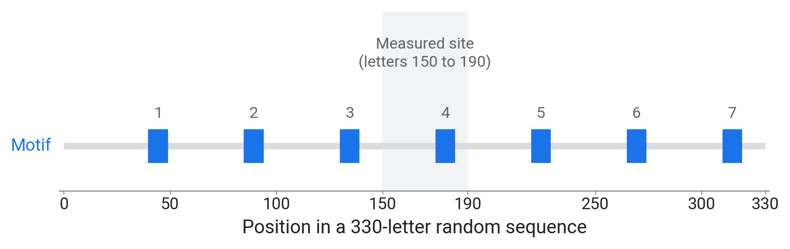{fig-align="center" height="470px"}

::: {.notes}
- Projected: 1 min.
- The bar is a 330-letter random RNA sequence; each box is one inserted copy. `plant(seqs, motif, copies)` writes copy n starting at letter 40 + 45(n − 1), so 7 copies fit. Shaded: letters 150 to 190, where the measured site is in the real data.
- The consensus is the filter's most frequent letter at each position: a candidate motif.
- The question to leave with the room: if the score goes up, is it the pattern or only the letters each copy adds (a U-rich motif adds U letters)? The students design the control in TODO-5b; the notebook states this problem and hints at building it from the motif's own letters.
- The intended control is the same letters in another order, inserted at the same places: the difference between the two curves is then what the letter order adds. The debrief slides (6.5, 6.6) show it.
- This turns a logo, which is only a description of what a filter responds to, into an experiment on the whole model's output.
:::

## 5.3 Your turn

Open **`01_cnn.ipynb`** in Colab, select the T4 GPU, run from the top.

| Step | Task | Check | Time |
|:--|:--|:--|:--|
| TODO-1 | write `one_hot` and `encode_batch` | the test cell passes | 3 min |
| TODO-2 | build your own network from the parts | the test cell passes | 7 min |
| TODO-3 | `train_step`, `evaluate`, then the ROC curve | the test cell passes | 7 min |
| TODO-4 | filter 0 step by step, then a logo for every filter | the test cell passes | 9 min |
| TODO-5 | one copy in one sequence, design a control, then both curves | the test cell passes | 8 min |

::: {.notes}
- Given cells (setup, data, motif toolkit, take-aways): about 12 min. Projected hands-on total: about 46 min.
- TODO-3: our network reaches about 0.79 after epoch 1 and 0.86 after epoch 10; the students' networks differ. Encoding and 10 epochs take about a minute on Colab.
- Helpers for TODO-4: `acts[:, f, :]`, `cutoff_for`, `windows_above`, `pwm_of`; then set `MY_FILTER` and `MY_MOTIF`. TODO-4 ends with choosing a motif. TODO-5 uses `plant`, first on one sequence (TODO-5a), then on all 1,000 (TODO-5b).
- Each TODO has a test cell; the solutions are published on the workshop site during the workshop.
:::

::: {.center}
# 6 What the CNN learned {data-name="Results"}
:::

## 6.1 Training curve

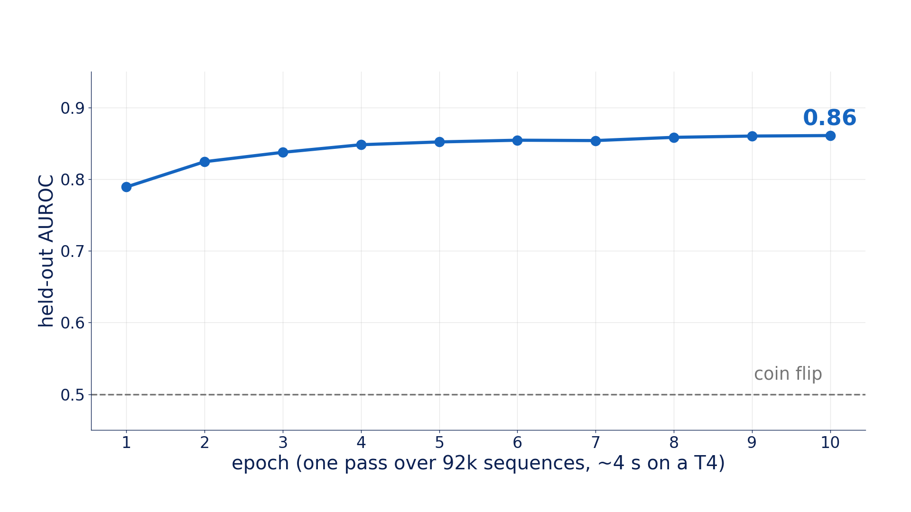{fig-align="center" height="700px"}

::: {.notes}
- Show after they have run it. x: epoch; y: AUROC on the 1,000 held-out sequences; dashed line: chance.
- Black: the workshop run, 0.79 after one epoch, 0.86 after ten. Light grey: three other training runs, each from different random starting weights; they follow the same path and end within 0.01 of each other.
- Most of the improvement happens in the first two or three epochs.

Next: the trained last-layer weights.
:::

## 6.2 The last layer weighs positions

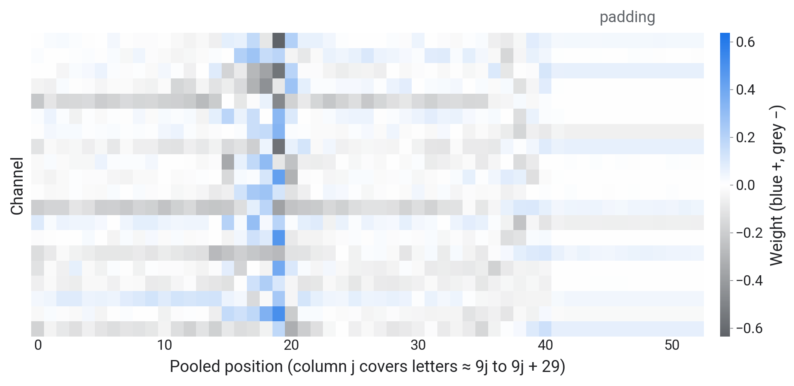{fig-align="center" height="700px"}

::: {.notes}
- The trained last-layer weights: one row per channel (20), one column per pooled position (53); blue positive, grey negative. Our run; the notebook does not draw this.
- Pooled column j covers letters of roughly 9j to 9j + 29. The large weights are in columns 17 to 20, letters about 150 to 210, where the measured site is in almost every sequence.
- The columns on the right (from about column 41, marked "padding") are padding (no sequence is longer than 375 letters), so their weights barely move from initialisation.
- The CNN learned where in the sequence to look, as well as which letter patterns to look for. Slide 5.6 shows what that implies.
:::

## 6.3 All ten filters

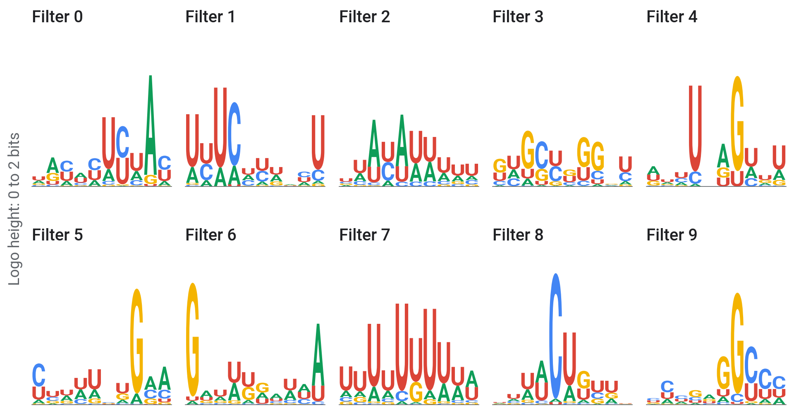{fig-align="center" height="700px"}

::: {.notes}
- One logo per first-layer filter, from the windows above the cutoff in 3,000 bound sequences. Height 0 to 2 bits; letter colours A green, C blue, G yellow, U red.
- Mostly U-rich logos; several have one dominant G or C at a single position; few look like sharp motifs.
- After TODO-4: choose the clearest logo, read its consensus and enter it as `MY_MOTIF`, with its filter number as `MY_FILTER`. That is the hypothesis for the next experiment.
:::

## 6.4 The same filter on unbound sequences

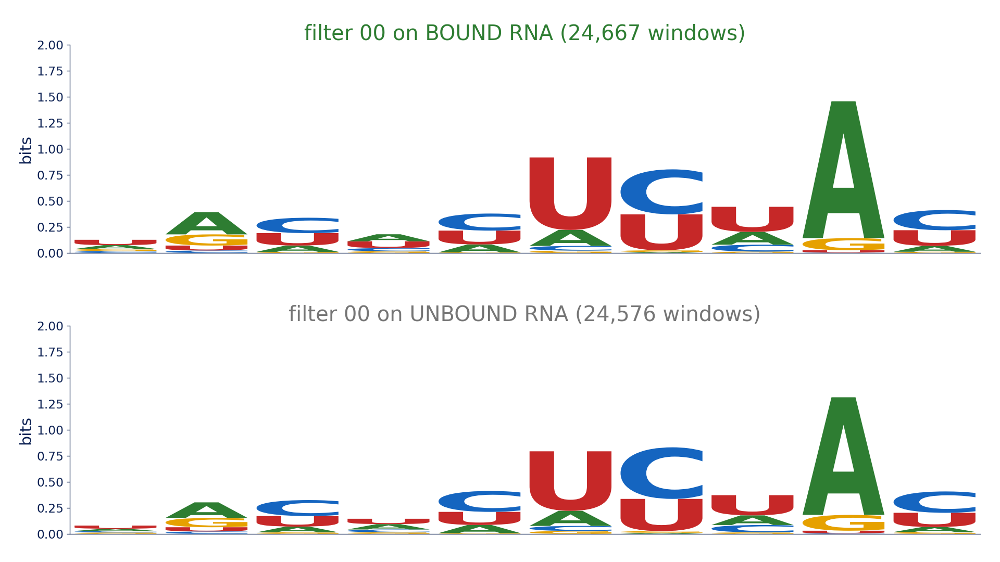{fig-align="center" height="628px"}

::: {.notes}
- Filter 0's logo from bound sequences (left) and from unbound sequences (right), each from the windows above the cutoff in 5,000 sequences; the titles give the window counts.
- A control for reading logos: filter 0 gives almost the same logo on unbound sequences.
- The windows it responds to look the same in both classes. Whether the filter's pattern changes the model's output needs a test; the next two slides insert it.
- If a student's chosen filter looks the same in both classes, the notebook suggests choosing another one.
:::

## 6.5 Insert the motif

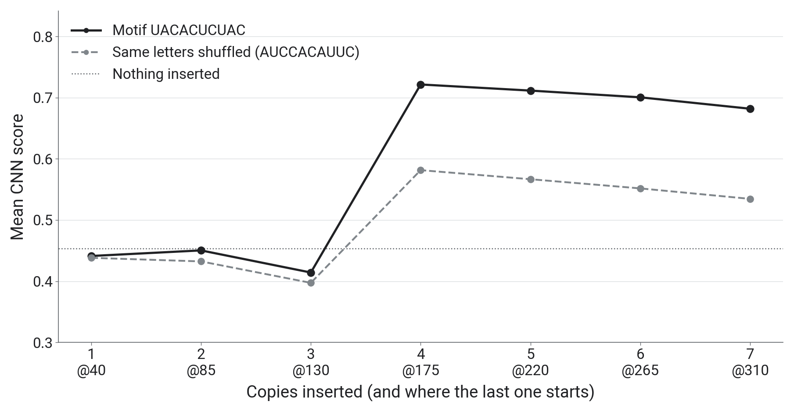{fig-align="center" height="700px"}

::: {.notes}
- 1,000 random RNA sequences. x: number of copies inserted, with the letter where the last copy starts; y: mean CNN score. The dotted line is their mean score with nothing inserted (about 0.45).
- Black: filter 0's consensus UACACUCUAC inserted 1 to 7 times, the most that fit in a 330-letter sequence. Grey dashed: the same letters in shuffled order. Compare the two curves rather than each curve with the baseline: the shuffled copy has the same letters, so it also changes the score.
- `plant()` writes copy n starting at letter 40 + 45(n − 1). The score jumps when copy 4 (letter 175) is placed in the region the CNN weighs (motif 0.41 to 0.72, shuffled 0.40 to 0.58) and decreases slightly with more copies (0.72 to 0.68), as they replace more of the background.
:::

## 6.6 The effect depends on position

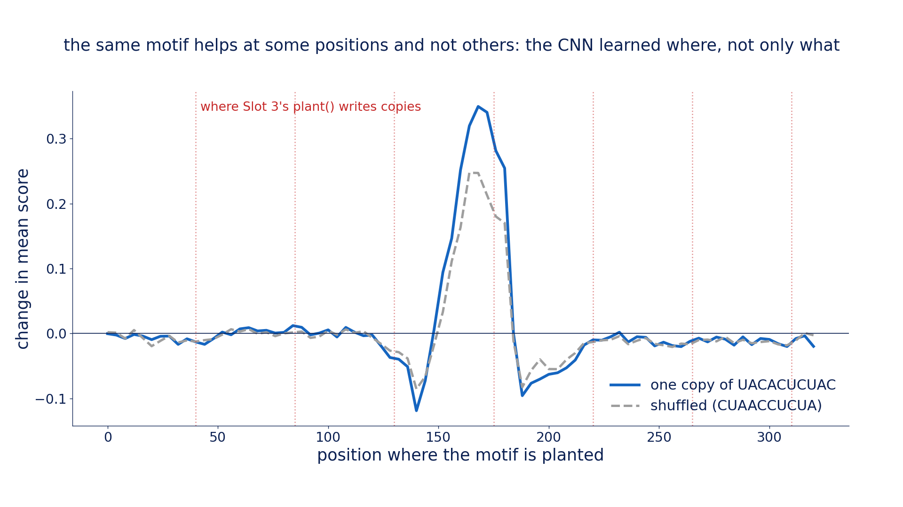{fig-align="center" height="700px"}

::: {.notes}
- One copy of the motif at every position, averaged over 400 random sequences (a given cell in the notebook). y: change in mean CNN score against nothing inserted. The numbers 1 to 7 mark where `plant()` puts each copy in the previous test; shaded: letters 150 to 190.
- The motif changes the score only between about letters 140 and 190, where almost every sequence in the data has its measured site: up to about +0.35 inside, dips of about −0.1 at both edges.
- The shuffled copy gets much of the same increase there (up to about +0.26), so a good part of the effect comes from which letters are in that region, whatever their order.
- This is the last-layer pattern from slide 6.2: the CNN weighs positions. It reflects how the data were cut, and it means the answer to "does this motif matter?" depends on where it is placed.

Next, after the break: part 2, DNA foundation models, pretrained on the whole genome.
:::
