::: {.center}
# 0 Welcome {data-name="Welcome"}
:::

## 0.1 About me

::: columns
::: {.column width="58%"}
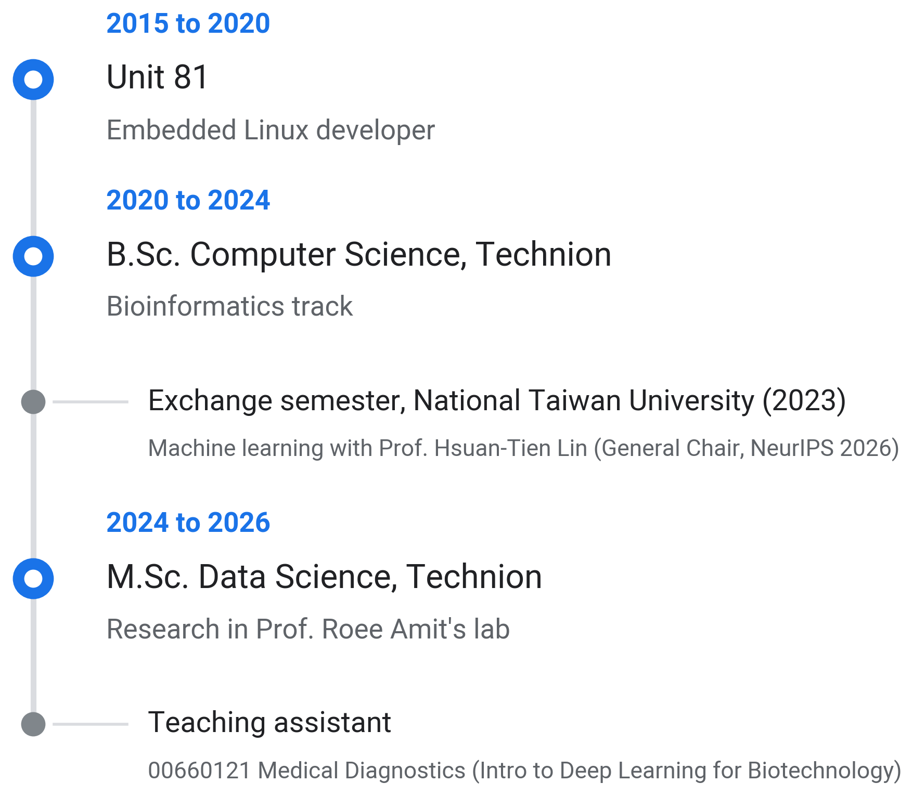{height="697px"}
:::
::: {.column width="42%"}
{height="677px"}

[During the exchange semester, Sun Moon Lake (日月潭), Taiwan, 2023]{.caption-small}
:::
:::

::: {.notes}
- B.Sc. in Computer Science, bioinformatics track, Technion (2020 to 2024). An exchange semester at National Taiwan University (spring 2023), where I took Machine Learning with Prof. Hsuan-Tien Lin: co-author of *Learning from Data*, General Chair of NeurIPS 2026, known for his online machine learning courses, and co-leader of NTU teams that won the KDD Cup several times. The photo: Wenwu Temple, Sun Moon Lake.
- M.Sc. in Data Science, Faculty of Data and Decision Sciences, Technion (2024 to 2026), with my research in Prof. Roee Amit's Synthetic Biology Laboratory. TA of 00660121 Medical Diagnostics; these three parts are a compressed version of that course's machine learning part.
- Before that, Unit 81 (2015 to 2020): embedded Linux developer, video streaming products and Linux drivers.
:::

## 0.2 My research

**Machine learning for molecular design**: from a sequence to how it binds

::: {.columns .vcenter}
::: {.column width="42%"}
{height="593px"}

[**Triplexis**: design RNA strands that bind a chosen DNA sequence as a triple helix]{.caption-small}
:::
::: {.column width="58%"}
{height="435px"}

[**Peptides** against influenza: screening millions of variants with AlphaFold 3]{.caption-small}
:::
:::

::: {.notes}
- Projected: 1 min.
- Triplexis (M.Sc. thesis): sequence-based deep learning for DNA-RNA triple helix formation, trained on synthetic libraries assayed by click chemistry and nanopore sequencing. Sequence in, "does it bind?" out, the same kind of problem as today.
- Peptides: structure-guided pre-screening of peptide inhibitors against influenza A neuraminidase. AlphaFold 3 co-folds a sample of variants, and a model trained on those folds ranks about 14 million variants without folding them. The picture: a predicted peptide pose in the enzyme's pocket, with the drugs zanamivir and oseltamivir superposed.
:::

## 0.3 Goals

:::: {.goals}
::: columns
::: {.column width="50%"}
[We will]{.goal-yes}

::: {.incremental}
- practice hands-on machine learning to build intuition for how these models work
- look inside models that read sequence
- build a mental model of how to approach sequence-based models in AI
- use coding agents to bridge the gap to the code
:::
:::
::: {.column width="50%"}
[We will not]{.goal-no}

::: {.incremental}
- learn to write code
- learn the fundamentals of ML and deep learning
- learn PyTorch or Hugging Face in depth
- open the transformer
:::
:::
:::
::::

::: {.notes}
- Projected: 1 min.
- Inside the models: one-hot encoding and filters (part 1), embeddings (part 2), fine-tuning (part 3).
- The notebooks give the problem and the rules; the code is written with a coding agent (Gemini in Colab, or any assistant). The test cell after each TODO checks the result and says what is wrong.
- Every part ends with a result to interpret.
- Sit next to someone with a different background: a programmer next to a biologist.
:::

## 0.4 What you need

::: columns
::: {.column width="58%"}
- A laptop and a Google account
- Colab with a GPU: *Runtime → Change runtime type → T4 GPU*
- Notebooks and slides: **[mathoory.github.io/ai-days-2026-dna-workshop]{.nowrap}**
:::
::: {.column width="42%"}
{height="671px"}

[Scan for the notebooks and slides]{.caption-small}
:::
:::

::: {.notes}
- Projected: 1 min.
- The QR code opens the same repository link.
- Every notebook runs on its own. Part 3 starts from our CNN and our embeddings, so everyone has the same models there.
:::

## 0.5 Agenda

```{=html}
<table class="agenda">
<thead><tr><th>Time</th><th>Part</th><th class="tut">Tutorial</th><th class="hands">Hands-on</th><th>Notebook</th></tr></thead>
<tbody>
<tr><td>11:00</td><td>1. Machine learning and CNNs</td><td class="tut">40 min</td><td></td><td></td></tr>
<tr class="brk"><td>11:40</td><td colspan="4">Break, 10 min</td></tr>
<tr><td>11:50</td><td>1. Machine learning and CNNs, continued</td><td></td><td class="hands">25 min</td><td><code>01_cnn</code></td></tr>
<tr><td>12:15</td><td>2. DNA foundation models</td><td class="tut">30 min</td><td class="hands">20 min</td><td><code>02_foundation_models</code></td></tr>
<tr class="brk"><td>13:05</td><td colspan="4">Break, 10 min</td></tr>
<tr><td>13:15</td><td>3. Shortcuts, controls and fine-tuning</td><td class="tut">15 min</td><td class="hands">20 min</td><td><code>03_shortcuts_and_controls</code></td></tr>
<tr class="brk"><td>13:50</td><td colspan="4">Break, end at 14:00</td></tr>
</tbody>
</table>
```

::: {.notes}
- Projected: 1 min.
- Each part: a talk, then the notebook. Part 1: 40 minutes of talk, a break, 25 of notebook. Part 2: 30 and 20. Part 3: 15 and 20, with the feedback at the end.
- Notebooks: `01_cnn`, `02_foundation_models`, `03_shortcuts_and_controls`.
- One data set all day: 92,346 training sequences plus 1,000 held out, each a stretch of RNA where AGO2 did or did not bind.
:::

::: {.center}
# 1 The task {data-name="Task"}
:::

## 1.1 RNA and AGO2

:::: {.columns .vcenter}
::: {.column width="50%"}
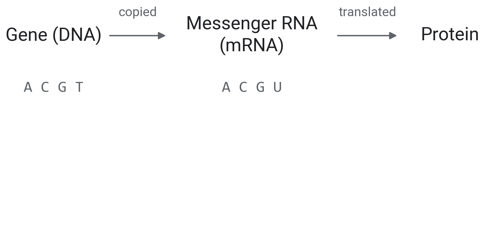{height="530px"}
:::
::: {.column width="50%" .fragment}
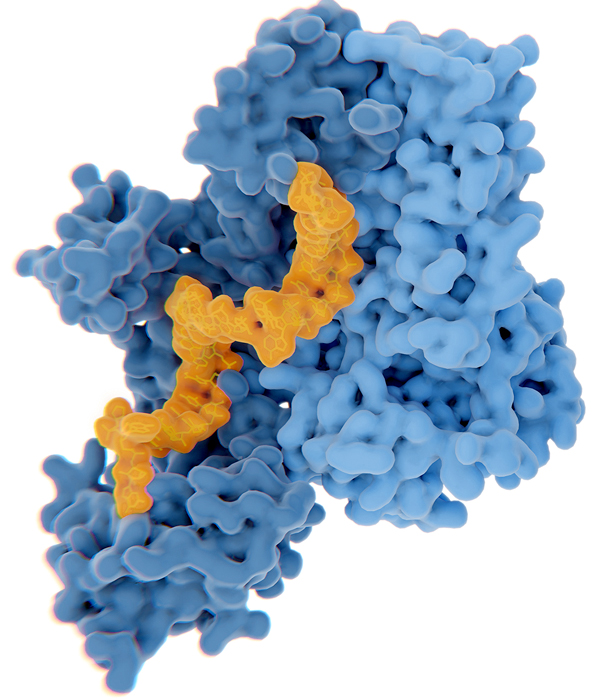{height="677px"}

[An RNA-binding protein (blue) holding an RNA strand (orange); AGO2 is one of them. Image: Nucleus Biotech]{.caption-small}
:::
::::

::: {.notes}
- AGO2 is Argonaute 2.
- Top row, left to right: a gene's DNA (letters A, C, G, T) is copied into a messenger RNA (mRNA, letters A, C, G, U), which the cell translates into a protein. RNA uses U where DNA has T.
- Click: AGO2 is an RNA-binding protein (RBP). The picture is a protein of this kind (blue surface) holding an RNA strand (orange). AGO2 sits on some mRNAs, at a short stretch of letters, its binding site; where it binds, the mRNA yields less protein.
- Our question for the day: from the RNA letters alone, can a model tell where AGO2 binds?
- Our sequences are RNA, so the notebooks use U; the DNA models of part 2 read T.
:::

## 1.2 The data

::: {.r-stack}
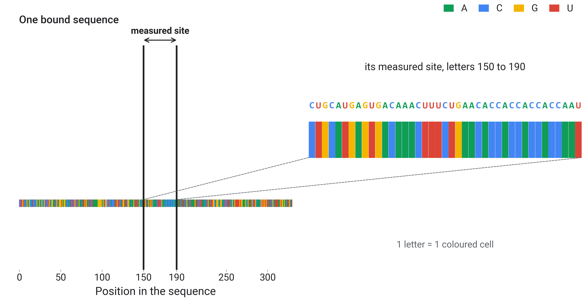{height="735px"}

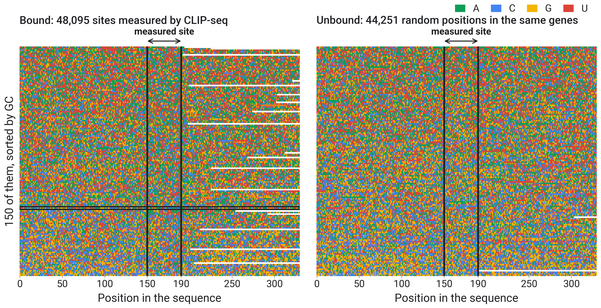{.fragment height="735px"}
:::

::: {.notes}
- Projected: 2 min.
- First one bound sequence: each letter is one coloured cell; its measured site written out on the right. Click: 150 bound and 150 unbound sequences, the same row outlined.
- CLIP-seq: an experiment that captures the RNA a protein binds. The 40-letter measured site sits at letters 150 to 190 (the black lines).
- Each row is one sequence, one colour per letter (A green, C blue, G yellow, U red); 150 of each class, sorted by GC, first 330 letters. The white stripes on the right are sequence ends.
- Counts are the training file; 1,000 more sequences (500 of each) are held out as the test set.
- CLIP-seq: UV light crosslinks proteins to the RNA they touch, an antibody pulls down AGO2, and the attached RNA fragments are sequenced.
- The data set is the GraphProt CLIP benchmark (Maticzka et al. 2014), used by Pan and Shen (2018), whose CNN we follow. The unbound sequences are the bound sites moved to random positions in the same genes.
- 99% of sequences have the measured site starting exactly at letter 150. Sequences are 137 to 375 letters long.
- The bound half is slightly richer in A and U: mean GC 0.41 vs 0.45 over all sequences. AGO2 sites are often in AU-rich 3′ UTRs (the part of an mRNA after its protein-coding letters), so part of this may be biology and part may come from how the unbound positions were drawn. Part 3 tests that.
:::

::: {.center}
# 2 Learning from examples {data-name="Learning"}
:::

## 2.1 What is learning, and why machine learning?

::: {.incremental}
- **Learning**: observations → learning → a skill
- **Machine learning**: data → an algorithm → a skill
- A skill improves a **performance measure**: earlier detection of disease, or today, finding where AGO2 binds
- Define "tree" and write a program for it: **hard**. Learn trees from examples: **a 3-year-old can do it**
:::

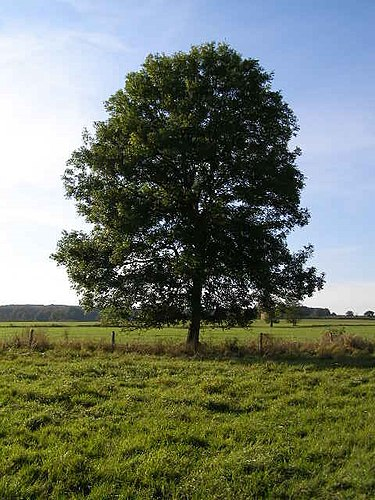{.fragment fragment-index="3" fig-align="center" height="349px"}

::: {.notes}
- Ask the room for a definition before showing these.
- A person learns from experience accumulated from observations; a machine learns from experience computed from data. Machine learning automates learning from data in order to predict or decide.
- The performance measure makes "learning" testable: accuracy, or today the AUROC (section 3).
- Writing down rules that recognise every tree is hard; showing examples is easy. The same holds for binding sites: nobody can write down the full rule for where AGO2 binds.
:::

## 2.2 A short history

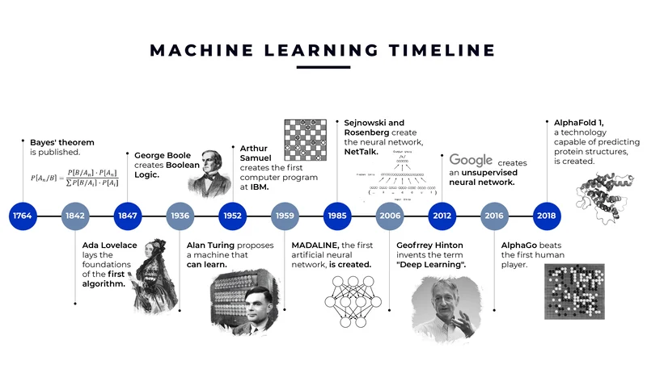{fig-align="center" height="760px"}

::: {.notes}
- From Bayes' theorem (1764) and Ada Lovelace's first algorithm to AlphaGo (2016) and AlphaFold (2018).
- The ideas are old; the data and computing power that make them work at scale are recent.
:::

## 2.3 Statistics, machine learning and AI

::: {.incremental}
- **Statistics**: use data to make inferences about a population or a process
- **Machine learning**: use data to find a function $g$ that approximates an unknown target $f$
- **AI**: compute something that shows intelligent behaviour
- **Use machine learning when**
    - there is a pattern to learn
    - there is no easy rule to program it
    - there are data about it
:::

::: {.notes}
- Statistics gives machine learning many of its tools; traditional statistics cares more about provable results under assumptions, less about computation.
- Machine learning is one route to AI. Chess: traditional AI searches a game tree; machine learning learns from board positions.
- When: all three hold for AGO2. Binding is not random (1), there is no simple rule for it (2), and CLIP-seq measured tens of thousands of sites (3). If (1) fails, there is nothing to learn; if (2) fails, write the rule; if (3) fails, there is nothing to learn from.
:::

## 2.4 AI, machine learning, deep learning

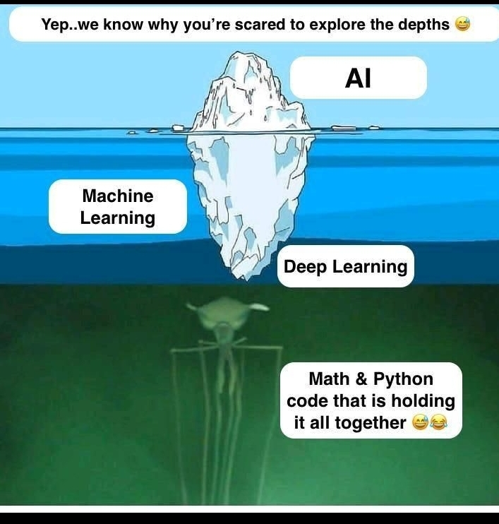{fig-align="center" height="760px"}

## 2.5 Supervised learning

- Examples $(x_i, y_i)$, $i = 1, \dots, N$: a sequence $x_i$ and its label $y_i$ (1 bound, 0 unbound)
- A model $g_\theta$ with parameters $\theta$ predicts $\hat p = g_\theta(x)$, the probability of bound

{fig-align="center" height="589px"}

::: {.notes}
- Four real training sequences, the first 32 of their 340 letters. $y$ is the CLIP-seq label; $\hat p$ is the prediction of the CNN trained in this part.
- Supervised learning: every training example comes with its answer. Here $N$ = 92,346. The next slide gives these symbols their tutorial-1 names.
- Training chooses $\theta$ so that $\hat p$ is close to $y$ on the training examples. The goal is good predictions on sequences the model has not seen (section 3).
- The second bound example gets 0.35 and the second unbound one 0.52: the model is often uncertain, and sometimes wrong.
:::

## 2.6 Notation

::: {.fill-table}
| | Symbol | Meaning |
|:---------|:---------|:------------------|
| Input space | $\mathcal{X}$ | what we observe |
| Output space | $\mathcal{Y}$ | the answers |
| Training examples | $D = \{(x_i, y_i)\}_{i=1}^{N}$ | inputs with known answers |
| Unknown target | $f: \mathcal{X} \to \mathcal{Y}$ | the true input-to-answer relation |
| Hypothesis set | $\mathcal{H}$ | the models we allow, $g_\theta$ for every $\theta$ |
| Learning algorithm | $\mathcal{A}$ | how one $g_\theta$ is picked |
| Final hypothesis | $g_\theta \approx f$ | the trained model |
:::

::: {.notes}
- The notation of tutorial 1. $f$ is unknown: we only see it through the examples. The algorithm picks one $g_\theta$ from $\mathcal{H}$.
- Today: $\mathcal{X}$ RNA sequences; $\mathcal{Y}$ 1 bound, 0 unbound; $D$ 92,346 labelled sequences; $f$ where AGO2 binds; $\mathcal{H}$ all CNNs of one shape; $\mathcal{A}$ gradient descent; $g_\theta$ the trained CNN.
:::

## 2.7 The learning flow

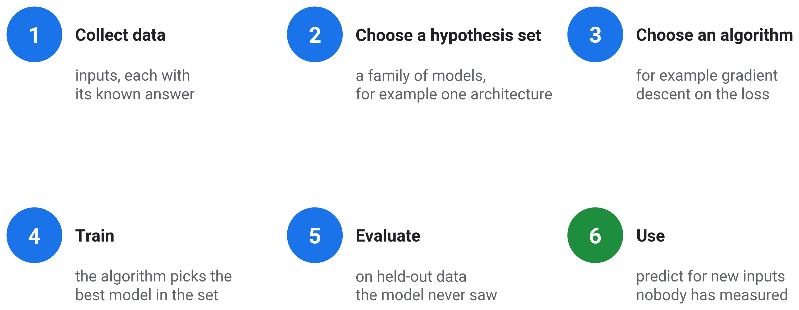{fig-align="center" height="754px"}

::: {.notes}
- The six steps of any supervised learning project.
- Today: 92,346 labelled sequences; a CNN of one shape; gradient descent; held-out AUROC on 1,000 sequences.
- Step 2 is the choice of architecture (TODO-2); steps 3 and 4 are the training loop (TODO-3); step 5 is section 3.
- Step 6 is why we do it: the trained model scores sequences nobody has measured.
:::

## 2.8 The loss

**Binary cross-entropy**

::: {.r-stack}
::: {.fragment .fade-out fragment-index="1"}
$\mathcal{L} = -\frac{1}{N}\sum_{i} \big[\, \color{#1A73E8}{y_i \log \hat p_i} + \color{#BDC1C6}{(1 - y_i)\log(1 - \hat p_i)} \,\big]$
:::

::: {.fragment fragment-index="1"}
$\mathcal{L} = -\frac{1}{N}\sum_{i} \big[\, \color{#BDC1C6}{y_i \log \hat p_i} + \color{#E8710A}{(1 - y_i)\log(1 - \hat p_i)} \,\big]$
:::
:::

::: {.r-stack}
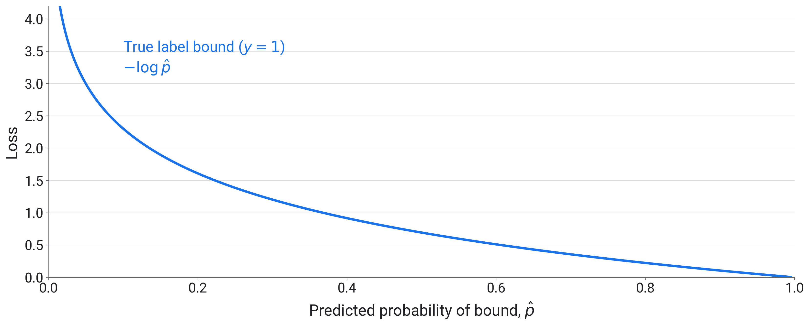{height="579px"}

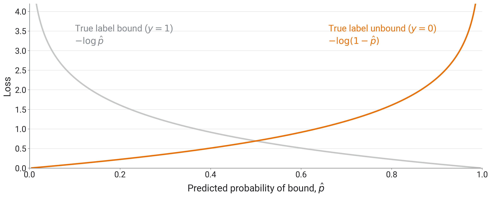{.fragment fragment-index="1" height="579px"}
:::

::: {.notes}
- One example's contribution to the loss, against the predicted probability. First a bound example, $-\log \hat p$, the blue term of the formula. Click: an unbound example, $-\log(1 - \hat p)$, the orange term.
- A confident correct prediction costs almost nothing; a confident wrong one costs a lot ($-\log 0.01 = 4.6$).
- On slide 2.5: predicting 0.90 for a bound sequence gives a loss of 0.10; predicting 0.35 gives 1.04.
- Predicting 0.5 for everything gives $\ln 2 = 0.69$, the loss of a coin flip.
- Tutorial 1 used the mean squared error, for predicting a number. Cross-entropy is the standard loss for a predicted probability.
:::

## 2.9 Features: chosen or learned

::: {.r-stack}
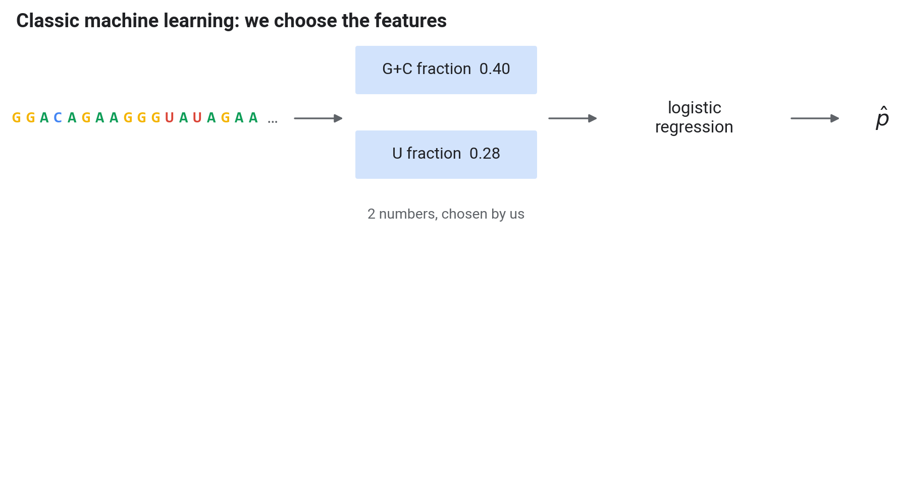{height="742px"}

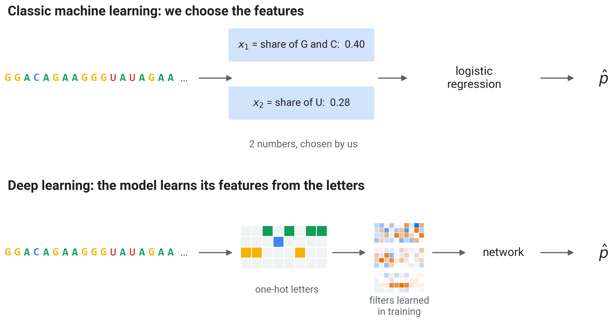{.fragment height="742px"}
:::

::: {.notes}
- A model needs numbers. Classic machine learning: we decide which numbers describe a sequence, its **features**, and the model learns how to weigh them.
- Our first model uses two features of one real bound sequence: its GC fraction (0.40) and its U fraction (0.28). Why these two: slide 1.2 showed that bound sequences are richer in A and U than unbound ones (mean GC 0.41 against 0.45), so they are the obvious first guess, and two numbers can be drawn on a slide.
- Click: deep learning gives the model the raw letters (one-hot, section 4) and lets it learn its own features during training. In a CNN these are the filters: real filters of our trained network are shown, blue positive and orange negative weights.
- Nobody told the CNN to look at GC. Part 3 checks how much of what it learned is composition anyway.
:::

## 2.10 The sigmoid: from a score to a probability

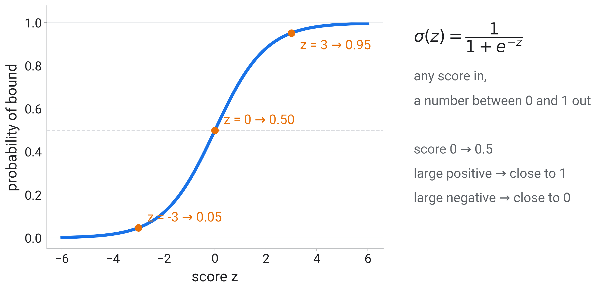{fig-align="center" height="695px"}

::: {.notes}
- A model first computes a score $z$, any number (a weighted sum of the features plus a bias). The sigmoid turns it into a probability between 0 and 1.
- Score 0 means 0.5, no preference; the larger the score, the closer to 1 (bound); the more negative, the closer to 0 (unbound).
- Every model today ends with a sigmoid. The score before it is called the **logit**.
:::

## 2.11 Gradient descent

::: {.r-stack}
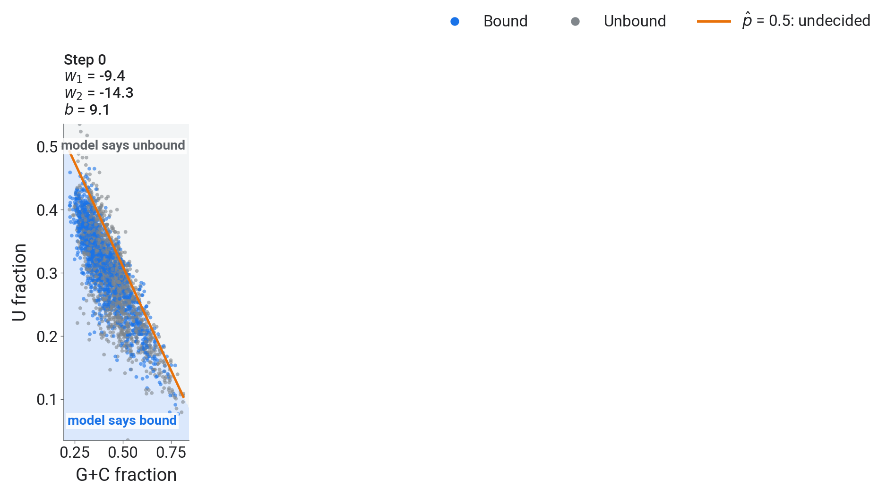{height="742px"}

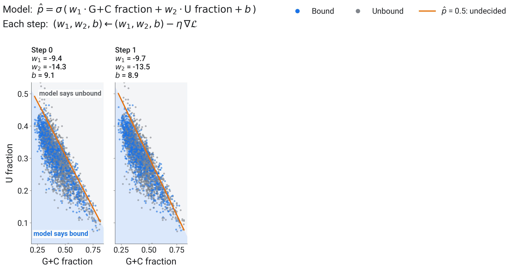{.fragment height="742px"}

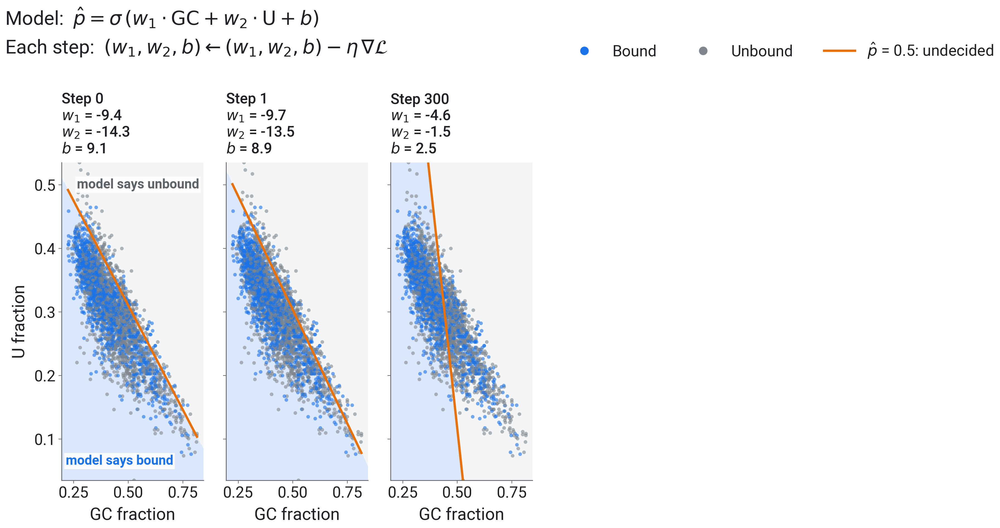{.fragment height="742px"}

{.fragment height="742px"}

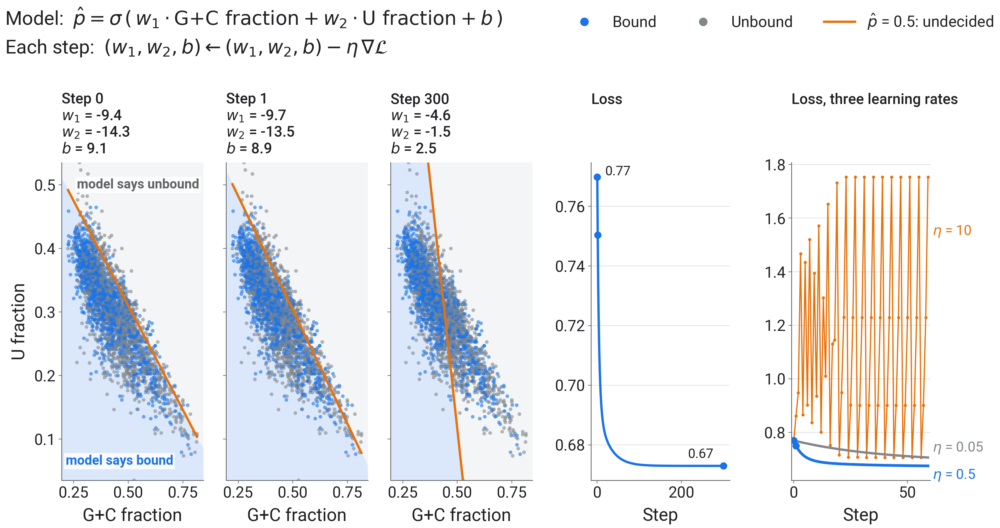{.fragment height="742px"}
:::

::: {.notes}
- The update: $\theta$ are all the parameters, $\mathcal{L}$ the loss, $\eta$ the learning rate. Start from some $\theta$, compute the gradient of the loss with respect to every parameter, move each parameter against its gradient, scaled by $\eta$, and repeat.
- Left and middle: 3,000 training sequences, one point each, placed by their two features, GC fraction and U fraction (previous slides); blue bound, grey unbound. The orange line is where the predicted probability equals 0.5: at step 0 (a deliberately bad start), after one step, and after 300 steps. Each title gives that step's $w_1$, $w_2$ and $b$. Right: the loss at each step.
- The smallest possible model on our data: two features per sequence and three parameters (two weights and a bias).
- The loss (slide 2.8) falls from 0.77 at the bad start to 0.67.
- How well these two numbers separate the classes on held-out data: AUROC 0.66 (part 3).
- Our CNN has 2,491 parameters. The genome models have millions to billions.
- The learning rate $\eta$ sets the size of each step (right). Same model and start, three learning rates: $\eta$ = 0.05 moves too slowly; $\eta$ = 0.5 is the run on the left; $\eta$ = 10 overshoots the minimum and the loss jumps up and down.
- The learning rate is set before training, a hyperparameter, and chosen on validation data (section 3). The notebook uses Adam with $\eta$ = 0.001.
:::

## 2.12 Mini-batches and epochs

- Each step uses a **batch** of 256 sequences; an **epoch** is one pass over all 92,346 (360 steps)

{fig-align="center" height="606px"}

::: {.notes}
- The CNN of this part, trained as in the notebook: 10 epochs, 3,600 steps. Light blue: the loss on each batch. Dark blue: the mean over each epoch.
- The gradient on one batch estimates the gradient on the whole training set. One batch is quick to compute, which allows many steps per epoch. The estimate changes from batch to batch, which is why the light line jumps (0.38 to 0.61 within the last epoch). This is mini-batch, or stochastic, gradient descent.
- The epoch means fall from 0.61 to 0.44, most of it in the first three epochs.
- 92,346 / 256 gives 360 full batches; the notebook drops the incomplete last one (`drop_last=True`) and reshuffles the order every epoch.
:::

## 2.13 ReLU

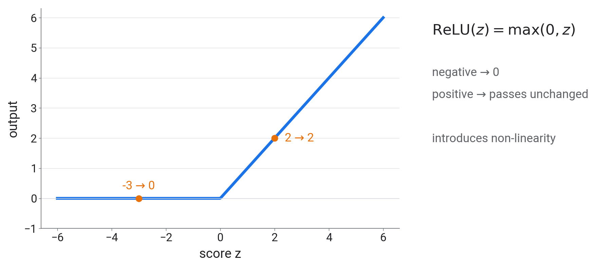{fig-align="center" height="707px"}

::: {.notes}
- ReLU (rectified linear unit) keeps positive values and sets negative ones to 0.
- It introduces non-linearity. Without it, a stack of weighted sums is just one weighted sum, a straight boundary like logistic regression.
- In the CNN, ReLU after a filter means: a window that does not resemble the filter gives 0, a window that does gives a positive value (slide 4.4).
:::

## 2.14 From logistic regression to a neural network

- A **neural network** stacks layers of units, with **ReLU** between them

{fig-align="center" height="609px"}

::: {.notes}
- Left: logistic regression is one unit, a weighted sum of the inputs plus a bias, then the sigmoid.
- Right: a hidden layer of units, each a weighted sum followed by ReLU, feeds the output unit.
- Without the nonlinearity, stacked weighted sums add up to a single weighted sum, which is no more expressive than logistic regression.
- Training is the same as on slide 2.11. `loss.backward()` computes the gradient for every weight in every layer by the chain rule (backpropagation), and the optimizer takes the step.
- The CNN of section 4 is a network of this kind in which each first-layer unit looks at a 10-letter window.
:::

::: {.center}
# 3 Testing a model {data-name="Testing"}
:::

## 3.1 Train, validate, test

{fig-align="center" height="205px"}

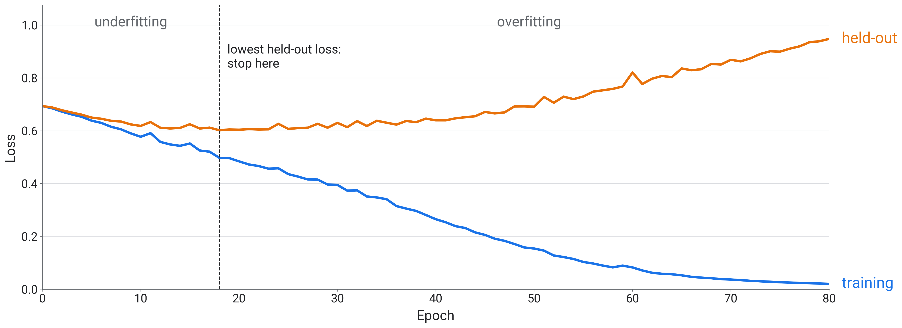{.fragment fig-align="center" height="520px"}

::: {.notes}
- An epoch is one pass over the training data.
- The 1,000 held-out sequences are 500 bound and 500 unbound; parts 1 and 2 use them as the test set. The bar is not to scale: the test set is about 1% of the data.
- Never grade a model on the data it was trained on.
- The notebook prints the held-out AUROC after every epoch, so we do look at the test set during training. That is acceptable for a workshop as long as nobody picks the best epoch by it; in a real project that is the validation set's job.
- The split is random by sequence. We checked for near-duplicates: 47% of held-out bound sequences have a training sequence within 150 letters on the genome (13% of unbound). On the 698 held-out sequences without one, the CNN scores 0.85 instead of 0.86, so the effect on our results is small. Real projects split by gene or chromosome.
- Click: why not the training loss?
- A larger CNN (about 230,000 weights) trained on only 1,000 sequences, so the effect is easy to see. Loss after every epoch on its training sequences (blue) and on the 1,000 held-out sequences (orange).
- The training loss keeps falling, to almost 0: the model memorises its 1,000 examples.
- The held-out loss falls until epoch 18, then rises: from there on, what the model learns about its training examples does not carry over to new sequences.
- The training loss only says how well the model fits what it has seen. What we want is a model that works on sequences it has not seen, so we measure on held-out data.
:::

## 3.2 Drawing the ROC curve

The scores of our convolutional neural network (CNN, section 4) on the 1,000 held-out sequences

::: {.r-stack}
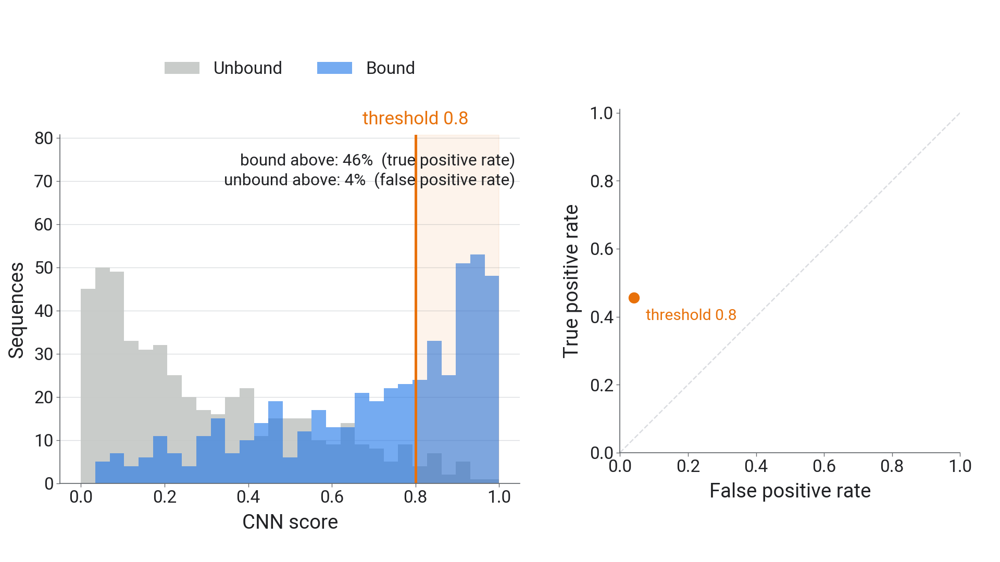{height="587px"}

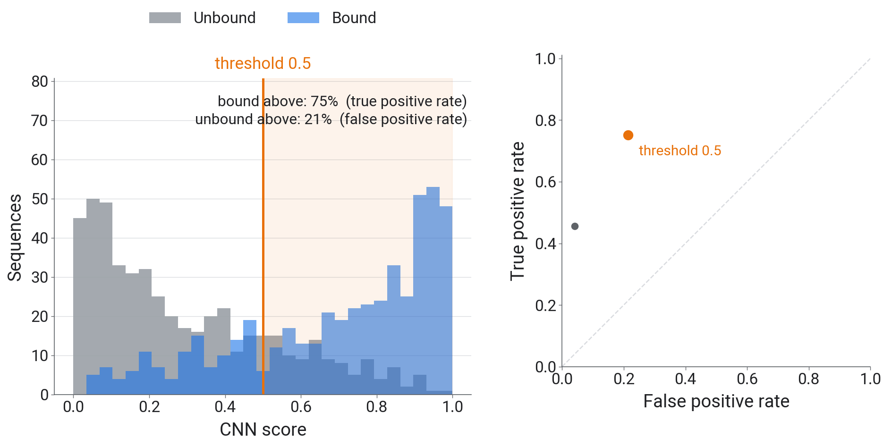{.fragment height="587px"}

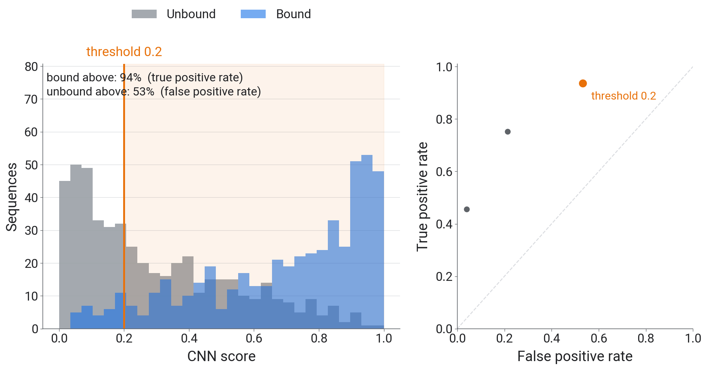{.fragment height="587px"}
:::

::: {.notes}
- The CNN of section 4 on the 1,000 held-out sequences: its scores, bound in blue and unbound in grey.
- Pick a threshold: every sequence above it is called bound. True positive rate: the fraction of bound sequences above the threshold. False positive rate: the fraction of unbound sequences above it. One threshold gives one point on the right.
- Threshold 0.8: 46% of bound and 4% of unbound sequences are above it. Click: 0.5 gives 75% and 21%. Click: 0.2 gives 94% and 53%.
- Lowering the threshold catches more bound sequences and also lets in more unbound ones: both rates go up together. The question is how fast each one rises.
- For anyone who knows diagnostic tests: sensitivity against 1 minus specificity.
:::

## 3.3 AUROC

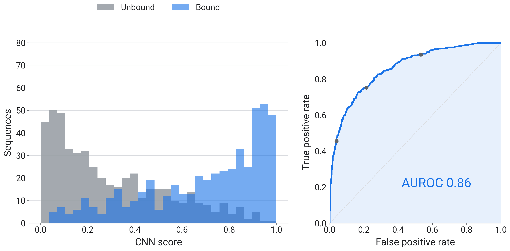{fig-align="center" height="709px"}

::: {.notes}
- All thresholds together give the ROC curve (receiver operating characteristic). AUROC is the area under it: the probability that a random bound sequence scores higher than a random unbound one. 0.5 is chance, 1.0 is perfect.
- Every threshold from 1 down to 0 adds a point; joined, they give the curve. The dashed diagonal is a model that ranks at random.
- The area is 0.86 for our CNN: pick one bound and one unbound held-out sequence at random, and 86% of the time the bound one gets the higher score.
- It does not depend on one threshold, so it compares models fairly. It says nothing about why a model scores well.
- The loss is what training lowers, and it is computed on the training data. The AUROC measures what we want, separating bound from unbound, on held-out data.
:::

::: {.center}
# 4 The convolutional neural network (CNN) {data-name="CNN"}
:::

## 4.1 One-hot encoding (TODO-1) {data-todo="TODO-1"}

- One column per letter, with a 1 in its row; padding columns of 0.25 up to 501

{fig-align="center" height="657px"}

::: {.notes}
- Each column is one letter; the four rows are A, C, G, U, and the coloured cell holds the 1. A sequence becomes a 4 × length matrix. The longest sequence is 375 letters.
- A padding column of 0.25 means "unknown letter": each base equally likely. 501 is the input width used by Pan and Shen, whose CNN this one follows.
- If asked why not A=1, C=2, G=3, U=4: that would impose an order (G "greater than" C) with no biological meaning. One-hot keeps the four letters equally far apart.
- TODO-1 writes the conversion: `one_hot` for one sequence (TODO-1a), then `encode_batch` for a list of sequences (TODO-1b). A test cell checks 201 sequences, including padding and an unknown letter. The rest of the notebook uses the students' own `encode_batch`.
:::

## 4.2 A filter slides along the sequence

::: {.r-stack}
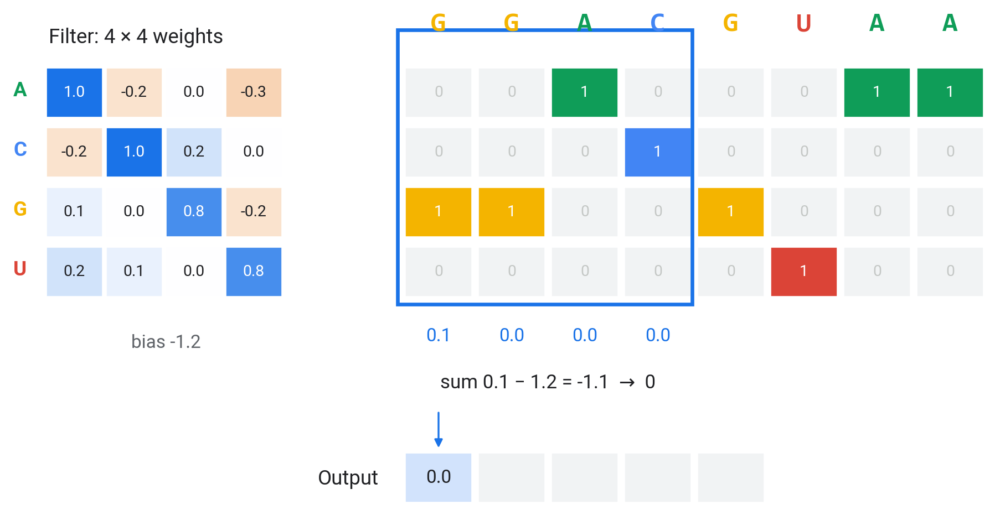{height="742px"}

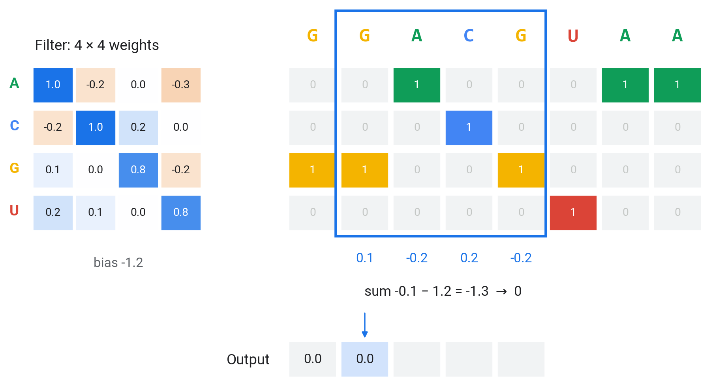{.fragment height="742px"}

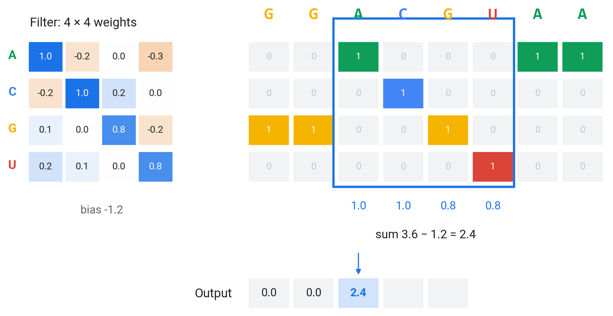{.fragment height="742px"}

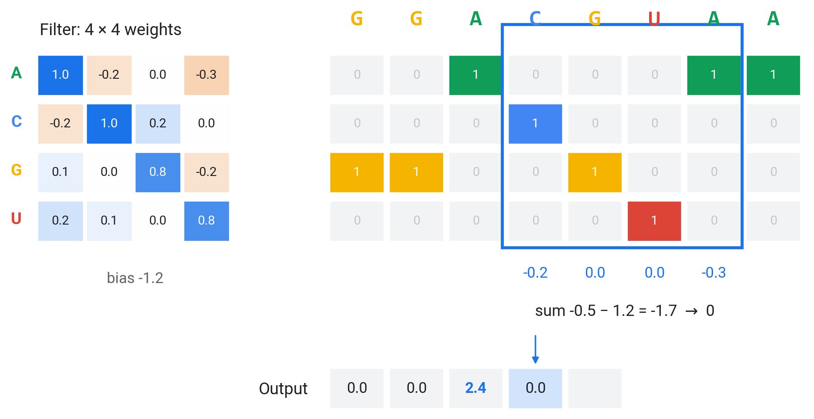{.fragment height="742px"}

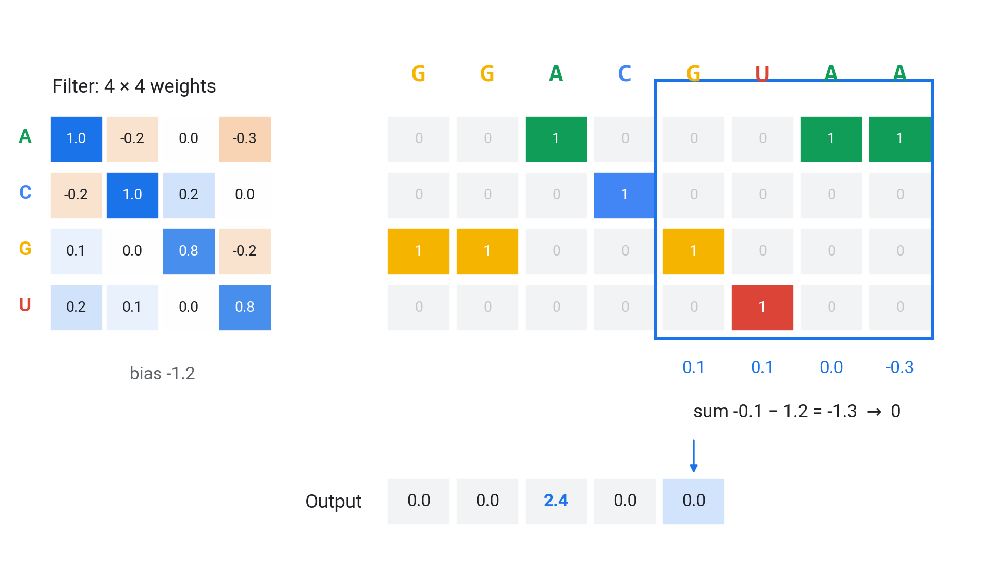{.fragment height="742px"}
:::

::: {.notes}
- A toy filter of width 4 on an 8-letter sequence, one click per position. The filter has one weight per letter and position (blue positive, orange negative) and a bias.
- At each position the window picks, in every column, the weight of the letter that is there (the 1 in the one-hot column). Their sum plus the bias is the output; ReLU turns negative outputs into 0.
- The filter's weights favour A, C, G, U in that order: on the window ACGU it gives 2.4, elsewhere 0.
- Five windows give five outputs. The real CNN does the same with filters of width 10 on 501 positions.
- The same toy filter comes back in section 5, when we read what a filter likes.
:::

## 4.3 Training changes the filters

::: {.r-stack}
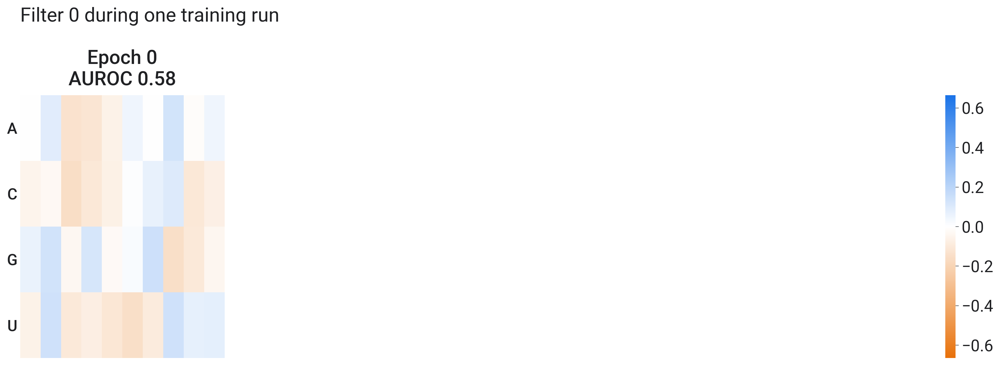{height="741px"}

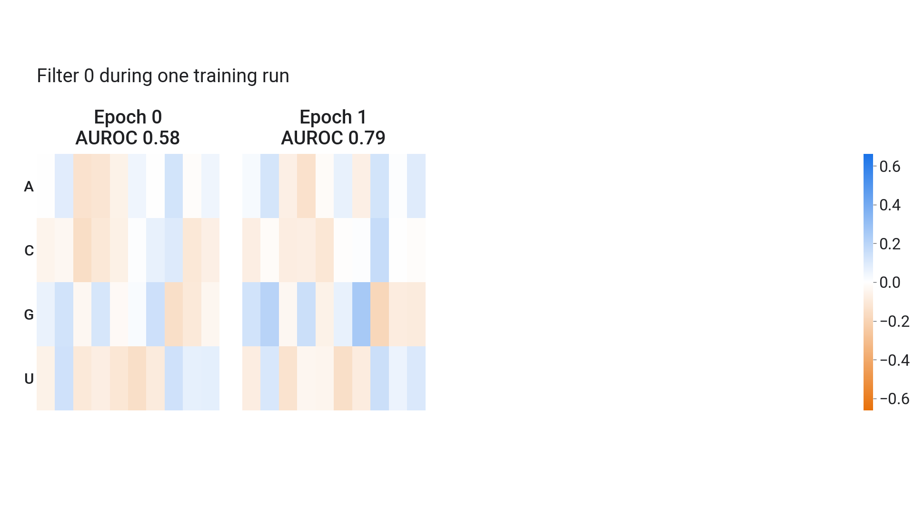{.fragment height="741px"}

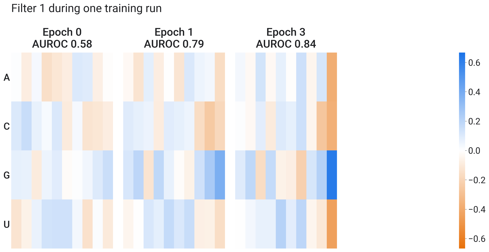{.fragment height="741px"}

{.fragment height="741px"}
:::

::: {.notes}
- One filter at epochs 0, 1, 3 and 10 of one training run (its number is in the figure), one epoch per click, with the held-out AUROC after each epoch. Rows A, C, G, U; columns the 10 positions; blue positive, orange negative weights.
- Epoch 0 is the random initialisation (AUROC 0.58). After epoch 1 the model reaches 0.79 and after epoch 3 0.85. By epoch 10 the filter has a clear preference, a G at position 7, and the model reaches 0.86.
- Each step is the update of slide 2.11, applied to all 2,491 weights. We use Adam, a variant of gradient descent that adapts the step size per weight.
:::

## 4.4 The filter along one sequence

{fig-align="center" height="678px"}

::: {.notes}
- A real filter of our trained CNN (filter 7, which prefers U-rich windows): its output at every position of one bound sequence, after ReLU. x: position; y: output.
- ReLU (slide 2.13) sets negative outputs to 0, so most positions give 0. Windows that resemble the weights give large values. The highest one is drawn in dark blue and its 10 letters are printed.
:::

## 4.5 Channels and pooling

- 10 filters give 10 output rows, **channels**; **max pooling** keeps the largest of every 3 positions

::: {.r-stack}
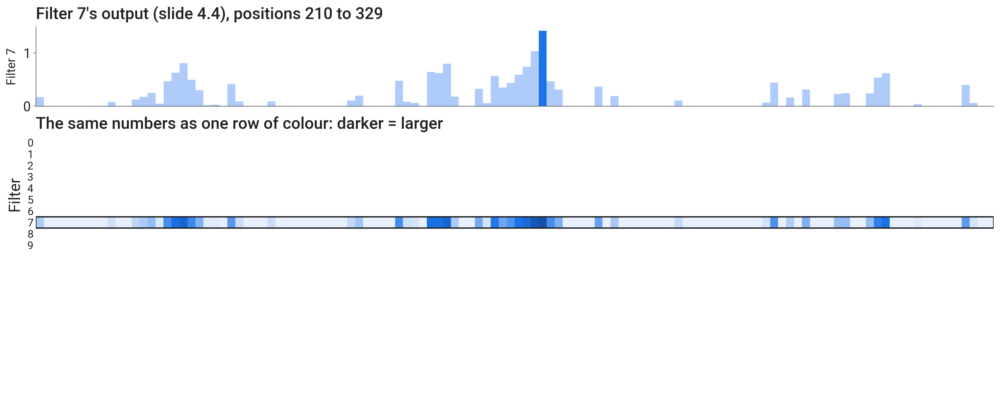{height="593px"}

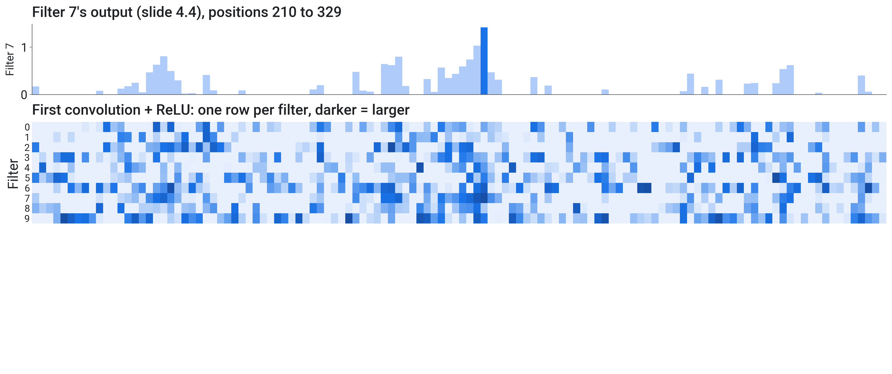{.fragment height="593px"}

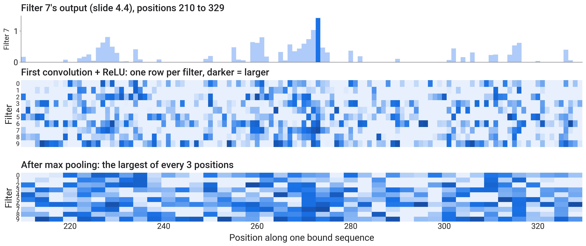{.fragment height="593px"}
:::

::: {.notes}
- Click by click: the track of slide 4.4 as bars, then the same numbers as one row of colour, then all 10 filters, then max pooling.
- One bound sequence of 340 letters, the one on slide 4.4, positions 210 to 330 (filter 7 peaks at 273). Top: the output of all 10 first-layer filters after ReLU at each position; darker blue is larger. Bottom: after max pooling, one value per block of 3 positions.
- Each row is one filter's track; row 7 is the track of slide 4.4.
- The network computes all 492 positions of the padded input (164 after pooling); the figure shows 120 of them.
- Pooling shortens each track threefold and keeps the strongest responses; the exact position within each block of 3 is lost. It has no parameters.
- The second convolution reads all 10 channels at once: each of its 20 filters is 10 × 5, one weight per channel and pooled position.
:::

## 4.6 Build your network (TODO-2) {data-todo="TODO-2"}

{fig-align="center" height="749px"}

::: {.notes}
- The parts: a convolution slides its filters along the sequence (one output row, a channel, per filter); ReLU sets negative values to 0; max pooling keeps the largest value of each block of neighbouring positions, so the rows get shorter; flatten lays everything out in one row; a linear layer makes one number, the logit.
- Two rules: the first filters cover all 4 letter rows, and the network ends with one number per sequence. Everything else is the students' choice; the notebook prints the shape after every layer (`show_shapes`), which tells them how many inputs the linear layer needs.
- Our reference network, used on the results slides: 10 filters of 4 × 10, ReLU, pooling by 3; 20 filters covering 5 pooled positions, ReLU, pooling by 3; flatten (20 × 53 = 1,060 numbers); linear to one logit. 2,491 parameters: 410 in the first convolution, 1,020 in the second, 1,061 in the linear layer.
- Shapes in our network: 4 × 501 → 10 × 492 → 10 × 164 → 20 × 160 → 20 × 53 → 1,060 → 1. A convolution shortens a row by the filter width minus 1; pooling by 3 divides its length by 3.
- No sigmoid inside the network: the loss (`BCEWithLogitsLoss`) applies it.
- Students who finish early can try other networks and compare their held-out AUROCs.
:::

## 4.7 The training step and the evaluation (TODO-3) {data-todo="TODO-3"}

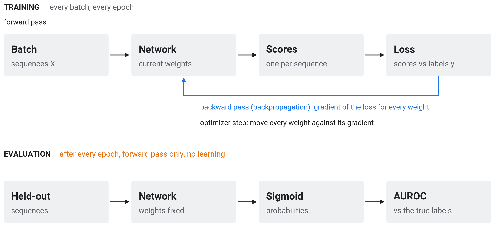{fig-align="center" height="766px"}

::: {.notes}
- Top, blue: one training step, repeated for every batch of every epoch. A batch goes through the network, the scores are compared with the labels (the loss), the gradients of the loss say how to change every weight, and the step changes them; then the next batch.
- Bottom, orange: after each epoch, the held-out sequences go through the same network without learning; the sigmoid turns scores into probabilities and the AUROC compares them with the true labels.
- TODO-3a: `train_step`, one training step on one batch; the notebook runs it five times on the same batch so the loss falls. TODO-3b: `evaluate`, the held-out AUROC without learning. The given `train()` calls both for every batch and epoch, and measures from epoch 0, so the curves show the start and training against held-out. TODO-3c: the ROC curve of the trained model.
:::

::: {.center}
# 5 Look inside {data-name="Look inside"}
:::

## 5.1 Which windows does a filter like?

::: {.r-stack}
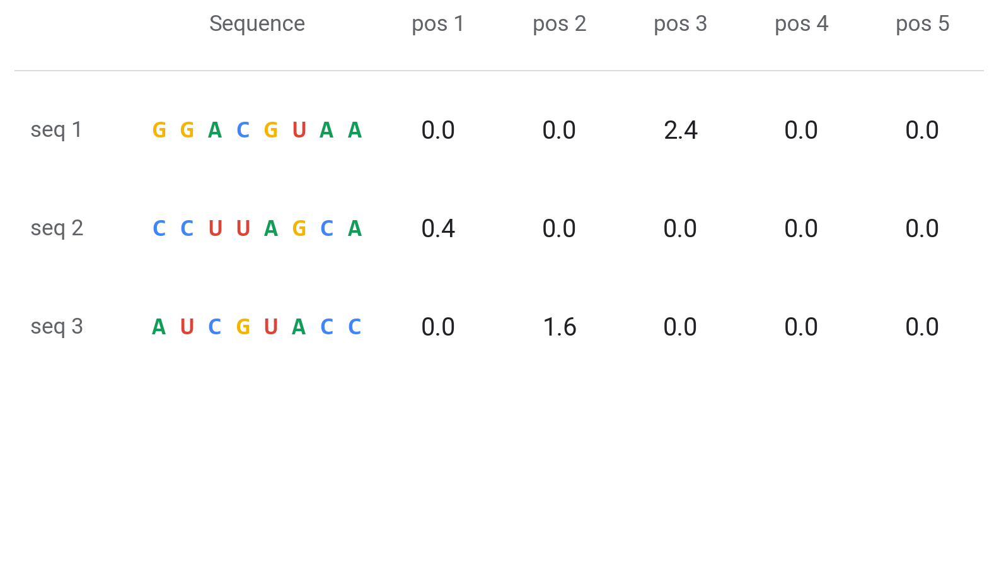{height="742px"}

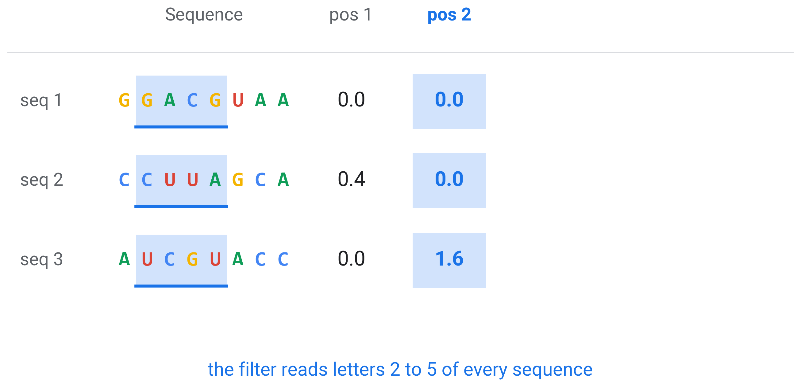{.fragment height="742px"}
:::

::: {.notes}
- The toy filter of slide 4.2, on three sequences: its output at each of the 5 positions of each sequence.
- We do not read the weights; we watch the filter work. A high output means the filter met a window it likes.
- Click: a filter's **cutoff** sits halfway between its mean output and its maximum, over all sequences and positions. Every position above it is a hit; here two of the 15.
- The hits are the 4 letters starting at that position: ACGU in sequence 1 and UCGU in sequence 3.
:::

## 5.2 From hits to a logo

PWM: position weight matrix, the frequency of each letter at each position

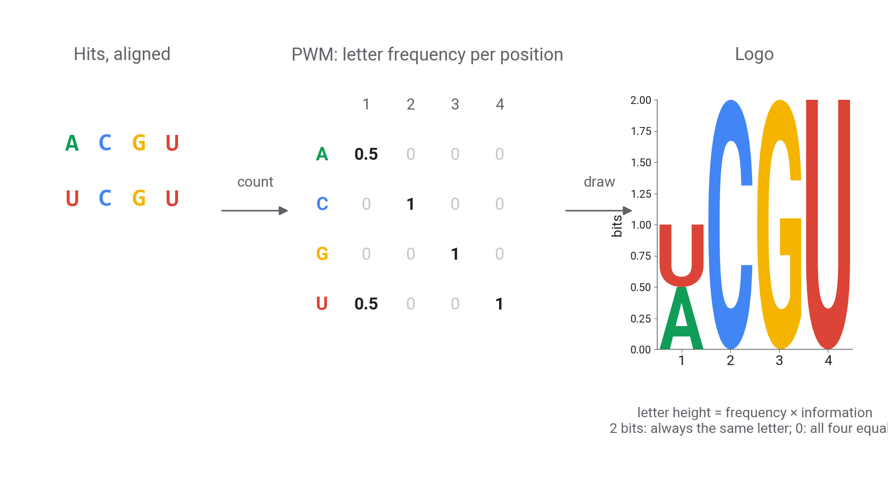{fig-align="center" height="684px"}

::: {.notes}
- The hits are aligned: both start where the filter fired, so their first letters correspond. Stack them and count the letters at each position: the position weight matrix (PWM).
- The logo draws the PWM as letters. A letter's height is its frequency times the information at that position: 2 bits when the position always has the same letter, 0 when all four are equally frequent.
- Position 1 is A half the time and U half the time, so it carries 1 bit; positions 2 to 4 always have the same letter, 2 bits.
- With a real filter there are thousands of hits instead of two.
:::

## 5.3 Filter 0 of our CNN (TODO-4) {data-todo="TODO-4"}

{fig-align="center" height="640px"}

::: {.notes}
- Left: filter 0's 40 weights (blue positive, orange negative). Right: its logo, built from the roughly 25,000 windows in bound sequences whose output is above the cutoff. The notebook's count differs slightly because it scans a different subset.
- The notebook's helpers are the steps of the last two slides: `cutoff_for` sets the cutoff, `windows_above` collects the 10-letter windows above it, and `pwm_of` counts the letters at each position. TODO-4a runs them on filter 0 step by step, then `consensus_of` reads off the most frequent letter at each position; TODO-4b repeats the steps for every filter.
- A logo shows which windows activate a filter. It leaves out the letters the filter penalises (its negative weights).
:::

## 5.4 Test a logo: insert it into random RNA (TODO-5) {data-todo="TODO-5"}

- Insert one filter's consensus 1 to 7 times. Which control shows that its pattern matters?

{fig-align="center" height="657px"}

::: {.notes}
- Projected: 1 min.
- The bar is a 330-letter random RNA sequence; each box is one inserted copy. `plant(seqs, motif, copies)` writes copy n starting at letter 40 + 45(n − 1), so 7 copies fit. Shaded: letters 150 to 190, where the measured site is in the real data.
- The consensus is the filter's most frequent letter at each position: a candidate motif.
- The question to leave with the room: if the score goes up, is it the pattern or only the letters each copy adds (a U-rich motif adds U letters)? The students design the control in TODO-5b; the notebook states this problem and hints at building it from the motif's own letters.
- The intended control is the same letters in another order, inserted at the same places: the difference between the two curves is then what the letter order adds.
- This turns a logo, which is only a description of what a filter responds to, into an experiment on the whole model's output.
:::

## 5.5 Your turn

Open **`01_cnn.ipynb`** in Colab, select the T4 GPU, run from the top.

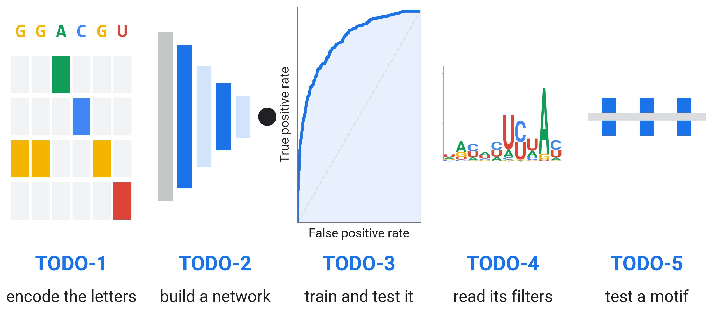{fig-align="center" height="701px"}

::: {.notes}
- TODO-1: `one_hot` and `encode_batch`. TODO-2: build your own network from the parts. TODO-3: `train_step`, `evaluate`, then the ROC curve. TODO-4: filter 0 step by step, then a logo for every filter. TODO-5: one copy in one sequence, design a control, then both curves.
- Helpers for TODO-4: `acts[:, f, :]`, `cutoff_for`, `windows_above`, `pwm_of`; then set `MY_FILTER` and `MY_MOTIF`. TODO-4 ends with choosing a motif. TODO-5 uses `plant`, first on one sequence (TODO-5a), then on all 1,000 (TODO-5b).
- Each TODO has a test cell; the solutions are published on the workshop site during the workshop.

Next, after the break: part 2, DNA foundation models, pretrained on the whole genome.
:::
