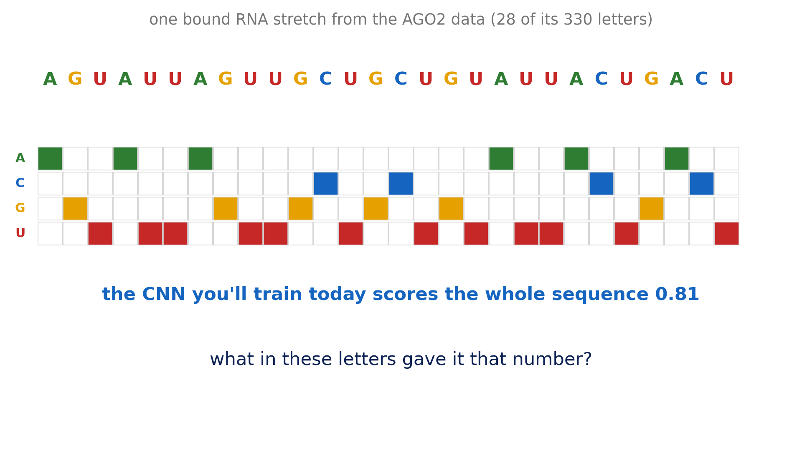
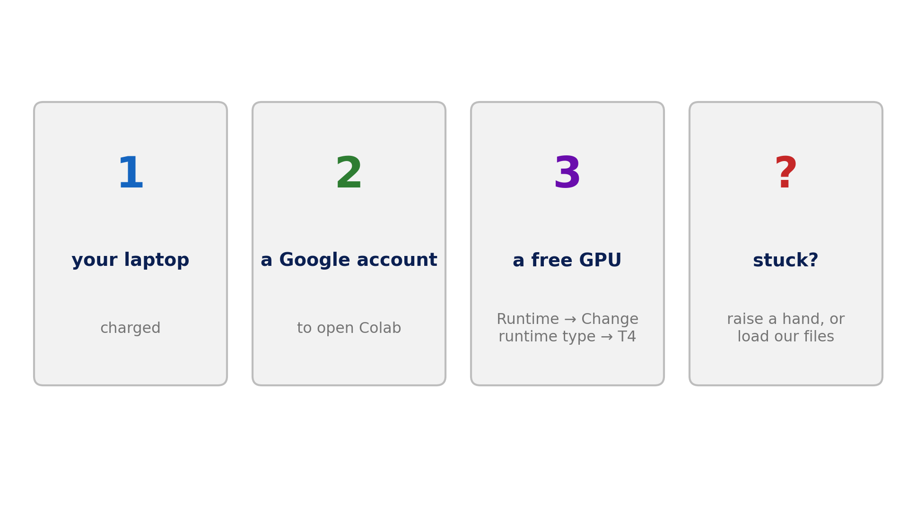
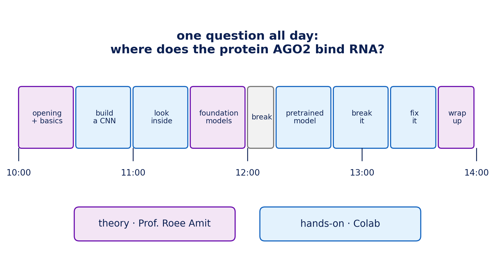
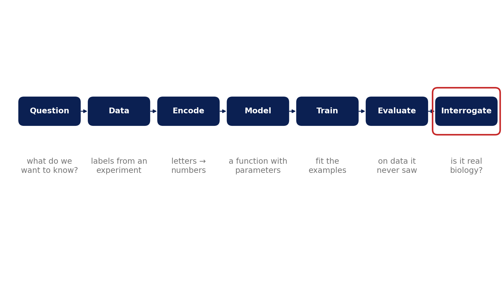
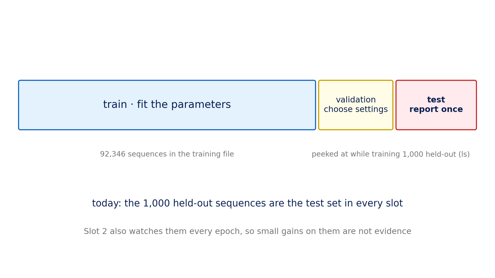

::: {.center}
# 1 Welcome {data-name="Welcome"}
:::

## 1.1 Teaching machines to read DNA

{fig-align="center" height="710px"}

::: {.notes}
**[Mattan] Open with real data**

- 28 letters of one real RNA stretch that the protein AGO2 was found bound to
- below: the same letters as numbers (one column per letter)
- the CNN you'll train in an hour reads all 330 letters and outputs **0.82**
- today's question, for every model we build: **what in the letters gave it that number?**
:::

## 1.2 About me

::: columns
::: {.column width="38%"}
{width="90%"}
:::
::: {.column width="62%"}
{height="480px"}

Mattan Hoory · M.Sc., Roee Amit lab
:::
:::

::: {.notes}
- QA → developer → B.Sc. CS (bioinformatics track) → M.Sc. in Prof. Roee Amit's lab
- TA of 00660121 *Medical Diagnostics*; today is the ML half of that course, compressed
- research: **Triplexis**, predicting where an RNA strand binds DNA as a triple helix: sequence in, "does it bind?" out, same problem shape as today
:::

## 1.3 Goals: [YES]{style="color:green;"}

::: incremental
* **Understand** what happens inside a model that reads sequence: one-hot, filters, embeddings, fine-tuning
* **Read** a result: what a number means, and when a difference is real
* **Test** whether a model learned biology or a shortcut
* **Experiment** with an AI assistant as your coding partner
:::

::: {.notes}
- the intuition is the product; the code is a vehicle
- every hands-on slot ends with a result you have to interpret
:::

## 1.4 Goals: [NO]{style="color:red;"}

* **Code** from scratch
* PyTorch / Hugging Face APIs
* Transformer internals

:::{.footer}
(the code is given or written with an assistant: it is not the main focus)
:::

::: {.notes}
- most code in the notebooks is given; the TODOs are short
- each TODO says exactly what to write, names the functions, and gives the number you should get; ask an AI if you are stuck, and check its answer against that number
- **sit next to someone from the other side**: a coder next to a biologist. Show of hands: who has trained a model? who has held a pipette this year?
:::

## 1.5 What you need

{fig-align="center" height="710px"}

::: {.notes}
- laptop, Google account, Colab with a **T4 GPU**: *Runtime → Change runtime type → T4*
- links: QR / short URL *(fill in once hosted)*
- every notebook can be started on its own: at the end of each one you download your results; at the start of the next you upload them, **or use ours**
- helpers walk the room; raise a hand
:::

## 1.6 Today

{fig-align="center" height="710px"}

::: {.notes}
- purple = Roee, theory · blue = hands-on in Colab
- one data set all day: ~92k RNA stretches where the protein AGO2 did or didn't bind
- arc: build a CNN → look inside → borrow a model pretrained on the genome → try to break both → fix the data
- break at 12:00
:::

## 1.7 One pipeline, all day

{fig-align="center" height="710px"}

::: {.notes}
- each hands-on slot starts by naming which steps it covers
- **Interrogate** = experiments on a trained model (plant a motif, shuffle the letters, change the negatives). It's where most of today's understanding comes from.

*Hand over to Roee.*
:::

::: {.center}
# 2 The biology {data-name="Biology"}
:::

## 2.1 A seven-letter address

{fig-align="center" height="710px"}

::: {.notes}
**[Roee] The one rule to know before any model**

- DNA → messenger RNA → protein. **AGO2** acts on the messenger RNA, after transcription.
- AGO2 carries a short **microRNA** (~22 letters). Letters 2–8, the **seed**, pair with the mRNA (A·U, G·C, read antiparallel). Once AGO2 lands, that mRNA is degraded or not translated, so less protein is made.
- above: a real bound stretch from our data carrying the miR-16 site **UGCUGCU**
- why it matters:
  - more than 60% of human protein-coding genes carry conserved microRNA sites (Friedman et al., *Genome Res* 2009)
  - a single-letter variant in a site can create or destroy regulation (e.g. a let-7 site in *KRAS*, Chin et al., *Cancer Res* 2008)
  - siRNA drugs (e.g. patisiran, 2018) work by loading into AGO2
- why predict what we can measure: an experiment covers one cell type and one condition; a model can score unmeasured transcripts, variants and designed sequences, **if it learned the rule**
- **hypothesis for the day:** a good model should respond to seed sites like this one. Slot 3 tests it.
:::

## 2.2 The data

{fig-align="center" height="710px"}

::: {.notes}
**[Roee] What the model sees: 150 bound and 150 unbound sequences, one row each, one pixel per letter**

- **bound** (positives, ~48k): stretches where a CLIP-seq experiment found AGO2. Each is ~330 letters, with the measured ~40-letter site in the middle (letters 150–190) and context on both sides.
- **unbound** (negatives, ~44k): stretches cut the same way from places the experiment did not flag. **A person chose them.**
- look closely: the bound block is slightly richer in A/U (mean G+C 0.42 vs 0.46 in these 150; 0.41 vs 0.45 over all 92k). That's not AGO2; it's where the negatives came from. It comes back in Slot 6.
- *Dodge: how CLIP-seq works ("crosslink, pull down AGO2, sequence what's stuck").*
:::

::: {.center}
# 3 Learning and testing {data-name="ML"}
:::

## 3.1 What training does

{fig-align="center" height="710px"}

::: {.notes}
**[Roee] The smallest possible model on our data: two features per sequence (G+C fraction, U fraction)**

- **model:** $h_\theta(x) = \sigma(w^\top x + b)$, a probability of "bound". The red line is where it equals 0.5.
- **parameters** $\theta = (w, b)$: here just three numbers. The Slot 2 CNN has 2,491; the genome models have millions to billions.
- **loss:** how wrong the probabilities are (binary cross-entropy). 0.693 = coin flip.
- **training:** compute the gradient, nudge $\theta$ downhill, repeat. Watch the line turn and the loss drop.
- the loss stops at ~0.67: two numbers carry a little information, not much. Slot 6 measures exactly how much.
- *the sigmoid* $\sigma$ squashes any score into (0, 1). Every model today ends with it.
:::

## 3.2 Train, validate, test

{fig-align="center" height="710px"}

::: {.notes}
**[Roee] Never grade a model on what it trained on**

- **train:** fit the parameters · **validation:** choose settings · **test:** report once
- today the **1,000 held-out sequences** (the `ls` file) play the test set in every slot
- honest caveat: Slot 2 prints the held-out AUROC every epoch, so we are also *looking* at it while training. Fine for a workshop, as long as we don't pick the best epoch by it; in a real project that is the validation set's job.
- *if asked, the DNA trap:* genomes are full of near-copies (gene families, overlapping windows); a random split can put near-twins on both sides and inflate the score. Real projects split by gene or chromosome.
:::

::: {.center}
# 4 Reading a result {data-name="Results"}
:::

## 4.1 AUROC

{fig-align="center" height="710px"}

::: {.notes}
**[Roee] The one number you'll read all day: real scores of the CNN on the 1,000 test sequences**

- left: the model's score for each bound (green) and unbound (grey) sequence
- pick any threshold → a true-positive rate and a false-positive rate → one point on the right
- **AUROC = area under that curve = the chance that a random bound sequence scores higher than a random unbound one**
- 0.5 = coin flip · 1.0 = perfect · this CNN: 0.86
- it ignores the threshold, so it compares models fairly; it says nothing about *why*
- for the Medical Diagnostics crowd: the same ROC as a diagnostic test (sensitivity vs 1 − specificity)
:::

## 4.2 How big is a difference?

{fig-align="center" height="710px"}

::: {.notes}
**[Roee] Before comparing two numbers, ask how much they move by chance**

- resample the 1,000 test sequences with replacement 2,000 times → the bar is where 95% of the AUROCs land
- on 1,000 sequences: about **±0.025**
- CNN 0.86 vs genome-model probes 0.78–0.79: separate bars, a real gap
- Mistral-DNA 0.78 vs Nucleotide Transformer 0.79: overlapping bars, **no evidence of a difference**, despite 30× more parameters
- the bars are for one model at a time. Two models scored on the **same** 1,000 sequences make correlated errors, so their *difference* moves less than the bars suggest (a paired bootstrap measures it). Overlapping bars = no evidence; it is not proof of equality.
- rule of thumb for today: on 1,000 test sequences, differences below ~0.03 are noise; on 3,000 (Slot 7), below ~0.02
:::

## 4.3 Fit vs held-out

{fig-align="center" height="710px"}

::: {.notes}
**[Roee] The same probe scored two ways (real embeddings from Slot 5)**

- left: 12,000 training sequences, sensible regularisation: 0.82 on what it saw vs 0.78 held out. A small gap is normal.
- right: only 600 sequences, almost no regularisation: **1.00** on what it saw, 0.66 held out. It memorised.
- **only the held-out number means anything.** This is the first check to run on any AI-written evaluation code: *which data was the score computed on?*

*Next: Slot 2, build the CNN.*
:::
