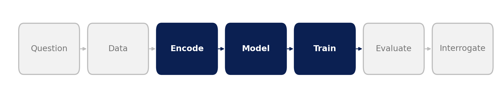
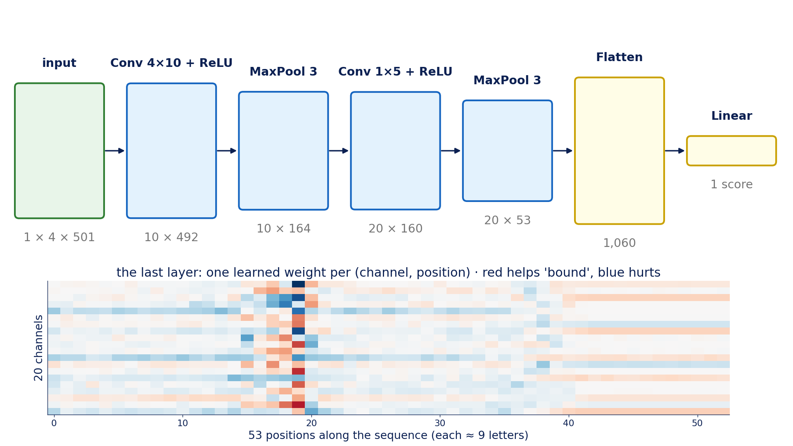
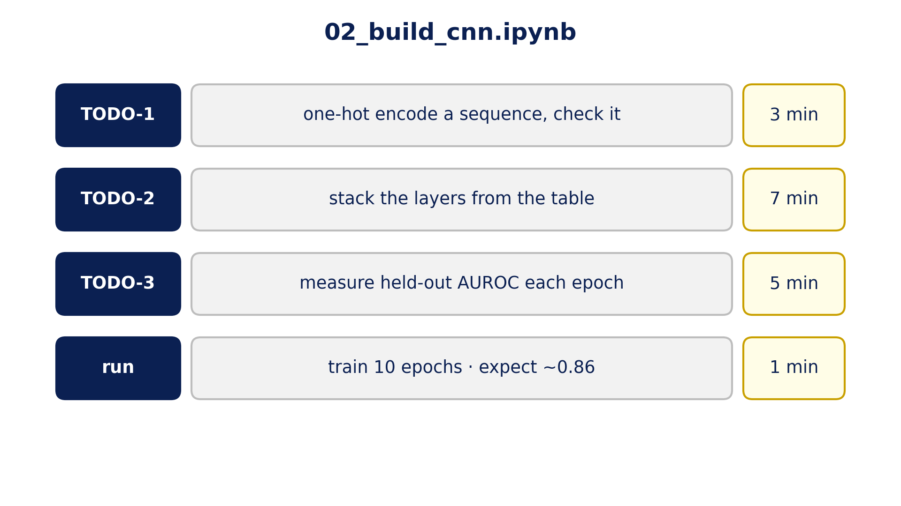

::: {.center}
# 1 Build {data-name="Build"}
:::

## 1.1 Letters become a matrix

{fig-align="center" width="85%"}

{fig-align="center" height="520px"}

::: {.notes}
**Encode · Model · Train: a model that reads RNA, trained on our data only**

- one-hot: each letter → a column with a single 1 in its row (A, C, G, U)
- a sequence → a **4 × 501** matrix (padded; padding columns are 0.25 = "unknown letter")
- **TODO-1:** encode one sequence and check the columns against its letters
- *if asked:* why not A=1, C=2, G=3, U=4? That invents an order (G "bigger" than C) that biology doesn't have.
:::

## 1.2 A filter is a dot product

{fig-align="center" height="710px"}

::: {.notes}
**A real learned filter from the trained CNN, on a real window**

- a filter = **4 × 10 weights**, one per (letter, position)
- one-hot window × weights → only the weights of the letters present survive → **sum + bias = the filter's output** at that position
- the same 40 weights slide along all 501 positions
- this filter fires hardest on U-rich windows, and only 1.07× more on bound than unbound RNA: keep that in mind for Slot 6
:::

## 1.3 Sliding along one sequence

{fig-align="center" height="710px"}

::: {.notes}
- the same filter's output at every position of one bound sequence
- mostly near zero (after ReLU, negatives become 0), a few sharp hits where the window resembles the weights
- **ReLU** = keep positive values, zero the rest: a filter either fires or it doesn't
:::

## 1.4 The whole network (TODO-2)

{fig-align="center" height="710px"}

::: {.notes}
**Real shapes, left to right** (TODO-2: stack these in order)

- `Conv2d(1, 10, (4, 10))` + **ReLU**: 10 filters → 10 × 492
- `MaxPool2d((1, 3))`: keep the strongest hit in each 3 → 10 × 164
- `Conv2d(10, 20, (1, 5))` + **ReLU**: combinations of hits → 20 × 160
- `MaxPool2d((1, 3))` → 20 × 53 · `Flatten` → 1,060 · `Linear(1060, 1)` → one score
- the heatmap is the trained last layer: **one weight per (channel, position)**. The weights concentrate around positions 15–20 (letters ≈ 135–180), the middle of the sequence, where the measured site sits. The CNN learned *where* to look. Slot 3 shows the consequence.
- no sigmoid inside the network: the loss applies it
:::

## 1.5 Training: what changes

{fig-align="center" height="710px"}

::: {.notes}
**One filter at epochs 0, 1, 3, 10 of a real training run**

- epoch 0: random numbers, AUROC 0.58
- by epoch 10: a clear preference (here: avoid G at several positions), AUROC 0.86
- one training step = four lines: `opt.zero_grad()` · `loss = criterion(model(X), y)` · `loss.backward()` · `opt.step()`
- measuring = `model.eval()` + `torch.no_grad()`: score without learning
- **TODO-3** writes the measuring part: sigmoid → probabilities → `roc_auc_score`
:::

## 1.6 Your turn

{fig-align="center" height="710px"}

::: {.notes}
**Open `02_build_cnn.ipynb` → Runtime → T4 GPU → run top to bottom**

- given cells: just run · `# TODO-N`: write the code between the markers (yourself or with an assistant)
- expect ~0.85 after 5 epochs, ~0.86 after 10 (~4 s per epoch on a T4)
- **reading your result:** on 1,000 test sequences about ±0.025 is noise; 0.85 vs 0.86 is the same model
- done early: change `EPOCHS`
- **last cell:** download `my_cnn.pt` (Slot 3 can use it, or ours)
:::

## 1.7 Training curve, reference run

{fig-align="center" height="710px"}

::: {.notes}
- show after they've run it: 0.79 → 0.85 → 0.86; three seeds land within 0.01
- most of the learning happens in the first 2–3 epochs

> Next: 0.86. **What did it learn?**
:::
