::: {.center}
# 1 From sequence to prediction {data-name="Overview"}
:::

## 1.1 Pretraining, by analogy

::: {.r-stack}
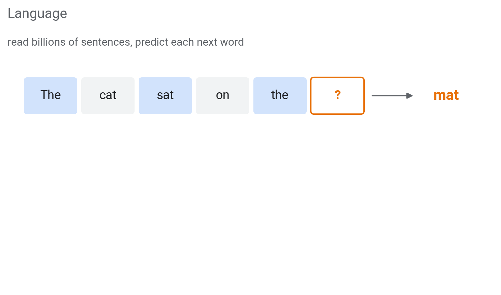{height="742px"}

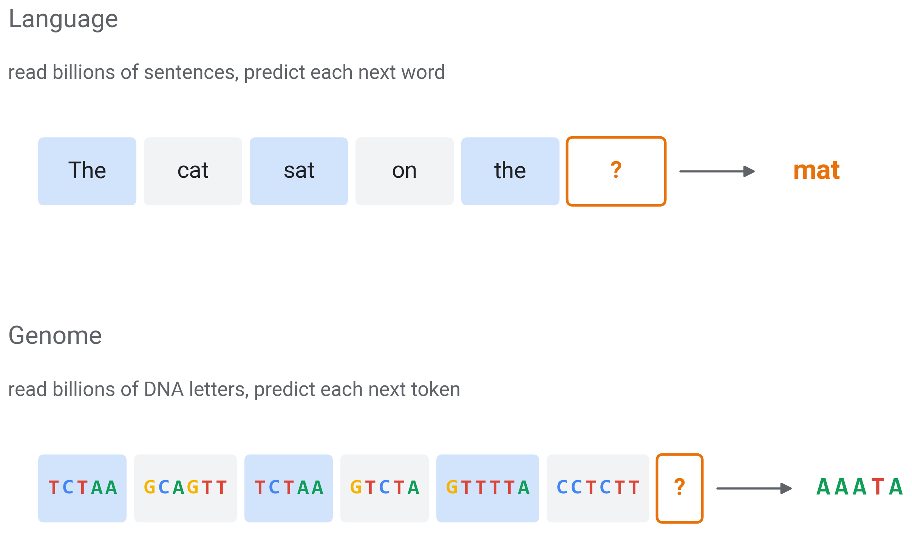{.fragment height="742px"}
:::

::: {.notes}
- A language model reads billions of sentences and learns to predict each next word. No one labels anything: the text supplies its own answers.
- To get "mat" right, a model has to learn grammar, which words go together, something about cats. That knowledge is the point of pretraining.
- Click: a DNA language model does the same on genome sequence. The bottom row is real: the last tokens of a real sequence from our data, cut into Mistral-DNA's tokens, and the token that follows.
- To predict the next token well, it has to learn which stretches of DNA occur together, and that may include signals that matter for our task.
:::

## 1.2 Pretraining a model

::: {.r-stack}
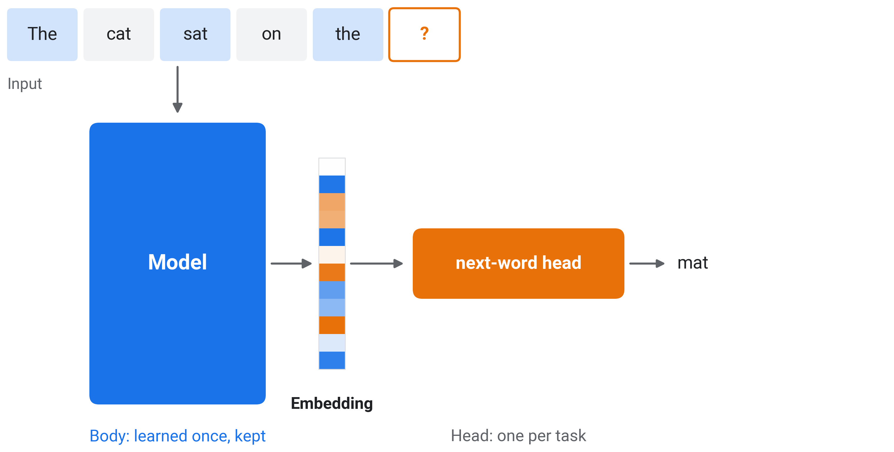{height="742px"}
:::

::: {.notes}
- The same sentence as the last slide. The model is a stack of layers, the **body**. It turns the words into an **embedding**: a vector of numbers that represents the input, in context.
- A small output layer, the **head**, reads the embedding and predicts the next word.
- Pretraining trains the body and the head together on billions of sentences, with no labels: the text supplies its own answers.
- The embedding here is drawn, not computed. On the DNA version (next slide, last clicks) it is real.
:::

## 1.3 One model, many tasks

::: {.r-stack}
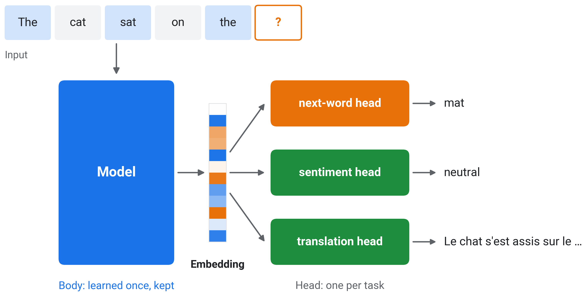{height="742px"}

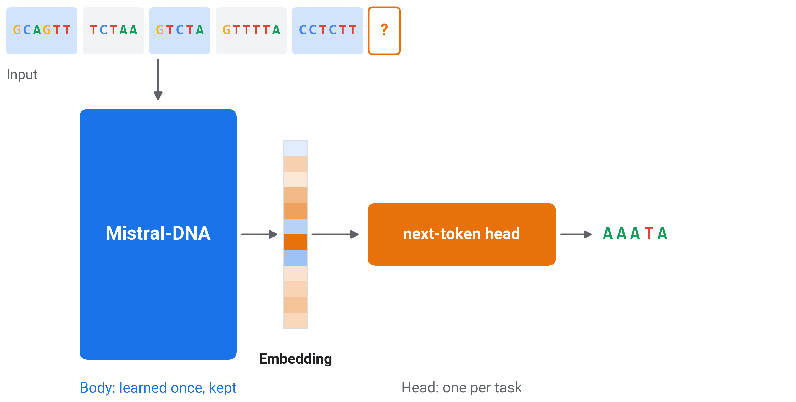{.fragment height="742px"}

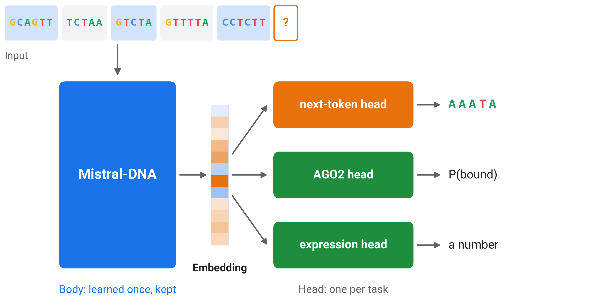{.fragment height="742px"}
:::

::: {.notes}
- The body is learned once and kept. Each new task gets its own small head on the same embedding: sentiment, translation and many more.
- A new task needs far fewer labelled examples than training a model from scratch, because the body already captures much of the language. This is a **foundation model**: pretrain once, adapt many times.
- Click: the same for DNA. Mistral-DNA (16M parameters) was pretrained on the human genome to predict the next token. The input is the end of a real sequence from our data, cut into Mistral-DNA's tokens, and the embedding is Mistral-DNA's real output for its last token (the first 12 of 256 numbers).
- Click: new heads for new tasks. Ours predicts AGO2 binding; others predict expression levels, splice sites, and so on.
- The claim to test in parts 2 and 3: what a model learns in pretraining transfers, so each task needs fewer labels.
:::

## 1.4 Two pretraining objectives

::: {.r-stack}
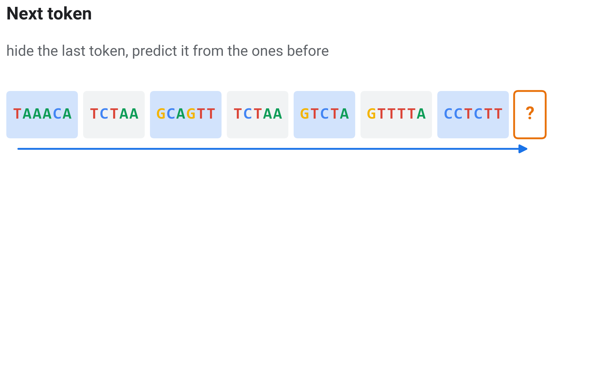{height="723px"}

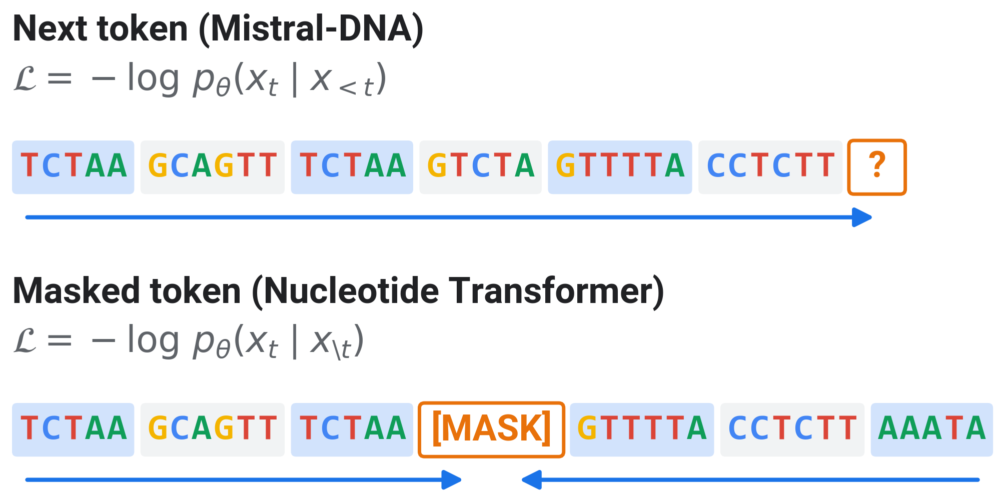{.fragment height="723px"}
:::

::: {.notes}
- Top: the end of a real sequence from our data, cut into Mistral-DNA's tokens, with the next one hidden; the equation is the loss. Next-token models (Mistral-DNA, HyenaDNA, Evo) predict each token from the tokens before it. $x_t$ is the token at position $t$; $x_{<t}$ the tokens before it.
- Click: masked models (Nucleotide Transformer, DNABERT-2) hide about 15% of the tokens and predict each from the tokens on both sides. $x_{\setminus t}$ is all tokens except the hidden ones.
- Both losses are the cross-entropy of part 1: minus the log of the probability the model gives the true token.
- In both, the genome supplies its own targets, so no experimental labels are needed.
:::

## 1.5 What the model predicts

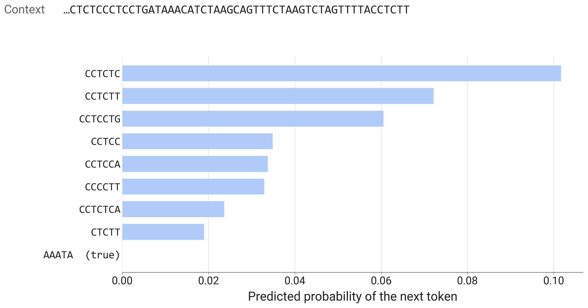{fig-align="center" height="766px"}

::: {.notes}
- Mistral-DNA, given the real context of the last slide, gives a probability to each of its 4,096 possible next tokens. Blue: its six most likely tokens, with their probabilities. Orange: the token that actually comes next, AAATA.
- Its top choice gets 0.10. The true token gets less than 0.0001 and ranks 2,362 of 4,096: the model was wrong here.
- Much of the genome is hard to predict from local context, so the loss stays high even in a trained model.
- The head turns one score per vocabulary token into these probabilities with the softmax (section 5).
:::

## 1.6 Four stages

::: {.r-stack}
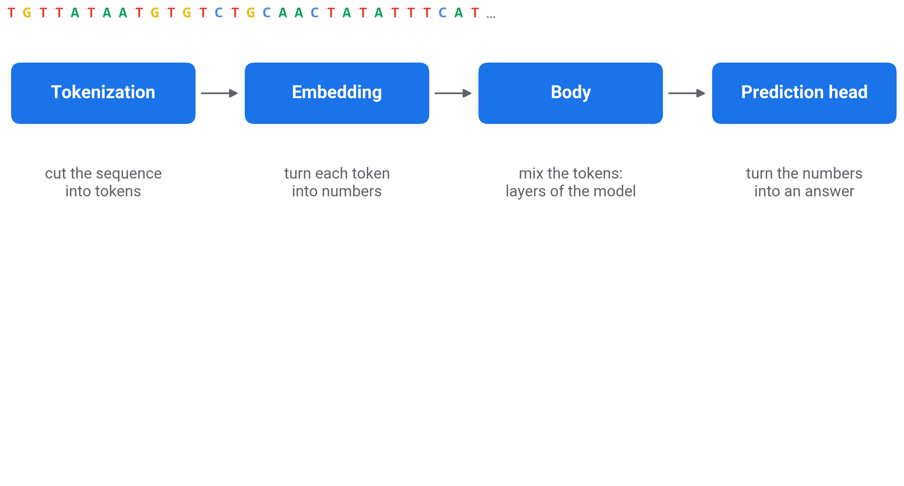{height="742px"}

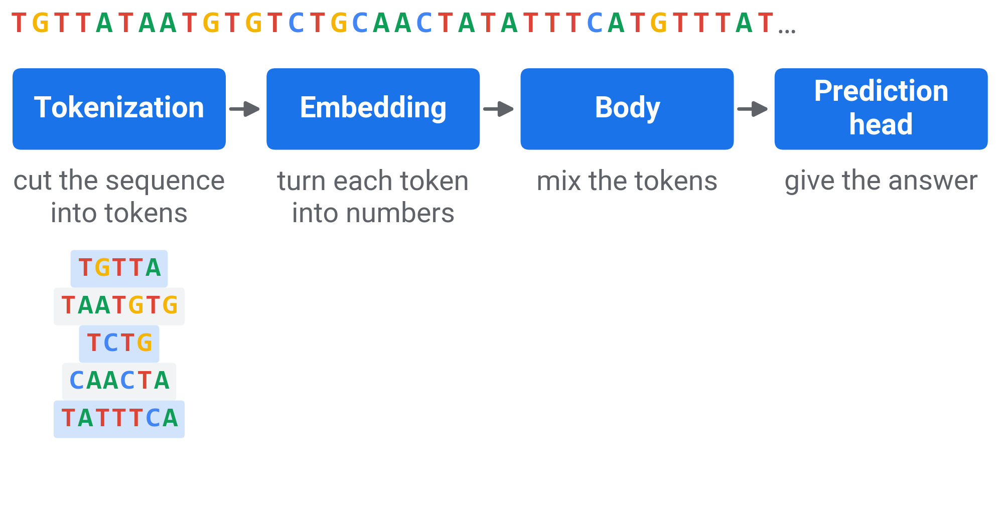{.fragment height="742px"}

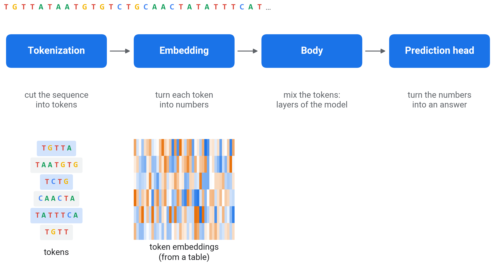{.fragment height="742px"}

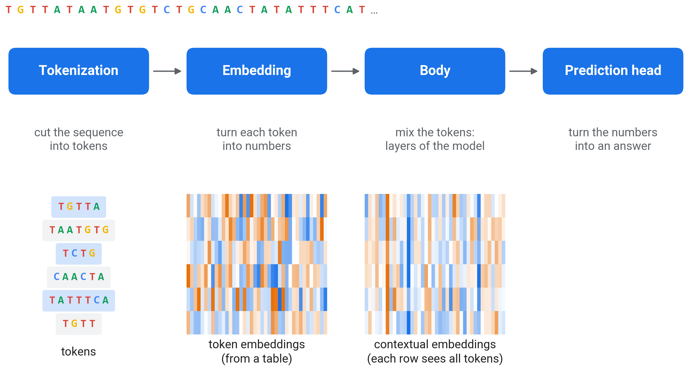{.fragment height="742px"}

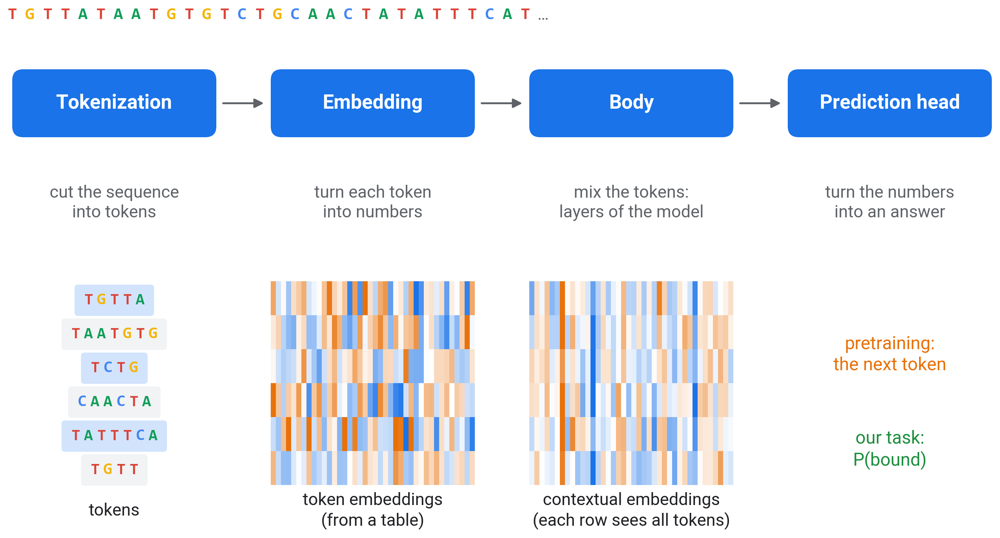{.fragment height="742px"}
:::

::: {.notes}
- These four stages describe most sequence models in use today. This part goes through them in order.
- The example is real: Mistral-DNA on the first 40 letters of one bound sequence (its first 6 tokens shown). One click per stage.
- Click, tokenization: the letters are cut into tokens (section 2).
- Click, embedding: each token becomes a row of 256 numbers taken from a learned table, its **token embedding** (section 3; the first 40 numbers shown). The same token always gets the same row.
- Click, body: the transformer turns them into **contextual embeddings**: still one row per token, but now each row depends on all the tokens (section 4). These are the embeddings of slide 1.2.
- Click, head: in pretraining it predicts the next token; for our task, P(bound), the probability that AGO2 binds (section 5).
:::

::: {.center}
# 2 Tokenization {data-name="Tokens"}

{height="141px"}
:::

## 2.1 Single letters

- A vocabulary of 4: each letter is a token, as in the CNN

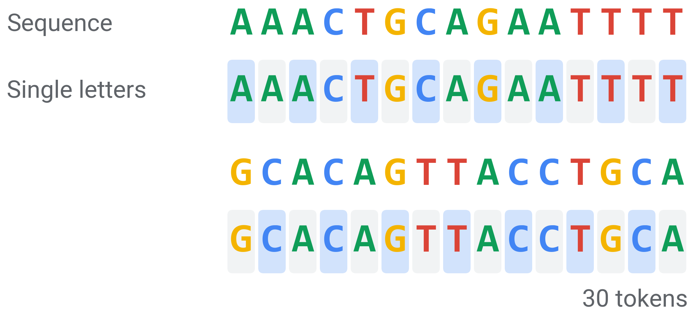{fig-align="center" height="655px"}

::: {.notes}
- Projected: 1 min.
- The figure and the next two: the same 30 letters of a real bound sequence, one box per token, with the token count on the right.
- A 330-letter sequence is 330 tokens. Every position is kept, but the model has to learn from scratch which letters belong together.
- Some genome models (HyenaDNA, Evo) also read single letters, which needs a model that can handle long inputs: a 1,000-letter sequence is 1,000 tokens.
:::

## 2.2 k-mers

- Fixed words of 6 letters, a vocabulary of $4^6 = 4{,}096$ (Nucleotide Transformer, NT)

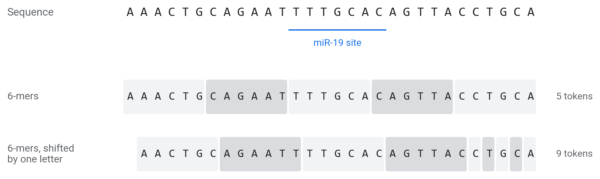{fig-align="center" height="655px"}

::: {.notes}
- Projected: 1 min.
- The models read DNA letters, so U becomes T. This is the same stretch of a real bound sequence from our data, cut into Nucleotide Transformer's 6-mer tokens.
- Shift the sequence by one letter and every token changes.
- A sequence of n letters becomes about n / 6 tokens, so the model can read six times more sequence for the same cost.
:::

## 2.3 Byte-pair encoding (BPE)

::: {.r-stack}
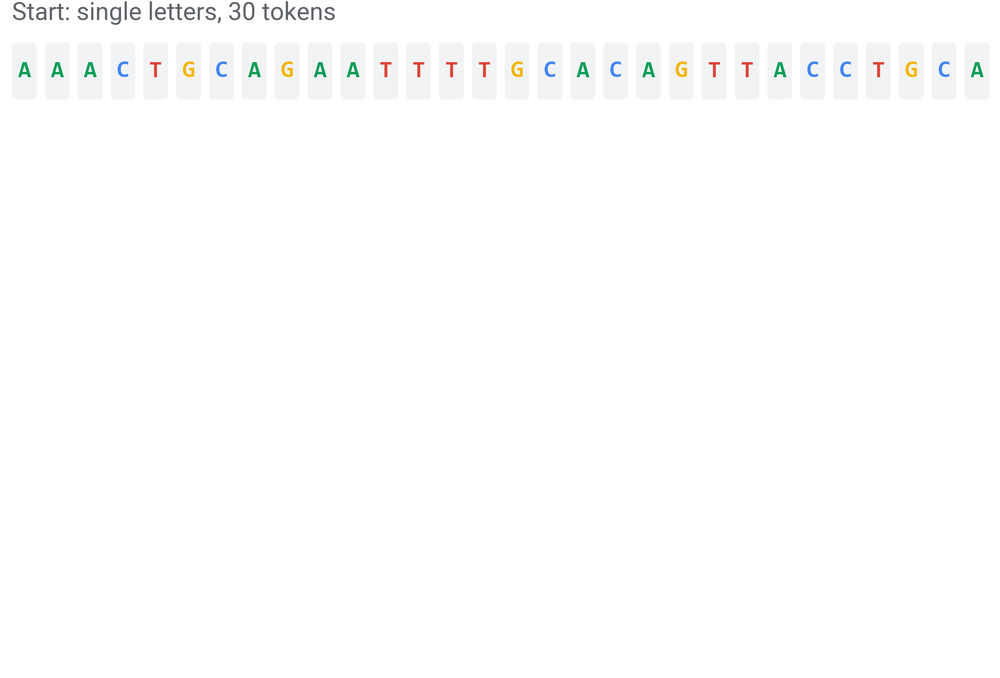{height="742px"}

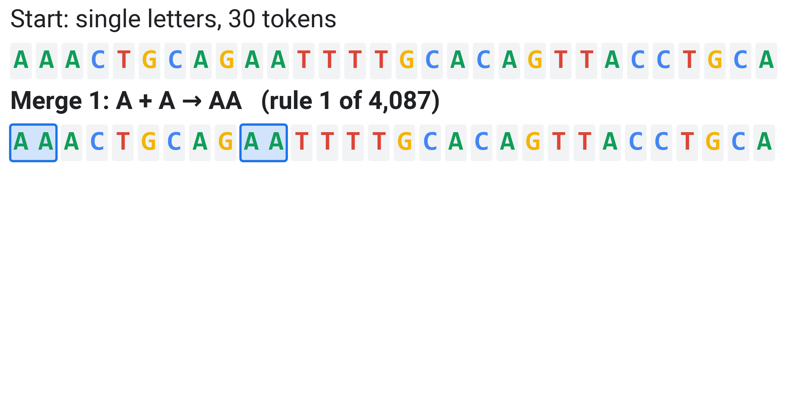{.fragment height="742px"}

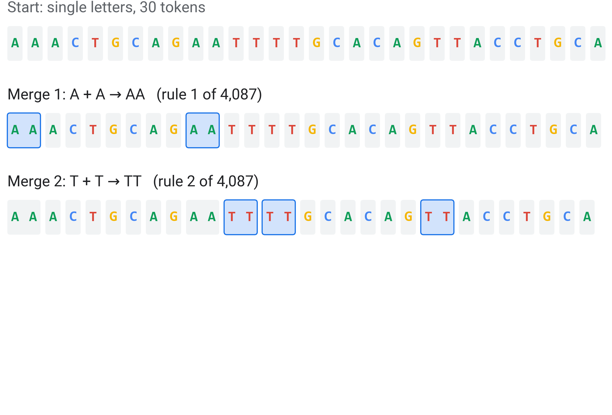{.fragment height="742px"}

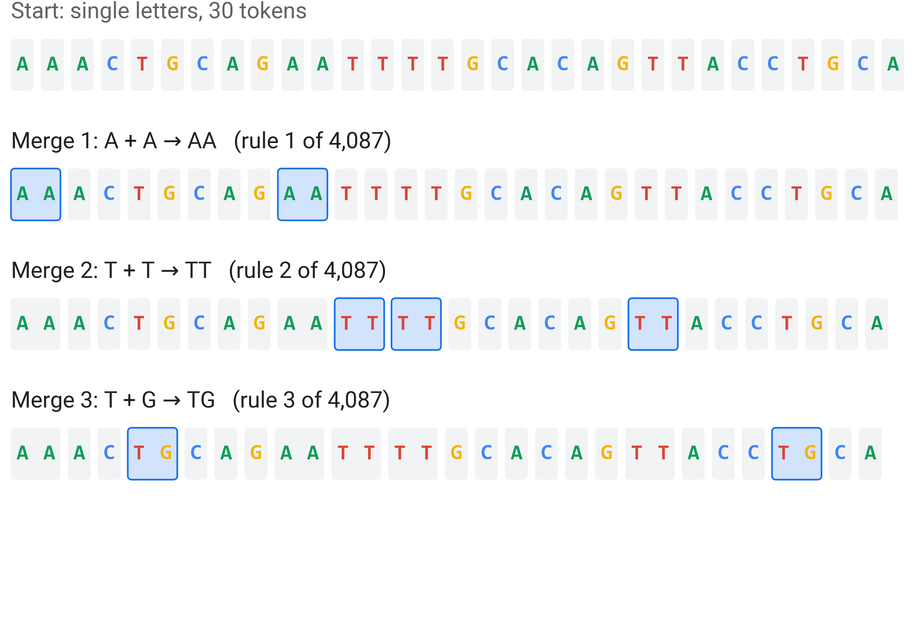{.fragment height="742px"}

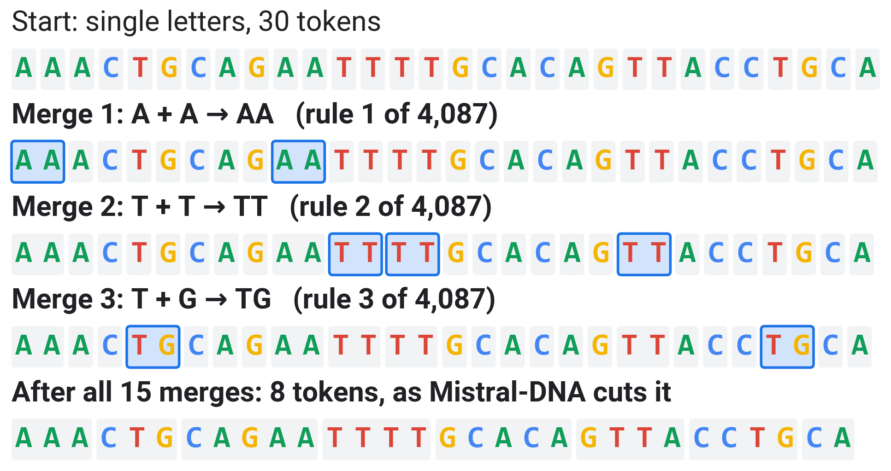{.fragment height="742px"}
:::

::: {.notes}
- Start from single letters; merge the most frequent neighbouring pair into a new token, and repeat. The rules are learned once, on the genome: count every pair of neighbouring tokens, merge the most frequent pair into a new token, and repeat until the vocabulary is full. Mistral-DNA has 4,087 merge rules.
- To cut a new sequence, the rules are applied in the order they were learned. These are Mistral-DNA's real rules, on the same 30 letters as the last two slides.
- Click: rule 1, A + A → AA, the most frequent pair in the genome. Click: rule 2, T + T → TT. Click: rule 3, T + G → TG.
- Click: after all 15 rules that apply to these letters, 8 tokens, exactly what Mistral-DNA's tokenizer gives.
- Frequent stretches become one token and rare ones stay short, so token lengths vary. DNABERT-2 also uses BPE.
:::

## 2.4 Batches: padding and the mask

- Sequences in a batch are padded to the same number of tokens; the **attention mask** marks the real ones

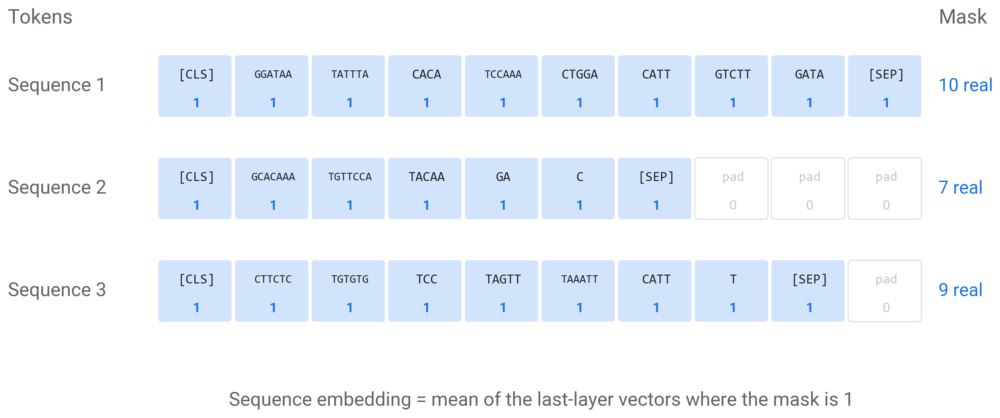{fig-align="center" height="591px"}

::: {.notes}
- Three real bound sequences (22, 31 and 40 letters, in DNA letters as the model reads them), tokenized together. Each row is one sequence; each cell one token, with its mask value below it.
- `[CLS]` and `[SEP]` are special tokens the tokenizer adds at the start and end. Shorter sequences are filled with padding tokens up to the longest one in the batch.
- The mask is 1 for real tokens (including `[CLS]` and `[SEP]`) and 0 for padding. The model uses it to ignore padding, and the sequence embedding averages the last-layer vectors only where it is 1.
- Without the mask, the padding vectors enter the average, and the same sequence gets a different embedding depending on which batch it is in.
:::

::: {.center}
# 3 Embedding {data-name="Embedding"}

{height="141px"}
:::

## 3.1 Token embeddings

- Token $i$ becomes row $i$ of a learned table $E$: $\;e_i = x_i^\top E$

::: {.r-stack}
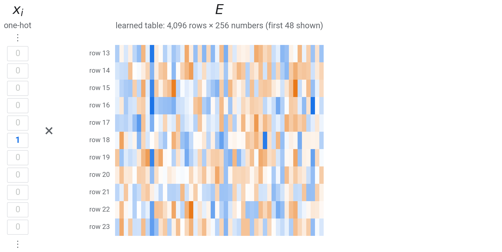{height="640px"}

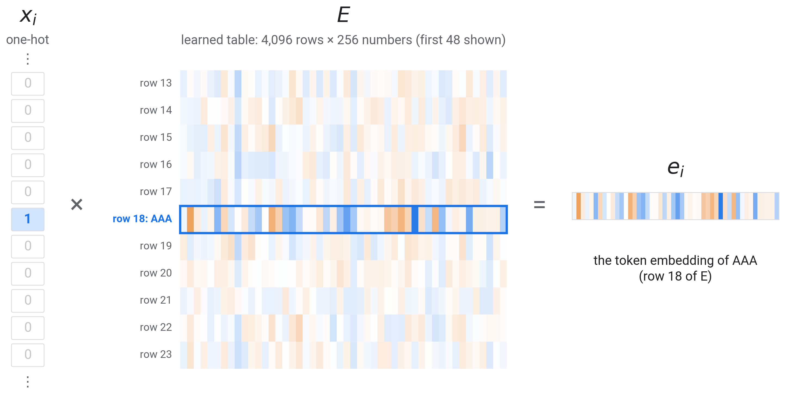{.fragment height="640px"}

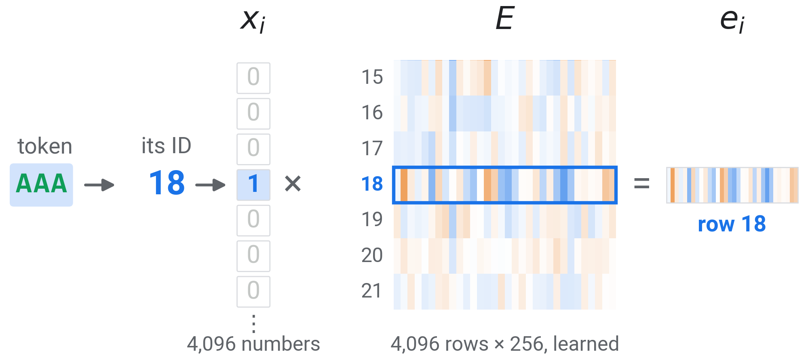{.fragment height="640px"}
:::

::: {.notes}
- Where $x_i$ comes from: the tokenizer gives each token its ID, its position in the 4,096-token vocabulary. AAA is ID 18. These IDs are the `input_ids` the tokenizer returns in the notebook.
- Click: $x_i$ is the one-hot vector of that ID: 4,096 numbers, all 0 except a 1 at position 18. It is drawn as a column, each entry next to the row of $E$ it multiplies.
- Click: $E$ is Mistral-DNA's real table, 4,096 rows of 256 numbers (rows 15 to 21 and the first 32 numbers shown; blue positive, orange negative). Multiplying by the one-hot vector keeps only row 18: the **token embedding** $e_i$ of AAA.
- So an embedding layer is a table lookup. The CNN's one-hot encoding is the same lookup with a fixed 4 × 4 identity table: nothing learned.
- The table is learned during pretraining, so tokens that occur in similar contexts end up with similar rows.
:::

::: {.center}
# 4 The transformer {data-name="Transformer"}

{height="141px"}
:::

## 4.1 The body, as a black box

- One row in per token, one row out; each row out depends on all the tokens

::: {.r-stack}
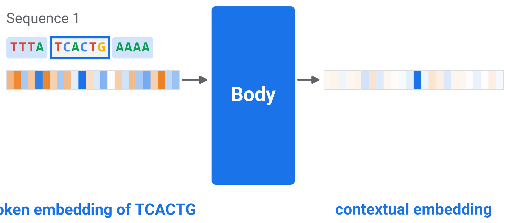{height="631px"}

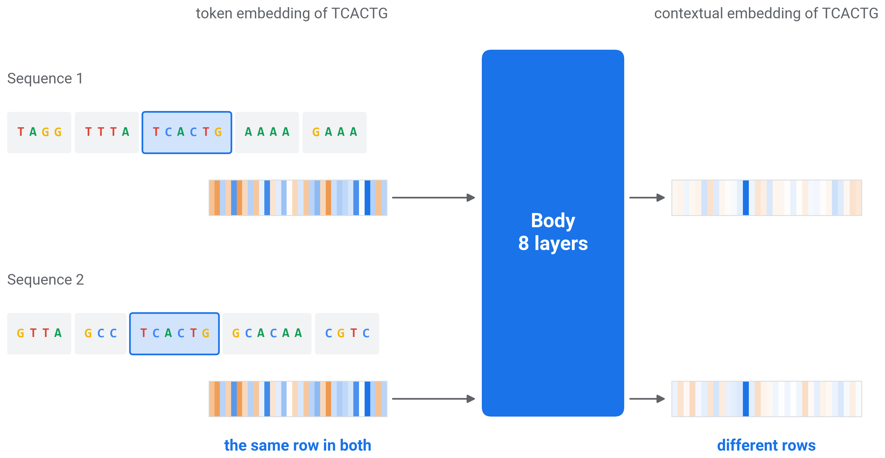{.fragment height="631px"}
:::

::: {.notes}
- The token TCACTG in a real bound sequence (highlighted). Its token embedding, from the table, goes into the body; out comes its **contextual embedding** (first 32 of 256 numbers shown).
- Click: the same token in a second real sequence. The row going in is identical, because the table has one row per token. The rows coming out differ: inside the body, each token's row is updated with information from the other tokens (attention).
- Mistral-DNA's body: 8 layers, 256 numbers per token, up to 512 tokens. Attention alone does not see token order, so the model also adds position information (Mistral-DNA rotates each row by an angle that depends on its position).
- We do not open the layers today. For the exercise we need only the last layer's output.
- The CNN's convolutions see a 10-letter window and a few pooled neighbours; a transformer layer can relate any two tokens in the input.
:::

## 4.2 The whole pipeline on one sequence {data-todo="TODO-1"}

::: {.r-stack}
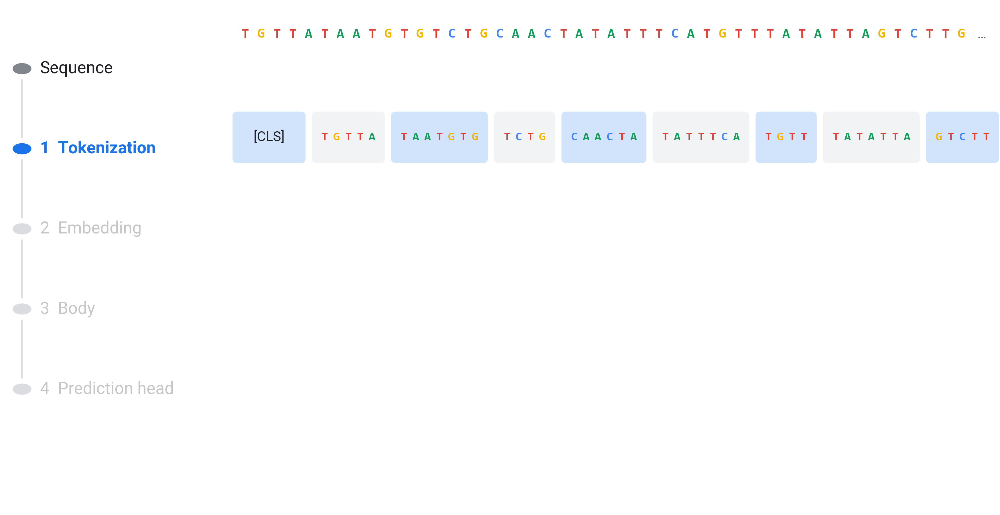{height="742px"}

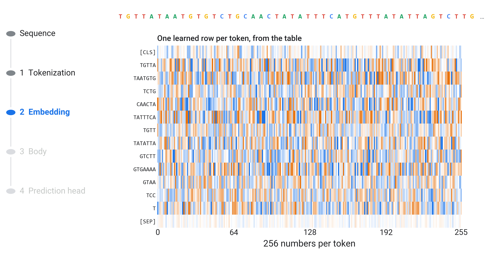{.fragment height="742px"}

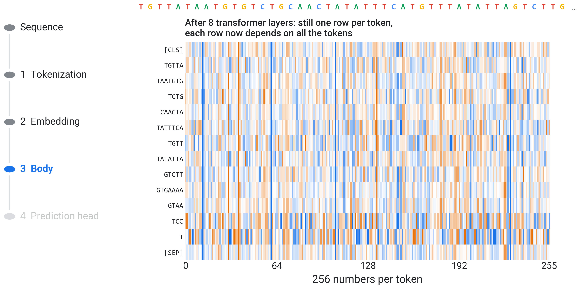{.fragment height="742px"}

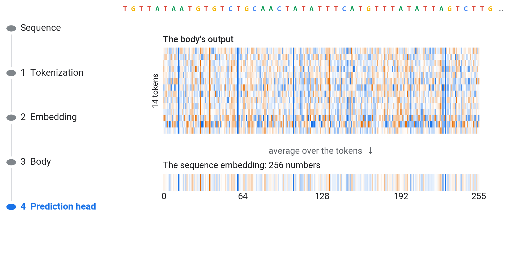{.fragment height="742px"}

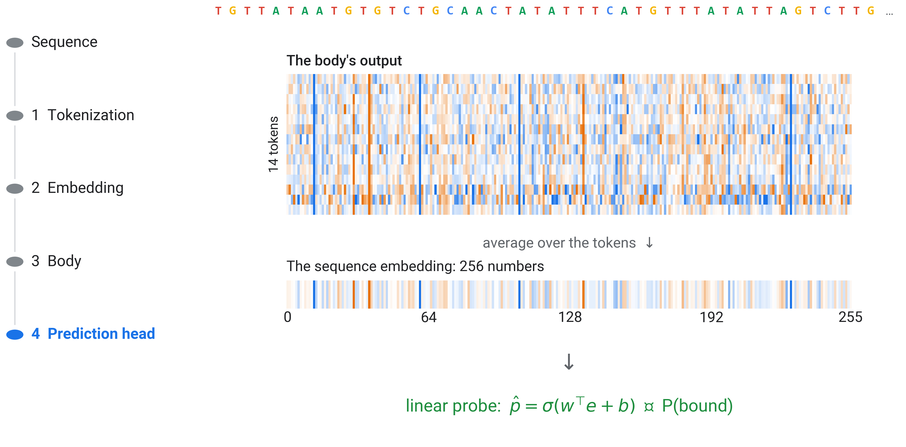{.fragment height="742px"}
:::

::: {.notes}
- Mistral-DNA on the first 60 letters of one real sequence; the left column shows where we are in the pipeline.
- 1 Tokenization: the letters become 14 tokens, with the special tokens `[CLS]` and `[SEP]` added at the start and end (they are not DNA).
- 2 Embedding: each token picks its row of the learned table: one row of 256 numbers per token (blue positive, orange negative).
- 3 Body: after the 8 transformer layers there is still one row per token, but each row now depends on every token of the sequence.
- 4 Prediction head: average the rows over the real tokens, the **sequence embedding**, 256 numbers. In a batch the attention mask keeps padding out of this average (slide 2.4).
- Then a prediction head turns those 256 numbers into P(bound), the probability that AGO2 binds (section 5); you train it in TODO-2.
- A few dimensions are large for almost every token (the vertical stripes). That is common in transformer models and does not depend on the sequence.
:::

## 4.3 In the CNN and in a DNA language model

::: {.r-stack}
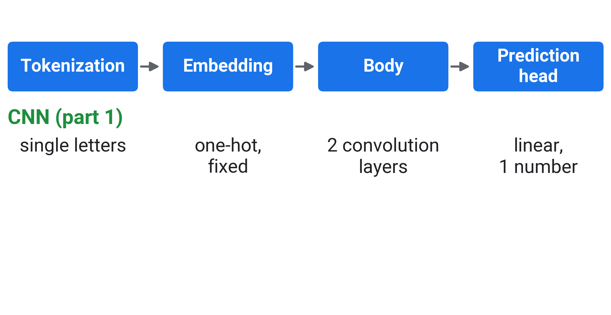{height="742px"}

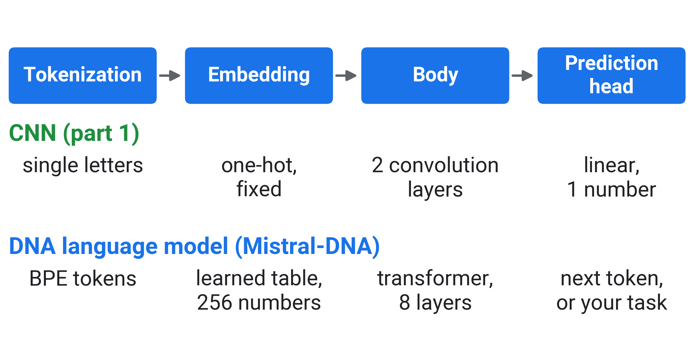{.fragment height="742px"}
:::

::: {.notes}
- The same four stages as slide 1.6, at the same place on the slide.
- First the CNN of part 1: single letters, a fixed one-hot table, two convolution layers, one linear layer to a logit.
- Click: Mistral-DNA, stage by stage: BPE tokens (slide 2.3), a learned table (slide 3.1), a transformer body (slide 4.1), and a head for the next token or for your task.
- The CNN's stages were fixed by us (one-hot) or trained on 92,346 labels. A language model learns its embedding and body from unlabelled genome sequence first.
:::

::: {.center}
# 5 Prediction heads {data-name="Heads"}

{height="141px"}
:::

## 5.1 Prediction heads

**Softmax**: the sigmoid for many classes; one score per token in, probabilities that sum to 1 out

::: {.r-stack}
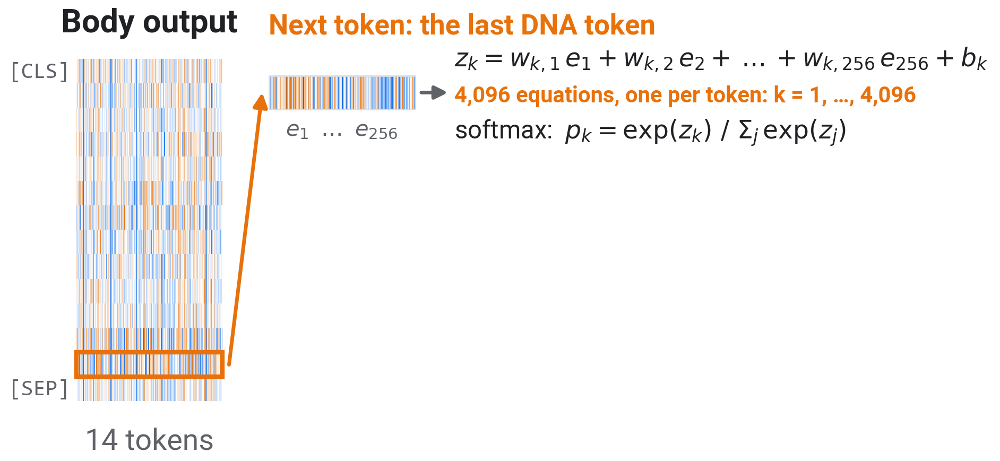{height="626px"}

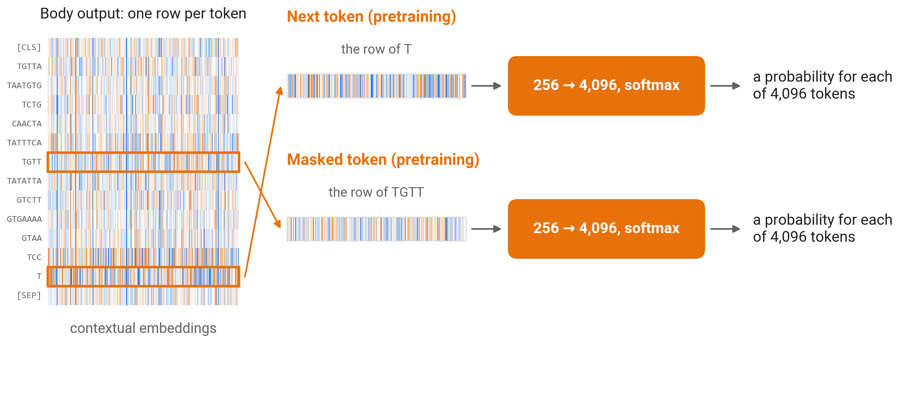{.fragment height="626px"}

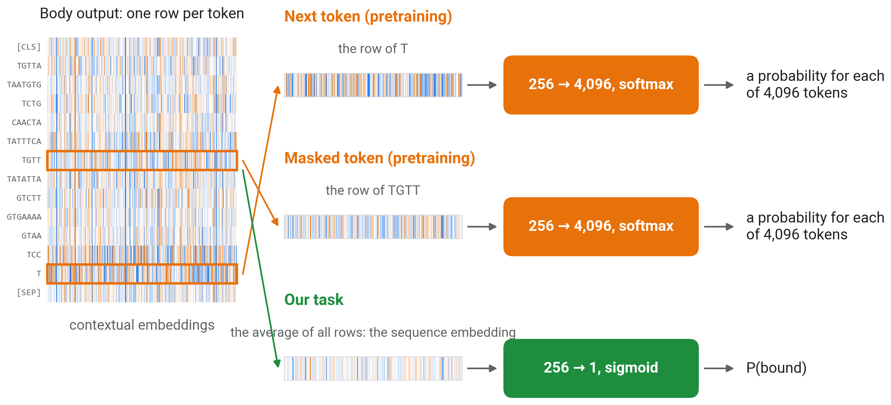{.fragment height="626px"}
:::

::: {.notes}
- Left: the body's output for the sequence of slide 4.2, one row of 256 numbers per token: its contextual embeddings. One head per click.
- Next token: the last token's row goes through a linear layer to 4,096 scores, one per vocabulary token; the softmax turns them into probabilities that sum to 1. Masked token: the same, from the hidden token's row.
- These two are the pretraining heads (slide 1.4). After pretraining they are dropped; the embedding table and the body are kept.
- Our task: the average of all rows, the **sequence embedding** (the 256 numbers of slide 4.2), goes through one linear layer to one number, then the sigmoid: P(bound).
:::

## 5.2 The linear probe {data-todo="TODO-2"}

- A new head, trained on labelled sequences; the body stays frozen

::: {.r-stack}
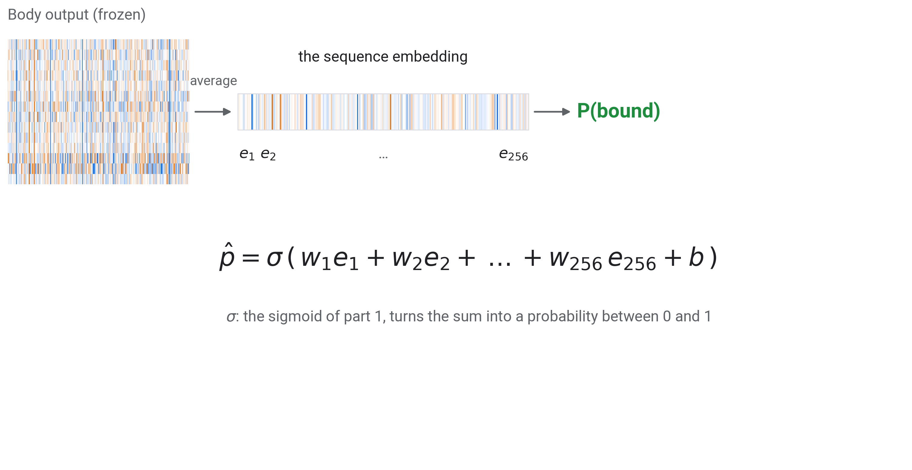{height="646px"}

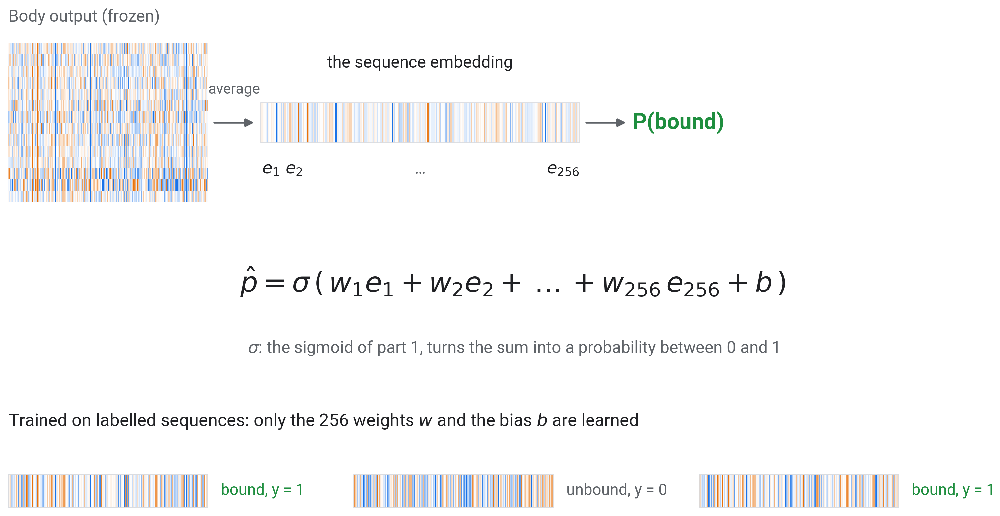{.fragment height="646px"}
:::

::: {.notes}
- The sequence embedding $e = (e_1, \dots, e_{256})$ of slide 4.2: the average of the body's output rows.
- The head is logistic regression, the model of part 1 (slides 2.10 and 2.11) with 256 inputs instead of 2: each number gets a weight, the weighted sum plus a bias $b$ goes through the sigmoid $\sigma$, and the result $\hat p$ is the probability that AGO2 binds, P(bound).
- Click: it is trained on 12,000 labelled sequences; three real ones are shown, their sequence embeddings and their labels. Only the 256 weights and the bias are learned; the body stays frozen. This is a **linear probe**.
- Before fitting, each of the 256 numbers is standardised (mean 0, standard deviation 1 on the training sequences), and regularisation keeps the weights small (`C = 0.1` in scikit-learn).
- Fit on the training vectors, score on the held-out vectors. Scored on its own training vectors, this probe gives about 0.82.
:::

## 5.3 From pretraining to our task

::: {.r-stack}
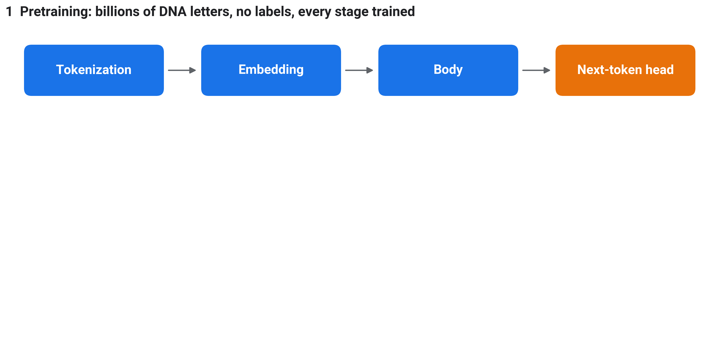{height="730px"}

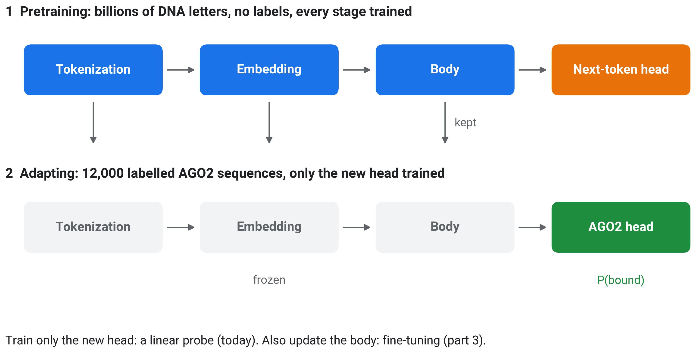{.fragment height="730px"}
:::

::: {.notes}
- 1, pretraining: the genome supplies its own targets. The tokenizer's rules, the embedding table, the body and the next-token head are all learned; Mistral-DNA's authors did this.
- Click, 2, adapting: the tokenizer, the table and the body are kept as they are (frozen, grey). The next-token head is replaced by a new head for our task, trained on labelled AGO2 sequences.
- Training only the new head is a linear probe, the simplest form of fine-tuning, and this part's notebook. Updating the body as well is fine-tuning in the full sense; part 3 compares it with the CNN.
- It can help because the body was trained on far more sequence than any one task has labels.
:::

## 5.4 DNA language models, 2021 to 2025

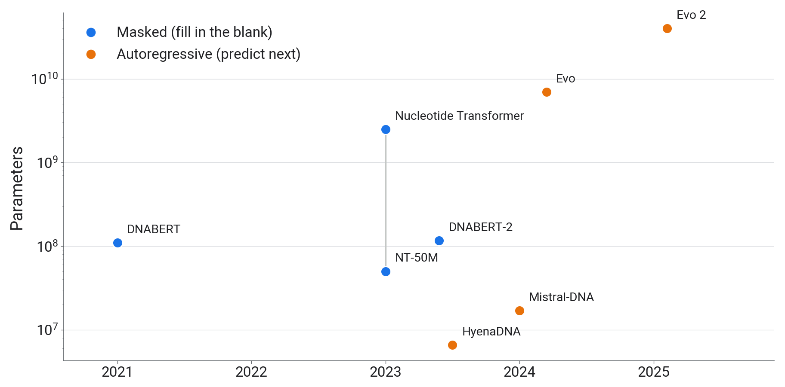{fig-align="center" height="752px"}

::: {.notes}
- x: year of publication; y: parameters, log scale. Filled points are masked models, open points next-token models. The vertical line joins the Nucleotide Transformer sizes.
- DNABERT (110M parameters), Nucleotide Transformer (50M to 2.5B), DNABERT-2 and HyenaDNA, then Evo (7B) and Evo 2 (40B).
- Not shown: Enformer, Borzoi and AlphaGenome, trained with labels from thousands of experiments, and the reference models for predicting gene regulation from sequence.
- The wrap-up shows ten models from these families tested on AGO2.

Next: load a pretrained model and probe it.
:::

::: {.center}
# 6 Hands-on {data-name="Hands-on"}
:::

## 6.1 Loading a model from Hugging Face

::: {.r-stack}
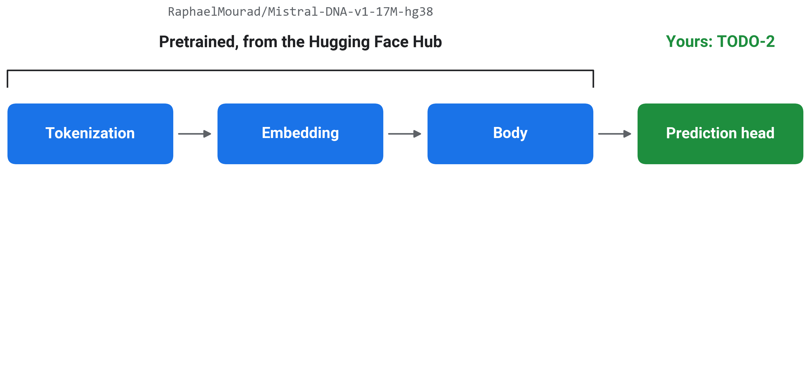{height="658px"}

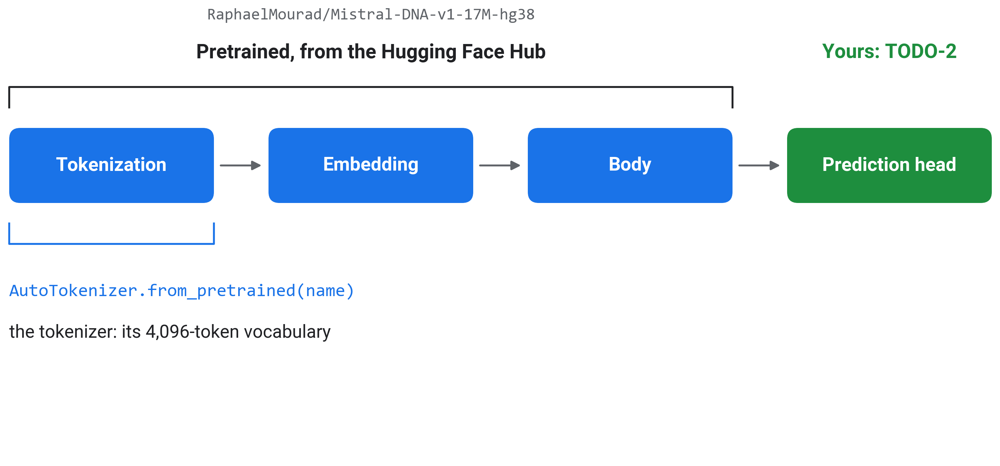{.fragment height="658px"}

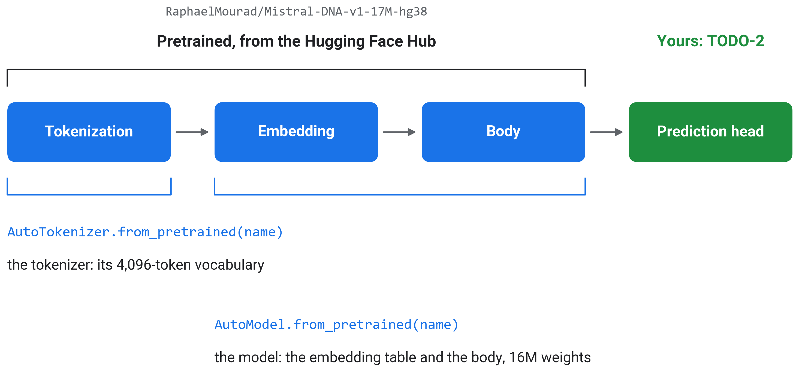{.fragment height="658px"}
:::

::: {.notes}
- The four stages again. The first three come pretrained from the Hugging Face Hub under one name; the prediction head is yours (TODO-2).
- Click: `AutoTokenizer.from_pretrained(name)` downloads the tokenizer, its 4,096-token vocabulary and merge rules.
- Click: `AutoModel.from_pretrained(name)` downloads the embedding table and the body: 16M weights, about 60 MB, roughly 10 seconds on Colab.
- The same two calls load any model on the Hub. Each model has a model card: what it was trained on, how, and its known limits.
- The model reads DNA letters, so our U becomes T before tokenizing. Mistral-DNA's name says 17M because it also counts the next-token head, which we do not use.
- In the notebook, TODO-1 is one function, `embed`, written from a table that maps each step (tokenize, run the model, last layer, masked mean, collect) to its API.
:::

## 6.2 Your turn

Open **`02_foundation_models.ipynb`**.

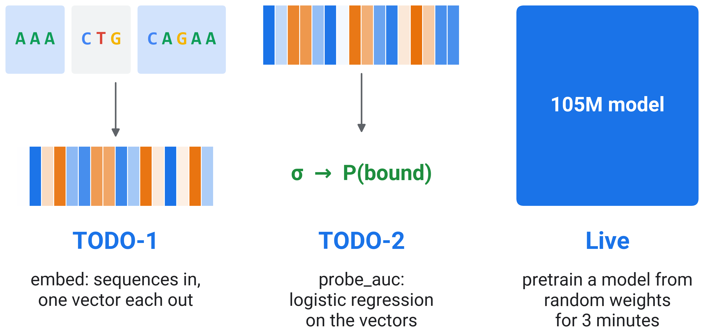{fig-align="center" height="679px"}

::: {.notes}
- Signatures: `embed(tok, model, seqs)` returns an `(N, 256)` array; `probe_auc(...)` returns `(auc, probe)`.
- TODO-1: before writing `embed`, the notebook prints one sequence's tokens and a padded pair, and asks how many letters a token holds (about 5) and whether a ~330-letter sequence fits in 512 tokens. The test checks the same vector alone and in a padded batch. Its test checks the same vector whether a sequence is embedded alone or in a batch. If the attention mask is ignored, padding changes the average and the vector of a sequence changes with its batch.
- TODO-2: the probe trains on 12,000 sequences (the `C=0.1` setting means fairly strong regularisation). If the result is about 0.82, it was scored on the training set; the test cell says so.
- NT-500M (human reference) is a 2 GB download, so its vectors are provided. It scores about 0.79 from these precomputed vectors.
- The live row is section 3 of the notebook: start the cell and read the take-aways while it trains.
- Each TODO has a test cell; the solutions are published on the workshop site during the workshop.
:::

::: {.center}
# 7 Frozen models and the CNN {data-name="Results"}
:::

## 7.1 Frozen pretrained models against the CNN

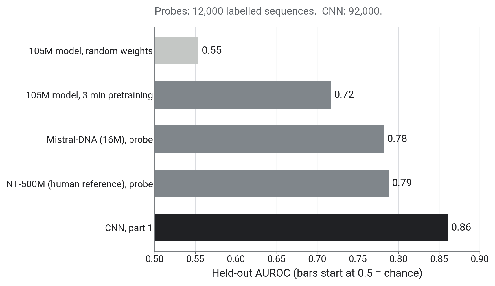{fig-align="center" height="766px"}

::: {.notes}
- Show after the notebook. Held-out AUROC on the same 1,000 sequences; bars start at 0.5 (chance). Blue: probes on frozen pretrained models (light blue: the 105M model after 3 minutes of pretraining; grey: random weights); green: the CNN trained on all 92,346 sequences.
- Mistral-DNA with a probe: 0.78. NT-500M, 30 times larger: 0.79. A difference of 0.01 on 1,000 test sequences is within sampling noise, so there is no evidence that size helps here.
- Both are below the part 1 CNN at 0.86, but the CNN was trained on about 92,000 labels and the probes on 12,000. At equal label counts the gap is smaller (part 3: CNN 0.82 vs probe 0.77 at 12,000 labels).
- The 105M model with random weights gives 0.55; after 3 minutes of pretraining, 0.72 in the run on this figure (0.73 in our latest run). That is only a little above the two composition numbers of part 1 (0.66), so it should not be read as learned binding biology.
:::
