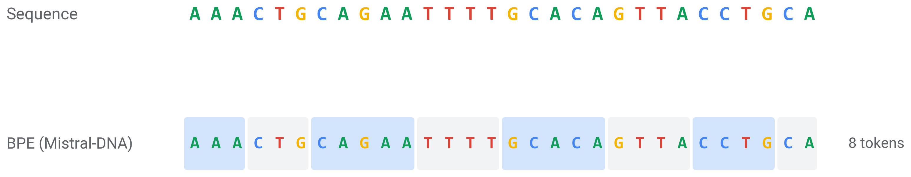
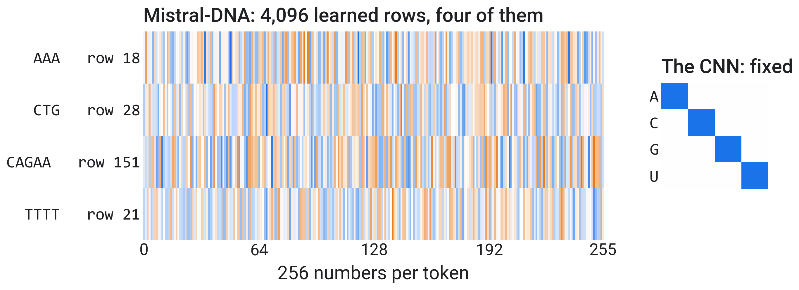
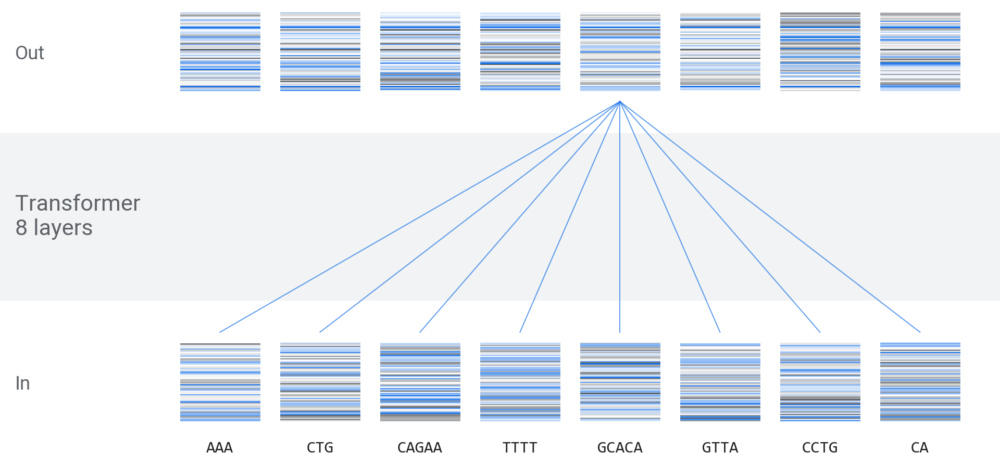
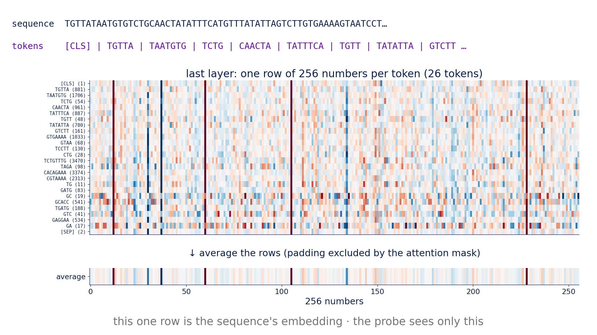
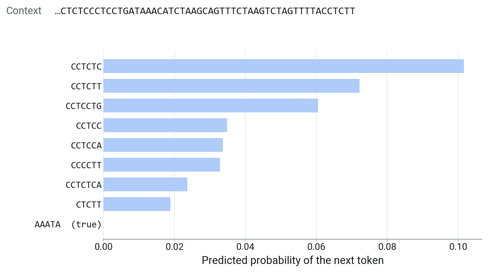
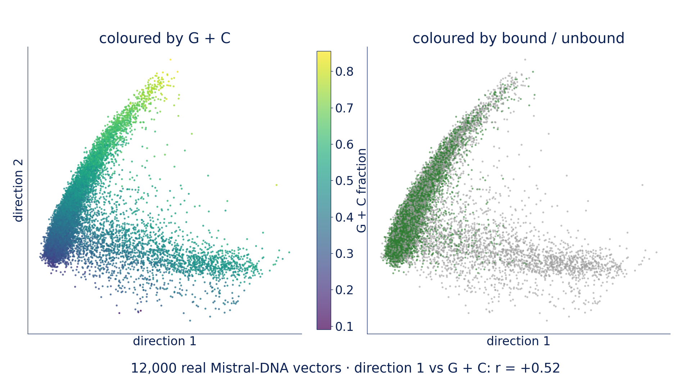
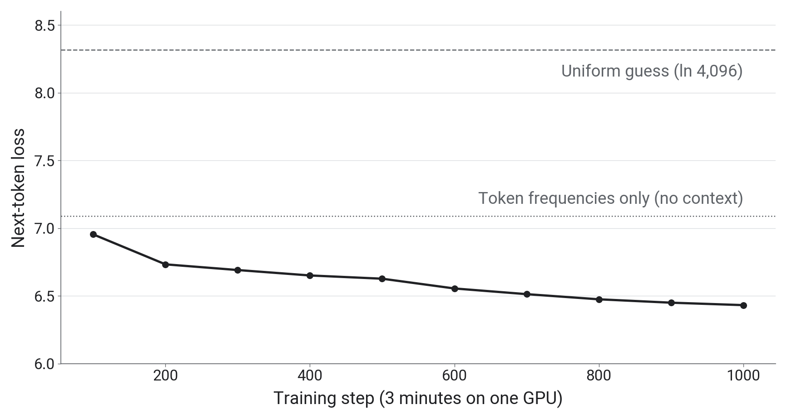

::: {.center}
# 1 From sequence to prediction {data-name="Overview"}
:::

## 1.1 Pretrain once, reuse many times

- **Pretraining**: billions of letters of genome sequence, no labels
- **Adaptation**: one task, thousands of labels (AGO2: 92,346)
- Today's model: **Mistral-DNA**, 16M parameters, pretrained on the human genome

::: {.notes}
- Projected: 2 min.
- A foundation model is pretrained on unlabelled sequence, then adapted to many tasks. A DNA language model is one pretrained to predict tokens of genome sequence from the other tokens.
- Most models so far, like our CNN, are trained from random weights for one task with that task's labels.
- Each task adds a small output layer (a head) and may adjust the model. Heads differ by task: a number (expression level), a label per position (splice sites), or one probability per sequence, as today.
- The claim to test in parts 2 and 3: what a model learns in pretraining transfers, so each task needs fewer labels.
:::

## 1.2 Four stages, in the CNN and in a language model

| Stage | CNN (part 1) | DNA language model |
|:--|:--|:--|
| **Tokenization** | single letters | k-mers or BPE tokens |
| **Embedding** | one-hot, 4 numbers | learned, 256 numbers |
| **Body** | 2 convolution layers | transformer, 8 layers |
| **Prediction head** | linear → 1 logit | linear → token probabilities, or 1 logit |

::: {.notes}
- Projected: 2 min.
- One row per stage; the language-model column gives Mistral-DNA's numbers.
- These four stages describe most sequence models in use today. This part goes through them in order; the transformer stays a black box.
- The CNN's stages were fixed by us (one-hot) or trained on 92,346 labels. A language model learns its embedding and body from unlabelled genome sequence first.
:::

::: {.center}
# 2 Tokenization {data-name="Tokens"}
:::

## 2.1 Single letters

- A vocabulary of 4: each letter is a token, as in the CNN

{fig-align="center" height="300px"}

::: {.notes}
- Projected: 1 min.
- The figure and the next two: the same 30 letters of a real bound sequence around a miR-19 site (underlined), one box per token, with the token count on the right.
- A 330-letter sequence is 330 tokens. Every position is kept, but the model has to learn from scratch which letters belong together.
- Some genome models (HyenaDNA, Evo) also read single letters, which needs a model that can handle long inputs: a 1,000-letter sequence is 1,000 tokens.
:::

## 2.2 k-mers

- Fixed words of 6 letters, a vocabulary of $4^6 = 4{,}096$ (Nucleotide Transformer)

{fig-align="center" height="445px"}

::: {.notes}
- Projected: 1 min.
- The models read DNA letters, so U becomes T. This is the same stretch of a real bound sequence from our data. Top row: Nucleotide Transformer's 6-mer tokens; bottom row: the same sequence shifted by one letter.
- Shift the sequence by one letter and every token changes. The letters left over at the end become single-letter tokens.
- A sequence of n letters becomes about n / 6 tokens, so the model can read six times more sequence for the same cost.
:::

## 2.3 Byte-pair encoding (BPE)

- Merge the most frequent neighbouring pair into a new token; repeat until 4,096 tokens

{fig-align="center" height="302px"}

::: {.notes}
- Projected: 2 min.
- Mistral-DNA's BPE tokenizer on the same bound sequence. Single letters (slide 2.1) are what the CNN read; the 6-mer rows are the previous slide.
- Start from the 4 letters and count every pair of neighbouring tokens in the genome.
- Frequent stretches become one token and rare ones stay short, so token lengths vary. Mistral-DNA and DNABERT-2 share one BPE vocabulary.
- The underlined miR-19 site is split differently by each tokenizer. No model sees it as one unit.
:::

::: {.center}
# 3 Embedding {data-name="Embedding"}
:::

## 3.1 Token embeddings

- Token $i$ becomes row $i$ of a learned table $E$: $\;e_i = x_i^\top E$

{fig-align="center" height="508px"}

::: {.notes}
- Projected: 2 min.
- Left: the real rows of Mistral-DNA's table for the first four tokens of our example sequence; blue positive, grey negative. The table has 4,096 rows of 256 numbers. Right: the CNN's table.
- $x_i$ is the one-hot vector of token $i$. Multiplying a one-hot vector by $E$ selects one row of $E$, so an embedding layer is implemented as a table lookup.
- The CNN's one-hot encoding is the same lookup with a fixed 4 × 4 identity table: nothing learned.
- The table is learned during pretraining, so tokens that occur in similar contexts end up with similar vectors.
- These are the input vectors, one per token. Section 4 follows them through the transformer and back out as one vector per sequence.
:::

::: {.center}
# 4 The transformer {data-name="Transformer"}
:::

## 4.1 The transformer, as a black box

- Each output vector depends on every input token (attention)

{fig-align="center" height="642px"}

::: {.notes}
- Projected: 2 min.
- The strips are real: the first 64 of the 256 numbers for each token, at the input (bottom) and after the last layer (top). The blue lines connect every input token to one output vector.
- In: one vector per token. Out: one vector per token, the same size (256 numbers).
- Mistral-DNA: 8 layers, 256 numbers per token, up to 512 tokens, 16M parameters.
- Inside each layer, attention mixes information between positions (8 attention heads per layer in Mistral-DNA) and a small feed-forward network transforms each position. Mistral-DNA's feed-forward part is a mixture of 8 experts. We do not open these today.
- The CNN's convolutions see a 10-letter window and then a few pooled neighbours; a transformer layer can relate any two tokens in the input.
- For the exercise we need only its last layer's output: the token-by-256 matrix on the next slide, averaged into one vector.
:::

## 4.2 From token vectors to one sequence embedding

- **Sequence embedding**: the transformer's last-layer output, averaged over all non-padding tokens (including the special start and end tokens `[CLS]` and `[SEP]`)

{fig-align="center" height="596px"}

::: {.notes}
- Mistral-DNA on the first 60 letters of one real sequence. Top: the last layer, one row of 256 numbers per token; blue positive, grey negative. Bottom: their average, the sequence embedding.
- Each token is mapped to an integer, the model outputs one 256-number vector per token in its last layer, and we average those vectors.
- `[CLS]` and `[SEP]` are special tokens the tokenizer adds at the start and end; they are not DNA.
- In a batch, shorter sequences are padded. The attention mask (1 for real tokens, 0 for padding) keeps padding out of the average.
- A few dimensions are large for almost every token (the vertical stripes). That is common in transformer models and does not depend on the sequence.
:::

::: {.center}
# 5 Prediction heads {data-name="Heads"}
:::

## 5.1 Prediction heads

| Use | Head | Output |
|:--|:--|:--|
| Next token | 256 → 4,096, softmax | probability of each token |
| Masked tokens | 256 → vocabulary, softmax | probability of each hidden token |
| Our task | average, 256 → 1, sigmoid | P(bound) |

- **Linear probe**: our task's head on a frozen model, which is logistic regression

::: {.notes}
- Projected: 2 min.
- The first two rows are the vocabulary heads used in pretraining (next slide); the third is ours.
- Softmax turns one score per vocabulary token into probabilities that sum to 1.
- Our task's head first averages the last layer over the tokens (the sequence embedding), then applies one linear layer. Before the logistic regression each of the 256 dimensions is standardised.
- After pretraining the vocabulary head is discarded and a new task head is attached. The body (and the embedding table) transfers to the new task.
- Frozen body, new linear head: a linear probe (this part's notebook). Body adapted too: fine-tuning (part 3, LoRA).
:::

## 5.2 Two pretraining objectives

- **Next token** (Mistral-DNA, HyenaDNA, Evo): $\;\mathcal{L} = -\log p_\theta(x_t \mid x_{<t})$
- **Masked tokens** (Nucleotide Transformer, DNABERT-2): $\;\mathcal{L} = -\log p_\theta(x_t \mid x_{\setminus t})$, hidden tokens predicted from both sides

{fig-align="center" height="492px"}

::: {.notes}
- These are the losses the vocabulary heads of slide 5.1 are trained with. $x_t$ is the token at position $t$; $x_{<t}$ the tokens before it; $x_{\setminus t}$ all tokens except the hidden ones.
- The figure: Mistral-DNA, given the first tokens of a real sequence (the end of that context is printed at the top), assigns a probability to each of its 4,096 possible next tokens. Its top choice gets about 10%; the true token is shown at the bottom with its much lower probability.
- Much of the genome is hard to predict from local context, so the loss stays high even in a trained model.
- Masked models hide about 15% of the tokens and predict them from the tokens on both sides.
- In both cases the genome supplies its own targets, so no experimental labels are needed.
:::

## 5.3 DNA language models, 2021 to 2025

{fig-align="center" height="700px"}

::: {.notes}
- x: year of publication; y: parameters, log scale. Filled points are masked models, open points next-token models. The vertical line joins the Nucleotide Transformer sizes.
- DNABERT (110M parameters), Nucleotide Transformer (50M to 2.5B), DNABERT-2 and HyenaDNA, then Evo (7B) and Evo 2 (40B).
- Not shown: Enformer, Borzoi and AlphaGenome, trained with labels from thousands of experiments, and the reference models for predicting gene regulation from sequence.
- The wrap-up shows ten models from these families tested on AGO2.

Next: load a pretrained model and probe it.
:::

::: {.center}
# 6 Hands-on {data-name="Hands-on"}
:::

## 6.1 From a sequence to a sequence embedding with Hugging Face

```python
from transformers import AutoTokenizer, AutoModel
name  = "RaphaelMourad/Mistral-DNA-v1-17M-hg38"
tok   = AutoTokenizer.from_pretrained(name, trust_remote_code=True)   # the token vocabulary
model = AutoModel.from_pretrained(name, trust_remote_code=True)       # the weights

seq = "UGAUUUAUCAAG...".replace("U", "T")            # the model reads DNA letters
ids = tok([seq], return_tensors="pt", padding=True)
h   = model(input_ids=ids["input_ids"], attention_mask=ids["attention_mask"],
            output_hidden_states=True).hidden_states[-1]          # (1, tokens, 256)
m   = ids["attention_mask"].unsqueeze(-1)            # 1 = real token, 0 = padding
vec = (h * m).sum(1) / m.sum(1)                      # (1, 256): the sequence embedding
```

::: {.notes}
- The same calls load any model on the Hugging Face Hub. Each model has a page with a model card: what it was trained on, how, and its known limits.
- The download goes to the Colab machine. Mistral-DNA is about 60 MB, roughly 10 seconds.
- Mistral-DNA has 16M parameters; the "17M" in its name includes an output layer we do not use.
- The tokenizer returns more keys than the model accepts, so pass only `input_ids` and `attention_mask`.
- The last three lines are TODO-1: average the last layer over the real tokens only. `unsqueeze(-1)` gives the mask shape (1, tokens, 1), so it multiplies all 256 numbers of each token.
:::

## 6.2 Your turn

Open **`02_foundation_models.ipynb`**.

| Step | Task | Check | Time |
|:--|:--|:--|:--|
| TODO-1 | `embed`: one vector per sequence | shape `(N, 256)` | 9 min |
| TODO-2 | `probe_auc`: logistic regression | about 0.78 | 5 min |
| live | pretrain a 105M model for 3 minutes | probe before and after | 6 min |

::: {.notes}
- Given cells (setup, loading Mistral-DNA, 2-D map, NT-500M vectors, take-aways): about 12 min. Projected hands-on total: about 32 min.
- Signatures: `embed(tok, model, seqs)` returns an `(N, 256)` array; `probe_auc(...)` returns `(auc, probe)`.
- TODO-1 check: the same vector whether a sequence is embedded alone or in a batch. If the attention mask is ignored, padding changes the average and the vector of a sequence changes with its batch.
- TODO-2: the probe trains on 12,000 sequences (the `C=0.1` setting means fairly strong regularisation). If the result is about 0.82, it was scored on the training set.
- NT-500M (human reference) is a 2 GB download, so its vectors are provided. It scores about 0.79 from these precomputed vectors.
- The live row is section 3 of the notebook (slide 7.3): start the cell and read the take-aways while it trains.
- Each TODO has a "Stuck?" cell that loads our version.
:::

::: {.center}
# 7 What the probe found {data-name="Results"}
:::

## 7.1 What the sequence embeddings vary with

- **PCA**: project the 256-dimensional embeddings onto the two directions of largest variance

{fig-align="center" height="596px"}

::: {.notes}
- 12,000 Mistral-DNA embeddings, one point per sequence, the same map the notebook draws.
- Left, coloured by G+C fraction: it changes smoothly across the map, mostly along direction 2 (correlation r = 0.81; with direction 1, r = 0.52).
- Right, coloured by label (blue bound, grey unbound): bound sequences concentrate at the low-G+C end, unbound ones spread along both arms.
- Composition is one of the main axes of these vectors, and the two classes differ in composition. Part 3 tests how much of the probe's score that explains.
:::

## 7.2 Frozen pretrained models against the CNN

{fig-align="center" height="700px"}

::: {.notes}
- Held-out AUROC on the same 1,000 sequences; bars start at 0.5 (chance). Grey: probes on frozen models (light grey: random weights); black: the CNN.
- Mistral-DNA with a probe: 0.78. NT-500M, 30 times larger: 0.79. The difference is within the ±0.025 noise from part 1, so there is no evidence that size helps here.
- Both are below the part 1 CNN at 0.86, but the CNN was trained on about 92,000 labels and the probes on 12,000. At equal label counts the gap is smaller (part 3: CNN 0.82 vs probe 0.77 at 12,000 labels).
- The 105M model with random weights gives 0.55; after 3 minutes of pretraining, 0.72 in the run on this figure and 0.73 in our latest run (next slide).
:::

## 7.3 Pretraining from random weights

{fig-align="center" height="700px"}

::: {.notes}
- The live cell: a 105M-parameter model of the same design as Mistral-DNA but larger, with random weights, trained to predict the next token on 200-letter pieces of the human genome for about 3 minutes (recipe from the Galaxy Training Network, Mourad and Batut, CC-BY).
- The figure: the next-token loss every 100 steps of one 3-minute run (logged from step 100 to 1,000). Dashed: uniform guessing, ln 4096 ≈ 8.3. Dotted: a model that knows only how frequent each token is, with no context (about 7.1).
- The loss falls from about 7.0 after 100 steps to about 6.4. Most of the early drop is learning token frequencies; going below the dotted line requires using context.
- Probed on AGO2 before and after: 0.55 to 0.73 in our latest run (1,834 steps; earlier runs gave 0.72 and 0.75). That is only a little above the two composition numbers of part 1, slide 3.3 (0.66), so it should not be read as learned binding biology.
- A T4 completes about 1,200 steps in 3 minutes against 1,834 on our A30 test GPU; in our Colab test the probe still went from 0.57 to 0.72. The released Mistral-DNA, a different model trained far longer, reaches 0.78.
:::
