::: {.center}
# 1 From sequence to prediction {data-name="Overview"}
:::

## 1.1 Pretraining, by analogy

::: {.r-stack}
{height="742px"}

{.fragment height="742px"}
:::

::: {.notes}
- A language model reads billions of sentences and learns to predict each next word. No one labels anything: the text supplies its own answers.
- To get "mat" right, a model has to learn grammar, which words go together, something about cats. That knowledge is the point of pretraining.
- Click: a DNA language model does the same on genome sequence. The bottom row is real: the last tokens of a real sequence from our data, cut into Mistral-DNA's tokens, and the token that follows.
- To predict the next token well, it has to learn which stretches of DNA occur together, and that may include signals that matter for our task.
:::

## 1.2 Pretraining a model

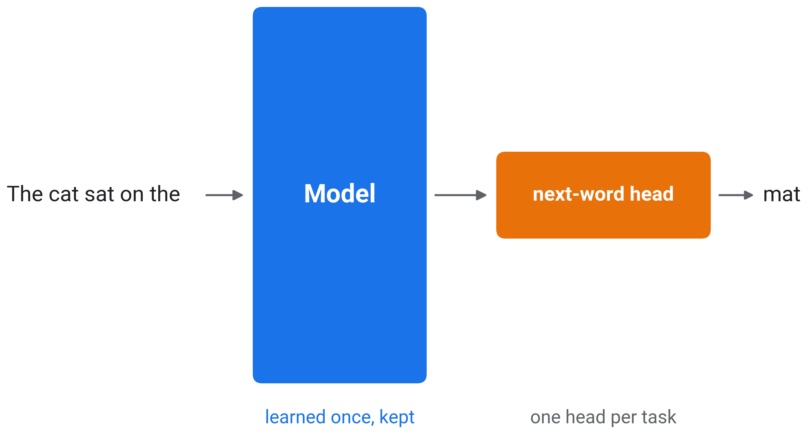{fig-align="center" height="766px"}

::: {.notes}
- One model (the blue block) and one **head**: a small output layer for one task. In pretraining the task is the next word.
- The model learns from the text alone, billions of examples, no labels.
:::

## 1.3 Adapting it to new tasks

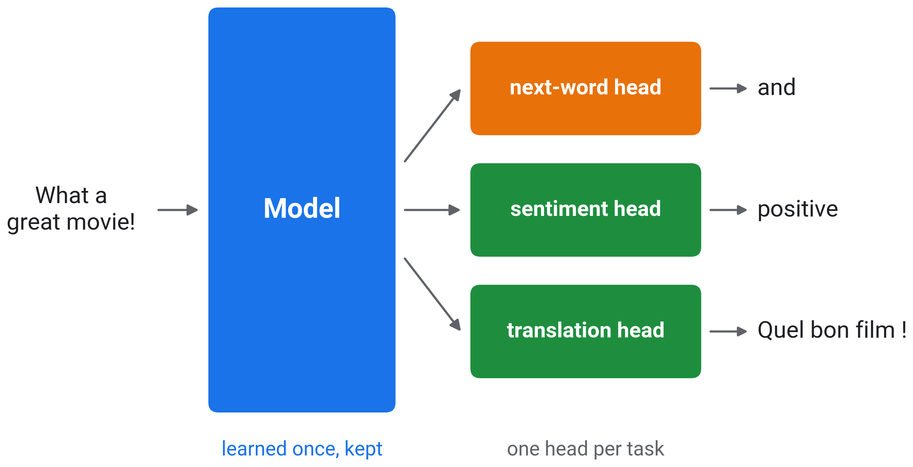{fig-align="center" height="737px"}

::: {.notes}
- The same model, learned once and kept. Each new task gets its own head: sentiment (positive or negative), translation, and many more.
- A new task needs far fewer labelled examples than training a model from scratch, because the model already "knows the language".
- This is the idea of a **foundation model**: pretrain once, adapt many times.
:::

## 1.4 The same for DNA

::: {.r-stack}
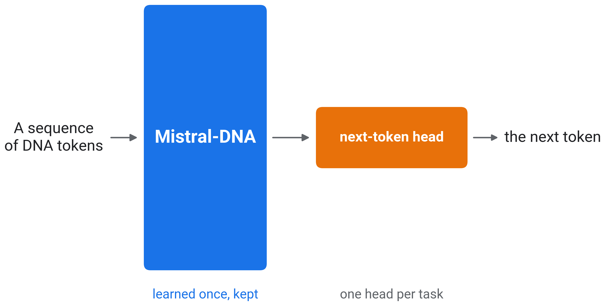{height="730px"}

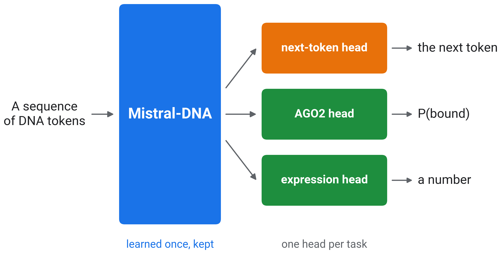{.fragment height="730px"}
:::

::: {.notes}
- Today's model: **Mistral-DNA**, 16M parameters, pretrained on the human genome to predict the next token.
- Click: new heads for new tasks. Ours predicts AGO2 binding from 92,346 labelled sequences; others predict expression levels, splice sites, and so on.
- Most models so far, like our CNN, are trained from random weights for one task with that task's labels.
- The claim to test in parts 2 and 3: what a model learns in pretraining transfers, so each task needs fewer labels.
:::

## 1.5 Pretraining objective: the next token

$\mathcal{L} = -\log p_\theta(x_t \mid x_{<t})$: hide the last token, predict it from the ones before

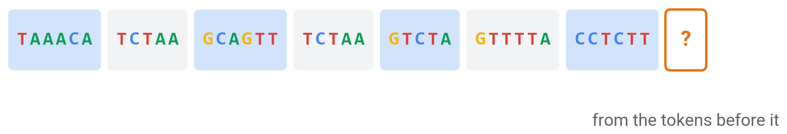{fig-align="center" height="246px"}

{.fragment fig-align="center" height="377px"}

::: {.notes}
- Mistral-DNA, HyenaDNA and Evo are trained this way. $x_t$ is the token at position $t$; $x_{<t}$ the tokens before it.
- Top: the end of a real context from our data, with the next token hidden.
- Click: Mistral-DNA's probabilities for its top 8 next tokens (light blue), and the true token (orange) with its much lower probability. Its top choice gets about 10%.
- Much of the genome is hard to predict from local context, so the loss stays high even in a trained model.
:::

## 1.6 Pretraining objective: masked tokens

$\mathcal{L} = -\log p_\theta(x_t \mid x_{\setminus t})$: hide a token in the middle, predict it from both sides

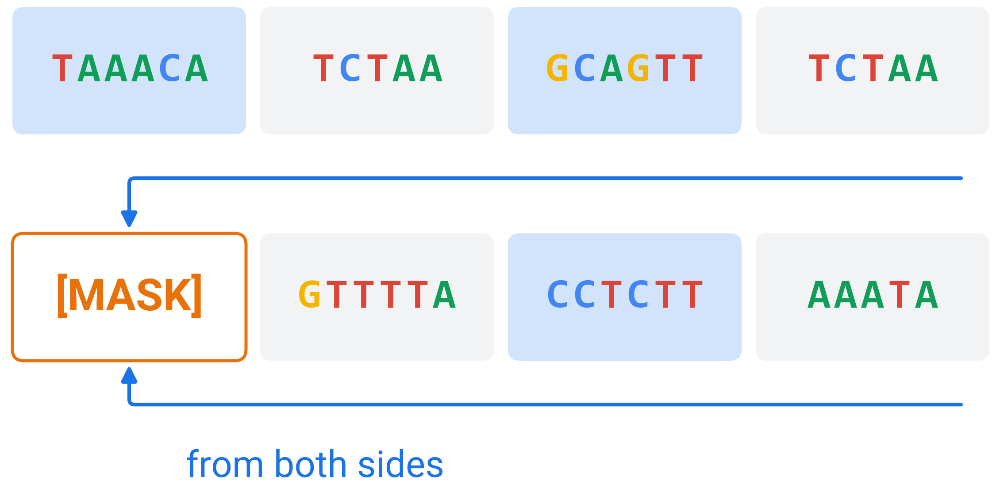{fig-align="center" height="696px"}

::: {.notes}
- Nucleotide Transformer and DNABERT-2 are trained this way. $x_{\setminus t}$ is all tokens except the hidden ones.
- Masked models hide about 15% of the tokens and predict them from the tokens on both sides.
- In both objectives the genome supplies its own targets, so no experimental labels are needed.
:::

## 1.7 Four stages

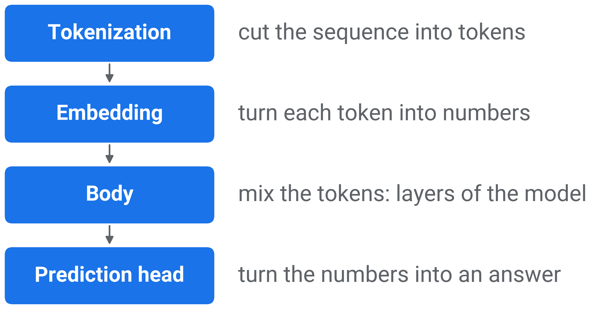{fig-align="center" height="754px"}

::: {.notes}
- These four stages describe most sequence models in use today. This part goes through them in order; the transformer stays a black box.
:::

## 1.8 In the CNN and in a DNA language model

::: {.r-stack}
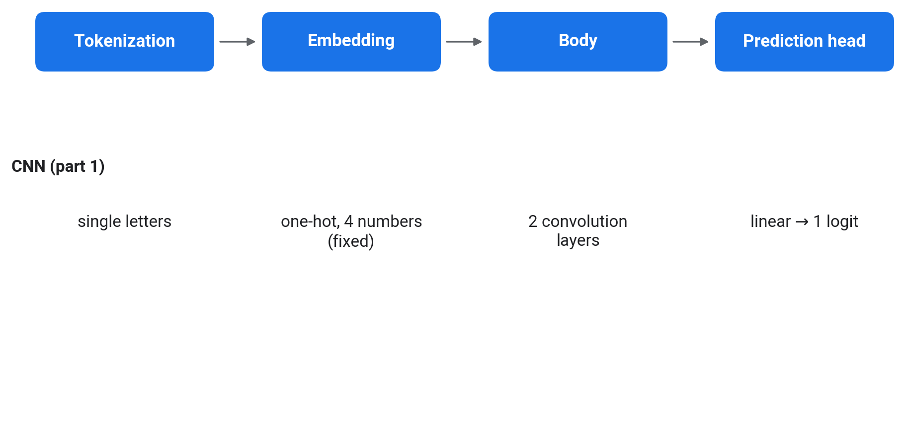{height="692px"}

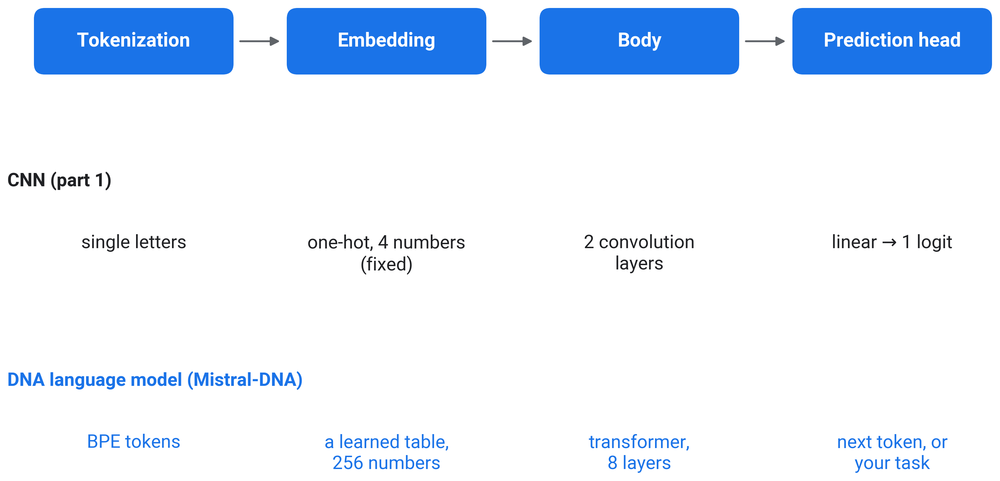{.fragment height="692px"}
:::

::: {.notes}
- First the CNN of part 1: single letters, a fixed one-hot table, two convolution layers, one linear layer to a logit.
- Click: Mistral-DNA, stage by stage. The CNN's stages were fixed by us (one-hot) or trained on 92,346 labels. A language model learns its embedding and body from unlabelled genome sequence first.
:::

::: {.center}
# 2 Tokenization {data-name="Tokens"}

{height="141px"}
:::

## 2.1 Single letters

- A vocabulary of 4: each letter is a token, as in the CNN

{fig-align="center" height="655px"}

::: {.notes}
- Projected: 1 min.
- The figure and the next two: the same 30 letters of a real bound sequence, one box per token, with the token count on the right.
- A 330-letter sequence is 330 tokens. Every position is kept, but the model has to learn from scratch which letters belong together.
- Some genome models (HyenaDNA, Evo) also read single letters, which needs a model that can handle long inputs: a 1,000-letter sequence is 1,000 tokens.
:::

## 2.2 k-mers

- Fixed words of 6 letters, a vocabulary of $4^6 = 4{,}096$ (Nucleotide Transformer, NT)

{fig-align="center" height="655px"}

::: {.notes}
- Projected: 1 min.
- The models read DNA letters, so U becomes T. This is the same stretch of a real bound sequence from our data, cut into Nucleotide Transformer's 6-mer tokens.
- Shift the sequence by one letter and every token changes.
- A sequence of n letters becomes about n / 6 tokens, so the model can read six times more sequence for the same cost.
:::

## 2.3 Byte-pair encoding (BPE)

- Merge the most frequent neighbouring pair into a new token; repeat until 4,096 tokens

{fig-align="center" height="655px"}

::: {.notes}
- Projected: 2 min.
- Mistral-DNA's BPE tokenizer on the same bound sequence. Single letters (slide 2.1) are what the CNN read; the 6-mer row is the previous slide.
- Start from the 4 letters and count every pair of neighbouring tokens in the genome.
- Frequent stretches become one token and rare ones stay short, so token lengths vary. Mistral-DNA and DNABERT-2 share one BPE vocabulary.
- The same stretch is split differently by each tokenizer.
:::

::: {.center}
# 3 Embedding {data-name="Embedding"}

{height="141px"}
:::

## 3.1 Token embeddings

- Token $i$ becomes row $i$ of a learned table $E$: $\;e_i = x_i^\top E$

{fig-align="center" height="655px"}

::: {.notes}
- Projected: 2 min.
- Left: the real rows of Mistral-DNA's table for the first four tokens of our example sequence; blue positive, orange negative. The table has 4,096 rows of 256 numbers. Right: the CNN's table.
- $x_i$ is the one-hot vector of token $i$. Multiplying a one-hot vector by $E$ selects one row of $E$, so an embedding layer is implemented as a table lookup.
- The CNN's one-hot encoding is the same lookup with a fixed 4 × 4 identity table: nothing learned.
- The table is learned during pretraining, so tokens that occur in similar contexts end up with similar vectors.
- These are the input vectors, one per token. Section 4 follows them through the transformer and back out as one vector per sequence.
:::

::: {.center}
# 4 The transformer {data-name="Transformer"}

{height="141px"}
:::

## 4.1 The transformer, as a black box

- Each output vector depends on every input token (attention)

{fig-align="center" height="650px"}

::: {.notes}
- Attention alone does not see token order. The model adds position information to the token vectors (Mistral-DNA rotates them by an angle that depends on the position).
- Projected: 2 min.
- The strips are real: the first 64 of the 256 numbers for each token, at the input (bottom) and after the last layer (top). The blue lines connect every input token to one output vector.
- In: one vector per token. Out: one vector per token, the same size (256 numbers).
- Mistral-DNA: 8 layers, 256 numbers per token, up to 512 tokens, 16M parameters.
- Inside each layer, attention mixes information between positions (8 attention heads per layer in Mistral-DNA) and a small feed-forward network transforms each position. Mistral-DNA's feed-forward part is a mixture of 8 experts. We do not open these today.
- The CNN's convolutions see a 10-letter window and then a few pooled neighbours; a transformer layer can relate any two tokens in the input.
- For the exercise we need only its last layer's output: the token-by-256 matrix on the next slide, averaged into one vector.
:::

## 4.2 The whole pipeline on one sequence {data-todo="TODO-1"}

::: {.r-stack}
{height="711px"}

{.fragment height="711px"}

{.fragment height="711px"}

{.fragment height="711px"}

{.fragment height="711px"}
:::

::: {.notes}
- Mistral-DNA on the first 60 letters of one real sequence; the left column shows where we are in the pipeline.
- 1 Tokenization: the letters become 14 tokens, with the special tokens `[CLS]` and `[SEP]` added at the start and end (they are not DNA).
- 2 Embedding: each token picks its row of the learned table: one row of 256 numbers per token (blue positive, orange negative).
- 3 Body: after the 8 transformer layers there is still one row per token, but each row now depends on every token of the sequence.
- 4 Prediction head: average the rows over the real tokens, the **sequence embedding**, 256 numbers. In a batch the attention mask keeps padding out of this average (next slide).
- Then the linear probe turns those 256 numbers into P(bound); that is what you train in TODO-2.
- A few dimensions are large for almost every token (the vertical stripes). That is common in transformer models and does not depend on the sequence.
:::

## 4.3 Batches: padding and the mask

- Sequences in a batch are padded to the same number of tokens; the **attention mask** marks the real ones

{fig-align="center" height="606px"}

::: {.notes}
- Three real bound sequences (22, 31 and 40 letters, in DNA letters as the model reads them), tokenized together. Each row is one sequence; each cell one token, with its mask value below it.
- `[CLS]` and `[SEP]` are special tokens the tokenizer adds at the start and end. Shorter sequences are filled with padding tokens up to the longest one in the batch.
- The mask is 1 for real tokens (including `[CLS]` and `[SEP]`) and 0 for padding. The model uses it to ignore padding, and the sequence embedding averages the last-layer vectors only where it is 1.
- Without the mask, the padding vectors enter the average, and the same sequence gets a different embedding depending on which batch it is in.
:::

::: {.center}
# 5 Prediction heads {data-name="Heads"}

{height="141px"}
:::

## 5.1 Prediction heads

**Softmax**: the sigmoid for many classes; one score per token in, probabilities that sum to 1 out

::: {.r-stack}
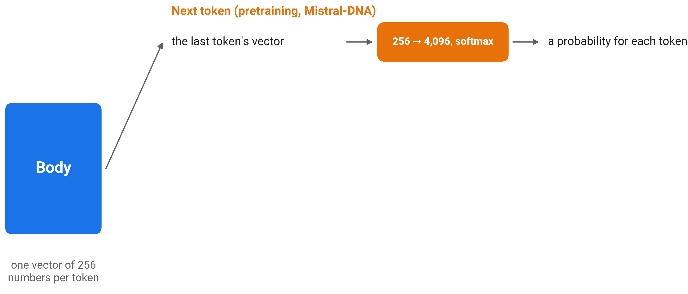{height="616px"}

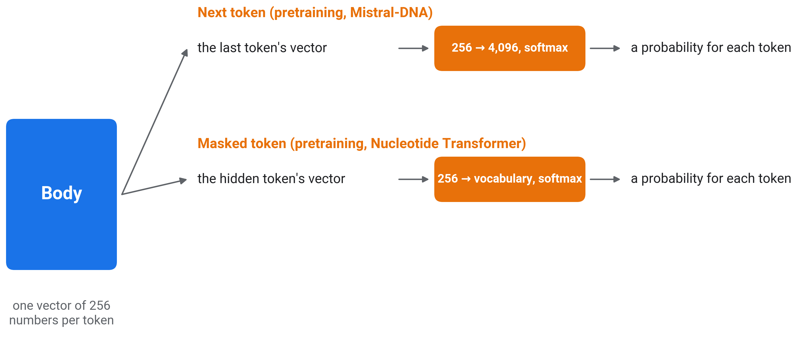{.fragment height="616px"}

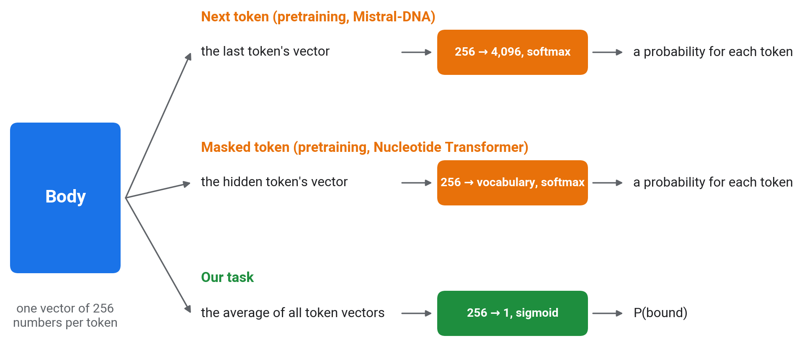{.fragment height="616px"}
:::

::: {.notes}
- One body, three heads; one per click.
- Next token: the last token's vector goes through a linear layer to 4,096 scores, one per vocabulary token; softmax turns them into probabilities that sum to 1. Masked token: the same, at the hidden position.
- These two are the pretraining heads (slides 1.5 and 1.6). After pretraining they are discarded and a new task head is attached; the body (and the embedding table) transfers.
- Our task: average the token vectors (the sequence embedding), then one linear layer to one number, then the sigmoid: P(bound). Before the logistic regression each of the 256 dimensions is standardised.
- Frozen body, new linear head: a **linear probe** (this part's notebook), which is logistic regression. Body adapted too: fine-tuning (part 3).
:::

## 5.2 The linear probe {data-todo="TODO-2"}

- Logistic regression on the 256 numbers of each sequence embedding; the language model stays frozen
- **Standardised**: each of the 256 numbers shifted and scaled to mean 0, standard deviation 1

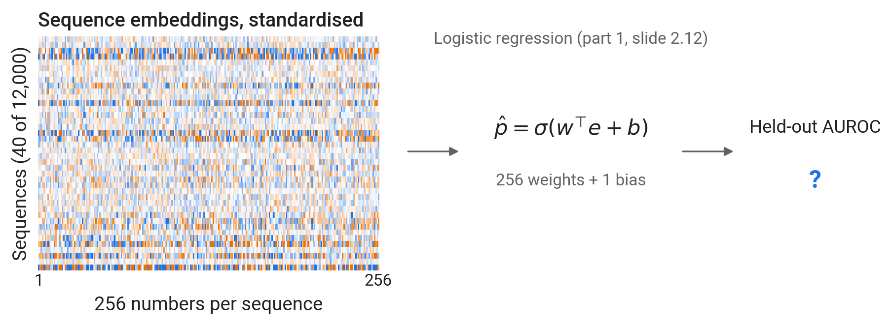{fig-align="center" height="444px"}

::: {.notes}
- Left: the standardised embeddings of 40 of the 12,000 training sequences, one row each. Right: the probe, and the held-out AUROC you will compute in TODO-2.
- The same model as part 1 slide 2.11, with 256 inputs instead of 2: 256 weights and one bias.
- Standardising shifts and scales each of the 256 numbers to mean 0 and standard deviation 1, using the training sequences only; the same shift and scale are applied to the test sequences.
- Regularisation penalises large weights and keeps the 256 weights small: `C = 0.1` in scikit-learn, where smaller `C` means stronger regularisation.
- Fit on the training vectors, score on the held-out vectors. Scored on its own training vectors, this probe gives about 0.82.
:::

## 5.3 DNA language models, 2021 to 2025

{fig-align="center" height="752px"}

::: {.notes}
- x: year of publication; y: parameters, log scale. Filled points are masked models, open points next-token models. The vertical line joins the Nucleotide Transformer sizes.
- DNABERT (110M parameters), Nucleotide Transformer (50M to 2.5B), DNABERT-2 and HyenaDNA, then Evo (7B) and Evo 2 (40B).
- Not shown: Enformer, Borzoi and AlphaGenome, trained with labels from thousands of experiments, and the reference models for predicting gene regulation from sequence.
- The wrap-up shows ten models from these families tested on AGO2.

Next: load a pretrained model and probe it.
:::

::: {.center}
# 6 Hands-on {data-name="Hands-on"}
:::

## 6.1 Loading a model from Hugging Face

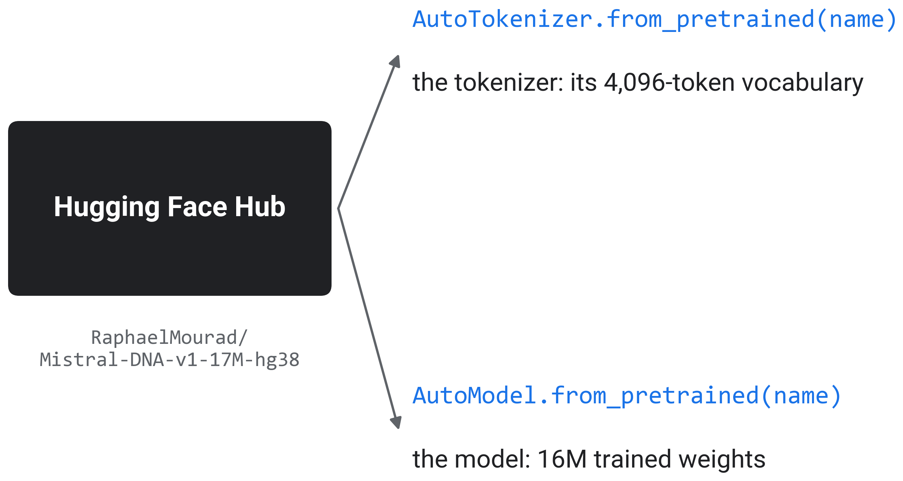{fig-align="center" height="766px"}

::: {.notes}
- The same two calls load any model on the Hugging Face Hub. Each model has a page with a model card: what it was trained on, how, and its known limits.
- The model reads DNA letters, so our U becomes T before tokenizing.
- The download goes to the Colab machine. Mistral-DNA is about 60 MB, roughly 10 seconds.
- Mistral-DNA has 16M parameters; the "17M" in its name includes an output layer we do not use.
- In the notebook, TODO-1 is one function, `embed`, written from a table that maps each step (tokenize, run the model, last layer, masked mean, collect) to its API.
:::

## 6.2 Your turn

Open **`02_foundation_models.ipynb`**.

{fig-align="center" height="679px"}

::: {.notes}
- Signatures: `embed(tok, model, seqs)` returns an `(N, 256)` array; `probe_auc(...)` returns `(auc, probe)`.
- TODO-1: before writing `embed`, the notebook prints one sequence's tokens and a padded pair, and asks how many letters a token holds (about 5) and whether a ~330-letter sequence fits in 512 tokens. The test checks the same vector alone and in a padded batch. Its test checks the same vector whether a sequence is embedded alone or in a batch. If the attention mask is ignored, padding changes the average and the vector of a sequence changes with its batch.
- TODO-2: the probe trains on 12,000 sequences (the `C=0.1` setting means fairly strong regularisation). If the result is about 0.82, it was scored on the training set; the test cell says so.
- NT-500M (human reference) is a 2 GB download, so its vectors are provided. It scores about 0.79 from these precomputed vectors.
- The live row is section 3 of the notebook: start the cell and read the take-aways while it trains.
- Each TODO has a test cell; the solutions are published on the workshop site during the workshop.
:::

::: {.center}
# 7 Frozen models and the CNN {data-name="Results"}
:::

## 7.1 Frozen pretrained models against the CNN

{fig-align="center" height="766px"}

::: {.notes}
- Show after the notebook. Held-out AUROC on the same 1,000 sequences; bars start at 0.5 (chance). Blue: probes on frozen pretrained models (light blue: the 105M model after 3 minutes of pretraining; grey: random weights); green: the CNN trained on all 92,346 sequences.
- Mistral-DNA with a probe: 0.78. NT-500M, 30 times larger: 0.79. A difference of 0.01 on 1,000 test sequences is within sampling noise, so there is no evidence that size helps here.
- Both are below the part 1 CNN at 0.86, but the CNN was trained on about 92,000 labels and the probes on 12,000. At equal label counts the gap is smaller (part 3: CNN 0.82 vs probe 0.77 at 12,000 labels).
- The 105M model with random weights gives 0.55; after 3 minutes of pretraining, 0.72 in the run on this figure (0.73 in our latest run). That is only a little above the two composition numbers of part 1 (0.66), so it should not be read as learned binding biology.
:::

