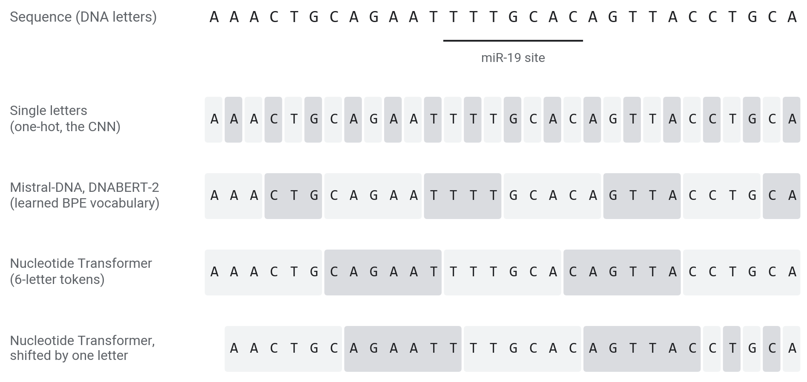

::: {.center}
# 1 From sequence to prediction {data-name="Overview"}
:::

## 1.1 Pretrain once, reuse many times

- A **foundation model** is pretrained on unlabelled sequence, then adapted to many tasks. A DNA **language model** is one pretrained to predict tokens of genome sequence from the other tokens
- Today's example: **Mistral-DNA**, 16M parameters, pretrained on the human genome

| Stage | Data | Labels | Example |
|:--|:--|:--|:--|
| **Pretraining** | billions of letters of genome sequence | none | Mistral-DNA: the human genome |
| **Adaptation** | one task's data set | thousands | AGO2: 92,346 labelled sequences |

- **Claim**: what a model learns in pretraining transfers, so each task needs fewer labels. Parts 2 and 3 test it on AGO2

::: {.notes}
- Projected: 2 min.
- Most models so far, like our CNN, are trained from random weights for one task with that task's labels.
- Each task adds a small output layer (a head) and may adjust the model.
- Heads differ by task: a number (expression level), a label per position (splice sites), or one probability per sequence, as today.
:::

## 1.2 Four stages, in the CNN and in a language model

| Stage | The CNN (part 1) | A DNA language model |
|:--|:--|:--|
| **Tokenization** | single letters | k-mers or learned BPE tokens |
| **Embedding** | a one-hot column of 4 numbers | a learned vector per token (256 numbers in Mistral-DNA) |
| **Body** | two convolution layers | a transformer (8 layers in Mistral-DNA) |
| **Prediction head** | a linear layer → one logit | pretraining: a probability for every token; our task: a linear layer → one logit |

::: {.notes}
- Projected: 2 min.
- The same four stages describe every sequence model today. This part goes through them in order; the transformer stays a black box.
- The CNN's stages were fixed by us (one-hot) or trained on 92,346 labels. A language model learns its embedding and body from unlabelled genome sequence first.
:::

::: {.center}
# 2 Tokenization {data-name="Tokens"}
:::

## 2.1 Single letters

- The CNN read one token per letter, each a one-hot column (part 1)
- A vocabulary of 4, and a 330-letter sequence is 330 tokens
- Every position is kept, but the model has to learn from scratch which letters belong together

::: {.notes}
- Projected: 1 min.
- Some genome models (HyenaDNA, Evo) also read single letters, which needs a model that can handle long inputs: a 1,000-letter sequence is 1,000 tokens.
:::

## 2.2 k-mers

- A **k-mer** is a fixed word of k letters. Nucleotide Transformer cuts DNA into consecutive 6-mers, a vocabulary of $4^6 = 4{,}096$
- `AAACTG CAGAAT TTTGCA CAGTTA CCTGCA ...`
- Shift the sequence by one letter and every token changes: `AACTGC AGAATT TTGCAC AGTTAC ...`

::: {.notes}
- Projected: 1 min.
- The models read DNA letters, so U becomes T. This is the start of a real bound sequence from our data.
- A sequence of n letters becomes about n / 6 tokens, so the model can read six times more sequence for the same cost.
- The letters left over at the end become single-letter tokens.
:::

## 2.3 Byte-pair encoding (BPE)

- Start from the 4 letters. Count every pair of neighbouring tokens in the genome, merge the most frequent pair into one new token, and repeat until the vocabulary has 4,096 tokens
- Frequent stretches become one token and rare ones stay short, so token lengths vary. Mistral-DNA and DNABERT-2 share one BPE vocabulary

{fig-align="center" height="492px"}

::: {.notes}
- Projected: 2 min.
- Real tokenizers on the same bound sequence, one row per method.
- Single letters (row 2) are what the CNN read. The 6-mer rows are the previous slide.
- The underlined miR-19 site is split differently by each tokenizer. No model sees it as one unit.
:::

::: {.center}
# 3 Embedding {data-name="Embedding"}
:::

## 3.1 Token embeddings

- Each token in the vocabulary has a row in a learned table $E$ (4,096 tokens × 256 numbers in Mistral-DNA)
- Token number $i$ becomes the vector $e_i$, row $i$ of $E$. With a one-hot vector $x_i$: $\;e_i = x_i^\top E$
- The CNN's one-hot encoding is the same lookup with a fixed 4 × 4 identity table: 4 tokens, 4 numbers each, nothing learned
- The table is learned during pretraining, so tokens that occur in similar contexts end up with similar vectors

::: {.notes}
- Projected: 2 min.
- Multiplying a one-hot vector by $E$ selects one row of $E$, so an embedding layer is implemented as a table lookup.
- These are the input vectors, one per token. Section 4 follows them through the transformer and back out as one vector per sequence.
:::

::: {.center}
# 4 The transformer {data-name="Transformer"}
:::

## 4.1 The transformer, as a black box

- **In**: one vector per token. **Out**: one vector per token, the same size
- Each output vector depends on all the tokens in the sequence (attention), not only on its own token
- Mistral-DNA: 8 layers, 256 numbers per token, up to 512 tokens, 16M parameters

::: {.notes}
- Projected: 2 min.
- Inside each layer, attention mixes information between positions (8 attention heads per layer in Mistral-DNA) and a small feed-forward network transforms each position. Mistral-DNA's feed-forward part is a mixture of 8 experts. We do not open these today.
- For the exercise we need only its last layer's output: the token-by-256 matrix on the next slide, averaged into one vector.
- The CNN's convolutions see a 10-letter window and then a few pooled neighbours; a transformer layer can relate any two tokens in the input.
:::

## 4.2 From token vectors to one sequence embedding

- **Sequence embedding**: the transformer's last-layer output, averaged over all non-padding tokens (including the special start and end tokens `[CLS]` and `[SEP]`)

{fig-align="center" height="596px"}

::: {.notes}
- Mistral-DNA on the first 60 letters of one real sequence: each token is mapped to an integer, the model outputs one 256-number vector per token in its last layer, and we average those vectors.
- In a batch, shorter sequences are padded. The attention mask (1 for real tokens, 0 for padding) keeps padding out of the average.
- A few dimensions are large for almost every token (the vertical stripes). That is common in transformer models and does not depend on the sequence.
:::

::: {.center}
# 5 Prediction heads {data-name="Heads"}
:::

## 5.1 Prediction heads

| Use | Head on top of the transformer | Output |
|:--|:--|:--|
| Pretraining, next token | linear layer 256 → 4,096, softmax | a probability for every possible next token |
| Pretraining, masked tokens | linear layer → vocabulary, softmax | a probability for every possible hidden token |
| Our task | average over tokens, then linear layer 256 → 1, sigmoid | P(bound), as the CNN's last layer |

- **Softmax**: turns one score per token of the vocabulary into probabilities that sum to 1
- **Linear probe**: the task head trained on the frozen model's sequence embeddings, which is logistic regression

::: {.notes}
- Projected: 2 min.
- After pretraining the vocabulary head is discarded and a new task head is attached. The body (and the embedding table) is what transfers.
- Before the logistic regression each of the 256 dimensions is standardised.
- Frozen body, new linear head: a linear probe (this part's notebook). Body adapted too: fine-tuning (part 3, LoRA).
:::

## 5.2 Two pretraining objectives

- **Next token** (Mistral-DNA, HyenaDNA, Evo): $\;\mathcal{L} = -\log p_\theta(x_t \mid x_{<t})$
- **Masked tokens** (Nucleotide Transformer, DNABERT-2): $\;\mathcal{L} = -\log p_\theta(x_t \mid x_{\setminus t})$, hidden tokens predicted from both sides

{fig-align="center" height="492px"}

::: {.notes}
- These are the losses the vocabulary heads of slide 5.1 are trained with.
- The figure: Mistral-DNA, given the first tokens of a real sequence, assigns a probability to each of its 4,096 possible next tokens. Its top choice gets about 10%; the true token is shown at the bottom with its much lower probability.
- Much of the genome is hard to predict from local context, so the loss stays high even in a trained model.
- Masked models hide about 15% of the tokens and predict them from the tokens on both sides.
- In both cases the genome supplies its own targets, so no experimental labels are needed.
:::

## 5.3 The landscape, 2021 to 2025

{fig-align="center" height="700px"}

::: {.notes}
- DNABERT (110M parameters), Nucleotide Transformer (50M to 2.5B), DNABERT-2 and HyenaDNA, then Evo (7B) and Evo 2 (40B).
- Filled points are masked models, open points next-token models.
- Not shown: Enformer, Borzoi and AlphaGenome, trained with labels from thousands of experiments; currently the strongest models for gene regulation.
- The wrap-up shows ten models from these families tested on AGO2.

Next: load a pretrained model and probe it.
:::

::: {.center}
# 6 Hands-on {data-name="Hands-on"}
:::

## 6.1 From a sequence to a sequence embedding with Hugging Face

```python
from transformers import AutoTokenizer, AutoModel
name  = "RaphaelMourad/Mistral-DNA-v1-17M-hg38"
tok   = AutoTokenizer.from_pretrained(name, trust_remote_code=True)   # the token vocabulary
model = AutoModel.from_pretrained(name, trust_remote_code=True)       # the weights

seq = "UGAUUUAUCAAG...".replace("U", "T")            # the model reads DNA letters
ids = tok([seq], return_tensors="pt", padding=True)
h   = model(input_ids=ids["input_ids"], attention_mask=ids["attention_mask"],
            output_hidden_states=True).hidden_states[-1]          # (1, tokens, 256)
m   = ids["attention_mask"].unsqueeze(-1)            # 1 = real token, 0 = padding
vec = (h * m).sum(1) / m.sum(1)                      # (1, 256): the sequence embedding
```

::: {.notes}
- The same calls load any model on the Hugging Face Hub. Each model has a page with a model card: what it was trained on, how, and its known limits.
- The download goes to the Colab machine. Mistral-DNA is about 60 MB, roughly 10 seconds.
- Mistral-DNA has 16M parameters; the "17M" in its name includes an output layer we do not use.
- The tokenizer returns more keys than the model accepts, so pass only `input_ids` and `attention_mask`.
- The last three lines are TODO-1: average the last layer over the real tokens only.
:::

## 6.2 Your turn

Open **`02_foundation_models.ipynb`**.

| Step | Task | Check | Time |
|:--|:--|:--|:--|
| TODO-1 | `embed`: one 256-number vector per sequence | shape `(N, 256)`; same alone or in a batch | 9 min |
| TODO-2 | `probe_auc`: standardise, logistic regression, test AUROC | about 0.78 | 5 min |
| live | pretrain a 105M model for 3 minutes | probe before and after | 7 min |

- Given cells (setup, loading Mistral-DNA, 2-D map, NT-500M vectors, take-aways): about 12 min. Total about 33 min

::: {.notes}
- Signatures: `embed(tok, model, seqs)` returns an `(N, 256)` array; `probe_auc(...)` returns `(auc, probe)`. NT-500M scores about 0.79 from precomputed vectors.
- Projected hands-on total: about 33 min (the times in the notebook headings).
- TODO-1's built-in check: if the attention mask is ignored, padding changes the average and the vector of a sequence changes with its batch.
- TODO-2: the probe trains on 12,000 sequences (the `C=0.1` setting means fairly strong regularisation). If the result is about 0.82, it was scored on the training set.
- Each TODO has a "Stuck?" cell that loads our version.
- NT-500M (human reference) is a 2 GB download, so its vectors are provided.
:::

::: {.center}
# 7 What the probe found {data-name="Results"}
:::

## 7.1 What the sequence embeddings vary with

- **PCA**: project the 256-dimensional embeddings onto the two directions of largest variance

{fig-align="center" height="596px"}

::: {.notes}
- 12,000 Mistral-DNA embeddings, the same map the notebook draws.
- Left, coloured by G+C fraction: it changes smoothly across the map, mostly along direction 2 (correlation r = 0.81; with direction 1, r = 0.52).
- Right, coloured by label: bound sequences concentrate at the low-G+C end, unbound ones spread along both arms.
- Composition is one of the main axes of these vectors, and the two classes differ in composition. Part 3 tests how much of the probe's score that explains.
:::

## 7.2 Frozen pretrained models against the CNN

{fig-align="center" height="700px"}

::: {.notes}
- Held-out AUROC on the same 1,000 sequences.
- Mistral-DNA with a probe: 0.78. NT-500M, 30 times larger: 0.79. The difference is within the ±0.025 noise from part 1, so there is no evidence that size helps here.
- Both are below the part 1 CNN at 0.86, but the CNN was trained on about 92,000 labels and the probes on 12,000. At equal label counts the gap is smaller (part 3: CNN 0.82 vs probe 0.77 at 12,000 labels).
- The 105M model with random weights gives 0.55; after 3 minutes of pretraining, about 0.73 (next slide).
:::

## 7.3 Pretraining from random weights

{fig-align="center" height="700px"}

::: {.notes}
- The live cell: a 105M-parameter model of the same design as Mistral-DNA but larger, with random weights, trained to predict the next token on 200-letter pieces of the human genome for about 3 minutes (recipe from the Galaxy Training Network, Mourad and Batut, CC-BY).
- The loss falls from about 7.0 after 100 steps to about 6.4. Uniform guessing is ln 4096 ≈ 8.3; a model that knows only how frequent each token is, with no context, sits at the dotted line. Most of the early drop is learning token frequencies; going below the dotted line requires using context.
- Probed on AGO2 before and after: 0.55 to 0.73 in our latest run (1,834 steps; earlier runs gave 0.72 and 0.75). That is only a little above the two composition numbers of part 1, slide 2.4 (0.66), so it should not be read as learned binding biology.
- A T4 completes fewer steps in 3 minutes than our A30 test GPU, so expect a smaller gain. The released Mistral-DNA, a different model trained far longer, reaches 0.78.
:::
