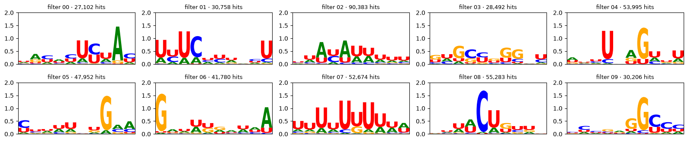
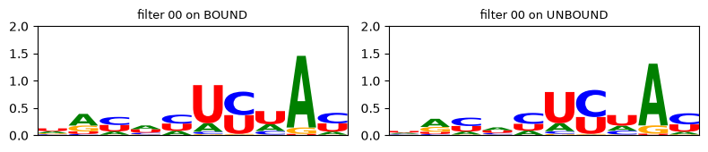
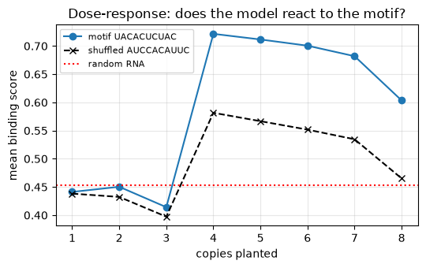
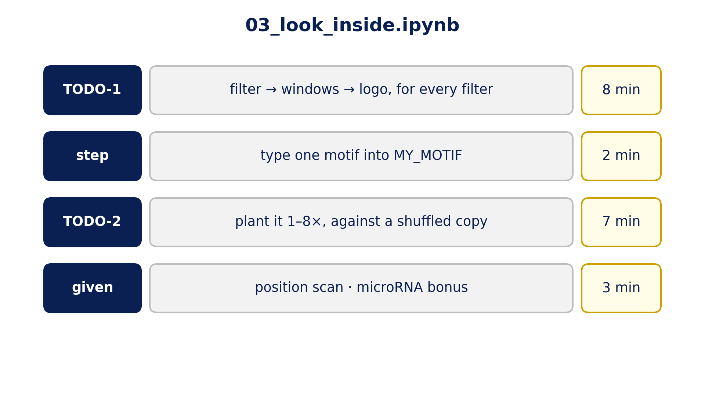

::: {.center}
# 1 Look {data-name="Look"}
:::

## 1.1 A filter and its logo

{fig-align="center" width="85%"}

{fig-align="center" height="520px"}

::: {.notes}
**Interrogate: 0.86 is a score, not an explanation**

- left: filter 00's 40 weights. Right: its **logo**: the letters in the ~25,000 windows where it fired (the notebook's count differs a little: it scans a different set), stacked per position.
- logo height = information in **bits**: 2 = always the same letter, 0 = doesn't care
- the logo keeps what the filter *likes*; its negative weights (what it *avoids*) don't appear. A logo is a lossy summary.
- **TODO-1** builds a logo for every filter: `cutoff_for → windows_above → pwm_of → consensus_of`
:::

## 1.2 All ten filters

{fig-align="center" width="100%"}

::: {.notes}
- reference CNN: mostly U-rich logos, two G/C-rich ones (filters 03 and 09), few crisp "words"
- **step after TODO-1:** pick the cleanest logo, read its motif (tallest letter per column), type it into `MY_MOTIF`. That is your hypothesis.
:::

## 1.3 Same filter on unbound RNA

{fig-align="center" width="92%"}

::: {.notes}
- the control for "looking": filter 00 on bound vs unbound RNA gives almost the same logo
- so it measures something about RNA in general (its composition), not something specific to AGO2
:::

::: {.center}
# 2 Test {data-name="Test"}
:::

## 2.1 Plant it, against a shuffled copy (TODO-2)

{fig-align="center" height="700px"}

::: {.notes}
**The experiment**

- 1,000 random RNA sequences = baseline (red dotted)
- plant your motif 1…8 times (blue) vs the **same letters shuffled** (black dashed)
- read the **gap** between the curves: the shuffle changes the score too, because it has the same letters
- the jump at **4 copies** is suspicious: `plant()` writes copy 4 at letter 175 …
:::

## 2.2 Where, not only what

{fig-align="center" height="710px"}

::: {.notes}
**One copy at every position, 400 random sequences each (given cell in the notebook)**

- the motif only matters between letters ~140 and ~190, exactly where every sequence in the data has its measured site
- the CNN's last layer learned that (Slot 2, slide 1.4): one weight per **position**
- so "copy 4" hit the sweet spot; copies 1–3 landed where the model doesn't look
- not a flaw; but "does this motif matter?" depends on **where** you test it
:::

## 2.3 Your turn

{fig-align="center" height="710px"}

::: {.notes}
**Open `03_look_inside.ipynb`**

- first cell: `USE_MY_CNN = True` to upload your `my_cnn.pt` from Slot 2, or leave it False to use ours
- TODO-1: logos for every filter · step: type your motif into `MY_MOTIF` · TODO-2: plant vs shuffled
- the position scan and the bonus run as given cells
- this shuffle reorders the motif's letters; Slot 6 has a stricter one
:::

::: {.center}
# 3 Back to the seed {data-name="microRNA"}
:::

## 3.1 Did it learn the seed rule?

{fig-align="center" height="710px"}

::: {.notes}
**The hypothesis from Slot 1: a good model should respond to seed sites (bonus cell)**

- 6 copies planted into real unbound RNA, vs the same letters shuffled (grey: mean ± sd of 10 shuffles)
- **miR-15/16 (UGCUGCU): 0.52 vs 0.31 ± 0.10**, a clear effect · miR-19: 0.43 vs 0.34 ± 0.06, within the shuffle spread: not evidence · miR-30 and let-7: no difference
- the CNN picked up one seed rule (miR-16) without being told; its logos didn't show it, the experiment did
- in our data these seed sites are 3–6× enriched in bound sequences but appear in only ~1–2% of them: a weak signal, learned partly
- **reading the result:** compare each bar with its own shuffled bar, not with the baseline

> Next (Roee): models pretrained on the whole genome.
:::
