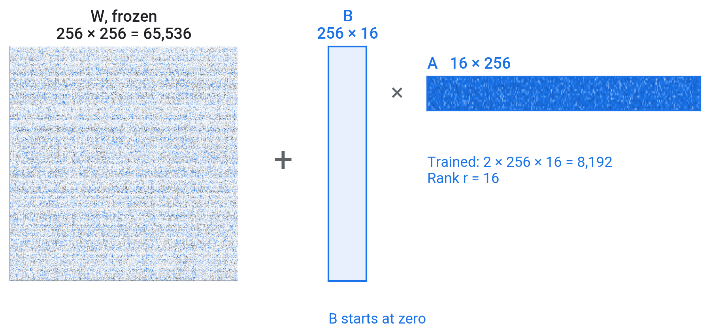
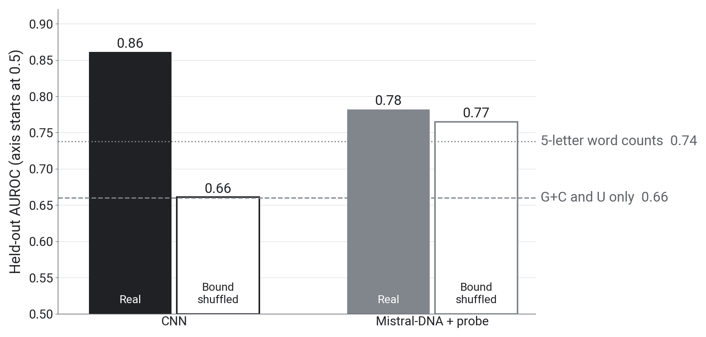
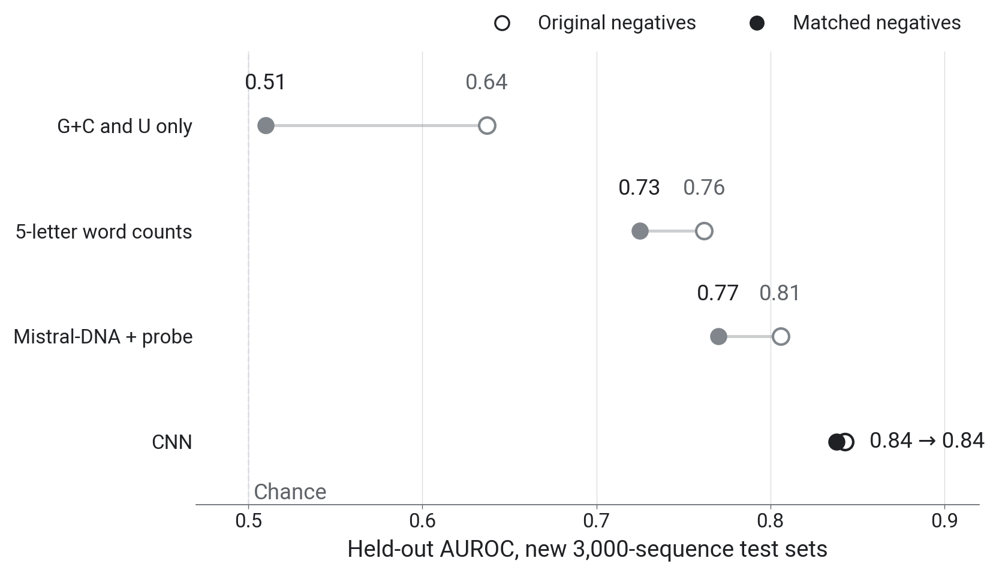

::: {.center}
# 1 Simpler explanations {data-name="Shortcuts"}
:::

## 1.1 The two classes differ in composition

- A **shortcut** is a simple property that differs between the classes in this data set, such as G+C
- Before crediting a model with biology, measure what much simpler features achieve

{fig-align="center" height="538px"}

::: {.notes}
- Bound sequences have less G+C than unbound ones: mean 0.41 against 0.45 over all 92,346 sequences. It was visible in the data raster in part 1 and in the embedding map in part 2.
- The unbound sequences are random positions in the same genes as the bound sites. AGO2 sites are often in AU-rich 3′ UTRs, so part of this difference may be real biology and part may come from how the negatives were drawn. Section 2 tests that.
- Two simple models and one stress test:
  - TODO-1: logistic regression on two numbers per sequence, the G+C and U fractions.
  - TODO-2: logistic regression on the counts of all 1,024 five-letter words, which ignores order and position.
  - TODO-3: the shuffle test, next slide.
- If a simple model scores well, a larger model may be using the same shortcut.
:::

## 1.2 The dinucleotide shuffle test

- A **dinucleotide** is a pair of neighbouring letters. The shuffle keeps every letter and dinucleotide count and scrambles everything longer, including where sites sit

{fig-align="center" height="596px"}

::: {.notes}
- A real bound sequence and its dinucleotide shuffle (Altschul and Erickson 1985). All 16 letter-pair counts are identical, so G+C is identical too; the miR-16 site (underlined) is gone.
- Shuffle the 500 bound test sequences, keep the 500 unbound ones, and ask the trained model, without retraining, to separate them.
- A model that uses only letter and letter-pair composition keeps its score. A model that also uses longer patterns loses that part and drops towards the composition model's 0.66, not towards 0.5.
- For our CNN the shuffle also moves the site away from letters 150 to 190, so its drop mixes letter order and position.
:::

::: {.center}
# 2 A control {data-name="Control"}
:::

## 2.1 Composition-matched data

- Bin every sequence by G+C, U and length; in each bin keep **as many unbound as bound**
- Bound and unbound then have the same single-letter composition and length; letter pairs and longer words can still differ

{fig-align="center" height="538px"}

::: {.notes}
- 67,764 of the 92,346 sequences remain, from both classes. About 30% of the bound sequences are dropped because no unbound sequence matches them; the bound sequences that remain are the ones that look most like the negatives. No new experiment is needed.
- In the matched set, G+C, U and length carry no information about the label. Letter pairs and five-letter words still can.
- From the same file we build two test sets of 3,000 sequences each: one with the original negatives and one matched. A difference between them comes from how the sequences were selected.
:::

::: {.center}
# 3 Fine-tuning {data-name="Fine-tuning"}
:::

## 3.1 Four ways to adapt a pretrained model

| Method | Trained | Cost |
|:--|:--|:--|
| Linear probe | a new output layer only (after one pass to compute embeddings) | seconds to minutes |
| Partial fine-tuning | the output layer and the top layers | minutes |
| Full fine-tuning | all weights | minutes to days, with model size |
| LoRA | small low-rank matrices added to each layer | minutes |

::: {.notes}
- Projected: 2 min.
- "Fine-tuning" usually refers to the last three; the first is called probing. Part 2 used a probe; this part uses LoRA.
- Full fine-tuning with few labels overfits easily.
:::

## 3.2 LoRA

$$W x \;\rightarrow\; (W + BA)\,x, \qquad B \in \mathbb{R}^{256 \times r},\; A \in \mathbb{R}^{r \times 256},\; r = 16$$

{fig-align="center" height="605px"}

::: {.notes}
- Projected: 2 min.
- LoRA keeps each large weight matrix W fixed and learns a low-rank correction BA. Here W is one real 256 × 256 matrix from Mistral-DNA: 65,536 frozen weights against 8,192 trained ones.
- B starts at zero, so training begins exactly from the pretrained model.
- Across the models in our tests, LoRA trained between about 1% and 9% of the parameters.
- A 16M-parameter model could be fully fine-tuned on a laptop GPU; LoRA is how 500M-parameter models are adapted on modest hardware. Part 3 uses it on Mistral-DNA so you practise the method.
:::

::: {.center}
# 4 Hands-on {data-name="Hands-on"}
:::

## 4.1 Your turn

Open **`03_shortcuts_and_controls.ipynb`**. In the rejoin cell at the end of section 0, set `USE_MY_FILES = True` to upload your CNN and vectors, or keep `False` to use ours.

| Step | Task | Check | Time |
|:--|:--|:--|:--|
| TODO-1 | AUROC from G+C and U | about 0.66 | 6 min |
| TODO-2 | AUROC from 5-letter word counts | about 0.74 | 4 min |
| TODO-3 | shuffle test on the CNN and the probe | about 0.66 and 0.77 | 10 min |
| TODO-4 | `shortcut_scores()` on both test sets | G+C/U 0.64 → 0.51, probe 0.81 → 0.77 | 12 min |
| TODO-5 | the LoRA training step | about 0.81 | 11 min |

- Given cells (setup, CNN retrain, before and after, take-aways): about 10 min. Total about 53 min

::: {.notes}
- Helpers: TODO-1 `gc_u`, `probe_auc`; TODO-2 `kmer_counts(seqs, k=5)`; TODO-3 `dinuc_shuffle`; TODO-5 `batch_logits`, `crit`, `opt`, `scaler`. TODO-4 also gives 5-letter words 0.76 → 0.73. The CNN retrained on each training set scores about 0.84 on both. The label curve (optional, 2 min) is precomputed.
- Projected hands-on total: about 53 min, 55 with the optional section (the times in the notebook headings), including LoRA training. Each TODO has a "Stuck?" cell.
- TODO-3: score the shuffled sequences with the probe already fitted on real sequences.
- TODO-5: start the LoRA cell as soon as it is written and read on while it trains.
:::

::: {.center}
# 5 What broke, what survived {data-name="Results"}
:::

## 5.1 Scores before and after shuffling

{fig-align="center" height="700px"}

::: {.notes}
- Our run; the notebook prints only the two AUROCs.
- Score distributions on the held-out set: bound (blue), unbound (grey), shuffled bound (black outline).
- CNN: shuffled bound sequences move towards the unbound distribution, AUROC 0.66. Part of what the CNN uses is letter order or position.
- Mistral-DNA with a probe: shuffled sequences score almost like the originals, AUROC 0.77. Its embeddings change little when everything beyond letter pairs is scrambled.
- About a quarter of the unbound sequences get a probe score near 0 (the tall grey bar at score 0 in the right panel). They do not differ from the other unbound sequences in G+C, length or repetitiveness; we have not found what they share.
:::

## 5.2 Shuffling lowers the CNN, barely moves the probe

{fig-align="center" height="700px"}

::: {.notes}
- Two numbers alone reach 0.66, nearly half of the distance from chance (0.5) to the CNN (0.86).
- Five-letter word counts, with no order or position, reach 0.74. Counted only inside the 40-letter site, word counts reach 0.83, close to the CNN, which suggests that much of what the CNN adds is where it looks.
- CNN: 0.86 on real sequences, 0.66 after shuffling, the same as the composition model. The shuffle removes both letter order and site position.
- Mistral-DNA probe: 0.78 on real sequences, 0.77 shuffled. Its score survives a shuffle that keeps letter and letter-pair counts, so most of what it uses is composition at that level.
- The gap between real and shuffled is the part of a score that depends on letter order and position.
:::

## 5.3 Discussion

1. How much of each score do two composition numbers explain?
2. Which model barely changed after the shuffle, and what does that say about what it uses?
3. Which part of the G+C difference could be AGO2 biology (3′ UTRs are A/U-rich), and which part could come from how the unbound positions were drawn?

::: {.notes}
- Two minutes with your neighbour.
- Question 3 connects the shuffle results with the matched data on the next slide.
:::

## 5.4 Before and after matching

{fig-align="center" height="700px"}

::: {.notes}
- These are new 3,000-sequence test sets, not the 1,000 held-out sequences used until now, so the "original" values differ slightly from earlier results (CNN 0.84 here, 0.86 before). On 3,000 sequences, 95% of resampled AUROCs fall within about ±0.015.
- Two numbers: 0.64 to 0.51, chance level. Single-letter composition carried that score.
- Five-letter word counts and the frozen probe each lose about 0.04 and keep most of their score: they rely on letter-pair and short-word composition, which matching does not remove.
- The CNN: 0.84 to 0.84 (notebook run). It uses more than single-letter composition.
:::

## 5.5 Fine-tuning against the CNN

{fig-align="center" height="700px"}

::: {.notes}
- Run offline on our A30 server with NT-500M (human reference), on matched data: the same labelled sequences and the same 3,000-sequence matched test set for every model.
- 20,000 labels: CNN 0.84, frozen probe 0.78, fine-tuned 0.87.
- 500 labels: CNN 0.66, frozen 0.73, fine-tuned 0.75.
- CNN and LoRA have three runs each, from different random starting weights (dots); the frozen probe has one run. The CNN and LoRA runs do not overlap at either label count.
- In the notebook you fine-tuned the smaller Mistral-DNA (about 0.81), which improved on its frozen probe but stayed below the CNN (0.84). The 500M model needs more GPU memory than free Colab offers.
- These fine-tuned models have not been put through the shuffle test yet.
:::

## 5.6 Test AUROC against the number of labels

{fig-align="center" height="700px"}

::: {.notes}
- The notebook plots three of these lines, up to 12,000 labels.
- Each model trained on 100 to 30,000 labelled matched sequences, three random draws per size (lines, with one standard deviation shaded).
- Frozen Mistral-DNA beats the CNN up to about 2,500 labels; above about 5,000 the CNN is better. At 12,000 labels: CNN 0.82, frozen probe 0.77.
- The same Mistral-DNA architecture with random weights stays between 0.50 and 0.57, so the advantage at low label counts comes from pretraining.
- Five-letter word counts also beat the CNN below about 1,000 labels.
- Squares: the CNN in the head-to-head experiment of the previous slide, diamonds: NT-500M fine-tuned. At 500 labels the CNN scores 0.58 on the curve and 0.66 in the head-to-head: the same recipe on different draws of 500 sequences, with single runs between 0.51 and 0.68. At that size, which sequences you have matters as much as the model.

:::

::: {.center}
# 6 Wrap-up {data-name="Wrap-up"}
:::

## 6.1 The day in nine results

| Part | Finding | Number |
|:--|:--|:--|
| 1 | seed-site words are enriched in bound sites | miR-19 site UUUGCAC 6 times enriched, in 1–2% of bound sites |
| 1 | a CNN trained on 92,346 sequences | held-out AUROC 0.86 |
| 1 | it responds to one inserted seed site | miR-15/16: 0.53 vs 0.31 shuffled |
| 1 | it weighs position | effect only at letters ~140–190 |
| 2 | frozen pretrained models + probe | 0.78–0.79 |
| 3 | two composition numbers alone | 0.66 |
| 3 | after a dinucleotide shuffle | CNN 0.86 → 0.66, probe 0.78 → 0.77 |
| 3 | composition-matched data | G+C/U 0.64 → 0.51, CNN 0.84 → 0.84 |
| 3 | Mistral-DNA fine-tuned with LoRA (20,000 labels) | 0.81 on matched data, frozen 0.77, CNN 0.84 |

::: {.notes}
- Each row is a measured number from today; the slides of each part have the figure behind it.
- The miR-15/16 row is the only seed site with an effect clearly beyond its shuffled controls; miR-19, miR-30 and let-7 were within the spread.
- The position row comes from inserting one copy at every position: the score changes only where the measured site sits in almost every sequence.
:::

## 6.2 Ten pretrained models on matched data

{fig-align="center" height="700px"}

::: {.notes}
- Ten pretrained models from 3M to 2.5B parameters on the matched data, run offline.
- Frozen with a probe (grey): all between 0.72 and 0.79, below the CNN. Size makes little difference.
- All values on the 3,000-sequence matched test set.
- Fine-tuned with one shared LoRA recipe (blue, one run each): NT-500M and DNABERT-2 reach 0.87, Mistral-DNA 0.79 (the notebook's own recipe gives 0.81), and HyenaDNA drops from 0.78 to 0.72.
- The dashed line is the CNN trained on the whole matched training set; the probes used 12,000 labels and LoRA 20,000.
- NT-2.5B was not fine-tuned: our recipe undertrained it at that size.
:::

## 6.3 Five points to take home

1. Here the negatives were random positions in the same genes, and G+C and U alone separated them from bound sites with AUROC 0.66 (1,000 held-out sequences)
2. The encoding limits what a model can use: one-hot letters keep order and position, 5-letter word counts drop both, and each tokenizer splits the same seed site differently
3. Check simple baselines first: on the 1,000 held-out sequences, two composition numbers reached 0.66 and 5-letter word counts 0.74 (12,000 labels each), against 0.86 for the CNN (92,346 labels)
4. Test what a model uses with controls: insert a motif against a shuffled copy, shuffle the input, match the negatives
5. Frozen Mistral-DNA with a probe scored 0.77 on the 3,000-sequence matched test set, and 0.77 against 0.78 under the shuffle. In one offline benchmark on the same test set, NT-500M fine-tuned with LoRA reached 0.87 against the CNN's 0.84 (20,000 labels, 3 runs each); it has not been shuffle-tested

## 6.4 When to use a pretrained model

- **Below about 2,500 labels**: a frozen pretrained model with a probe beat the CNN on this task
- **With 20,000 labels**: fine-tuned NT-500M (0.87) beat the CNN (0.84) in one offline benchmark (3,000 matched test sequences, 3 runs each); keep a small task model as the baseline
- **Not tested today**: scoring mutations (variants) without labels by how unexpected the model finds them (published results are mixed)

::: {.notes}
- The thresholds are from today's AGO2 label curve (slide 5.6) and will differ between tasks.
- Whatever model is chosen, the same tests apply: a simple baseline, a shuffle, a matched control.
:::

## 6.5 From a question to a model

1. **Question**: what should the model predict, and which experiment gives the labels?
2. **Negatives**: how were they chosen, and what else differs between the classes?
3. **Baselines**: what do composition and word counts already achieve?
4. **Model**: train on the task, or adapt a pretrained model (depends on the number of labels)
5. **Controls**: insert, shuffle, match; report held-out scores with their uncertainty

::: {.notes}
- This is the procedure we followed today, in the order to apply it to a new problem.
:::

## 6.6 Feedback

::: columns
::: {.column width="58%"}
- Two minutes: what should change for your background?
- **[forms.gle/NfE6ZHj98ri3WYmG6]{.nowrap}**
- Notebooks and slides stay online: **[github.com/mathoory/ai-days-2026-dna-workshop]{.nowrap}**
:::
::: {.column width="42%"}
{width="80%"}
:::
:::

::: {.notes}
:::

## 6.7 Credits and further reading

- **Data**: Maticzka et al. (2014) *GraphProt*, Genome Biology (the CLIP benchmark and its negatives). Pan and Shen (2018) *iDeepE*, Bioinformatics (the CNN design we follow).
- I. Ullah, **KAUST Genomic Foundation Models workshop** (2026): pipeline ideas, used with permission. github.com/bioinfo-kaust/gfm-workshop
- R. Mourad and B. Batut, **Galaxy Training Network**: pretraining and fine-tuning an LLM on DNA (CC-BY); R. Mourad (2024), *Mistral-DNA* models.
- Dalla-Torre et al. (2024) *Nucleotide Transformer*, Nature Methods. Zhou et al. (2024) *DNABERT-2*, ICLR. Nguyen et al. (2023) *HyenaDNA*, NeurIPS. Nguyen et al. (2024) *Evo*, Science. Brixi et al. (2025) *Evo 2*.
- Hu et al. (2021) *LoRA*. Tang and Koo (2024) *Evaluating the representational power of pre-trained DNA language models for regulatory genomics*.
- Altschul and Erickson (1985) dinucleotide shuffle. Tareen and Kinney (2020) *logomaker*. Friedman et al. (2009) *Most mammalian mRNAs are conserved targets of microRNAs*, Genome Research. Chin et al. (2008) *A SNP in a let-7 microRNA complementary site in the KRAS 3′ untranslated region increases non-small cell lung cancer risk*, Cancer Research.

