::: {.center}
# 1 Simpler explanations {data-name="Shortcuts"}
:::

## 1.1 The two classes differ in composition {data-todo="TODO-1"}

- A **shortcut** is a simple property that differs between the classes in this data set, such as G+C
- Before crediting a model with biology, measure what much simpler features achieve

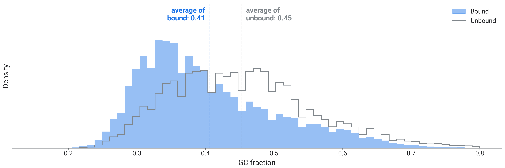{fig-align="center" height="538px"}

::: {.notes}
- G+C fraction of all 92,346 training sequences: bound filled blue, unbound grey outline, dashed lines at the class means.
- Bound sequences have less G+C than unbound ones: mean 0.41 against 0.45. It was visible in the data raster in part 1 and in the embedding map in part 2.
- The unbound sequences are random positions in the same genes as the bound sites. AGO2 sites are often in AU-rich 3′ UTRs (the part of an mRNA after its protein-coding letters), so part of this difference may be real biology and part may come from how the negatives were drawn. Section 2 tests that.
- Two simple models and one stress test:
  - TODO-1: write `gc_u`, the G+C and U fractions of a sequence, then a logistic regression on these two numbers.
  - TODO-2: count the 5-letter words of one sequence by hand, then a logistic regression on the counts of all 1,024 five-letter words, which ignores order and position.
  - TODO-3: the shuffle test, slide 1.3.
- If a simple model scores well, a larger model may be using the same shortcut.
- The G+C/U model is the logistic regression of part 1 slide 2.14, trained here on 12,000 sequences; it scores 0.66 held out.
:::

## 1.2 Word counts: a model without order {data-todo="TODO-2"}

- Count every 5-letter word in a sequence: 1,024 numbers, one per possible word

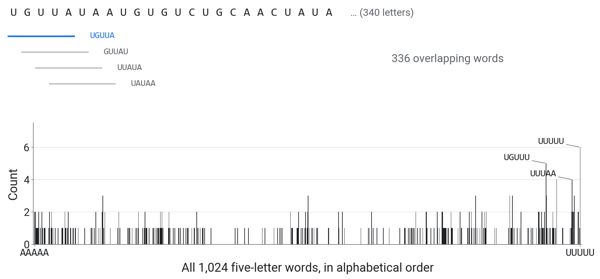{fig-align="center" height="642px"}

::: {.notes}
- Top: the start of one real bound sequence and its first four overlapping 5-letter words. A sequence of 340 letters has 336 of them.
- Bottom: how often each of the 1,024 possible words occurs in this sequence, in alphabetical order from AAAAA to UUUUU. 258 different words occur; the most frequent, UUUUU, 6 times.
- The notebook divides the counts by the number of words, so long and short sequences are comparable, and fits a logistic regression on the 1,024 numbers (12,000 labelled sequences): 0.74 held out.
- The counts keep which short words occur and drop everything longer than 5 letters, including their order and where in the sequence they are. A 7-letter motif appears only as its 5-letter pieces.
- The next slide's shuffle keeps even less: letters and letter pairs.
:::

## 1.3 The dinucleotide shuffle test {data-todo="TODO-3"}

- A **dinucleotide** is a pair of neighbouring letters. The shuffle keeps every letter and dinucleotide count and scrambles everything longer, including where sites sit

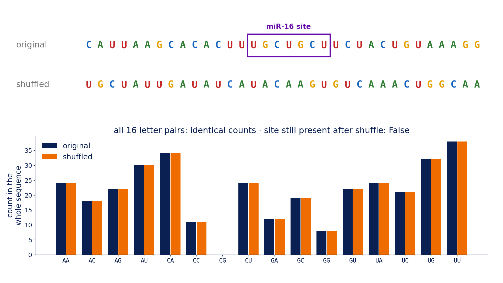{fig-align="center" height="596px"}

::: {.notes}
- Top: part of a real bound sequence and of its dinucleotide shuffle (Altschul and Erickson 1985). Bottom: the counts of the 16 letter pairs in the whole sequence, blue original, orange shuffled.
- All 16 letter-pair counts are identical, so G+C is identical too; every longer word is scrambled.
- Shuffle the 500 bound test sequences, keep the 500 unbound ones, and ask the trained model, without retraining, to separate them.
- A model that uses only letter and letter-pair composition keeps its score. A model that also uses longer patterns loses that part and drops towards the composition model's 0.66. The shuffled sequences keep their composition, so the score has no reason to fall to 0.5.
- For our CNN the shuffle also moves the site away from letters 150 to 190, so its drop mixes letter order and position.
:::

::: {.center}
# 2 A control {data-name="Control"}
:::

## 2.1 Composition-matched data

- Bin every sequence by G+C, U and length; in each bin keep **as many unbound as bound**
- Bound and unbound then have the same single-letter composition and length; letter pairs and longer words can still differ

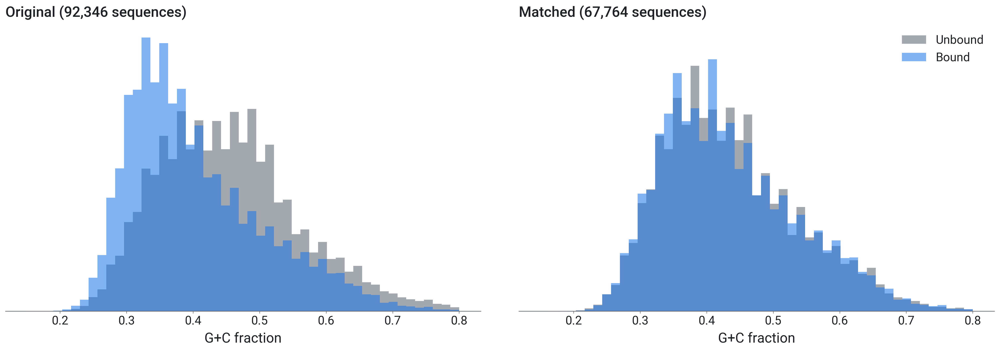{fig-align="center" height="538px"}

::: {.notes}
- G+C fraction before (left, all 92,346 training sequences) and after matching (right); blue bound, grey unbound.
- 67,764 of the 92,346 sequences remain, from both classes. About 30% of the bound sequences are dropped because no unbound sequence matches them; the bound sequences that remain are the ones that look most like the negatives. No new experiment is needed.
- In the matched set, G+C, U and length carry no information about the label. Letter pairs and five-letter words still can.
- From the same file we build two test sets of 3,000 sequences each: one with the original negatives and one matched. A difference between them comes from how the sequences were selected.
:::

::: {.center}
# 3 Fine-tuning {data-name="Fine-tuning"}
:::

## 3.1 Four ways to adapt a pretrained model

::: {.r-stack}
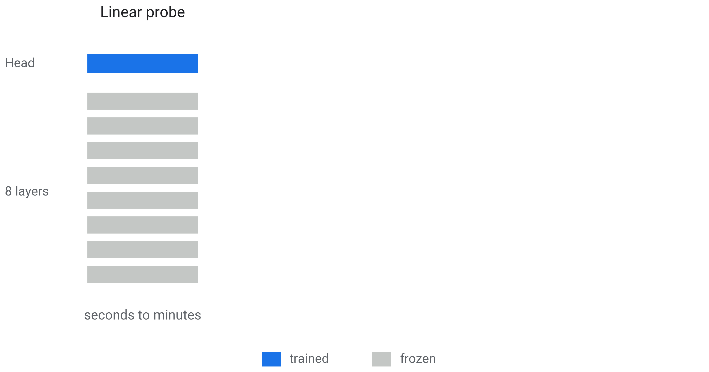{height="680px"}

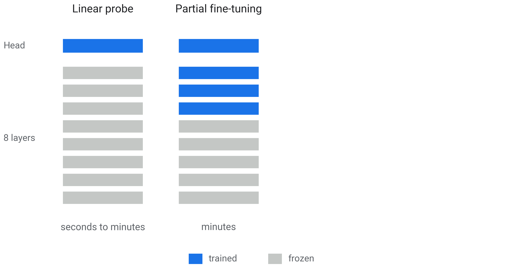{.fragment height="680px"}

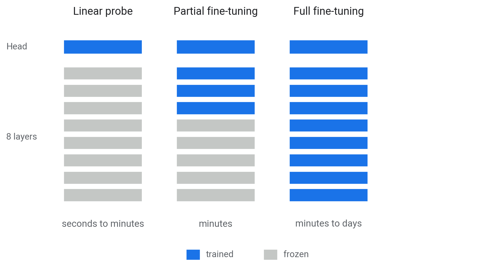{.fragment height="680px"}

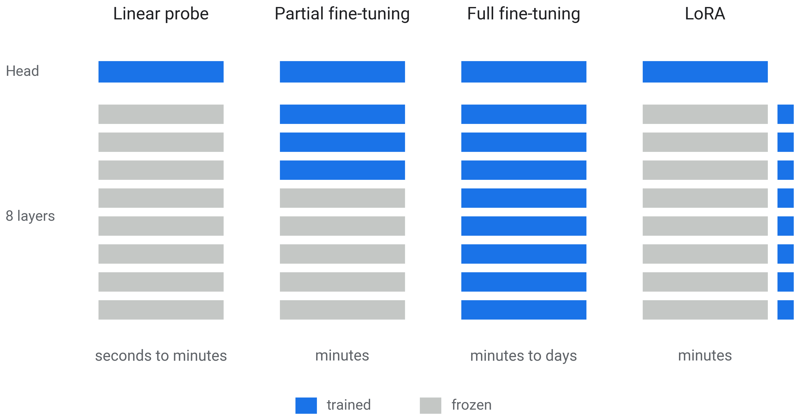{.fragment height="680px"}
:::

::: {.notes}
- Projected: 2 min.
- One column per method, one per click: the head at the top, the 8 layers below; blue trained, grey frozen. The bottom line gives the typical training time.
- These are the body and the heads of part 2: what changes is how much of the body is trained for the new task.
- Linear probe: a new output layer only, after one pass to compute embeddings. Partial fine-tuning: the head and the top layers. Full fine-tuning: all weights. LoRA: small low-rank matrices added to each layer.
- "Fine-tuning" usually refers to the last three; the first is called probing. Part 2 used a probe; the offline results at the end use LoRA, which trains small corrections to the weights instead of the weights themselves.
- Full fine-tuning with few labels overfits easily.
:::

::: {.center}
# 4 Hands-on {data-name="Hands-on"}
:::

## 4.1 Your turn

Open **`03_shortcuts_and_controls.ipynb`**; it starts from our CNN and our embeddings.

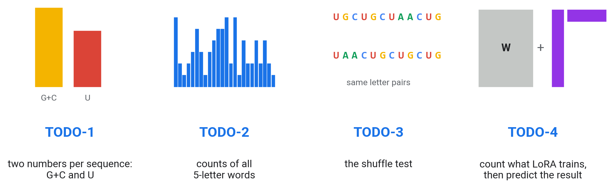{fig-align="center" width="100%"}

::: {.notes}
- Helpers: TODO-1 `probe_auc` (`gc_u` is written by the students); TODO-2 `Counter`, `kmer_counts(seqs, k=5)`; TODO-3 `dinuc_shuffle`.
- TODO-3: score the shuffled sequences with the probe already fitted on real sequences.
- `shortcut_scores` is a given cell that repeats TODO-1, TODO-2 and the probe on both benchmarks: G+C/U 0.64 → 0.51, 5-letter words 0.76 → 0.73, probe 0.81 → 0.77. The CNN retrained on each training set scores about 0.84 on both.
- The label curve (optional, 2 min) is precomputed. Each TODO has a test cell; the solutions are published on the workshop site during the workshop.
:::

::: {.center}
# 5 Beyond the notebook {data-name="Results"}
:::

## 5.1 Discussion

1. How much of each score do two composition numbers explain?
2. Which model barely changed after the shuffle, and what does that say about what it uses?
3. Which part of the G+C difference could be AGO2 biology (3′ UTRs, the end of an mRNA after its protein-coding part, are A/U-rich), and which part could come from how the unbound positions were drawn?

::: {.notes}
- Two minutes with your neighbour.
- Use the numbers from your notebook. Question 3 connects the shuffle results with the matched data of section 2.
:::

## 5.2 Fine-tuning against the CNN

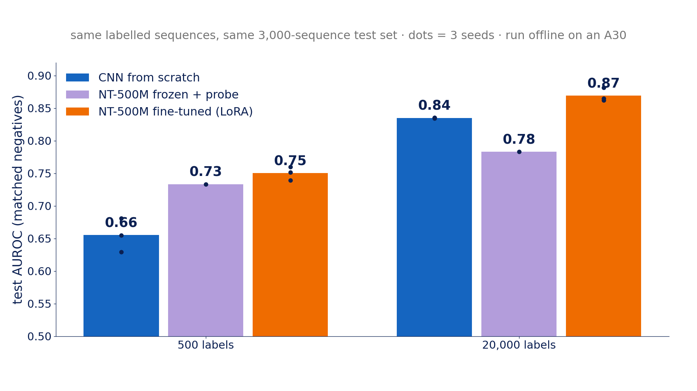{fig-align="center" height="700px"}

::: {.notes}
- Bars: mean AUROC; dots: single runs. Green: CNN from scratch; blue: NT-500M frozen with a probe; purple: NT-500M fine-tuned with LoRA. Left: 500 labels; right: 20,000.
- Run offline on our A30 server with NT-500M (human reference), on matched data: the same labelled sequences and the same 3,000-sequence matched test set for every model.
- 20,000 labels: CNN 0.84, frozen probe 0.78, fine-tuned 0.87.
- 500 labels: CNN 0.66, frozen 0.73, fine-tuned 0.75.
- CNN and LoRA have three runs each, from different random starting weights; the frozen probe has one run. The CNN and LoRA runs do not overlap at either label count.
- These fine-tuned models have not been put through the shuffle test yet.
:::

## 5.3 Test AUROC against the number of labels

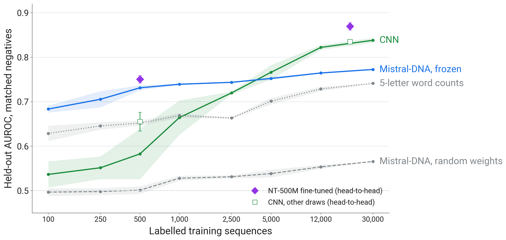{fig-align="center" height="700px"}

::: {.notes}
- x: labelled training sequences, log scale; y: AUROC on the 3,000-sequence matched test set. Each model trained on 100 to 30,000 labelled matched sequences, three random draws per size (lines, with one standard deviation shaded). Green: CNN; blue: frozen Mistral-DNA; grey dotted: 5-letter word counts; light dashed: Mistral-DNA with random weights.
- The notebook plots three of these lines, up to 12,000 labels.
- Frozen Mistral-DNA scores higher than the CNN up to about 2,500 labels; above about 5,000 the CNN is better. At 12,000 labels: CNN 0.82, frozen probe 0.77.
- The same Mistral-DNA architecture with random weights stays between 0.50 and 0.57, so the advantage at low label counts comes from pretraining.
- Five-letter word counts also score higher than the CNN below about 1,000 labels.
- Squares: the CNN in the head-to-head experiment of the previous slide, diamonds: NT-500M fine-tuned. At 500 labels the CNN scores 0.58 on the curve and 0.66 in the head-to-head: the same recipe on different draws of 500 sequences, with single runs between 0.51 and 0.68. At that size, the draw of training sequences changes the CNN's score by about as much as the differences between models.
:::

::: {.center}
# 6 Wrap-up {data-name="Wrap-up"}
:::

## 6.1 The day in numbers

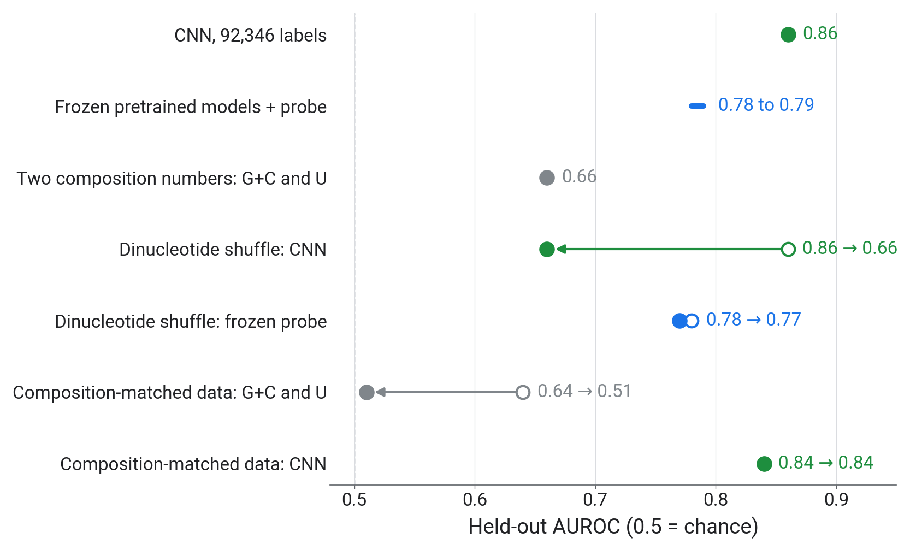{fig-align="center" height="720px"}

::: {.notes}
- Each row is a measured held-out AUROC from today; open circle to filled circle is the same model before and after a control.
- Green: the CNN; blue: frozen pretrained models; grey: two composition numbers.
- The shuffle and the matched data separate what each model uses: the composition model falls to chance on matched data, the CNN keeps its score there, and the frozen probe barely notices the shuffle.
:::

## 6.2 Ten pretrained models on matched data

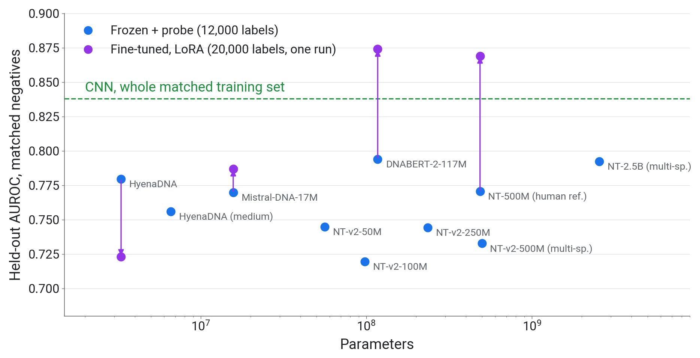{fig-align="center" height="700px"}

::: {.notes}
- Ten pretrained models from 3M to 2.5B parameters on the matched data, run offline. x: parameters, log scale; y: AUROC. All values on the 3,000-sequence matched test set.
- Frozen with a probe (blue): all between 0.72 and 0.79, below the CNN. Size makes little difference.
- Fine-tuned with one shared LoRA recipe (purple, one run each; the arrow goes from frozen to fine-tuned): NT-500M and DNABERT-2 reach 0.87, Mistral-DNA 0.79, and HyenaDNA drops from 0.78 to 0.72.
- The green dashed line is the CNN trained on the whole matched training set (0.84); the probes used 12,000 labels and LoRA 20,000.
- NT-2.5B was not fine-tuned: our recipe undertrained it at that size.
:::

## 6.3 Five points to take home

::: {.incremental}
1. Two composition numbers separated bound from unbound (AUROC 0.66)
2. The encoding limits what a model can use
3. Check simple baselines first
4. Test what a model uses with insertions, shuffles and matched data
5. Frozen pretrained models relied mostly on short-range composition
:::

::: {.notes}
- Point 1: the negatives were random positions in the same genes; on the 1,000 held-out sequences G+C and U alone reached 0.66.
- Point 2: one-hot letters keep order and position, 5-letter word counts drop both, and each tokenizer splits the same stretch of sequence differently.
- Point 3: two composition numbers reached 0.66 and 5-letter word counts 0.74 (12,000 labels each), against 0.86 for the CNN (92,346 labels).
- Point 4: the motif insertion against a control of the same letters, the dinucleotide shuffle (CNN 0.86 to 0.66) and matched data (G+C/U 0.64 to 0.51).
- Point 5: frozen Mistral-DNA with a probe scored 0.77 against 0.78 under the shuffle and 0.77 on the 3,000-sequence matched test set. In one offline benchmark, NT-500M fine-tuned with LoRA reached 0.87 against the CNN's 0.84 (20,000 labels, 3 runs each); it has not been shuffle-tested.
:::

## 6.4 When to use a pretrained model

::: {.incremental}
- **Below about 2,500 labels**: a frozen pretrained model with a probe
- **About 20,000 labels**: fine-tuning a large pretrained model
- **Always**: a small task model as the baseline
:::

::: {.notes}
- Below about 2,500 labels the frozen probe scored higher than the CNN on this task (slide 5.3).
- With 20,000 labels, fine-tuned NT-500M (0.87) scored higher than the CNN (0.84) in one offline benchmark (3,000 matched test sequences, 3 runs each).
- The thresholds are from today's AGO2 label curve (slide 5.3) and will differ between tasks.
- Whatever model is chosen, the same tests apply: a simple baseline, a shuffle, a matched control.
- Not tested today: scoring mutations (variants) without labels by how unexpected the model finds them; published results are mixed.
:::

## 6.5 From a question to a model

::: {.incremental}
1. **Question**: what to predict, and which experiment gives the labels
2. **Negatives**: how they were chosen
3. **Baselines**: composition and word counts
4. **Model**: train from scratch or adapt, by the number of labels
5. **Controls**: insert, shuffle, match; report uncertainty
:::

::: {.notes}
- This is the procedure we followed today, in the order to apply it to a new problem.
- Point 2 in full: how the negatives were chosen, and what else differs between the classes.
- Point 5 in full: report held-out scores with their uncertainty.
:::

## 6.6 Feedback

::: columns
::: {.column width="58%"}
- Two minutes: what should change for your background?
- **[forms.gle/NfE6ZHj98ri3WYmG6]{.nowrap}**
- Notebooks and slides stay online: **[mathoory.github.io/ai-days-2026-dna-workshop]{.nowrap}**
:::
::: {.column width="42%"}
{width="80%"}
:::
:::

::: {.notes}
- Feedback at the end of the notebook, before the final break (13:50). The link and the QR code open the same form.
:::

## 6.7 Credits and further reading

- **Data**: Maticzka et al. (2014) *GraphProt*, Genome Biology (the CLIP benchmark and its negatives). Pan and Shen (2018) *iDeepE*, Bioinformatics (the CNN design we follow).
- I. Ullah, **KAUST Genomic Foundation Models workshop** (2026): pipeline ideas, used with permission. github.com/bioinfo-kaust/gfm-workshop
- R. Mourad and B. Batut, **Galaxy Training Network**: pretraining and fine-tuning an LLM on DNA (CC-BY); R. Mourad (2024), *Mistral-DNA* models.
- Dalla-Torre et al. (2024) *Nucleotide Transformer*, Nature Methods. Zhou et al. (2024) *DNABERT-2*, ICLR. Nguyen et al. (2023) *HyenaDNA*, NeurIPS. Nguyen et al. (2024) *Evo*, Science. Brixi et al. (2025) *Evo 2*.
- Hu et al. (2021) *LoRA*. Tang and Koo (2024) *Evaluating the representational power of pre-trained DNA language models for regulatory genomics*.
- Altschul and Erickson (1985) dinucleotide shuffle. Tareen and Kinney (2020) *logomaker*.

::: {.notes}
- The data set and the CNN design come from GraphProt and iDeepE; the part 2 pretraining cell follows the Galaxy Training Network tutorial (CC-BY); the KAUST workshop's pipeline ideas are used with permission.
:::
