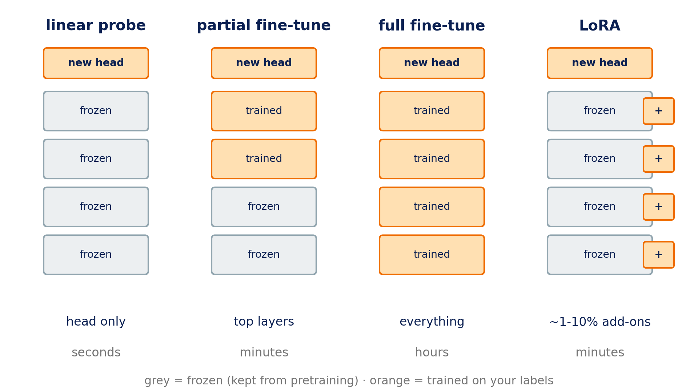

::: {.center}
# 1 Pretrained models {data-name="Pretrained"}
:::

## 1.1 Learn once, reuse

* **Pretrain once** on the unlabelled genome
* **Reuse** for every task, with a few labels

::: {.notes}
**[Roee] Draft by Mattan: adapt freely.**

- so far: every task (AGO2 binding, splice sites, promoters) collects its own labels and trains from zero, like our CNN
- now: a model first learns from the **unlabelled genome**, then each task adds a small piece on top
- the bet: what it learned transfers, so tasks need fewer labels. Slots 5–7 test the bet on AGO2.
- other tasks use other "heads": a number (expression), a label per letter (splice sites), the next letters (design). Today: one probability.
:::

## 1.2 Letters → tokens

{fig-align="center" height="710px"}

::: {.notes}
**[Roee] DNA has no spaces, so each model decides what a "word" is (real tokenizers, real bound sequence)**

- **Mistral-DNA** and **DNABERT-2** share one learned vocabulary (BPE): frequent stretches become a token; lengths vary
- **Nucleotide Transformer**: fixed 6-letter words. Shift the sequence by one letter and **every token changes** (bottom row); leftovers become single letters.
- the miR-19 site (purple) is cut differently by each tokenizer; no model sees it as one unit
- the models read T, not U: we convert RNA to DNA letters before tokenizing
:::

## 1.3 Tokens → one vector

{fig-align="center" height="710px"}

::: {.notes}
**[Roee] Mistral-DNA on one real sequence**

- tokens → IDs (numbers in brackets) → the model → its **last layer**: one 256-number vector per token
- `[CLS]` / `[SEP]`: special start/end tokens, not DNA
- average the token rows → **one row per sequence** (bottom). That's the *embedding*.
- in a batch, short sequences are **padded**; the **attention mask** (1 = real token, 0 = padding) makes sure the average uses real tokens only
- a **linear probe** = logistic regression on that vector (after standardising each of the 256 numbers)
- *Dodge: what happens inside the backbone (attention). It's a function from tokens to vectors.*
:::

## 1.4 What pretraining teaches

{fig-align="center" height="710px"}

::: {.notes}
**[Roee] The pretraining task, live from Mistral-DNA**

- after reading the first tokens of a real sequence, the model gives a probability to each of its 4,096 tokens as the next one
- its top guess has ~10%; the true token isn't in its top 8. DNA is hard to predict: much of the genome looks almost random to it.
- the loss it was trained on = −log(probability of the true next token). A blind guess among 4,096 = ln 4096 ≈ 8.3.
- two flavours: **predict next** (Mistral-DNA, HyenaDNA, Evo) and **fill in a hidden piece** (Nucleotide Transformer, DNABERT-2)
- no labels needed for pretraining: the genome provides the answers
:::

## 1.5 The landscape

{fig-align="center" height="710px"}

::: {.notes}
**[Roee] 2021–2025**

- DNABERT (110M) → Nucleotide Transformer (50M–2.5B) → DNABERT-2, HyenaDNA → Evo (7B) → Evo 2 (40B)
- green = fill in the blank · brown = predict next
- not on the plot: Enformer, Borzoi, AlphaGenome, trained **with labels** on thousands of experiments; today's strongest regulatory models
- Slot 7 shows 10 of these tested on AGO2 (offline runs): frozen, size barely matters; fine-tuned, some beat our CNN
:::

## 1.6 Four ways to use a pretrained model

{fig-align="center" height="710px"}

::: {.notes}
**[Roee] Fine-tuning, from cheapest to most expensive**

- **linear probe:** everything frozen, train only a new head. Seconds. (Slot 5)
- **partial fine-tune:** also retrain the top layers
- **full fine-tune:** retrain everything. Most expensive; with few labels it overfits easily.
- **LoRA:** keep every weight frozen, train small add-on matrices inside each layer (~1–10% of the parameters). (Slot 7)
- "fine-tuning" usually means the last three; the first is called **probing**

*Next: Slot 5. The students load a pretrained model and probe it.*
:::
