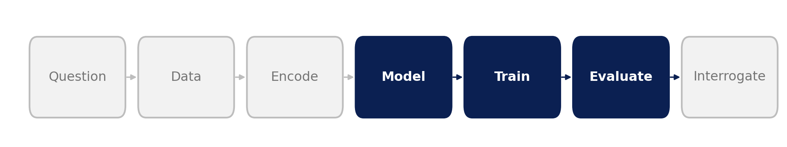
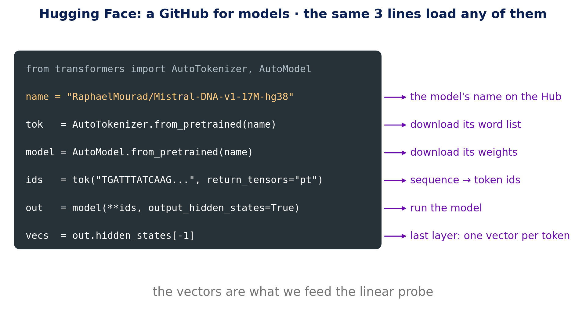
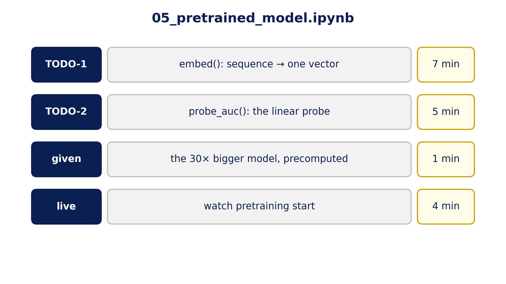
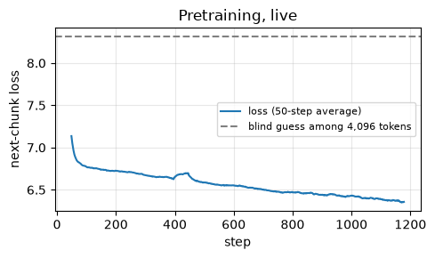
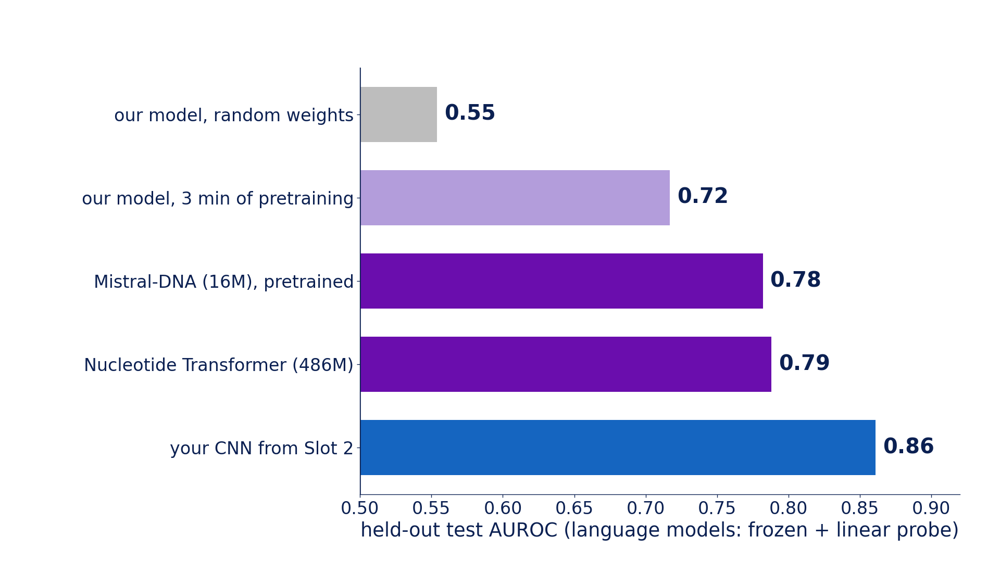

::: {.center}
# 1 Borrow a model {data-name="Borrow"}
:::

## 1.1 Three lines load any model

{fig-align="center" width="85%"}

{fig-align="center" height="520px"}

::: {.notes}
**Model · Train · Evaluate, with a model someone else trained**

- Hugging Face: a public hub of models and data sets; each model has a page and a **model card** (what it was trained on, its limits)
- the same three steps for any model: tokenizer → model → outputs
- downloads go to the Colab machine, not your laptop: Mistral-DNA is ~60 MB, about 10 seconds
- Mistral-DNA has 16M parameters; the "17M" in its name includes an output layer we don't use
:::

## 1.2 Your turn

{fig-align="center" height="710px"}

::: {.notes}
**Open `05_pretrained_model.ipynb`. Fill in the two TODOs; ask an AI if you are stuck.**

- **TODO-1 `embed()`:** sequence → tokens → last layer → average over **real** tokens (use the attention mask) → `(N, 256)`. The check: the same sequence must give the same vector alone or next to a longer one.
- **TODO-2 `probe_auc()`:** standardise → logistic regression → AUROC **on the test set**; return `(auc, probe)`. Expect ≈ 0.78.
- each TODO lists the gotchas to tell your assistant and the number to expect; if a check fails, a "Stuck?" cell gives our version
- the 30× bigger model's vectors are precomputed (it's a 2 GB download)
- last cell: download your vectors (Slot 6 can use them, or ours)
:::

::: {.center}
# 2 What it learned {data-name="Results"}
:::

## 2.1 Watch pretraining start

{fig-align="center" height="700px"}

::: {.notes}
**The live cell: a fresh 105M-parameter model, random weights, ~4 minutes**

- it reads 200-letter pieces of the human genome and learns to predict the next chunk (Galaxy Training Network recipe, Mourad & Batut, CC-BY)
- the loss is ~7.0 after 100 steps and ~6.4 by 3 minutes (dashed line: blind guessing, ln 4096 ≈ 8.3)
- probe it on AGO2 before and after: **0.55 → 0.72** (A30 reference run; another run gave 0.75. A T4 makes fewer steps in 3 minutes, so expect less)
:::

## 2.2 The scoreboard

{fig-align="center" height="710px"}

::: {.notes}
**Reference run, held-out test AUROC**

- random weights 0.55 → 3 minutes of pretraining ~0.72 → Mistral-DNA, fully pretrained, **0.78**
- Nucleotide Transformer, 30× bigger: **0.79**. Within the ±0.025 noise (Slot 1): no evidence of a difference.
- frozen + probe, both are below the CNN from Slot 2 (**0.86**)
:::

## 2.3 What the vectors encode

{fig-align="center" height="710px"}

::: {.notes}
**12,000 real Mistral-DNA vectors, squashed to their 2 main directions (the notebook's map cell)**

- PCA = the two directions along which the vectors vary most
- left, coloured by G+C: a smooth gradient along direction 1 (r = +0.52)
- right, coloured by bound / unbound: bound sequences crowd into the low-G+C end; unbound ones spread along both arms
- so one of the main things the vectors vary with is **what the sequence is made of**, and the classes differ in it
- **reading the result:** a probe on these vectors can score well just by reading composition. Slot 6 tests that directly.
:::
