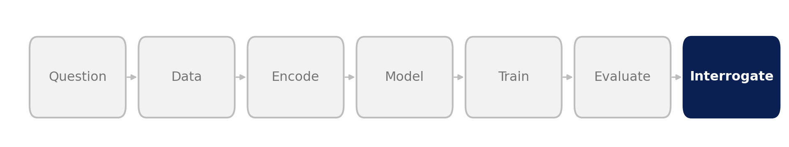
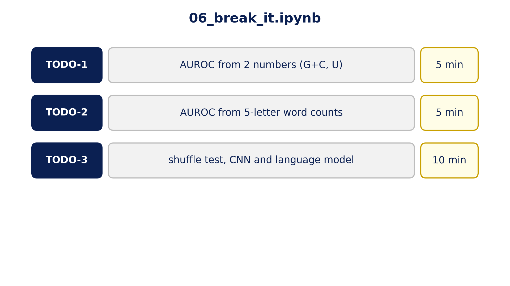
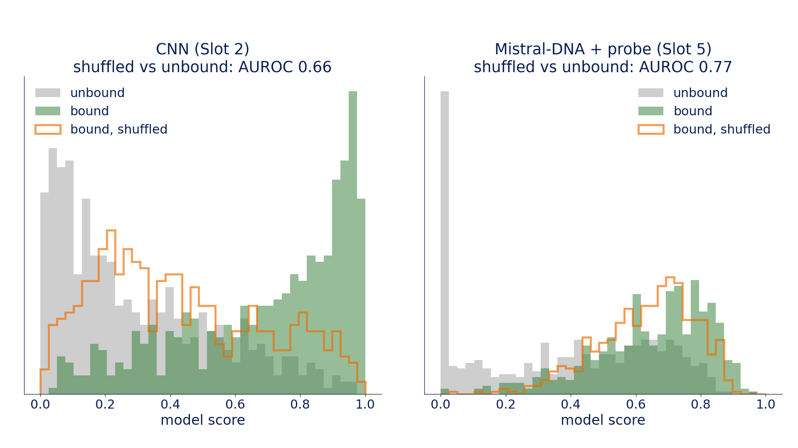
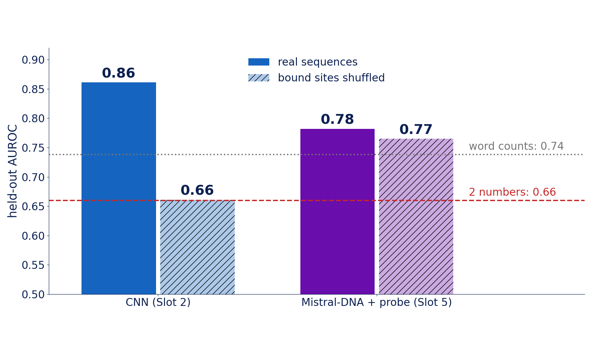

::: {.center}
# 1 Try to break it {data-name="Attack"}
:::

## 1.1 The letters already differ

{fig-align="center" width="85%"}

{fig-align="center" height="520px"}

::: {.notes}
**Interrogate: before believing either model, try the cheap explanations**

- bound RNA has less G+C than unbound (mean 0.41 vs 0.45); you saw it in the pixels in Slot 1 and in the embedding map in Slot 5
- three cheap models that **should lose**:
  - **TODO-1:** two numbers per sequence (G+C, U)
  - **TODO-2:** counts of every 5-letter word, with no order and no position
  - **TODO-3:** the shuffle test (next slide)
- if a cheap model scores well, the data has a shortcut, and a big model may be using it
:::

## 1.2 The shuffle test

{fig-align="center" height="710px"}

::: {.notes}
**A real bound sequence through `dinuc_shuffle`**

- every letter **and every letter pair** keeps its count (bars); G+C is unchanged; the miR-16 site is gone
- shuffle all 500 bound test sequences, keep the 500 real unbound ones, and ask the trained model to tell them apart
  - AUROC stays high → it reads **composition**
  - AUROC drops towards 0.5 → it reads **order** (motifs)
- don't retrain: same model, new inputs
:::

## 1.3 Your turn

{fig-align="center" height="710px"}

::: {.notes}
**Open `06_break_it.ipynb`**

- first cell: `USE_MY_FILES = True` to upload your CNN / vectors, or use ours
- TODO-1 → expect ≈ 0.66 · TODO-2 → ≈ 0.74 · TODO-3 → CNN ≈ 0.66, language model ≈ 0.77
- gotcha for TODO-3: use the probe already fitted on the real data; don't fit a new one
:::

::: {.center}
# 2 What broke {data-name="Results"}
:::

## 2.1 What shuffling does to the scores

{fig-align="center" height="710px"}

::: {.notes}
**Score histograms: real bound (green), shuffled bound (orange outline), unbound (grey)**

- **CNN:** shuffled bound sequences slide toward the unbound pile → AUROC 0.66. It was reading order, at least partly.
- **Mistral-DNA + probe:** shuffled bound sequences score just like real ones → 0.77. Its vectors barely notice the order.
:::

## 2.2 The scoreboard

{fig-align="center" height="710px"}

::: {.notes}
**Reference run, held-out test AUROC**

- two numbers alone: **0.66**, nearly half of the way from a coin flip (0.5) to the CNN (0.86), for free
- word counts, no order: 0.74
- CNN 0.86 → **0.66 shuffled**: exactly what two numbers give. Remove the order and the CNN knows only composition.
- Mistral-DNA probe 0.78 → 0.77: the shuffle keeps every letter **and letter-pair** count, so almost everything the probe uses survives at that level: composition, not order and not longer words
- **reading the result:** the gap between real and shuffled is the part of the score that came from letter order
:::

## 2.3 Whose fault?

::: {style="font-size:1.8em; text-align:center; margin-top:2.4em;"}
The model's, or **the data's**?
:::

::: {.notes}
**Discuss with your neighbour (2 minutes)**

1. how much of each score came from two numbers?
2. which model barely noticed the shuffle, and what was it reading?
3. bound and unbound differ in G+C because of **how the negatives were chosen**. Whose fault is that?

> Slot 7: fix the data, not the model.
:::
