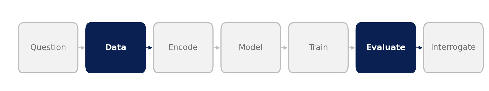
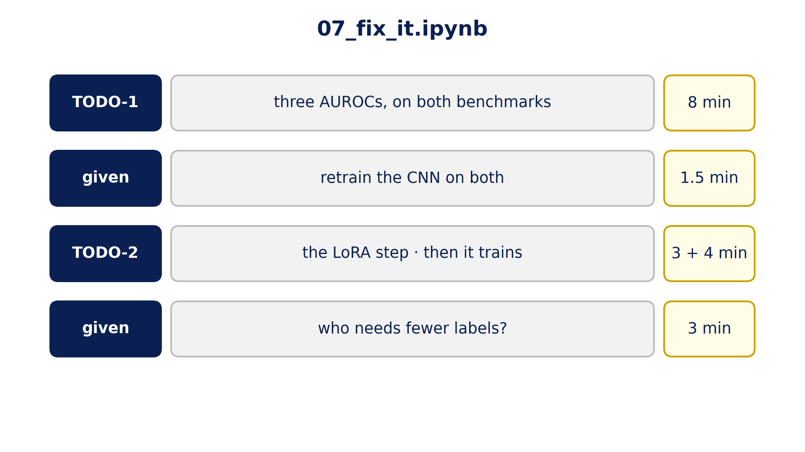

::: {.center}
# 1 A control {data-name="Control"}
:::

## 1.1 Composition-matched negatives

{fig-align="center" width="85%"}

{fig-align="center" height="520px"}

::: {.notes}
**Data · Evaluate: fix the data, not the model**

- sort every sequence into a bin by G+C × U × length; in each bin keep **as many unbound as bound**
- 67,764 of 92,346 sequences survive; no new experiment
- now composition carries no information: whatever score remains came from something else
- two benchmarks of **equal size** from the same file (original negatives vs matched), so any difference comes from the negatives
:::

## 1.2 LoRA: fine-tune cheaply

{fig-align="center" height="710px"}

::: {.notes}
**So far the genome model was frozen. Fine-tuning lets it adapt.**

- every layer holds big weight matrices $W$; LoRA keeps $W$ frozen and learns a thin correction $B \times A$
- for one 256 × 256 matrix: 65,536 frozen numbers, 8,192 trained
- in the notebook: Mistral-DNA, 2 passes over 20k matched sequences, ~3–4 min on a T4
- **TODO-2** is the same four training lines as Slot 2: `batch_logits`, `crit`, `opt` are given by the setup cell
:::

## 1.3 Your turn

{fig-align="center" height="710px"}

::: {.notes}
**Open `07_fix_it.ipynb`**

- TODO-1: one function, three AUROCs, run on both benchmarks. `probe_auc` returns `(auc, probe)`: keep only the AUROC. **Check: on matched, the 2-number model ≈ 0.51.**
- then a given CNN retrain on both benchmarks (~1.5 min)
- TODO-2: the LoRA training step
- then a given "who needs fewer labels?" cell (~3 min)
:::

::: {.center}
# 2 What survived {data-name="Results"}
:::

## 2.1 Before and after the control

{fig-align="center" height="710px"}

::: {.notes}
**Same file, same test-set size, only the negatives differ (3,000 test sequences: noise ≈ ±0.015)**

- two numbers: 0.64 → **0.51**, a coin flip. The free points are gone.
- word counts and the frozen genome model each lose ~0.04: **that part was composition**
- the CNN: 0.84 → 0.84. It was reading something else.
:::

## 2.2 Fine-tuning changes the picture

{fig-align="center" height="710px"}

::: {.notes}
**Fair head-to-head on the matched data: same labelled sequences, same test set, 3 seeds each (run offline on our A30 server, NT-500M)**

- **20,000 labels:** CNN 0.84 · frozen probe 0.78 · **fine-tuned 0.87**
- **500 labels:** CNN 0.66 · frozen 0.73 · **fine-tuned 0.75**
- fine-tuned, the pretrained model beats the task-specific CNN at both label counts; frozen, only when labels are scarce
- the dots (seeds) don't overlap: a real gap
- students fine-tune the small Mistral-DNA (≈0.80); the 486M model needs more GPU than a free Colab gives
:::

## 2.3 Is it the model?

{fig-align="center" height="710px"}

::: {.notes}
**Ten pretrained models from 3M to 2.5B parameters, matched negatives (offline runs)**

- frozen (purple): all 0.72–0.79, below the CNN; size barely matters
- the blue line is the CNN trained on all ~64k matched training sequences; the probes used 12k and LoRA 20k, so the line is a generous bar
- fine-tuned with one shared LoRA recipe (orange, one run each): NT-500M and DNABERT-2 reach **0.87**; Mistral-DNA 0.79; HyenaDNA *drops* to 0.72
- one recipe doesn't suit every architecture; fine-tuning is an experiment too
- NT-2.5B isn't fine-tuned here: our recipe under-trained it at that size (offline note)
:::

## 2.4 Who needs fewer labels?

{fig-align="center" height="710px"}

::: {.notes}
**Train on 100 … 30,000 labelled sequences (matched data, 3 draws each)**

- frozen Mistral-DNA (purple) beats the CNN (blue) up to ~2,500 labels; above ~5,000 the CNN wins
- the same model with random weights (grey) stays near 0.5–0.57: the advantage was **learned from the genome**
- counting 5-letter words also beats the CNN below ~1,000 labels: with little data, simple features win
- orange diamonds: NT-500M fine-tuned, above everything at 500 and 20,000 labels
- the CNN at 500 labels here (0.58) differs from the head-to-head slide (0.66): same recipe, different draws of the 500. Single runs ranged 0.51–0.68. With 500 labels, *which* 500 matters as much as the model.
- **reading the result:** "which model is best?" has no answer without "with how many labels?"
:::

## 2.5 When to reach for a pretrained model

::: incremental
* **Few labels**: a new cell type, a rare disease, a pilot experiment
* **No labels yet**: rank variants by how surprising the model finds them, then test the top ones
* **Plenty of labels**: fine-tune it, and keep a small task model as the baseline
:::

::: {.notes}
- "labels are cheap now": only for the assay you ran, in the cell type you ran it in
- whatever you pick, test it the way we did today: a baseline, a shuffle, a matched control
- the fine-tuned 0.87 models haven't been through the shuffle test yet; that's the next experiment, and the one we'd demand before trusting them

*Hand over to Roee.*
:::
