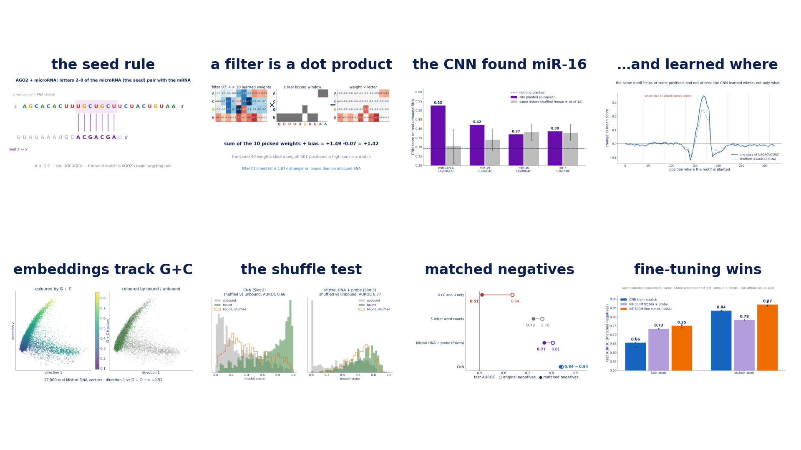
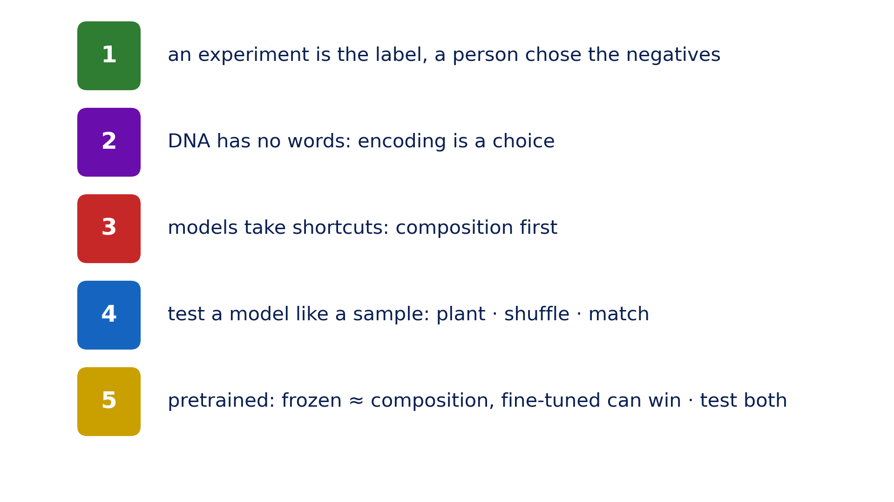
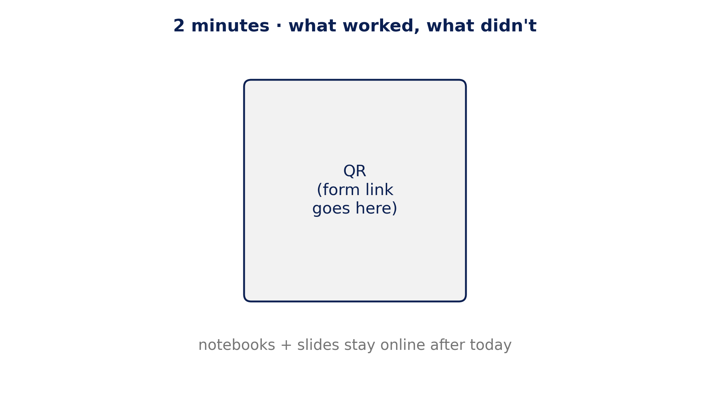

::: {.center}
# 1 Wrap-up {data-name="Wrap-up"}
:::

## 1.1 What we saw

{fig-align="center" height="710px"}

::: {.notes}
**[Roee] Draft by Mattan. One figure per lesson, all from today's data**

- **the seed rule** (Slot 1): letters 2–8 of the microRNA pair with the target
- **a filter is a dot product** (Slot 2): models are made of operations you can inspect
- **the CNN found miR-16** (Slot 3 planting): one seed site clearly, the others weakly or not at all
- **…and learned where** (Slot 3): how the data was cut shapes what a model learns
- **embeddings track G+C** (Slot 5): composition is one of the main axes of a pretrained model's vectors
- **the shuffle test** (Slot 6): order vs ingredients
- **matched negatives** (Slot 7): the control that removes the free points
- **fine-tuning wins** (Slot 7, offline): on matched data, fine-tuned NT-500M beats the CNN at 500 and at 20,000 labels
:::

## 1.2 Five ideas to take home

{fig-align="center" height="710px"}

::: {.notes}
**[Roee]**

1. a sequence is the input; an experiment is the label; a person chose the negatives
2. DNA has no words: how you encode it (one-hot, k-mers, tokens) is a decision
3. models take shortcuts; in sequence data, check composition first
4. test a model the way you'd test a sample: plant, shuffle, match
5. pretrained models: frozen, they mostly encode composition; fine-tuned, they can beat a task model. Test them.

**From the abstract:** training takes four lines of code; whether it learned anything real comes down to how you test it.
:::

## 1.3 Two minutes for us

{fig-align="center" height="710px"}

::: {.notes}
**[Mattan] Feedback form** *(QR + link to be added)*

- what worked, what didn't, what was missing for your background
- notebooks and slides stay online
:::

## 1.4 Credits & further reading {.smaller}

- I. Ullah, **KAUST Genomic Foundation Models workshop** (2026): pipeline ideas and figures, used with permission. github.com/bioinfo-kaust/gfm-workshop
- R. Mourad & B. Batut, **Galaxy Training Network**: *Pretraining / fine-tuning an LLM on DNA* (CC-BY). Mistral-DNA models.
- Dalla-Torre et al. (2024) *Nucleotide Transformer*, Nature Methods · Zhou et al. (2024) *DNABERT-2*, ICLR · Nguyen et al. (2023) *HyenaDNA*, NeurIPS
- Hu et al. (2021) *LoRA* · Tang & Koo (2024) *Evaluating the representational power of pre-trained DNA language models for regulatory genomics*
- Pan & Shen (2018) *iDeep*: the AGO2 CLIP-seq data · Friedman et al. (2009) Genome Research · Chin et al. (2008) Cancer Research

