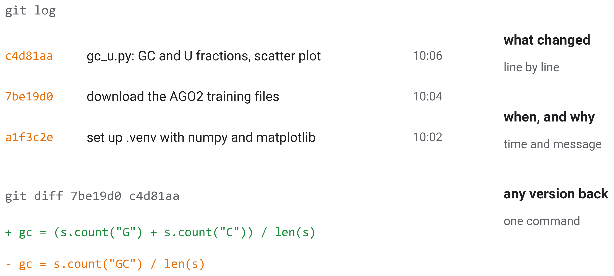
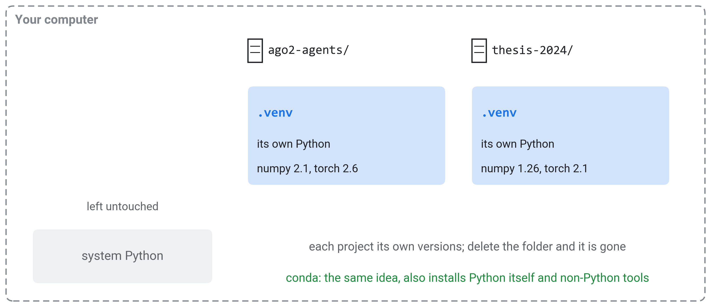
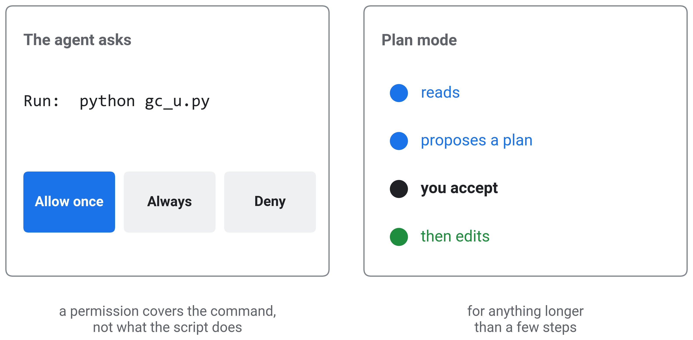
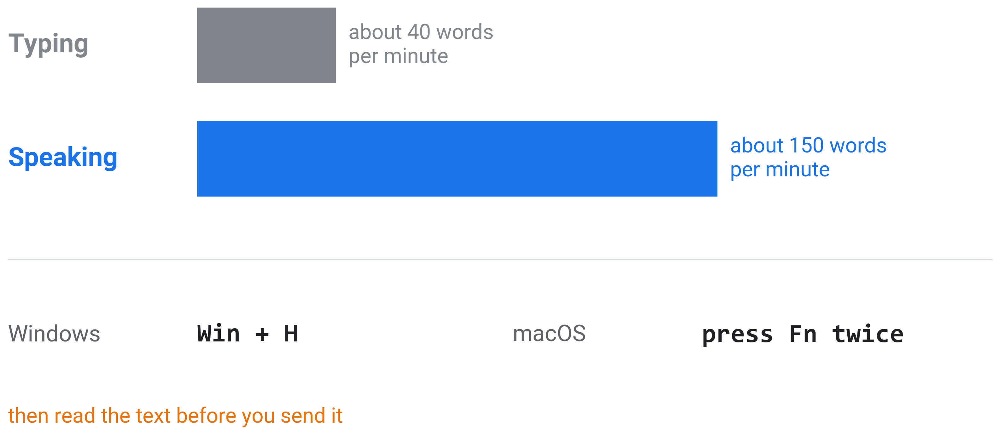
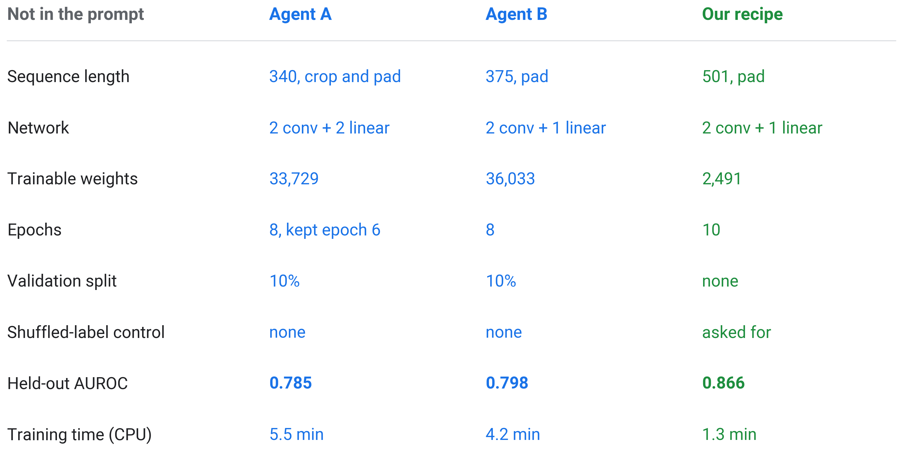
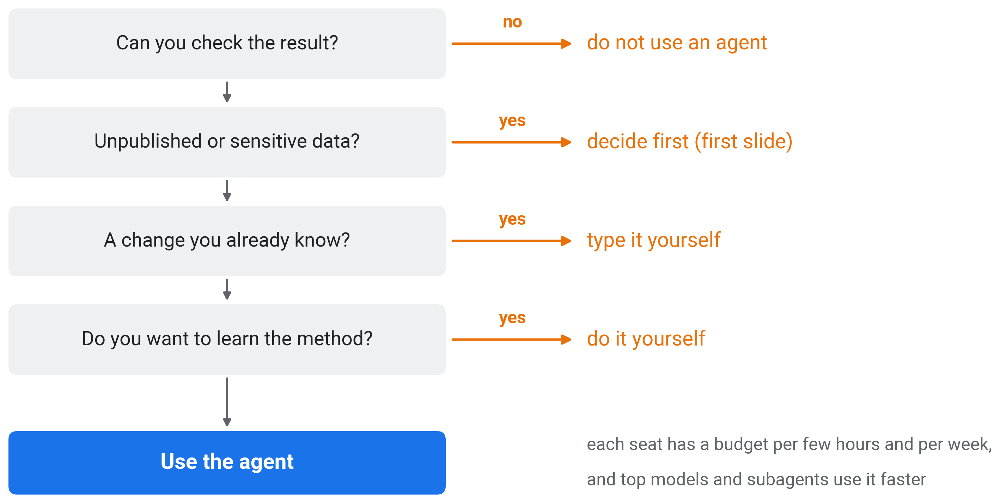
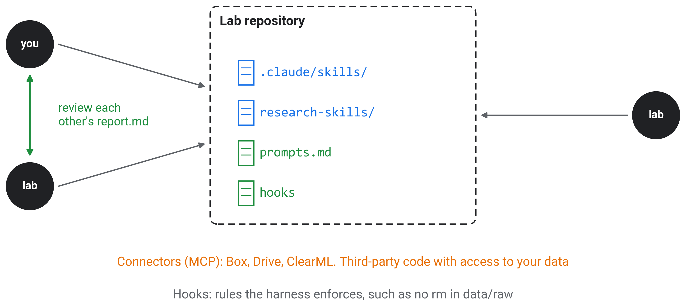
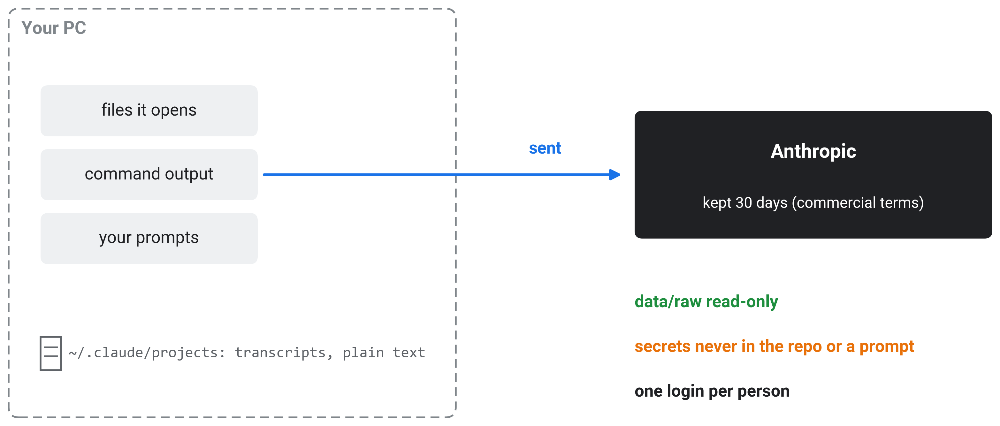

## Before we start

::: {.warning}
[Not approved by the Technion. Data you give an agent leaves your computer and may be exposed.]{.alarm}

Anthropic, for the lab's commercial seats:

> Anthropic does not train generative models using code or prompts sent to Claude Code under commercial terms.
> [Anthropic, Claude Code documentation, Data usage. Standard retention for commercial users is 30 days.]{.cite}

These terms, and the tools in this tutorial, have **not been reviewed or approved by the Technion**. Their use is at the **sole responsibility of the user**.
:::

::: {.notes}
- Everything the agent reads (files, command output, your prompts) is sent to Anthropic and kept for 30 days under the commercial terms. Transcripts are also stored in plain text on your own computer.
- The statement about training is Anthropic's, about its own plan. Nobody at the Technion has checked it against Technion policy.
- Today we use public data only. Before using an agent on unpublished or patentable lab data, ask Roee.
:::

::: {.center}
# 1 Getting Started {data-name="Start"}
:::

## 1.1 Definition

::: {.dict}
[agent]{.head}[/ˈeɪ.dʒənt/]{.pron}[noun]{.pos}

1. A person who acts on behalf of another.
2. [(computing)]{.domain} A program that pursues a goal by choosing actions, carrying them out and observing their results, until the goal is reached.

> An agent is anything that can be viewed as perceiving its environment through sensors and acting upon that environment through actuators.
> [Russell and Norvig, *Artificial Intelligence: A Modern Approach*]{.cite}
:::

::: {.notes}
- Open Claude Desktop now, sign in with your lab seat, and open the Code tab in an empty folder. The first task comes in two slides.
- Sense 2 is the one for today. The agent chooses its own actions toward a goal and observes what each one did.
- Russell and Norvig's definition is the textbook one. For a coding agent the sensors are files and command output. The actuators are writing files and running commands.
:::

## 1.2 A chatbot answers, an agent acts

::: {.r-stack}
{height="741px"}

{.fragment height="741px"}
:::

::: {.notes}
- A chatbot (ChatGPT in a browser) only returns text. You run the code yourself, see the error and paste it back.
- Click: an agent puts the same kind of language model inside an application that may act on your computer. It can read and write files and run commands, Python included. It can also search the web or connect to a server.
- It sees the result of each action itself. You no longer carry errors back and forth.
- It asks before actions you have not allowed yet. It does not judge which actions are risky. You do, when you approve.
:::

## 1.3 Set up

{fig-align="center" height="466px"}

- Data: [huggingface.co/datasets/yup8/ai-days-2026-ago2](https://huggingface.co/datasets/yup8/ai-days-2026-ago2), AGO2 binding sites and unbound RNA

::: {.notes}
- Claude Desktop runs on Windows and macOS. The Code tab is the coding agent (Claude Code), and the Chat tab is the chatbot. Sign in with your lab seat.
- On Windows the Code tab needs Git for Windows and Python from python.org (with the py launcher). Install both before the session.
- Open an empty folder, such as ago2-agents on the desktop. The agent can read and write inside it.
- The data are 48,095 RNA sequences bound by AGO2 (CLIP-seq) and 44,251 unbound sequences from the same genes, plus 1,000 held-out sequences. The agent downloads them itself.
:::

## 1.4 First task {data-todo="Task 1"}

::: {.prompt .roomy}
[PASTE INTO THE CODE TAB NOW]{.prompt-label}

```text
I am new to coding agents. Work step by step and tell me briefly what you do.
Make this folder a git repository and commit after each step that works.

Goal: one scatter plot of the AGO2 RNA dataset.
1. Set up a Python environment with numpy and matplotlib in .venv
   (Windows: py -m venv .venv, then .venv\Scripts\python -m pip install ...; macOS: python3 -m venv .venv).
2. Download the two training files (FASTA; letters can be lower case, some sequences use T for U):
   https://huggingface.co/datasets/yup8/ai-days-2026-ago2/resolve/main/CLIPSEQ_AGO2.train.positives.fa   (bound)
   https://huggingface.co/datasets/yup8/ai-days-2026-ago2/resolve/main/CLIPSEQ_AGO2.train.negatives.fa   (unbound)
3. For each sequence: GC fraction = (G + C) / length, U fraction = (U + T) / length.
4. Plot GC fraction (x) against U fraction (y): 5,000 random sequences per group (seed 0), bound in blue,
   unbound in grey, small transparent dots, drawn in random order. Do not open plot windows.
5. Save the plot as gc_u.png and tell me in two sentences whether the groups differ.
```
:::

::: {.notes}
- Paste it now. It runs while we go on. Expect three or four approvals (environment, install, download, run), and approve them as they come.
- Each line fixes a problem an agent had when we tested this prompt: Python on Windows, lower-case letters, T in some sequences, how many dots, which colour is drawn on top, and a plot window that blocks the agent.
:::

## 1.5 Git: the project's history

::: {.dict .mini}
[git]{.head}[/ɡɪt/]{.pron}[noun]{.pos} [(computing)]{.domain} A program that records every version of a project's files, with what changed, when and why.
:::

::: {.r-stack}
{.fragment height="511px"}

{.fragment height="511px"}
:::

::: {.notes}
- Your prompt asked the agent to commit after every step that works. Each commit is a snapshot of all files with a message saying what was done.
- git log lists the commits, newest first. git diff shows what changed between two of them, line by line: here the fix that turned a count of the pair "GC" into a count of G plus C.
- With an agent this record matters more than without one. The agent changes many files quickly, and the log is how you see what it did and in which order.
- Click: the undo button. When a later step breaks something, going back to the last commit that worked is one command, and the agent can run it. The harness can also rewind its own file edits, but not files changed by a script it ran. Git covers both.
- Keep data out of git by adding the data files and .venv to .gitignore.
:::

## 1.6 Virtual environments

::: {.dict .mini}
[virtual environment]{.head}[noun]{.pos} [(Python)]{.domain} A folder with its own Python and its own packages, used by one project only.
:::

{.fragment fig-align="center" height="623px"}

::: {.notes}
- Your prompt asked for a .venv folder. Everything the agent installs for this project goes there, not into the Python of your computer.
- Different projects can then use different versions of the same package, such as numpy 1.26 for an old analysis and numpy 2.1 for a new one, without breaking each other.
- The agent installs freely inside .venv, and deleting the folder removes all of it. Write the versions to requirements.txt and the environment can be rebuilt on another computer.
- conda does the same, and can also install Python itself and tools that are not Python packages, such as CUDA libraries or samtools. On the GPU server the lab uses conda environments.
:::

::: {.center}
# 2 Inside an Agent {data-name="Agents"}
:::

## 2.1 Model and harness

::: {.dict .mini}
[harness]{.head}[/ˈhɑːr.nɪs/]{.pron}[noun]{.pos} [(computing)]{.domain} The program around a language model that runs its tools and asks your permission. It also manages the context and loads skills.
:::

{.fragment fig-align="center" height="650px"}

::: {.notes}
- One real step of your first task, as messages. The harness (black) sends the model (blue) your prompt, CLAUDE.md and the list of tools it may use. The model's reply is a tool call, here Bash("python gc_u.py"). The harness asks you, runs it and sends back the output, a FileNotFoundError. The model's next answer is an edit that fixes the path.
- The model only ever writes text. Every action on your computer is carried out by the harness, and the harness is what you see on your screen right now.
- Claude Code (the Code tab of Claude Desktop) is Anthropic's harness, and Codex is OpenAI's. Each runs its company's models. Claude Code runs Fable, Opus, Sonnet and Haiku, Codex runs GPT-6 Astra, Sol and Luna. Part 2 compares them.
- Model and harness are chosen separately. In the same harness you can switch to a smaller model for routine work and a larger one for hard problems.
- Most of today is about the harness, and that knowledge carries over when the models change.
:::

## 2.2 The agent loop

{fig-align="center" height="765px"}

::: {.notes}
- Yours is doing this now. Every agent repeats one cycle. It plans a step and acts on it, then reads the output before planning the next.
- The example is from a real run of today's first task. The script failed on a wrong path. After reading the error the agent fixed the path and reran the script, without us.
- It stops when the goal is reached or when it needs a decision from you.
:::

## 2.3 You stay in control

{fig-align="center" height="707px"}

::: {.notes}
- These are the requests on your screens now. Each one shows the command. Allow it once, always, or deny it. At first, approve each step and read it. Later, allow routine actions such as editing files in the project folder, and keep asking for the rest.
- A permission covers a command, not what the command does. Once you allow `python`, any script it writes can delete files. Read the script, or keep the folder under git (slide 1.5).
- Plan mode is the safest way to start anything longer than a few steps. You can also write in the prompt: "show me your plan and wait for my OK".
- Never give an agent a folder with the only copy of your data.
:::

## 2.4 Anatomy of a prompt

::: {.dict .mini}
[prompt]{.head}[/prɒmpt/]{.pron}[noun]{.pos} [(computing)]{.domain} The instruction you give the agent: what to do, with what, how, and when it is done.
:::

{.fragment fig-align="center" height="650px"}

::: {.notes}
- The prompt you pasted, by what each part does. Goal and inputs come first, including where the files are and what is odd about them. Then come how to work, the definitions you mean, the constraints, the end condition and what to report.
- This task came first because it is small (one script, under a second of compute) and still uses every agent ability, from setting up an environment to saving a file you can see. You can check it by eye, and the answer is known: bound sequences have less GC and more U.
- Whatever you leave out, the agent decides for you (section 3).
- For anything bigger, add one line: "If anything is unclear, ask me before you start." Then fix one thing at a time and run again.
:::

## 2.5 Speak the prompt

{fig-align="center" height="627px"}

::: {.notes}
- A prompt with every part of the last slide is long to type. Speaking is about three to four times faster than typing for most people. Details you would skip when typing get said.
- Windows has dictation built in (Win + H), and so does macOS (press Fn twice, or the key set in the Keyboard settings). Both type into any text box, including the Code tab.
- Talk to it as to a colleague. Describe the data and what is odd about them, then what you want at the end and how you will check it.
- Read the text before you send it. Dictation gets gene names, numbers and file names wrong.
:::

## 2.6 Compare yours

{fig-align="center" height="765px"}

::: {.notes}
- Open your gc_u.png and show it to your neighbour. This one is an agent's result from our test run, with mean GC fraction 0.41 bound against 0.45 unbound and mean U fraction 0.31 against 0.29.
- Bound and unbound overlap along one diagonal band, so GC and U alone separate them only weakly.
- Look at the differences between your plots from the same prompt, in fonts, sizes, legend and title. Section 3 is about those.
- If yours is not done, answer its open question. It will finish while we go on.
:::

::: {.center}
# 3 Skills {data-name="Skills"}
:::

## 3.1 Anatomy of a skill

::: {.dict .mini}
[skill]{.head}[/skɪl/]{.pron}[noun]{.pos} [(agents)]{.domain} A folder of instructions, and the files they need, that the agent loads when a task matches it: a reusable prompt.
:::

{.fragment fig-align="center" height="650px"}

::: {.notes}
- A skill is a folder with a SKILL.md of instructions, plus any reference documents and scripts it needs. It is written once and used in every session.
- The agent always sees the skill's name and one-line description. When a task matches the description, it loads the instructions. It reads references and runs scripts only when needed, so many installed skills cost almost nothing until used.
- Personal skills live in ~/.claude/skills. A project's skills live in its .claude/skills folder, shared with everyone who uses the project.
:::

## 3.2 Not in the prompt, the agent decides

{fig-align="center" height="675px"}

::: {.notes}
- We gave two agents the same request for a GC and U scatter plot. Everything the prompt did not specify was set by the agent, from the number of points to the statistics.
- Without a skill these choices vary. Another run, or a colleague's agent, makes different ones, as you saw when you compared plots.
- A skill writes the choices down once. With the figure skill every plot gets the same fonts, sizes and colours, and a statistics report.
- The lab's conventions, such as our colours and our report format, belong in a skill, not in each person's prompt.
:::

## 3.3 Install one, in a new session

::: {.prompt .large}
[NEW SESSION, SAME FOLDER: ASK YOUR AGENT]{.prompt-label}

```text
Install the Claude Code skill at https://github.com/TingxiYu/academic-figure-skill
into ~/.claude/skills/academic-figure-skill (clone the repository there).
Then tell me what the skill does and when it will be used.
```
:::

::: {.notes}
- Open a new session in the same folder, since the first one may still be finishing Task 1. Paste this there, and use the same new session for Task 2. Section 4 explains why a new task gets a new session.
- The repository root is the skill folder (SKILL.md at the top), so cloning it into ~/.claude/skills installs it. By hand: git clone https://github.com/TingxiYu/academic-figure-skill ~/.claude/skills/academic-figure-skill
- If the agent does not list the skill afterwards, start one more new session.
- This skill asks you to confirm a plan for each figure, runs several rounds of checks and writes a statistics report. Answer its questions briefly.
:::

## 3.4 Read the skill you installed

::: {.prompt}
[~/.claude/skills/academic-figure-skill/SKILL.md, THE FIRST LINES]{.prompt-label}

```text
---
name: academic-figure-skill
description: Academic-grade scientific figure creation for Nature/Cell/Science journals. Use when the user
  asks to create, polish, review, or export scientific figures for manuscript submission. ...
---
## Design Principles
**1. One figure, one core message.**
**2. Restrained color > abundant color.**
**3. Design for print, not screen.** Journal column widths are fixed (89 mm single, 183 mm double).
**4. Vector first, raster as fallback.**

## Complete Workflow
Follow this closed loop for every request. Never skip steps. Never assume the user's question.
```
:::

- **Your turn**: open the file, then ask your agent "which of these rules will change my gc_u.png?"

::: {.notes}
- This is the top of the skill. The agent always sees the name and description, and it loads the instructions below them when a figure is requested. Excerpt from github.com/TingxiYu/academic-figure-skill (Apache-2.0).
- Everything below the description is a prompt someone else wrote for you. It sets fonts, sizes, colours and a fixed workflow with a confirmation step.
- Open it in any text editor, or ask the agent to show it. Then ask the agent which rules apply to your plot. Its answer is what you will see in Task 2.
:::

## 3.5 Second task: a CNN, reported with the skill {data-todo="Task 2"}

::: {.prompt .large}
[PASTE INTO THE SAME NEW SESSION]{.prompt-label}

```text
Train a small neural network that predicts from the RNA sequence whether AGO2 binds it,
on this laptop's CPU. Train on the two training files and test on the held-out files
CLIPSEQ_AGO2.ls.positives.fa and CLIPSEQ_AGO2.ls.negatives.fa (same address as before).
Make the figures with the academic-figure-skill and write report.md with what you did
and the results. Show me your plan before you start.
```
:::

::: {.notes}
- Paste it now, or say it in your own words. Anyone in the lab could write this prompt. It states the goal and the data, and it asks for the skill, the report and a plan first.
- Stay on this slide until everyone has read the agent's plan. Read it for what it chose, then approve.
- Allowing the .venv Python for the session is reasonable in this folder. It is under git and contains only public data, which covers the caveat of slide 2.3.
- PyTorch takes a few minutes to install, and training then a few minutes more. We go on while it runs.
:::

## 3.6 Not in the prompt, the agent chooses

{fig-align="center" height="720px"}

::: {.notes}
- We gave this prompt to two agents. Both built a reasonable network, and they differ from each other and from the recipe of the AI Days workshop in length, size, epochs and validation.
- Neither ran a control, because the prompt did not ask for one. Both reached a held-out AUROC near 0.79. The workshop recipe, chosen by hand, reached 0.87 in a quarter of the time with a network of 2,491 weights.
- The agent filling the gaps does not mean any answer is fine. Read the plan before approving it, and ask for what matters to you, such as a control or a fixed seed.
- Both agents also dropped the upper and lower case of the files, which marks the measured binding site. Only someone who knows the data notices that.
:::

::: {.center}
# 4 Context and Effort {data-name="Context"}
:::

## 4.1 The context window

::: {.dict .mini}
[context window]{.head}[noun]{.pos} [(language models)]{.domain} Everything the model reads before each reply: instructions, the conversation, files opened, command output. It has a fixed size.
:::

::: {.dict .mini}
[token]{.head}[/ˈtəʊ.kən/]{.pron}[noun]{.pos} [(language models)]{.domain} The unit a model reads and writes, a word or a piece of a word, about three quarters of an English word on average.
:::

::: {.r-stack}
{.fragment height="452px"}

{.fragment height="452px"}
:::

- **New task, new session**

::: {.notes}
- The model has no memory between replies. Every reply re-reads the whole context. Its size is counted in tokens, and so are the seat's limits.
- Command output and large files fill it fastest. A training log printed to the screen can take a large share.
- Click: when the window is full, the history is compacted into a summary. Details that were in it, such as exact numbers or a file you showed early, may be gone after that. So Task 2 runs in a new session.
:::

## 4.2 Subagents and new sessions

::: {.dict .mini}
[subagent]{.head}[/ˈsʌbˌeɪ.dʒənt/]{.pron}[noun]{.pos} [(agents)]{.domain} A helper the agent starts for one part of a task, with its own empty context, that returns only a short result.
:::

::: {.r-stack}
{.fragment height="631px"}

{.fragment height="631px"}
:::

::: {.notes}
- Subagents read and search on their own and return a short result. The main context grows only by that result. Ask for them in the prompt, as in "use subagents to read these papers". Their individual steps are collapsed in the view.
- Click: new sessions. A fresh session starts with none of the old session's context. Hand over with a file. Ask the old session to write handoff.md with what was done, what is open and where the files are, then start the new one with "read handoff.md".
- Shared files in the project (the wiki, part 2) keep sessions and people in sync.
:::

## 4.3 Reasoning effort

::: {.dict .mini}
[effort]{.head}[/ˈef.ət/]{.pron}[noun]{.pos} [(agents)]{.domain} How much the model thinks before each step. It is set from low to max.
:::

{.fragment fig-align="center" height="516px"}

- **Medium most of the time**
- **Higher is not better**

::: {.notes}
- The levels are low, medium, high, extra high and max. Higher effort takes longer and uses more of the seat's limits.
- Medium is where to be most of the time: it handles scripts, plots, edits and new analyses well and fast. Low is enough for small, mechanical edits.
- Higher effort is not better by default. It is slower, uses more of the seat's limits and can overthink simple tasks. Raise it for a bug the agent keeps failing on, or for a design decision you will build on.
- The bars show the direction, not measured values.
:::

## 4.4 Limits, and when not to use an agent

{fig-align="center" height="725px"}

::: {.notes}
- Ask the four questions in order. If none stops you, use the agent.
- /usage in the Code tab shows how much of the current budget is used.
- A long autonomous run with five subagents on the top model can use a day's budget in an hour.
- If you cannot tell a right answer from a wrong one, the agent's speed does not help.
:::

::: {.center}
# 5 Results and Bookkeeping {data-name="Results"}
:::

## 5.1 Work in phases

{fig-align="center" height="609px"}

::: {.notes}
- Split a project into phases small enough to review, such as data, baseline, model and analysis. Task 2 is one phase.
- In each phase you approve the agent's plan before it runs, and you read its report.md before the next phase starts.
- The report records what was done and what did not work, with every number, its command and the figures. A new session starts the next phase from it.
- The lab's research-workflow skill runs projects this way (part 2).
:::

## 5.2 The same plot, with the skill

:::: {.columns .vcenter}
::: {.column width="48%"}
{height="658px"}

[Without the skill]{.caption-small}
:::
::: {.column width="52%"}
{height="465px"}

[With the academic figure skill]{.caption-small}
:::
::::

::: {.notes}
- Your agent is probably asking now to confirm the skill's figure plan. Read it before approving.
- An agent made both plots from the same request. With the skill the plot uses Arial at journal column width (89 mm) and has no top or right axis. The skill also wrote a PDF, a 300 dpi PNG and a statistics report.
- It also changed the request. The skill's rules do not allow subsampling, so it drew all 92,346 points, and the dense middle hides the difference the left plot shows. It did not say so. If yours plans the same, tell it: "subsample to 5,000 per group, as in gc_u.png".
- A skill contains someone's taste and rules. Read one before you rely on it, and write your own for the lab's conventions.
:::

## 5.3 CLAUDE.md: the lab template

::: {.prompt .roomy}
[CLAUDE.md, READ AT THE START OF EVERY SESSION]{.prompt-label}

```text
# Project: <one line: the question>
## Layout
data/raw/       read-only: never modify or delete
data/derived/   produced by scripts in src/
wiki/           FINDINGS.md, DECISIONS.md, RISKS.md: update at the end of every phase
phases/NN_name/ plan.md and report.md per phase
## How to run
.venv/bin/python src/train.py --config configs/<name>.yaml
## Rules
- GPU server: only GPU 1 (CUDA_VISIBLE_DEVICES=1); check nvidia-smi before starting a job
- Every number in a report comes with the command that produced it
- Commit after each working step; never commit data or secrets
- Log runs to ClearML project <lab>/<project>
```
:::

::: {.notes}
- Open the CLAUDE.md your agent wrote at the end of Task 2 and grow it into this structure.
- /init asks the agent to draft one from an existing project.
- Keep it to one screen. It is read in every session and uses context.
:::

## 5.4 Your results

::: {.r-stack}
{height="673px"}

{.fragment height="673px"}
:::

- **Every number with its command**

::: {.notes}
- Compare your AUROC with two references. The workshop recipe, chosen by hand, took about 8 seconds per epoch on a laptop CPU and reached 0.87 after ten epochs. The test agents, with the same prompt as yours, reached 0.785 and 0.798. Ask your agent to show the network it built and the data counts.
- Click: check its work. A plot can be checked by eye, an AUROC cannot. Ask your agent now for a run with shuffled training labels. It must give about 0.5, and a clearly higher value means test data leaked into training. Composition alone (GC and U) gives 0.66, and a useful model must score higher. Each sequence must be in only one of the training and test files.
- Agents report numbers confidently, including ones they did not compute. Open report.md and look for the command and printed output behind each number.
- If your report is not finished, let the agent run and open it during part 2.
:::

::: {.center}
# 6 On the GPU Server {data-name="Server"}

Part 2: watch, and let your agent finish

[claude.ai/download](https://claude.ai/download) / [the data](https://huggingface.co/datasets/yup8/ai-days-2026-ago2) / [the figure skill](https://github.com/TingxiYu/academic-figure-skill)
:::

## 6.1 Two setups

::: {.r-stack}
{height="740px"}

{.fragment height="740px"}
:::

::: {.notes}
- In setup A, Claude runs on your PC and executes commands on the server over ssh. You install nothing on the server, and your files and skills remain on your PC. Jobs started with nohup or tmux keep running when your PC sleeps, but nothing watches them.
- Click, setup B, where Claude runs on the server. From your PC, a WSL terminal connects with ssh and attaches to a tmux session with Claude in it. tmux keeps the session alive when you disconnect. The agent keeps working and watching overnight.
- Remote Control lets you follow and steer that session from the Claude app or your phone. Read each permission request before approving it on the phone.
- Skills are reusable prompts, kept on the machine that runs Claude. In setup B those are the lab's skills on gold-srv2.
:::

## 6.2 Nightly runs

{fig-align="center" height="657px"}

::: {.notes}
- In the evening, plan the runs with the agent and launch them on the GPU server (setup B).
- With job-heartbeat, a scheduled prompt wakes the agent at a fixed interval. It runs a status script that prints facts about the job, and checks the output for problems. It fixes or restarts what it can and alerts a person when needed. A separate watchdog alerts if no agent has woken up for too long.
- Set a limit on restarts. A job that crashes and restarts all night blocks the GPU for everyone.
- In the morning the agent reads the logs and writes report.md. Training runs should save checkpoints, and a restart then continues from the last one.
:::

## 6.3 Our lab's skills

{fig-align="center" height="765px"}

::: {.notes}
- These run on gold-srv2 and are kept in research-skills/ of a shared git repository, so everyone uses the same version, including every fix.
- research-workflow and research-vault run and record a project. scientific-reporting builds a report from its evidence. clearml-scientific-publishing puts runs and the report on ClearML. job-heartbeat watches long jobs.
:::

## 6.4 Tracking experiments: ClearML

{fig-align="center" height="673px"}

::: {.notes}
- ClearML records the settings, metric curves and output files of every run on a server the whole lab can open. You compare runs in the web dashboard.
- With the lab's clearml-scientific-publishing skill, the agent logs runs and publishes the phase report to ClearML with its figures and evidence.
:::

## 6.5 Example: a literature review

{fig-align="center" height="657px"}

- **Open every cited paper**

::: {.notes}
- One session reading 30 full papers fills its context with PDFs. Instead the main session splits the topic and starts five subagents with six papers each. Each writes its notes to a file and returns a few lines.
- The main session writes the review and a comparison table from the notes. Tomorrow, a new session starts from review.md and the lit/ notes, not from the papers.
- Watch for papers behind a paywall that the agent cannot read but summarises anyway, and for papers that do not exist. Open the cited paper for every claim you will use.
- The subagents together use about five times the limits of one session.
:::

## 6.6 A shared wiki

::: {.dict .mini}
[wiki]{.head}[/ˈwɪk.i/]{.pron}[noun]{.pos} [(projects)]{.domain} A set of linked pages that everyone on a project reads and edits; here, plain files in the repository.
:::

{.fragment fig-align="center" height="650px"}

::: {.notes}
- Every session reads these files at the start and updates them at the end of a phase. FINDINGS holds dated results with the evidence and where it is. DECISIONS records what was chosen and why, and the alternatives. RISKS lists what could make the results wrong, each with a check and its status.
- You do not write them by hand. The agent fills them in at the end of each phase and you correct them. The lab's research-vault skill keeps this structure.
- Without this bookkeeping each session starts from zero and results cannot be traced.
:::

## 6.7 Sharing in the lab

{fig-align="center" height="643px"}

::: {.notes}
- Keep the lab's skills, a file of prompts that worked and the hooks in one repository. Review each other's report.md before trusting it.
- Connectors (MCP) give the agent access to Box, Drive or ClearML. They are third-party code with access to your data, so treat them like a skill.
- Skills copied by hand into each person's ~/.claude drift apart. Committed to a repository, they improve for everyone.
- A hook is a script the harness runs before or after an action. Unlike a line in CLAUDE.md, the agent cannot ignore it.
:::

## 6.8 The models

{fig-align="center" height="765px"}

::: {.notes}
- Each point is one model: its price per million output tokens on the API (log scale) and its overall score on benchlm.ai, which combines eight weighted categories of benchmarks (verified 20 October 2026). Input costs one fifth of the output price.
- Price and score do not rise together at the top. Opus 5.5 scores highest (86.7) at $20, while Fable 5.1 and GPT-6 Astra cost $50 and score lower (83.2, 84.0).
- In the middle, Sonnet 5.5 (82.2) scores above GPT-6 Sol (78.6) at the same price. Haiku 5.5 and GPT-6 Luna cost a fortieth of that and score about 67.
- On the lab seats you do not pay per token, but larger models use up the seat's limits faster. One overall score hides large differences between tasks, so try two models on your own problem.
:::

## 6.9 Data, secrets and the shared server

{fig-align="center" height="613px"}

::: {.notes}
- As on the first slide, files the agent opens, command output and prompts are sent to Anthropic and kept for 30 days. The Technion has not reviewed this. Transcripts also stay on your PC in plain text.
- Make raw data read-only (chmod -R a-w data/raw). Keep tokens, clearml.conf and .env out of the repository and out of prompts. Use one account and one login per person.
- For data that may become a patent or an unpublished result, ask Roee before giving an agent access.
- A permission-skipping mode exists for sandboxes. On the lab server it means any command runs without a question.
:::

## 6.10 Demo: a DNA language model on the GPU

::: {.prompt .large}
[DEMO PROMPT]{.prompt-label}

```text
On the GPU server (use only GPU 1: CUDA_VISIBLE_DEVICES=1), embed the AGO2 sequences with the pretrained
DNA language model RaphaelMourad/Mistral-DNA-v1-17M-hg38. Convert U to T first. One vector per
sequence: the average of the last layer. Embed both the training and the held-out files.
Train a logistic regression on the training vectors and report the held-out AUROC, with the command
and output. Compare it with the CNN of Task 2 (0.87) and with GC and U alone (0.66).
```
:::

::: {.notes}
- Setup A, live. Watch the agent check which GPU is free and install what is missing in its own environment. It copies the results back at the end.
- The frozen language model with a linear probe should reach about 0.78 held-out AUROC, below the CNN trained on all labels (0.87) and above composition alone (0.66).
:::

## 6.11 Links

- Claude Desktop: [claude.ai/download](https://claude.ai/download)
- Data: [huggingface.co/datasets/yup8/ai-days-2026-ago2](https://huggingface.co/datasets/yup8/ai-days-2026-ago2)
- Figure skill: [github.com/TingxiYu/academic-figure-skill](https://github.com/TingxiYu/academic-figure-skill)
- Data terms: [code.claude.com/docs/en/data-usage](https://code.claude.com/docs/en/data-usage)
- The data's source: Maticzka et al., *Genome Biology* 15, R17 (2014), [doi:10.1186/gb-2014-15-1-r17](https://doi.org/10.1186/gb-2014-15-1-r17)

::: {.notes}
- The AI Days workshop decks and notebooks are at mathoory.github.io/ai-days-2026-dna-workshop.
:::
