## Before we start

::: {.warning}
[Not approved by the Technion. Data you give an agent leaves your computer and may be exposed.]{.alarm}

The lab's Claude seats run under Anthropic's commercial terms. Anthropic's documentation for these plans states:

> Anthropic does not train generative models using code or prompts sent to Claude Code under commercial terms.
> [Anthropic, Claude Code documentation, Data usage; standard retention for commercial users: 30 days]{.cite}

These terms, and the tools in this tutorial, have **not been reviewed or approved by the Technion**. Their use is at the **sole responsibility of the user**.
:::

::: {.notes}
- Everything the agent reads (files, command output, your prompts) is sent to Anthropic to be processed and kept for 30 days under the commercial terms; transcripts are also stored in plain text on your own computer.
- No training on our data is Anthropic's statement about its own plan. Nobody at the Technion has checked it against Technion policy.
- So: public data only today. Before using an agent on unpublished or patentable lab data, ask Roee.
:::

::: {.center}
# 1 Getting Started {data-name="Start"}
:::

## 1.1 Definition

::: {.dict}
[agent]{.head}[/ˈeɪ.dʒənt/]{.pron}[noun]{.pos}

1. A person who acts on behalf of another.
2. [(computing)]{.domain} A program that pursues a goal by choosing actions, carrying them out and observing their results, until the goal is reached.

> An agent is anything that can be viewed as perceiving its environment through sensors and acting upon that environment through actuators.
> [Russell and Norvig, *Artificial Intelligence: A Modern Approach*]{.cite}
:::

::: {.notes}
- Open Claude Desktop now, sign in with your lab seat, and open the Code tab in an empty folder. The first task comes in two slides.
- Sense 2 is the one for today. Three parts: a goal, actions it chooses itself, and observation of what happened.
- Russell and Norvig's definition is the textbook one. For a coding agent the sensors are files and command output; the actuators are writing files and running commands.
:::

## 1.2 A chatbot answers, an agent acts

::: {.r-stack}
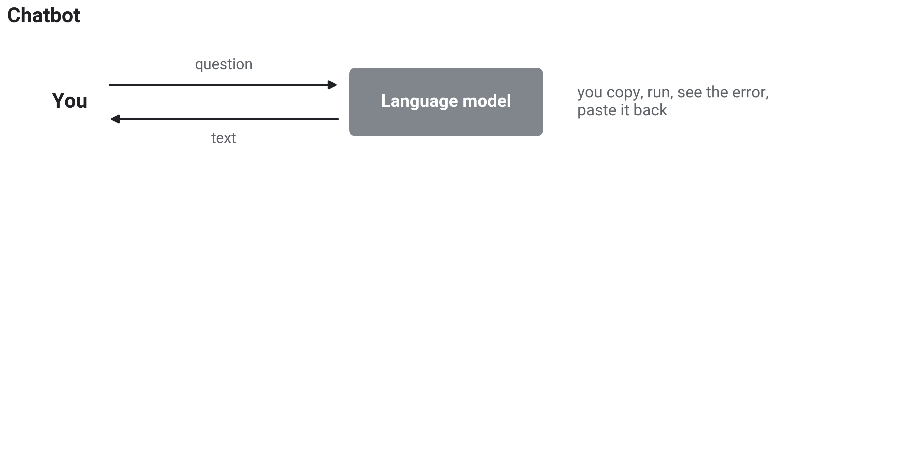{height="741px"}

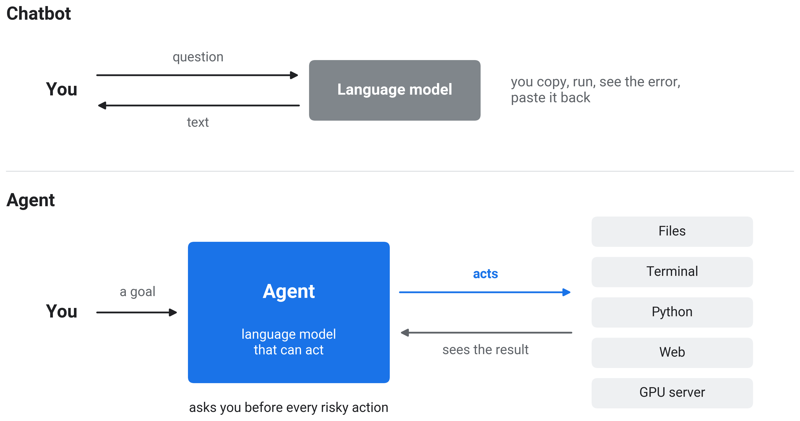{.fragment height="741px"}
:::

::: {.notes}
- A chatbot (ChatGPT in a browser) only returns text. You are the one who runs the code, sees the error and pastes it back.
- Click: an agent is an application around the same kind of language model, with permission to act on your computer: read and write files, run commands, run Python, search the web, connect to a server.
- It sees the result of each action itself, so the copy-run-paste loop disappears.
- It asks before actions you have not allowed yet. It does not judge which actions are risky; you do, when you approve.
:::

## 1.3 Set up

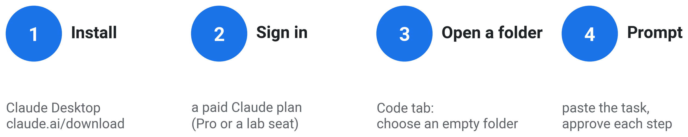{fig-align="center" height="288px"}

- Data: [huggingface.co/datasets/yup8/ai-days-2026-ago2](https://huggingface.co/datasets/yup8/ai-days-2026-ago2), AGO2 binding sites and unbound RNA

::: {.notes}
- Claude Desktop runs on Windows and macOS. The Code tab is the coding agent (Claude Code); the Chat tab is the chatbot. Sign in with your lab seat.
- On Windows the Code tab needs Git for Windows and Python from python.org (with the py launcher). Install both before the session.
- Open an empty folder, for example ago2-agents on the desktop. The agent can read and write inside it.
- The data: 48,095 RNA sequences bound by AGO2 (CLIP-seq) and 44,251 unbound sequences from the same genes, plus 1,000 held-out sequences. The agent downloads them itself.
:::

## 1.4 First task {data-todo="Task 1"}

::: {.prompt .dense}
[PASTE INTO THE CODE TAB NOW]{.prompt-label}

```text
I am new to coding agents. Work step by step and tell me briefly what you do.
Make this folder a git repository and commit after each step that works.

Goal: one scatter plot of the AGO2 RNA dataset.
1. Set up a Python environment with numpy and matplotlib in .venv
   (Windows: py -m venv .venv, then .venv\Scripts\python -m pip install ...; macOS: python3 -m venv .venv).
2. Download the two training files (FASTA; letters can be lower case, some sequences use T for U):
   https://huggingface.co/datasets/yup8/ai-days-2026-ago2/resolve/main/CLIPSEQ_AGO2.train.positives.fa   (bound)
   https://huggingface.co/datasets/yup8/ai-days-2026-ago2/resolve/main/CLIPSEQ_AGO2.train.negatives.fa   (unbound)
3. For each sequence: GC fraction = (G + C) / length, U fraction = (U + T) / length.
4. Plot GC fraction (x) against U fraction (y): 5,000 random sequences per group (seed 0), bound in blue,
   unbound in grey, small transparent dots, drawn in random order. Do not open plot windows.
5. Save the plot as gc_u.png and tell me in two sentences whether the groups differ.
```
:::

::: {.notes}
- Paste it now; it runs while we go on. Approve the steps as they come: three or four approvals (environment, install, download, run).
- Each line closes a gap we hit when we tested this prompt with an agent: Python on Windows, lower-case letters and T in some sequences, how many dots, which colour lands on top, a plot window that blocks the agent.
:::

::: {.center}
# 2 How an Agent Works {data-name="Agents"}
:::

## 2.1 Model and harness

::: {.dict .mini}
[harness]{.head}[/ˈhɑːr.nɪs/]{.pron}[noun]{.pos} [(computing)]{.domain} The program around a language model that runs its tools, asks your permission, manages its context and loads its skills.
:::

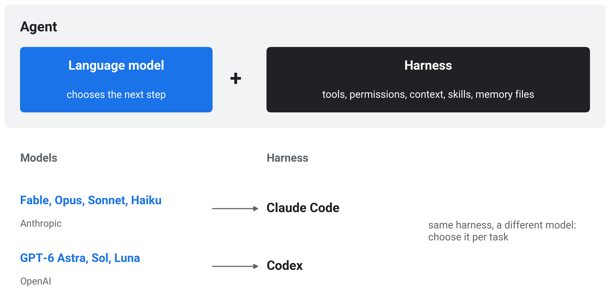{fig-align="center" height="650px"}

::: {.notes}
- An agent has two parts. The language model reads everything in its context and chooses the next step. The harness is everything around it, and it is what you see on your screen right now.
- Claude Code (the Code tab of Claude Desktop) is Anthropic's harness; Codex is OpenAI's. Each runs its company's models: Fable, Opus, Sonnet and Haiku in Claude Code; GPT-6 Astra, Sol and Luna in Codex. Part 2 compares them.
- The two are chosen separately: in the same harness you can switch to a smaller model for routine work and a larger one for hard problems.
- Most of today is about the harness: skills, context, sessions, permissions. Those carry over when the models change.
:::

## 2.2 The agent loop

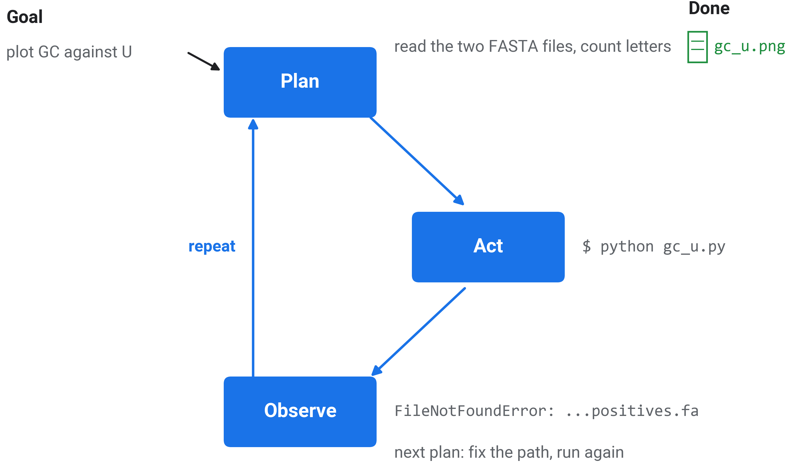{fig-align="center" height="765px"}

::: {.notes}
- Yours is doing this now. Every agent works in this loop: plan the next step, act (write a file, run a command), observe the output, plan again.
- The example is from a real run of today's first task: the script failed on a wrong path, the agent read the error, fixed the path and ran again, without us.
- It stops when the goal is reached, or when it needs a decision from you.
:::

## 2.3 You stay in control

- **Permissions**: the agent asks before it runs a command or edits a file; allow once, always, or deny
- **Plan mode**: the mode menu under the prompt box; the agent only reads and proposes until you accept its plan
- **One folder per project**: the agent works where you open it
- **Read what it did**: each command and each changed file is shown

::: {.notes}
- These are the requests popping up on your screens now. In the beginning, approve each step and read it. Later, allow routine actions (editing files in the project folder) and keep asking for the rest.
- A permission covers a command, not what the command does: once you allow `python`, any script it writes can delete files. Read the script, or keep the folder under git (next slide).
- Plan mode is the safest way to start anything longer than a few steps. Or write in the prompt: "show me your plan and wait for my OK".
- Never give an agent a folder that holds the only copy of your data.
:::

## 2.4 Git is the undo button

::: {.dict .mini}
[commit]{.head}[/kəˈmɪt/]{.pron}[noun]{.pos} [(git)]{.domain} A saved snapshot of every file in the project, which you can return to later.
:::

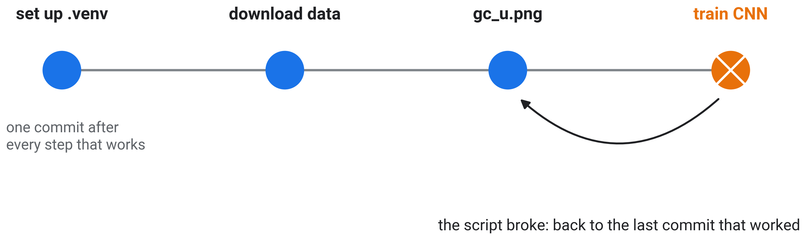{fig-align="center" height="429px"}

::: {.notes}
- Your first prompt asked the agent to make the folder a git repository and to commit after every step that works: look for "git commit" among its steps.
- When a later step breaks something, "go back to the last commit that worked" is one command, and the agent can run it.
- The harness can also rewind its own file edits, but not files changed by a script it ran. Git covers both.
- Keep data out of git: add the data files and .venv to .gitignore.
:::

## 2.5 Anatomy of a prompt

::: {.dict .mini}
[prompt]{.head}[/prɒmpt/]{.pron}[noun]{.pos} [(computing)]{.domain} The instruction you give the agent: what to do, with what, how, and when it is done.
:::

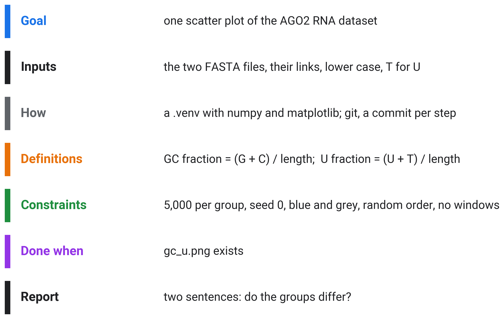{fig-align="center" height="650px"}

::: {.notes}
- The prompt you pasted, by what each part does. A goal, the inputs with where they are and what is odd about them, how to work, the definitions you mean, the constraints, when it is done, and what to report.
- Why this task first: it is small (one script, under a second of compute), it uses every agent ability (environment, download, parsing, code, running, a file you can see), you can check it by eye, and the answer is known: bound sequences have less GC and more U.
- The parts you leave out, the agent decides for you (section 3).
- For anything bigger, add one line: "If anything is unclear, ask me before you start." Then fix one thing at a time and run again.
:::

## 2.6 Compare yours

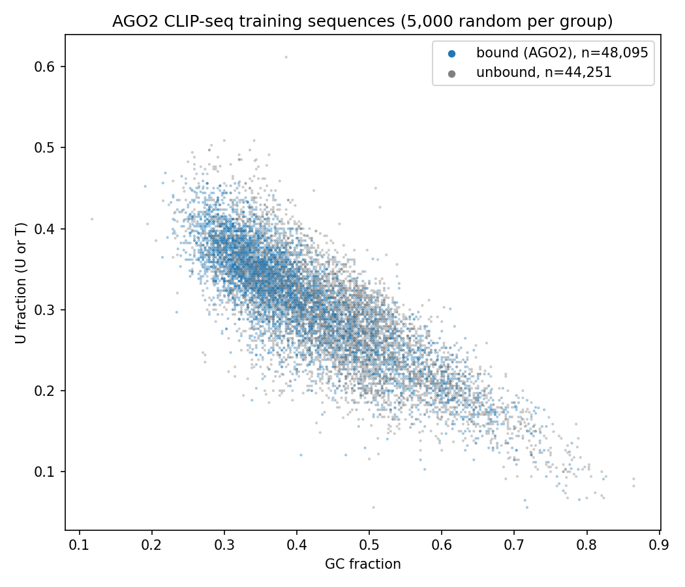{fig-align="center" height="765px"}

::: {.notes}
- Open your gc_u.png and show it to your neighbour. This one is an agent's result from our test run: mean GC fraction 0.41 bound against 0.45 unbound, mean U fraction 0.31 against 0.29.
- The two groups overlap along one diagonal band: GC and U alone separate them only weakly.
- Same prompt, but look at the differences between your plots: fonts, sizes, legend, title. That is the next section.
- Not done yet? Answer its open question; it will finish while we go on.
:::

::: {.center}
# 3 Skills {data-name="Skills"}
:::

## 3.1 What a skill is

::: {.dict .mini}
[skill]{.head}[/skɪl/]{.pron}[noun]{.pos} [(agents)]{.domain} A folder of instructions, and the files they need, that the agent loads when a task matches it: a reusable prompt.
:::

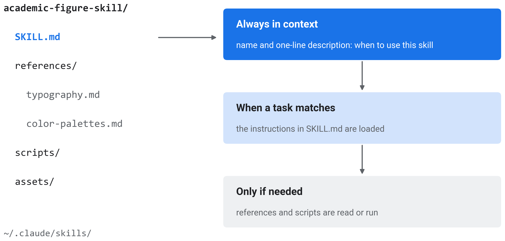{fig-align="center" height="650px"}

::: {.notes}
- A skill is a folder: a SKILL.md with instructions, plus any reference documents and scripts it needs. Written once, used in every session.
- The agent always sees the skill's name and one-line description. When a task matches the description, it loads the instructions; references and scripts only when needed. So many skills cost almost nothing until used.
- Personal skills live in ~/.claude/skills; a project's skills in its .claude/skills folder, shared with everyone who uses the project.
:::

## 3.2 Not in the prompt, the agent decides

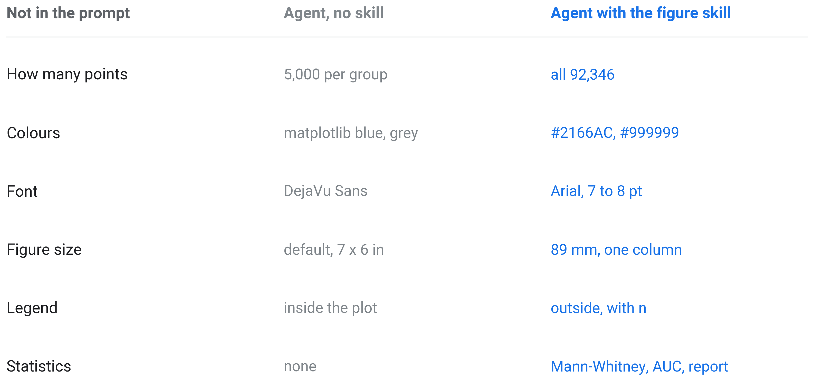{fig-align="center" height="675px"}

::: {.notes}
- Two agents, the same request for a GC and U scatter plot. Everything the prompt did not say, each agent decided on its own: how many points, colours, font, size, legend, statistics.
- Without a skill, these are coin flips: another run, or another person's agent, makes other choices. You saw it when you compared plots.
- A skill writes the choices down once. With the figure skill every plot gets the same fonts, sizes and colours, and a statistics report, every time.
- The lab's conventions (our colours, our report format) belong in a skill, not in each person's prompt.
:::

## 3.3 Install one, in a new session

::: {.prompt}
[NEW SESSION, SAME FOLDER: ASK YOUR AGENT]{.prompt-label}

```text
Install the Claude Code skill at https://github.com/TingxiYu/academic-figure-skill
into ~/.claude/skills/academic-figure-skill (clone the repository there).
Then tell me what the skill does and when it will be used.
```
:::

- Asking for a summary first is the habit: a skill is instructions the agent will follow, and some include scripts it runs

::: {.notes}
- Open a new session in the same folder (the first one may still be finishing Task 1), paste this there, and keep this session for Task 2. A new task gets a new session: section 4 explains why.
- The repository root is the skill folder (SKILL.md at the top), so cloning it into ~/.claude/skills is the whole installation. By hand: git clone https://github.com/TingxiYu/academic-figure-skill ~/.claude/skills/academic-figure-skill
- If the agent does not list the skill afterwards, start one more new session.
- This skill is heavy: it asks to confirm a plan for each figure, runs several rounds of checks and writes a statistics report. Answer its questions briefly.
:::

## 3.4 Second task: a CNN, reported with the skill {data-todo="Task 2"}

::: {.prompt .denser}
[PASTE INTO THE SAME NEW SESSION]{.prompt-label}

```text
Second task: train a small neural network on the AGO2 data, on this computer's CPU.
First show me your plan and wait for my OK. If anything is unclear, ask me before writing code.
Data: https://huggingface.co/datasets/yup8/ai-days-2026-ago2/resolve/main/<file>, FASTA, lower case allowed, T means U.
  Training: CLIPSEQ_AGO2.train.positives.fa, CLIPSEQ_AGO2.train.negatives.fa (download any you do not have)
  Held-out test (1,000): CLIPSEQ_AGO2.ls.positives.fa, CLIPSEQ_AGO2.ls.negatives.fa
1. Install the CPU build of PyTorch into .venv: pip install torch --index-url https://download.pytorch.org/whl/cpu
2. One-hot encode each sequence: 4 rows (A, C, G, U) by 501 columns; other letters and columns after the end are 0.25.
3. Network: Conv2d(1, 10, (4, 10)), ReLU, MaxPool2d((1, 3)), Conv2d(10, 20, (1, 5)), ReLU, MaxPool2d((1, 3)),
   Flatten, Linear(1060, 1).
4. Train 10 epochs: Adam, learning rate 0.001, shuffled batches of 256, BCEWithLogitsLoss, seed 0.
   Print the seconds per epoch and the held-out AUROC after each epoch.
5. Control: train again with the training labels shuffled and report its AUROC.
6. Use the academic-figure-skill for the figures: AUROC against epoch, and gc_u.png redrawn.
7. Write report.md (what you did, every number with the command that produced it) and CLAUDE.md
   (how to set up, run and check this project). Commit after each step that works.
```
:::

::: {.notes}
- Paste it now. Stay on this slide until everyone has read and approved the agent's plan. Read it, correct it, then approve.
- For this folder it is reasonable to allow the .venv Python for the session: the folder is under git and holds only public data, so the caveat of slide 2.3 is covered.
- CLAUDE.md is a file every new session in this folder reads first: how to set up, run and check the project. The lab template comes at slide 5.3.
- The network is the one of the AI Days workshop, 2,491 weights; spelling it out makes everyone's numbers comparable at slide 5.4.
- Watching the AUROC on the test set after every epoch is fine for a demonstration; for real model selection use a separate validation split.
- Installing PyTorch takes a few minutes; training then under two. We go on while it runs.
:::

::: {.center}
# 4 Context and Effort {data-name="Context"}
:::

## 4.1 The context window

::: {.dict .mini}
[context window]{.head}[noun]{.pos} [(language models)]{.domain} Everything the model reads before each reply: instructions, the conversation, files opened, command output. It has a fixed size.
:::

::: {.r-stack}
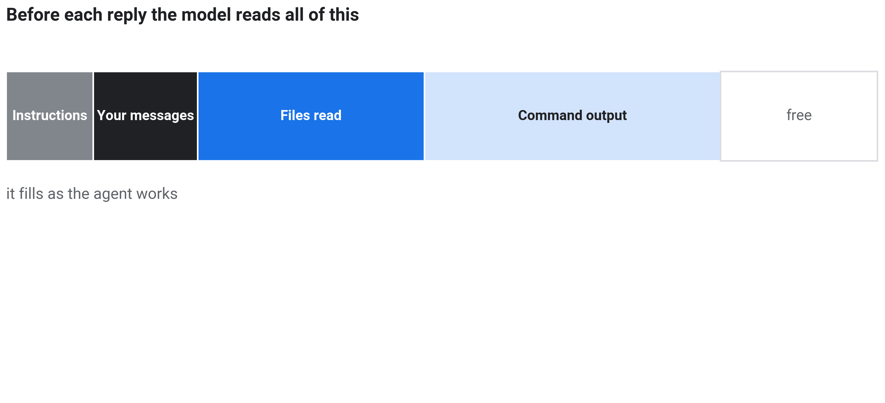{height="518px"}

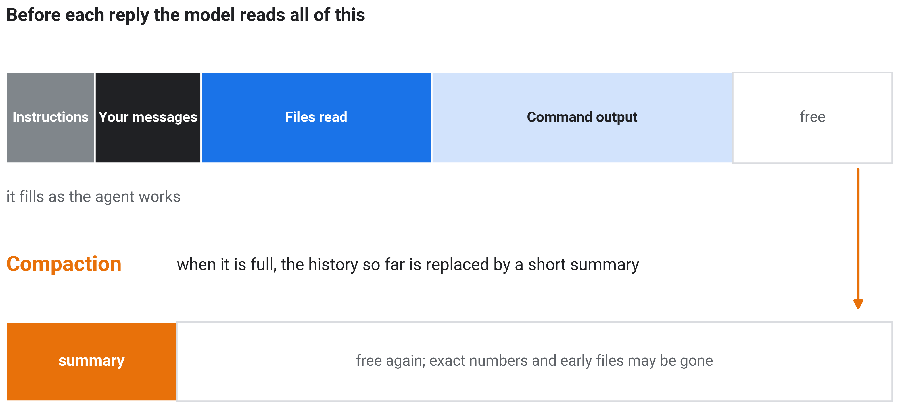{.fragment height="518px"}
:::

- Long sessions get slower and less accurate; **start a new session for a new task**

[Agent waiting? Answer it, then look up.]{.waiting}

::: {.notes}
- The model has no memory between replies. Every reply re-reads the whole context.
- Command output and large files fill it fastest. A training log printed to the screen can take a large share.
- Click: when it is full, the history is compacted into a summary. Details that were in it (exact numbers, a file you showed early) may be gone after that. This is why Task 2 runs in a new session.
:::

## 4.2 Subagents and new sessions

::: {.dict .mini}
[subagent]{.head}[/ˈsʌbˌeɪ.dʒənt/]{.pron}[noun]{.pos} [(agents)]{.domain} A helper the agent starts for one part of a task, with its own empty context, that returns only a short result.
:::

::: {.r-stack}
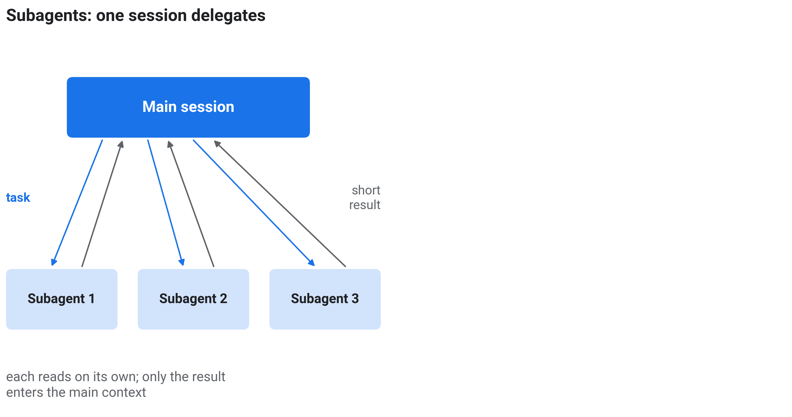{height="619px"}

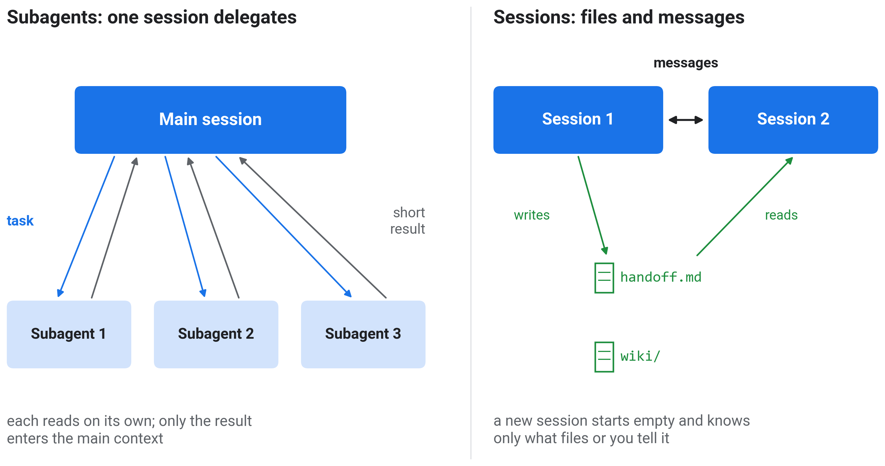{.fragment height="619px"}
:::

[Agent waiting? Answer it, then look up.]{.waiting}

::: {.notes}
- Subagents: they read and search on their own and return a short result, so the main context stays small. Ask for it: "use subagents to ...". Their individual steps are collapsed in the view.
- Click: new sessions. A fresh session knows nothing of the old one. Hand over with files: ask the old session to write handoff.md (what was done, what is open, where the files are), and start the new one with "read handoff.md".
- Shared files in the project (the wiki, part 2) are how sessions, and people, stay in sync.
:::

## 4.3 Reasoning effort

::: {.dict .mini}
[effort]{.head}[/ˈef.ət/]{.pron}[noun]{.pos} [(agents)]{.domain} How much the model thinks before each step; set from low to max.
:::

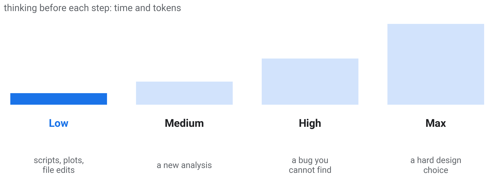{fig-align="center" height="514px"}

- Lower is faster, and enough for most lab work; raise it when it is stuck

[Agent waiting? Answer it, then look up.]{.waiting}

::: {.notes}
- Five levels: low, medium, high, extra high, max. Higher effort takes longer and uses more of the seat's limits.
- Most lab work (scripts, plots, edits) is done well at low or medium effort, and fast. Raise it for a bug the agent keeps failing on, or a design decision you will build on.
- The bars show the direction, not measured values.
:::

## 4.4 When it goes in circles

- **Esc** stops it at once
- **Rewind, or start fresh**: a new session with what was tried and what failed
- **Three hypotheses first**: "list three possible causes and how to test each, before you edit anything"
- **Raise the effort** for this one problem
- **After three failed fixes**, stop and think yourself

[Agent waiting? Answer it, then look up.]{.waiting}

::: {.notes}
- The usual sign: the same error comes back after each "fix", or the agent edits more and more files.
- The usual cause: a context full of failed attempts. A new session with a short summary of what was tried often solves it at once.
- Asking for hypotheses before edits turns guessing into testing. A minimal example that shows the bug helps the same way.
:::

## 4.5 Limits, and when not to use an agent

- **Usage limits**: a seat has a budget per few hours and per week; large models and subagents use it faster
- **Not when you cannot check the result**
- **Not for sensitive data** without a decision (first slide)
- **Not for a one-line change** you already know
- **Not when the point is to learn it yourself**

[Agent waiting? Answer it, then look up.]{.waiting}

::: {.notes}
- /usage in the Code tab shows how much of the current budget is used.
- A long autonomous run with five subagents on the top model can use a day's budget in an hour.
- "Cannot check" is the important one: if you cannot tell a right answer from a wrong one, the agent's speed does not help.
:::

::: {.center}
# 5 Results and Bookkeeping {data-name="Results"}
:::

## 5.1 Work in phases

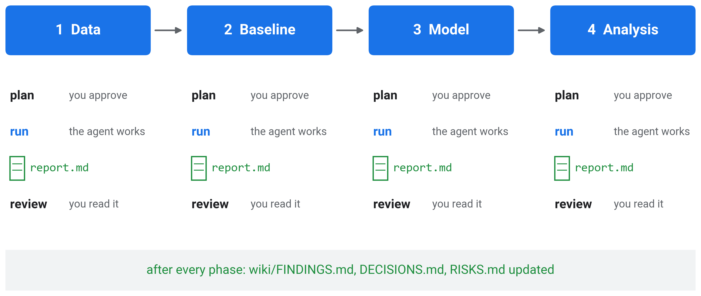{fig-align="center" height="609px"}

[Agent waiting? Answer it, then look up.]{.waiting}

::: {.notes}
- Split a project into phases, each small enough to review: data, baseline, model, analysis. Task 2 is one phase.
- Each phase: the agent proposes a plan, you approve it, it runs, it writes report.md, you read the report before the next phase starts.
- The report is the record: what was done, the numbers with their commands, the figures, what did not work. A new session starts the next phase from it.
- The lab's research-workflow skill runs projects this way (part 2).
:::

## 5.2 The same plot, with the skill

:::: {.columns .vcenter}
::: {.column width="48%"}
{height="658px"}

[Without the skill]{.caption-small}
:::
::: {.column width="52%"}
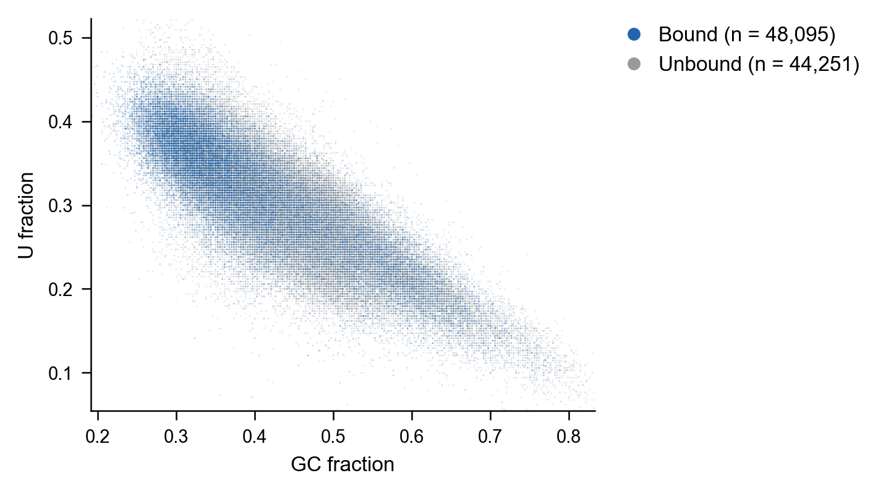{height="465px"}

[With the academic figure skill]{.caption-small}
:::
::::

::: {.notes}
- Your agent is probably asking now to confirm the skill's figure plan. Read it before approving.
- Both plots made by an agent from the same request. With the skill: Arial, journal column width (89 mm), no top and right axes, a restrained palette, PDF plus 300 dpi PNG, and a statistics report.
- It also overruled the request: the skill forbids subsampling, so it drew all 92,346 points, and the dense centre hides the difference the left plot shows. It did not say so. If yours plans the same, tell it: "subsample to 5,000 per group, as in gc_u.png".
- Skills encode someone's taste and rules. Read one before you rely on it, and write your own for the lab's conventions.
:::

## 5.3 CLAUDE.md: the lab template

::: {.prompt}
[CLAUDE.md, READ AT THE START OF EVERY SESSION]{.prompt-label}

```text
# Project: <one line: the question>
## Layout
data/raw/       read-only: never modify or delete
data/derived/   produced by scripts in src/
wiki/           FINDINGS.md, DECISIONS.md, RISKS.md: update at the end of every phase
phases/NN_name/ plan.md and report.md per phase
## How to run
.venv/bin/python src/train.py --config configs/<name>.yaml
## Rules
- GPU server: only GPU 1 (CUDA_VISIBLE_DEVICES=1); check nvidia-smi before starting a job
- Every number in a report comes with the command that produced it
- Commit after each working step; never commit data or secrets
- Log runs to ClearML project <lab>/<project>
```
:::

::: {.notes}
- Open the CLAUDE.md your agent wrote at the end of Task 2: this is the structure to grow it into.
- /init asks the agent to draft one from an existing project.
- Keep it to one screen: it is read every session and uses context.
:::

## 5.4 Your results

::: {.r-stack}
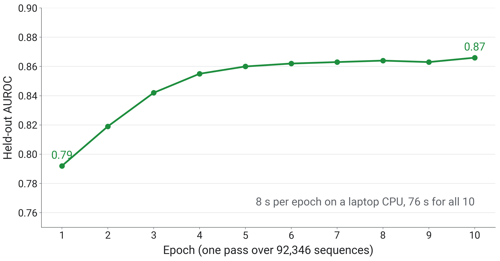{height="673px"}

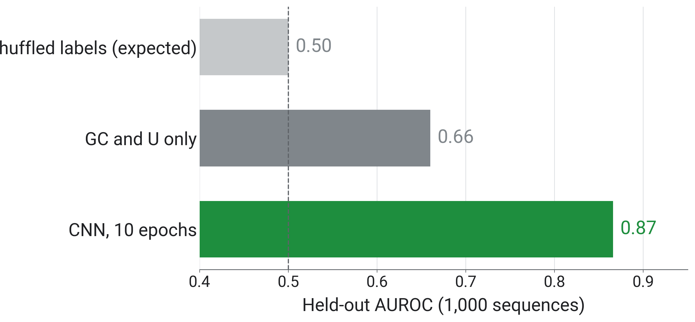{.fragment height="673px"}
:::

- **Show me the command and its output** for every number in the report

::: {.notes}
- Your AUROC against ours: measured on a laptop CPU with this exact recipe, about 8 seconds per epoch, 0.79 after one epoch and 0.87 after ten. Yours should be within a few hundredths; much higher or lower means something differs, so ask the agent to show the network and the data counts.
- Click: check its work. A plot can be checked by eye; an AUROC cannot. Your shuffled-label control must give about 0.5: clearly higher means test data leaked into training. Composition alone (GC and U) gives 0.66: a model has to beat that. And no sequence may appear in both training and test files.
- Agents report numbers confidently, including ones they did not compute. Open report.md: every number should come with the command and the printed output behind it.
- Report not finished yet? Let the agent run; open it during part 2.
:::

::: {.center}
# 6 On the GPU Server {data-name="Server"}

Part 2: watch, and let your agent finish

[claude.ai/download](https://claude.ai/download) / [the data](https://huggingface.co/datasets/yup8/ai-days-2026-ago2) / [the figure skill](https://github.com/TingxiYu/academic-figure-skill)
:::

## 6.1 Two setups

::: {.r-stack}
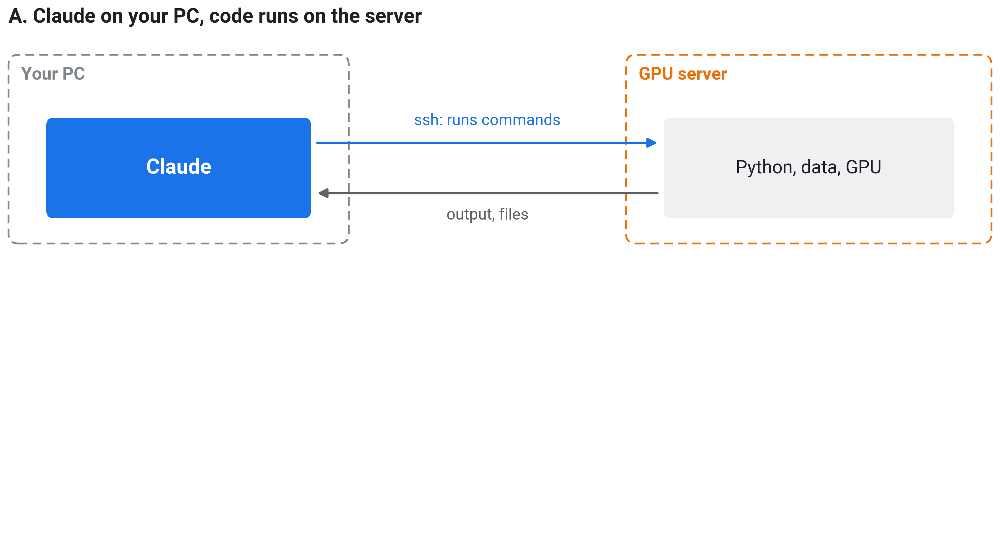{height="740px"}

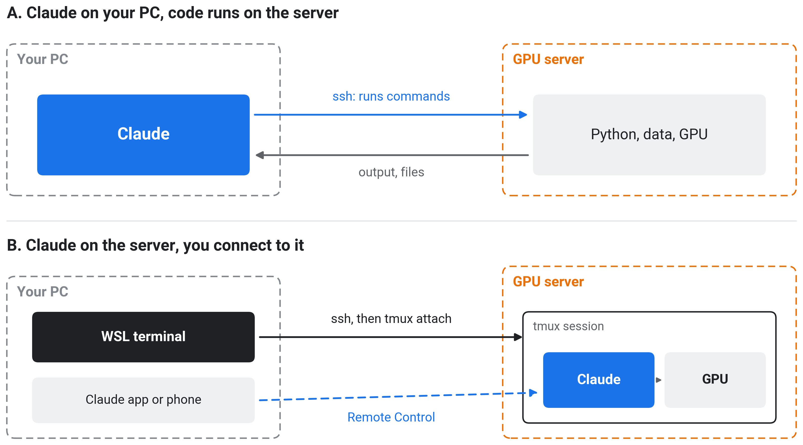{.fragment height="740px"}
:::

::: {.notes}
- A: Claude runs on your PC and executes commands on the server over ssh. Nothing to install on the server; your files and skills stay local. Jobs started with nohup or tmux keep running when your PC sleeps, but nothing watches them.
- Click, B: Claude runs on the server. From your PC, a WSL terminal connects with ssh and attaches to a tmux session where Claude runs. tmux keeps the session alive when you disconnect, so overnight work continues and the agent keeps watching.
- Remote Control lets you follow and steer that session from the Claude app or your phone. Read each permission request before approving it on the phone.
- Skills are reusable prompts. They live on the machine where Claude runs: in setup B, the lab's skills on gold-srv2.
:::

## 6.2 Our lab's skills

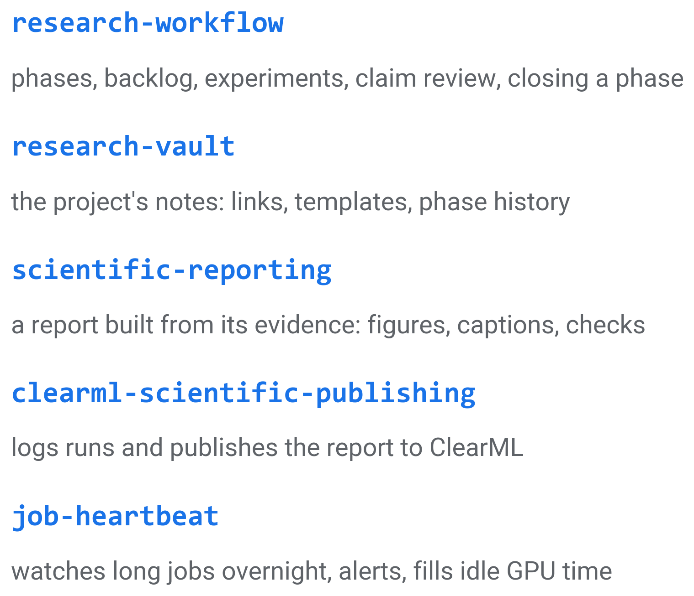{fig-align="center" height="765px"}

::: {.notes}
- These run on gold-srv2 and live in research-skills/ of a shared git repository, so everyone uses the same version and improvements reach everyone.
- research-workflow and research-vault are how a project is run and recorded. scientific-reporting builds a report from its evidence; clearml-scientific-publishing puts runs and the report on ClearML; job-heartbeat watches long jobs.
:::

## 6.3 Nightly runs

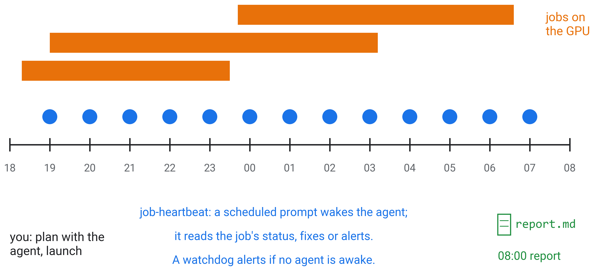{fig-align="center" height="536px"}

::: {.notes}
- In the evening, plan the runs with the agent and launch them on the GPU server (setup B).
- job-heartbeat: a scheduled prompt wakes the agent at a fixed interval. It runs a status script that prints facts about the job, decides whether anything is wrong, fixes or restarts what it can, and alerts a person when needed. A separate watchdog alerts if no agent has woken up for too long.
- Give it a limit on restarts: a job that crashes and restarts all night blocks the GPU for everyone.
- In the morning the agent reads the logs and writes report.md. Training runs should save checkpoints, so a restart continues instead of starting over.
:::

## 6.4 Tracking experiments: ClearML

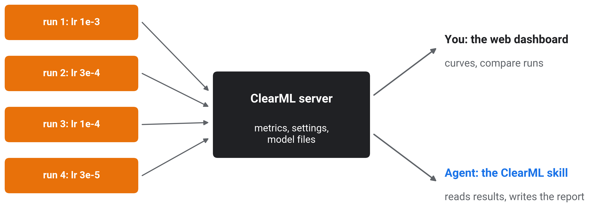{fig-align="center" height="560px"}

::: {.notes}
- ClearML records every run: its settings, its metric curves and its output files, on a server the whole lab can open. You compare runs in the web dashboard.
- The lab's clearml-scientific-publishing skill lets the agent log runs and publish the phase report to ClearML with its figures and evidence.
:::

## 6.5 Example: a literature review

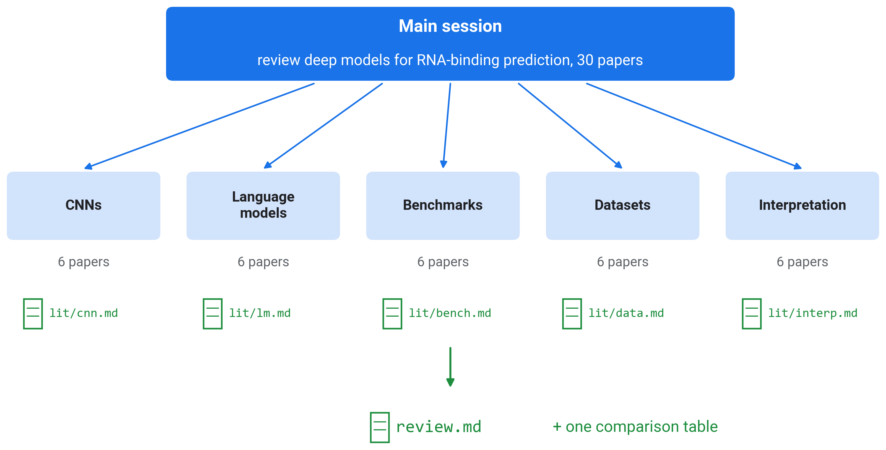{fig-align="center" height="657px"}

- Check that every cited paper exists and says what the notes claim

::: {.notes}
- One session reading 30 full papers fills its context with PDFs. The main session splits the topic, starts five subagents with six papers each, and each writes its notes to a file and returns a few lines.
- The main session writes the review and a comparison table from the notes. Tomorrow, a new session starts from review.md and the lit/ notes, not from the papers.
- Two failure modes: papers behind a paywall that the agent cannot read but summarises anyway, and papers that do not exist. Open the cited paper for every claim you will use.
- Five subagents use about five times the limits of one session.
:::

## 6.6 A shared wiki

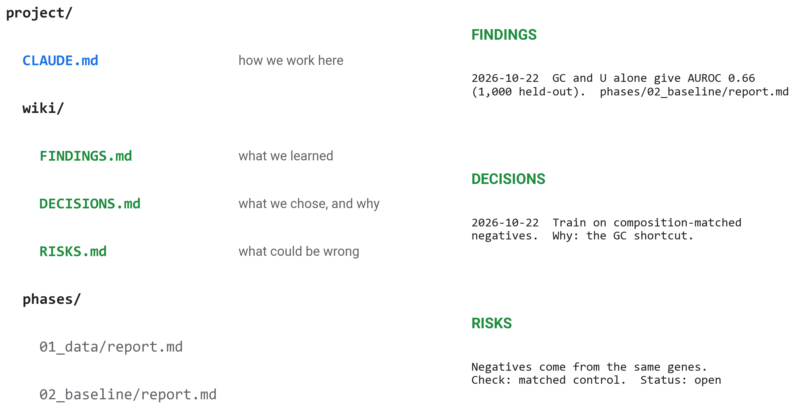{fig-align="center" height="740px"}

::: {.notes}
- Three files that every session reads at the start and updates at the end of a phase. FINDINGS: dated results with the evidence and where it is. DECISIONS: what was chosen, why, and what else was considered. RISKS: what could make the results wrong, how to check, and the status.
- You do not write them by hand: the agent fills them in at the end of each phase, and you correct them. The lab's research-vault skill keeps this structure.
- Bookkeeping is what makes agent work reusable: without it each session starts from zero and results cannot be traced.
:::

## 6.7 Sharing in the lab

- **Skills in a shared repository**: a project's .claude/skills, or the lab's research-skills; one version for everyone
- **Review in pairs**: read each other's report.md before trusting it
- **Prompts that worked**: one shared file
- **Connectors (MCP)**: Box, Drive, ClearML; third-party code with access to your data, like a skill
- **Hooks**: rules the harness enforces, for example blocking any rm in data/raw

::: {.notes}
- Skills copied by hand into each person's ~/.claude drift apart. Committed to a repository, they improve for everyone.
- A hook is a script the harness runs before or after an action; unlike a line in CLAUDE.md, the agent cannot ignore it.
:::

## 6.8 The models

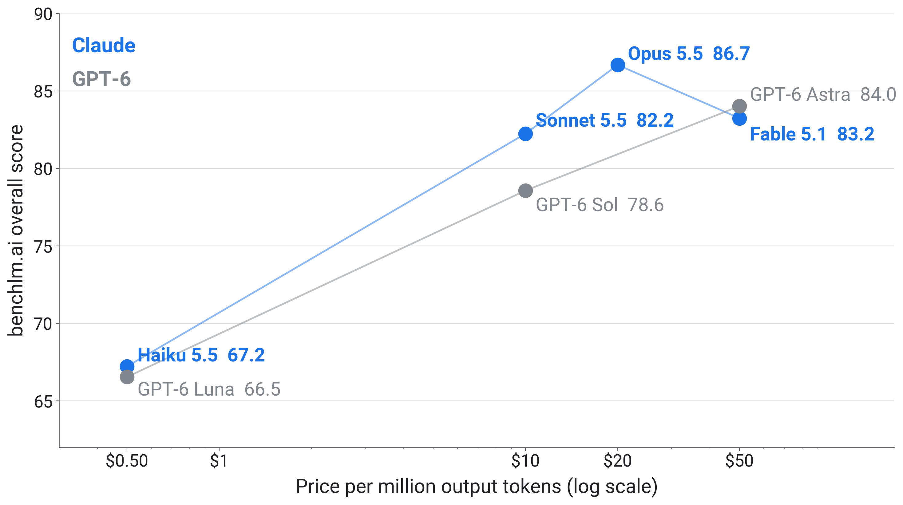{fig-align="center" height="765px"}

::: {.notes}
- Prices from the two companies' API pricing pages, October 2026, per million output tokens; input costs one fifth of that. Haiku 5.5's price is for prompts up to 100,000 tokens.
- The two families line up tier by tier: Fable and GPT-6 Astra at the top, Sonnet and Sol in the middle, Haiku and Luna for cheap, high-volume work. Opus sits between top and middle.
- On the lab seats you do not pay per token; larger models use up the seat's limits faster.
- A rough rule: the mid tier for most coding, the top tier for hard reasoning and long autonomous tasks, the small tier for simple, repeated jobs.
:::

## 6.9 Data, secrets and the shared server

- **What the agent reads goes to the model provider**: unpublished lab data needs a decision first
- **Secrets** (tokens, clearml.conf, .env) stay out of the repository and out of the prompt
- **One account and one login per person**; no shared logins
- **Raw data read-only**: chmod -R a-w data/raw
- **Never skip permissions** on a shared machine

::: {.notes}
- Back to the first slide: under the commercial terms, data is sent to Anthropic and kept for 30 days; the Technion has not reviewed this.
- Data that may become a patent or an unpublished result: ask Roee before giving an agent access.
- A permission-skipping mode exists for sandboxes. On the lab server it means any command runs without a question.
:::

## 6.10 Demo: a DNA language model on the GPU

::: {.prompt}
[DEMO PROMPT]{.prompt-label}

```text
On the GPU server (use only GPU 1: CUDA_VISIBLE_DEVICES=1), embed the AGO2 sequences with the pretrained
DNA language model RaphaelMourad/Mistral-DNA-v1-17M-hg38. Convert U to T first. One vector per
sequence: the average of the last layer. Embed both the training and the held-out files.
Train a logistic regression on the training vectors and report the held-out AUROC, with the command
and output. Compare it with the CNN of Task 2 (0.87) and with GC and U alone (0.66).
```
:::

::: {.notes}
- Setup A, live. Watch for: the agent checks which GPU is free, installs what is missing in its own environment, and copies results back.
- Expected: the frozen language model with a linear probe reaches about 0.78 held-out AUROC, below the CNN trained on all labels (0.87) and above composition alone (0.66).
:::

## 6.11 Links

- Claude Desktop: [claude.ai/download](https://claude.ai/download)
- Data: [huggingface.co/datasets/yup8/ai-days-2026-ago2](https://huggingface.co/datasets/yup8/ai-days-2026-ago2)
- Figure skill: [github.com/TingxiYu/academic-figure-skill](https://github.com/TingxiYu/academic-figure-skill)
- Data terms: [code.claude.com/docs/en/data-usage](https://code.claude.com/docs/en/data-usage)
- The data's source: Maticzka et al., *Genome Biology* 15, R17 (2014), [doi:10.1186/gb-2014-15-1-r17](https://doi.org/10.1186/gb-2014-15-1-r17)

::: {.notes}
- The AI Days workshop decks and notebooks: mathoory.github.io/ai-days-2026-dna-workshop
:::
